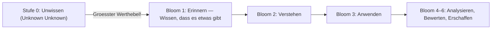

# Lernstufen verstehen: Die Bloom-Taxonomie & der Wert von „Wissen, dass es etwas gibt“

In jeder der **290 Lektionen** dieses Handbuchs (`L001`–`L200`, `A001`–`A060` und `D001`–`D030`) findest du am Lernziel einen Hinweis wie `*(Bloom: Erinnern)*`, `*(Bloom: Verstehen)*` oder `*(Bloom: Analysieren)*`. Dieses Kapitel erklärt, was dahintersteckt — und warum bereits die **allererste Stufe** (*„Wissen, dass es etwas gibt“*) den grössten Unterschied zwischen frustrierendem Blindflug und sicherer Praxis macht.

---

## 1. Der grösste Lernsprung: Von „Unwissen“ zu „Wissen, dass es etwas gibt“

Oft wird die unterste Stufe der Bloom-Taxonomie (**Erinnern / Kennen**) als „nur auswendig lernen“ abgetan. In der täglichen IT- und Datenpraxis ist genau das Gegenteil wahr: **Der Schritt von Stufe 0 (*Unwissen*) zu Stufe 1 (*Wissen, dass es etwas gibt*) ist der wertvollste Sprung im gesamten Lernprozess.**

*Alt-Text: Lernprogression vom Unwissen über das erste Wissen, dass ein Konzept existiert (Bloom-Stufe 1 Erinnern), hin zu Verstehen, Anwenden und Analysieren/Bewerten.*

### Warum Stufe 1 so mächtig ist

| Dimension | Stufe 0: „Unwissen“ (*Unknown Unknown*) | Stufe 1: „Wissen, dass es etwas gibt“ (*Known Unknown*) |
| :--- | :--- | :--- |
| **Suchfähigkeit** | Du weisst nicht einmal, *wonach* du suchen oder fragen müsstest. | Du kennst das Stichwort (z. B. `PIVOT`, `Find DB Object`, `IEEE-754`, `Strg+Umschalt+C`) und findest die Syntax in 30 Sekunden. |
| **Fehlerrisiko** | Du läufst blind in stille Datenfehler (z. B. 33-stellige IDs werden in Excel auf 15 Stellen genullt; `NOT IN` liefert 0 Zeilen bei `NULL`). | Ein inneres **Stoppschild** warnt dich rechtzeitig: *„Halt, da war doch etwas mit Excel und langen Zahlen!“* |
| **Werkzeugwahl** | Du löst ein Problem umständlich von Hand (z. B. 300 Zeilen einzeln in Excel zusammenkopieren statt `CONNECT BY` oder `/*csv*/`). | Du weisst, dass Oracle SQL bzw. SQL Developer dafür ein eingebautes Werkzeug hat — und kannst es gezielt nachschlagen. |
| **Lern-Ökonomie** | Alles wirkt wie ein undurchdringlicher Dschungel. | Du musst **nicht alles auswendig können** — es reicht für viele Spezialthemen zu wissen, *dass* es sie gibt, bis du sie konkret brauchst. |

!!! tip "Merksatz für den Arbeitsalltag"
    **Du kannst nicht nach etwas suchen, von dem du nicht weisst, dass es existiert.**  
    Allein zu wissen, *dass* es in Oracle `LAG`/`LEAD`, `REGEXP_REPLACE`, `JSON_TABLE`, `SET NUMWIDTH 38` oder im SQL Developer `Strg+Umschalt+C` + Excel-Text-Vorbereitung gibt, schützt dich vor teuren Irrwegen — selbst dann, wenn du die exakte Syntax jedes Mal im Handbuch nachschlägst.

---

## 2. Die 6 Stufen der revidierten Bloom-Taxonomie im SQL-Kontext

Nach Anderson & Krathwohl (2001, Revision der Taxonomie von Benjamin Bloom) gliedern sich kognitive Lernziele in sechs aufeinander aufbauende Stufen:

| Stufe | Bezeichnung | Leitfrage | Konkretes Beispiel aus diesem Kurs |
| :---: | :--- | :--- | :--- |
| **1** | **Erinnern** *(Remember)* | *Weiss ich, dass es das gibt und wie es heisst?* | Wissen, dass `DISTINCT` Duplikate entfernt, `TO_CHAR` Datentypen wandelt oder Excel ab 15 Stellen rundet |
| **2** | **Verstehen** *(Understand)* | *Kann ich erklären, warum es so funktioniert?* | Erklären, warum `WHERE`-Aliases scheitern (Execution Order) oder warum `NULL + 100 = NULL` ergibt |
| **3** | **Anwenden** *(Apply)* | *Kann ich es auf eine konkrete Aufgabe anwenden?* | Einen `LEFT OUTER JOIN` schreiben, `Strg+F7` nutzen oder eine `.xlsx`-Export-Query mit `TO_CHAR` ausführen |
| **4** | **Analysieren** *(Analyze)* | *Kann ich Ursachen, Fehler und Unterschiede zerlegen?* | Herausfinden, warum eine Query ein kartesisches Produkt erzeugt oder ein Index wegen `UPPER(ename)` nicht greift |
| **5** | **Bewerten** *(Evaluate)* | *Kann ich die beste Lösung begründet auswählen?* | Entscheiden, ob für einen Export `.xlsx + TO_CHAR`, `CSV + Power Query` oder Copy-Paste (`Strg+Umschalt+C`) richtig ist |
| **6** | **Erschaffen** *(Create)* | *Kann ich eigene, komplexe Lösungen entwerfen?* | Eine End-to-End-Pipeline aus Hierarchie, `JSON_TABLE` und Window Functions im Capstone-Projekt (`A060`) bauen |

---

## 3. Wie du die Taxonomie beim Lernen gezielt nutzt

1. **Beim ersten Durchgang (Überblick schaffen):** Versuche nicht sofort, jede Spezialfunktion auswendig auf Stufe 3 zu beherrschen. Nimm zuerst **Stufe 1 (*Wissen, dass es etwas gibt*)** bewusst als wertvolles Ergebnis mit — besonders bei Themen wie `Advanced SQL` (`A001`–`A060`) oder seltenen `ORA-`-Fehlern.
2. **Für den Job (Route A) & die Prüfung (`1Z0-171`):**
   - Grundlagen (`SELECT`, `WHERE`, `JOIN`, `GROUP BY`, `TO_CHAR`, `NVL`) trainierst du bis **Stufe 3–4 (Anwenden & Analysieren)**.
   - Bei Entscheidungsfragen (*„Warum liefert diese Query 0 Zeilen?“* / *„Welches Exportformat verhindert Datenverlust?“*) prüfst du gezielt auf **Stufe 4–5 (Analysieren & Bewerten)**.
3. **Selbstkontrolle über die Aufgaben-Sterne (`★` / `★★` / `★★★`):**
   - **(★) Basis:** Festigt **Stufe 1–2** (*Erinnern / Verstehen*).
   - **(★★) Plus:** Trainiert **Stufe 3** (*Anwenden*).
   - **(★★★) Challenge & Analyse-Aufgaben:** Fordert **Stufe 4–5** (*Analysieren / Bewerten*).
