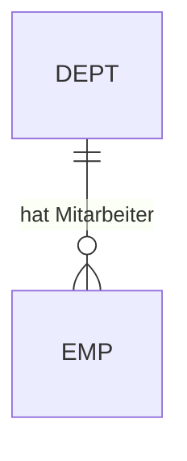

# Phase 1: Onboarding, Baseline & Relational Foundations (`L001`–`L020`)

**Exam Domains**: Domain 1 (*Relational Database Concepts*, 5 %) + Domain 2 Teil 1 (*Retrieving Data*, ca. 5 %)  
**Verwendete Schemas**: `SCOTT/TIGER` (`EMP`, `DEPT`) → `HR` (`EMPLOYEES`, `DEPARTMENTS`)  
**Interactive Studio**: [Phase 1 Tracker](https://chatelao.github.io/sql-schulung/#curriculum/phase-1) · [FreeSQL Sandbox](https://chatelao.github.io/sql-schulung/#labs/freesql/phase-1) · [Flashcards D1](https://chatelao.github.io/sql-schulung/#flashcards/D1) · [Flashcards D2](https://chatelao.github.io/sql-schulung/#flashcards/D2)

---

## Checkpoint #0 (`L001`–`L002`)

### `L001` — Kursstart & Identical Checkpoint #0 (Baseline-Test)
- **Lernziel**: Du kennst die 200-Lektionen-Struktur und erfasst deine ehrliche Start-Baseline ohne Druck.
- **Studio-Link**: [Tracker `L001`](https://chatelao.github.io/sql-schulung/#curriculum/L001) · [Checkpoint `CP-0` starten ↗](https://chatelao.github.io/sql-schulung/#checkpoints/CP-0)
- **Ablauf (45 Min.)**:
  1. Lies den [Selbststudium-Leitfaden](../getting-started/self-study-guide.md) (10 Min.).
  2. Öffne **[`CP-0`](https://chatelao.github.io/sql-schulung/#checkpoints/CP-0)** und beantworte die 22 Fragen + 3 SQL Tasks (25–30 Min.).
  3. Schätze in Teil C deine Sicherheit je Domain ein (wahrscheinlich überall `1/5`) und reiche `CP-0` ein.
- !!! tip "Anfänger-Regel"
    Schlage während `CP-0` **nichts** nach. Raten ist ausdrücklich erwünscht (erwarteter Score: 10–25 %). So siehst du bis `CP-5` deinen echten Wissenszuwachs.

### `L002` — Baseline-Reflexion & Zielsetzung
- **Lernziel**: Du wertest deine Start-Prozentsätze aus und legst dein persönliches Wochenpensum fest.
- **Studio-Link**: [Tracker `L002`](https://chatelao.github.io/sql-schulung/#curriculum/L002) · [`CP-0` Reflexion](https://chatelao.github.io/sql-schulung/#checkpoints/CP-0)
- **Selbstlern-Aufgabe**:
  1. Fülle die 4 Reflexionsfragen direkt unter `CP-0` aus und exportiere einen ersten Snapshot als JSON/Markdown.
  2. Entscheide dich anhand des [200-Lektionen-Zeitplans](../getting-started/lesson-schedule.md) für 6, 10 oder 40 Lektionen pro Woche.

---

## Relational Foundations (`L003`–`L008`)

### `L003` — Warum Spreadsheets an Grenzen stoßen
- **Lernziel**: Du erklärst, warum relationale Datenbanken Daten auf mehrere verknüpfte Tabellen aufteilen statt in einer einzigen Excel-Liste zu speichern.
- **Studio-Link**: [Tracker `L003`](https://chatelao.github.io/sql-schulung/#curriculum/L003)
- **Konzept & Analogie**: In einer Excel-Tabelle stehen Mitarbeitername, Abteilungsname und Standort (`DALLAS`) in jeder Zeile nebeneinander. Zieht Abteilung 20 (`RESEARCH`) von `DALLAS` nach `AUSTIN` um, müssen in Excel dutzende Zeilen einzeln geändert werden — vergisst man eine, widersprechen sich die Daten (**Update-Anomalie**). Ein **RDBMS** (Relational Database Management System) speichert jede Abteilung *genau einmal* in `DEPT` und verweist in `EMP` nur über die Nummer `DEPTNO = 20` darauf.

| Excel-Denke (1 breite Liste) | Relationale Datenbank (2 verknüpfte Tables) |
| :--- | :--- |
| `'DALLAS'` wird 5× wiederholt | `'DALLAS'` steht **1×** in `SCOTT.DEPT` (`deptno = 20`) |
| Zwei Kopien einer Datei laufen auseinander | **Single Source of Truth** für alle Benutzer |
| Formeln & Daten sind vermischt | Daten liegen getrennt von Abfragen (`SELECT`) |

- **Selbstlern-Aufgabe**: Nenne 2 Probleme, die entstehen, wenn du in einer einzigen Excel-Tabelle zusätzlich den letzten Mitarbeiter der Abteilung `OPERATIONS` löschst.
  ??? success "Musterlösung & Erklärung"
      1. **Lösch-Anomalie**: Mit dem letzten Mitarbeiter gehen auch die Abteilungsnummer `40`, der Name `OPERATIONS` und der Standort `BOSTON` verloren. In `SCOTT.DEPT` bleibt `DEPT 40` dagegen erhalten!
      2. **Redundanz / Inkonsistenz**: Bei mehreren Mitarbeitern wird der Standort mehrfach gespeichert und kann leicht unterschiedlich geschrieben werden (`Dallas` vs. `DALLAS`).

### `L004` — Tables, Rows, Columns & Primary Keys
- **Lernziel**: Du identifizierst Tables, Rows (Tupel), Columns (Attribute) und Primary Keys anhand von `SCOTT.DEPT`.
- **Studio-Link**: [Tracker `L004`](https://chatelao.github.io/sql-schulung/#curriculum/L004) · [SQL Ref: Database Objects](https://docs.oracle.com/en/database/oracle/oracle-database/26/sqlrf/Database-Objects.html)
- **Konzept**: Eine **Table** ist wie ein Aktenschrank für genau eine Objektart (z. B. `DEPT` für Abteilungen). Jede **Row** (Zeile) ist ein konkreter Datensatz, jede **Column** (Spalte) ein Merkmal (`deptno`, `dname`, `loc`). Der **Primary Key (PK)** ist die eindeutige ID jeder Zeile: Er darf **niemals doppelt** vorkommen und **niemals `NULL`** (leer) sein.
- **Beispiel (`SCOTT.DEPT`)**: `DEPTNO` (`10, 20, 30, 40`) ist der Primary Key; `EMPNO` (`7369`..`7934`) ist der Primary Key in `SCOTT.EMP`.
- **Selbstlern-Aufgabe**: Prüfe die Datentabelle in [`SCOTT/TIGER`](../schemas/scott-tiger.md): Warum taugt `ENAME` in `SCOTT.EMP` **nicht** als Primary Key, auch wenn aktuell alle 14 Namen verschieden sind?
  ??? success "Musterlösung & Erklärung"
      Zwei Mitarbeiter können denselben Nachnamen haben (z. B. ein zweiter `SMITH`). Ein Primary Key muss fachlich und technisch dauerhaft eindeutig sein — daher nutzt man eine künstliche Nummer wie `EMPNO`.

### `L005` — Tables mit Foreign Keys verknüpfen
- **Lernziel**: Du verstehst, wie ein Foreign Key (FK) zwei Tabellen über einen Primary Key verbindet und ungültige Verweise verhindert.
- **Studio-Link**: [Tracker `L005`](https://chatelao.github.io/sql-schulung/#curriculum/L005) · [SQL Ref: constraint](https://docs.oracle.com/en/database/oracle/oracle-database/26/sqlrf/constraint.html)
- **Konzept**: `EMP.DEPTNO` ist ein **Foreign Key (FK)**, der auf den Primary Key `DEPT.DEPTNO` zeigt. Oracle garantiert dadurch **Referential Integrity**: Du kannst in `EMP` keinen Mitarbeiter mit `deptno = 99` anlegen, solange `99` nicht in `DEPT` existiert.
- **Selbstlern-Aufgabe**: Schau in [`SCOTT.EMP`](../schemas/scott-tiger.md#emp-14-rows): Welche zweite Spalte in `EMP` verweist ebenfalls auf einen Mitarbeiter in derselben Tabelle (`EMPNO`)?
  ??? success "Musterlösung & Erklärung"
      `MGR` (Manager-ID) verweist auf `EMPNO` des Vorgesetzten (z. B. hat `SMITH` `MGR = 7902`, das ist `FORD`). Nur `KING` hat `MGR = NULL`.

### `L006` — Entity-Relationship Diagrams (ERDs) lesen
- **Lernziel**: Du liest Crow's-Foot-Beziehungen (`1:1`, `1:M`, `M:N`) sicher ab.
- **Studio-Link**: [Tracker `L006`](https://chatelao.github.io/sql-schulung/#curriculum/L006)
- **Konzept**: Ein ERD zeigt Datenstrukturen grafisch:


  - `||` (links bei `DEPT`): **genau ein** Department.
  - `o{` (rechts bei `EMP`, der „Krähenfuß“ / Crow's Foot): **null, ein oder viele** Employees.
- **Selbstlern-Aufgabe**: Im [`HR`-ERD](../schemas/hr-schema.md#entity-relationship-diagram-erd) steht `LOCATIONS ||--o{ DEPARTMENTS`. Was bedeutet das fachlich?
  ??? success "Musterlösung & Erklärung"
      An einem Standort (`LOCATION`) können 0, 1 oder viele Abteilungen (`DEPARTMENTS`) sitzen; jede Abteilung gehört zu einem Standort.

### `L007` — ERDs auf `SELECT`-Queries abbilden
- **Lernziel**: Du ordnest Bestandteile eines ERD den passenden Klauseln eines `SELECT`-Statements zu (direktes `1Z0-171`-Prüfungsziel!).
- **Studio-Link**: [Tracker `L007`](https://chatelao.github.io/sql-schulung/#curriculum/L007) · [SQL Ref: SELECT](https://docs.oracle.com/en/database/oracle/oracle-database/26/sqlrf/SELECT.html)
- **Konzept**:
  - **Entity** (Rechteck im ERD) → **Table** in `FROM dept`
  - **Attribute** (Eigenschaft im Rechteck) → **Column** in `SELECT dname, loc` / `WHERE`
  - **Relationship** (Linie mit Krähenfuß) → **Join Condition** (`ON e.deptno = d.deptno`)
- !!! warning "1Z0-171 Exam Trap"
    Verwechsle **Entity** und **Attribute** nicht mit einzelnen Zeilen: Eine **Row** ist eine *Instanz* einer Entity, keine Tabellenspalte.

### `L008` — Die vier SQL Statement Families
- **Lernziel**: Du unterscheidest `DML`, `DDL`, `DCL` und `TCL` inklusive ihres Commit-Verhaltens.
- **Studio-Link**: [Tracker `L008`](https://chatelao.github.io/sql-schulung/#curriculum/L008) · [SQL Ref: Types of SQL Statements](https://docs.oracle.com/en/database/oracle/oracle-database/26/sqlrf/Types-of-SQL-Statements.html)

| Familie | Vollständiger Name | Kernbefehle | Auto-Commit? |
| :--- | :--- | :--- | :---: |
| **DML** | Data Manipulation Language | `SELECT`, `INSERT`, `UPDATE`, `DELETE`, `MERGE` | Nein |
| **DDL** | Data Definition Language | `CREATE`, `ALTER`, `DROP`, `TRUNCATE`, `RENAME` | **Ja** |
| **DCL** | Data Control Language | `GRANT`, `REVOKE` | **Ja** |
| **TCL** | Transaction Control Language | `COMMIT`, `ROLLBACK`, `SAVEPOINT` | Steuert Transaktion |

- **Selbstlern-Aufgabe**: Zu welcher Familie gehört `TRUNCATE TABLE` und warum ist das in der Praxis gefährlich?
  ??? success "Musterlösung & Erklärung"
      `TRUNCATE TABLE` gehört zur **DDL** (nicht DML wie `DELETE`!). Es löst ein **implizites `COMMIT`** aus und kann daher nicht mit `ROLLBACK` rückgängig gemacht werden.

---

## Lab Setup & erste Queries (`L009`–`L012`)

### `L009` — Mit der Lab-Umgebung verbinden
- **Lernziel**: Du verbindest dich erfolgreich mit deiner Oracle-23ai-Umgebung und führst das Phase-1-Lab-Skript aus.
- **Studio-Link**: [Tracker `L009`](https://chatelao.github.io/sql-schulung/#curriculum/L009) · [Phase 1 in FreeSQL öffnen ↗](https://chatelao.github.io/sql-schulung/#labs/freesql/phase-1)
- **Schritte**:
  - **Variante A**: Verbinde VS Code / SQL Developer oder `sqlcl` mit `FREEPDB1` / `PDB_TRAINING` (siehe [Variante A Setup](../getting-started/variant-a-inhouse.md)).
  - **Variante B**: Melde dich bei [freesql.com](https://freesql.com/) an oder klicke oben auf **Phase 1 in FreeSQL öffnen ↗**.

### `L010` — Dein erstes `SELECT *` & `DESCRIBE`
- **Lernziel**: Du inspizierst Tabellenstrukturen mit `DESCRIBE` und fragst alle Zeilen mit `SELECT *` ab.
- **Studio-Link**: [Tracker `L010`](https://chatelao.github.io/sql-schulung/#curriculum/L010) · [SQL Ref: SELECT](https://docs.oracle.com/en/database/oracle/oracle-database/26/sqlrf/SELECT.html)
- **Beispiel**:
  ```sql
  DESCRIBE scott.dept;
  SELECT * FROM scott.dept;
  ```
  **Erwartete Ausgabe**: 4 Zeilen (`10 ACCOUNTING`, `20 RESEARCH`, `30 SALES`, `40 OPERATIONS`).
- **Selbstlern-Aufgabe**: Führe `DESCRIBE scott.emp;` und `SELECT * FROM scott.emp;` aus. Wie viele Zeilen und wie viele Spalten hat `SCOTT.EMP`?
  ??? success "Musterlösung & Erklärung"
      `14` Zeilen und `8` Spalten (`EMPNO`, `ENAME`, `JOB`, `MGR`, `HIREDATE`, `SAL`, `COMM`, `DEPTNO`).

### `L011` — `ORA-`-Fehlermeldungen gelassen lesen
- **Lernziel**: Du erkennst die häufigsten Einsteiger-Fehler `ORA-00942` und `ORA-00904` und behebst sie gezielt.
- **Studio-Link**: [Tracker `L011`](https://chatelao.github.io/sql-schulung/#curriculum/L011) · [ORA-Fehler-Lexikon](../cheatsheets/ora-errors.md)
- **Selbstlern-Aufgabe (Fehler absichtlich provozieren!)**:
  1. Führe `SELECT * FROM scott.empp;` aus → Lies den genauen Fehlertext.
  2. Führe `SELECT enmae FROM scott.emp;` aus → Lies den genauen Fehlertext.
  ??? success "Musterlösung & Erklärung"
      1. `ORA-00942: table or view does not exist` → Tabellenname oder Schema-Prefix falsch.
      2. `ORA-00904: "ENMAE": invalid identifier` → Spaltenname falsch geschrieben.

### `L012` — Einstieg in das `HR`-Schema
- **Lernziel**: Du skalierst von `SCOTT` auf das größere `HR`-Schema und begrenzt erste Ausgaben.
- **Studio-Link**: [Tracker `L012`](https://chatelao.github.io/sql-schulung/#curriculum/L012)
- **Beispiel**:
  ```sql
  SELECT employee_id, first_name, last_name, salary
  FROM hr.employees
  FETCH FIRST 5 ROWS ONLY;
  ```
  **Erwartete Ausgabe**: 5 Zeilen (`100 Steven King 24000`, `101 Neena Kochhar 17000`, `102 Lex De Haan 17000`, `103 Alexander Hunold 9000`, `104 Bruce Ernst 6000`).
- **Selbstlern-Aufgabe**: Wie viele Abteilungen stehen in `HR.DEPARTMENTS`? Schreibe die passende `SELECT`-Abfrage.
  ??? success "Musterlösung & Erklärung"
      `SELECT * FROM hr.departments;` liefert **27 Zeilen**.

---

## Projections, Arithmetic & `NULL` (`L013`–`L016`)

### `L013` — Bestimmte Spalten auswählen (Projection)
- **Lernziel**: Du wählst gezielt benötigte Spalten aus statt `SELECT *` zu verwenden.
- **Studio-Link**: [Tracker `L013`](https://chatelao.github.io/sql-schulung/#curriculum/L013)
- **Beispiel**:
  ```sql
  SELECT empno, ename, job, sal FROM scott.emp;
  ```
  **Erwartete Ausgabe**: 14 Zeilen, aber nur noch 4 statt 8 Spalten.
- **Selbstlern-Aufgabe**: Gib aus `HR.JOBS` nur `job_id`, `job_title` und `max_salary` aus.
  ??? success "Musterlösung & Erklärung"
      ```sql
      SELECT job_id, job_title, max_salary FROM hr.jobs; -- 19 Zeilen
      ```

### `L014` — Arithmetische Ausdrücke (`+`, `-`, `*`, `/`)
- **Lernziel**: Du berechnest abgeleitete Werte direkt in der `SELECT`-Liste, ohne die Tabelle zu verändern.
- **Studio-Link**: [Tracker `L014`](https://chatelao.github.io/sql-schulung/#curriculum/L014) · [SQL Ref: Arithmetic Operators](https://docs.oracle.com/en/database/oracle/oracle-database/26/sqlrf/Arithmetic-Operators.html)
- **Beispiel**:
  ```sql
  SELECT ename, sal, sal * 12 AS annual_sal, sal * 12 + 500 AS with_bonus
  FROM scott.emp;
  ```
  **Erwartete Ausgabe** (Auszug): `SMITH | 800 | 9600 | 10100`, `KING | 5000 | 60000 | 60500`.

### `L015` — Operator Precedence (Punkt vor Strich)
- **Lernziel**: Du wendest Oracles Auswertungsreihenfolge (`*`, `/` vor `+`, `-`) und Klammern korrekt an.
- **Studio-Link**: [Tracker `L015`](https://chatelao.github.io/sql-schulung/#curriculum/L015) · [SQL Ref: About SQL Operators](https://docs.oracle.com/en/database/oracle/oracle-database/26/sqlrf/About-SQL-Operators.html)
- **Selbstlern-Aufgabe**: Sage für `SMITH` (`sal = 800`) das Ergebnis beider Ausdrücke voraus, bevor du sie ausführst:
  1. `sal + 200 * 12`
  2. `(sal + 200) * 12`
  ??? success "Musterlösung & Erklärung"
      1. `800 + 2400 = 3200` (Multiplikation bindet stärker!)
      2. `1000 * 12 = 12000` (Klammern erzwingen Addition zuerst).

### `L016` — Die goldene Regel für `NULL`
- **Lernziel**: Du unterscheidest `NULL` (unbekannt/leer) sauber von `0` und weißt, warum Arithmetik mit `NULL` immer `NULL` ergibt.
- **Studio-Link**: [Tracker `L016`](https://chatelao.github.io/sql-schulung/#curriculum/L016) · [SQL Ref: Nulls](https://docs.oracle.com/en/database/oracle/oracle-database/26/sqlrf/Nulls.html)
- **Beispiel**:
  ```sql
  -- Achte genau auf SMITH vs. ALLEN vs. TURNER!
  SELECT ename, sal, comm, sal + comm AS total_pay
  FROM scott.emp;
  ```
  **Erwartete Ausgabe** (Auszug):
  - `SMITH`: `sal = 800`, `comm = NULL` → `total_pay = NULL`
  - `ALLEN`: `sal = 1600`, `comm = 300` → `total_pay = 1900`
  - `TURNER`: `sal = 1500`, `comm = 0` → `total_pay = 1500`
- !!! warning "1Z0-171 Exam Trap"
    `NULL` ist **weder `0` noch ein Leerzeichen**. Jede arithmetische Rechnung (`+`, `-`, `*`, `/`) mit `NULL` ergibt `NULL`!

---

## Aliases, Concatenation, `DISTINCT` & `DUAL` (`L017`–`L020`)

### `L017` — Column Aliases (`AS` vs. `"Double Quotes"`)
- **Lernziel**: Du benennst Ausgabespalten lesbar um und vermeidest Quoting-Fehler.
- **Studio-Link**: [Tracker `L017`](https://chatelao.github.io/sql-schulung/#curriculum/L017)
- **Beispiel**:
  ```sql
  SELECT ename AS employee_name, sal * 12 "Annual Salary"
  FROM scott.emp;
  ```
- !!! warning "1Z0-171 Exam Trap"
    Aliases ohne Anführungszeichen werden automatisch `UPPERCASE` (`EMPLOYEE_NAME`). Leerzeichen, Sonderzeichen oder erhaltene Groß-/Kleinschreibung erfordern `"Double Quotes"`, **niemals** `'Single Quotes'` (`ORA-00923`).

### `L018` — Concatenation (`||`), Literals & Alternative Quotes (`q'[...]'`)
- **Lernziel**: Du verkettest Spalten mit Textliteralen und gehst sicher mit Apostrophen im Text um.
- **Studio-Link**: [Tracker `L018`](https://chatelao.github.io/sql-schulung/#curriculum/L018) · [SQL Ref: Concatenation Operator](https://docs.oracle.com/en/database/oracle/oracle-database/26/sqlrf/Concatenation-Operator.html)
- **Beispiel**:
  ```sql
  SELECT ename || ' works as a ' || job AS summary FROM scott.emp;
  SELECT q'[Department's Name: ]' || dname AS label FROM scott.dept;
  ```
- **Selbstlern-Aufgabe**: Was liefert `SELECT 'Hello ' || NULL || 'World' FROM dual;`? (Tipp: Vergleiche mit `L016`!)
  ??? success "Musterlösung & Erklärung"
      `'Hello World'`! Anders als Arithmetik (`+`) ignoriert der Verkettungsoperator `||` ein `NULL` und behandelt es wie einen leeren String.

### `L019` — Duplikate entfernen mit `DISTINCT`
- **Lernziel**: Du entfernst doppelte Ergebniszeilen und kennst die Syntaxregeln von `DISTINCT`.
- **Studio-Link**: [Tracker `L019`](https://chatelao.github.io/sql-schulung/#curriculum/L019)
- **Beispiel**:
  ```sql
  SELECT DISTINCT deptno FROM scott.emp;       -- 3 Zeilen (10, 20, 30)
  SELECT DISTINCT deptno, job FROM scott.emp;  -- 9 eindeutige Paare
  ```
- !!! warning "1Z0-171 Exam Trap"
    `DISTINCT` gilt immer für die **Kombination aller Spalten** und darf nur **einmal direkt nach `SELECT`** stehen (`SELECT DISTINCT deptno, DISTINCT job` wirft `ORA-00936`).

### `L020` — Die `DUAL`-Tabelle & Phase-1-Review
- **Lernziel**: Du nutzt `DUAL` für einmalige Berechnungen und prüfst deinen Phase-1-Wissensstand.
- **Studio-Link**: [Tracker `L020`](https://chatelao.github.io/sql-schulung/#curriculum/L020) · [SQL Ref: Selecting from DUAL](https://docs.oracle.com/en/database/oracle/oracle-database/26/sqlrf/Selecting-from-the-DUAL-Table.html)
- **Beispiel**:
  ```sql
  SELECT 24 * 60 AS mins_per_day, SYSDATE FROM dual;
  ```
  *(23ai-Hinweis)*: Oracle 23ai erlaubt auch `SELECT 24 * 60;`, für `1Z0-171` bleibt `FROM dual` der Prüfungsstandard.
- **Phase-1-Abschlussaufgabe**: Schreibe eine Query auf `SCOTT.EMP`, die für alle 14 Mitarbeiter den Satz `SMITH (CLERK) earns 800 per month` in einer Spalte `"Employee Summary"` ausgibt.
  ??? success "Musterlösung & Erklärung"
      ```sql
      SELECT ename || ' (' || job || ') earns ' || sal || ' per month' AS "Employee Summary"
      FROM scott.emp;
      ```
      Danach: Wiederhole die [Flashcards D1](https://chatelao.github.io/sql-schulung/#flashcards/D1) und starte Phase 2!

---
## Hybrid-Paaraufgaben (3 gemischte Paare: Remote + Vor Ort)

*Arbeitsmodus: Je 1 Person vor Ort (Headset) + 1 Person via Teams im Breakout-Room; Rollenwechsel Driver/Navigator nach 8 Minuten.*

1. **Paaraufgabe A (NULL-Detektiv):** Analysiert gemeinsam `scott.emp` und formuliert eine Query, die `ename`, `sal`, `comm`, das fehlerhafte `sal + comm` und ein korrektes Gesamtgehalt mit `NVL(comm, 0)` ausgibt. Schreibt eine zweite Variante mit `q'[...]'`-Literal als formatierten Satz.
2. **Paaraufgabe B (Fehler-Bingo):** Ein Partner baut absichtlich je einen `ORA-00942`- und `ORA-00904`-Fehler in ein `SELECT` ein und teilt den Screen; der Navigator benennt Ursache und Fix, ohne die Tastatur zu berühren.

## Praxis-Transfer in deinen Arbeitsalltag (Firmenbezug)

- **Aufgabe:** Nimm eine Tabelle oder einen CSV-/Excel-Export aus deinem Arbeitsalltag (Lern-Backlog). Identifiziere **Primary Key**, **Foreign Key** und mindestens **eine Spalte, die `NULL` sein darf**. Formuliere ein `SELECT` mit sinnvollen Spalten-Aliasen und `DISTINCT` auf eine Kategorien-Spalte.
