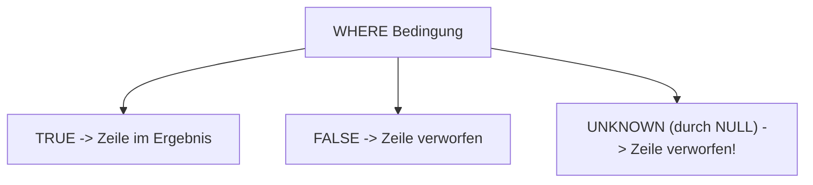
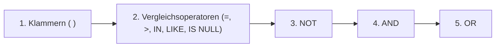
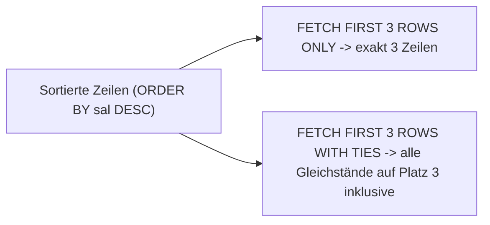

# Phase 2: Filtering, Sorting & Substitution Variables (`L021`–`L042`)

**Exam Domain**: Domain 2 (*Retrieving and Sorting Data*, 15 % gesamt)  
**Verwendete Schemas**: `SCOTT.EMP`, `HR.EMPLOYEES`, `HR.JOBS`  
**Interactive Studio**: [Phase 2 Tracker](https://chatelao.github.io/sql-schulung/#curriculum/phase-2) · [FreeSQL Sandbox](https://chatelao.github.io/sql-schulung/#labs/freesql/phase-2) · [SQL\*Plus Simulator](https://chatelao.github.io/sql-schulung/#labs/sqlplus) · [Flashcards D2](https://chatelao.github.io/sql-schulung/#flashcards/D2)

---

## `WHERE`-Klausel & einfache Vergleiche (`L021`–`L024`)

### `L021` — Zeilen filtern mit `WHERE`
- **Lernziel**: Du schränkst Abfrageergebnisse gezielt auf relevante Zeilen ein.
- **Studio-Link**: [Tracker `L021`](https://chatelao.github.io/sql-schulung/#curriculum/L021) · [SQL Ref: SELECT](https://docs.oracle.com/en/database/oracle/oracle-database/26/sqlrf/SELECT.html)
- **Beispiel**:
  ```sql
  SELECT ename, job, sal FROM scott.emp WHERE deptno = 10;
  ```
  **Erwartete Ausgabe**: 3 Zeilen (`CLARK`, `KING`, `MILLER`).
- **Selbstlern-Aufgabe**: Finde alle Mitarbeiter in `SCOTT.EMP`, die mehr als `2500` verdienen (erwartet: 5 Zeilen).
  ??? success "Musterlösung & Erklärung"
      ```sql
      SELECT ename, job, sal FROM scott.emp WHERE sal > 2500;
      -- JONES (2975), BLAKE (2850), SCOTT (3000), KING (5000), FORD (3000)
      ```

### `L022` — Comparison Operators (`=`, `<>`, `!=`, `<`, `>`, `<=`, `>=`)
- **Lernziel**: Du verwendest Vergleichsoperatoren sicher und beachtest Case-Sensitivity bei Zeichenketten.
- **Studio-Link**: [Tracker `L022`](https://chatelao.github.io/sql-schulung/#curriculum/L022) · [SQL Ref: Comparison Conditions](https://docs.oracle.com/en/database/oracle/oracle-database/26/sqlrf/Comparison-Conditions.html)
- **Konzept**: SQL-Schlüsselwörter sind case-insensitive (`select` = `SELECT`), aber **Zeichenketten innerhalb von `'...'` sind case-sensitive** (`'CLERK'` ≠ `'clerk'`).
- **Selbstlern-Aufgabe**: Warum liefert `SELECT ename FROM scott.emp WHERE job = 'clerk';` **0 Zeilen**, obwohl es 4 Clerks gibt?
  ??? success "Musterlösung & Erklärung"
      In `SCOTT.EMP` ist `JOB` in Großbuchstaben (`'CLERK'`) gespeichert. Mit `'CLERK'` liefert die Abfrage `SMITH`, `ADAMS`, `JAMES`, `MILLER`.

### `L023` — Date Literals in `WHERE`
- **Lernziel**: Du filterst Datumsspalten portabel mit dem ANSI-Date-Literal `DATE 'YYYY-MM-DD'`.
- **Studio-Link**: [Tracker `L023`](https://chatelao.github.io/sql-schulung/#curriculum/L023) · [SQL Ref: Literals](https://docs.oracle.com/en/database/oracle/oracle-database/26/sqlrf/Literals.html)
- **Beispiel**:
  ```sql
  SELECT ename, hiredate FROM scott.emp
  WHERE hiredate >= DATE '1982-01-01';
  ```
  **Erwartete Ausgabe**: 3 Zeilen (`SCOTT`, `ADAMS`, `MILLER`).

- **Selbstlern-Aufgabe:** Lückentext: Finde alle Mitarbeitenden in `scott.emp`, die nach dem `01.01.1982` eingestellt wurden (ANSI Date Literal):
```sql
SELECT ename, hiredate FROM scott.emp WHERE hiredate > DATE '___';
```
  ??? success "Musterlösung & Erklärung"
      ```sql
      SELECT ename, hiredate FROM scott.emp WHERE hiredate > DATE '1982-01-01';
      ```
      ANSI Date Literals nutzen immer das Format `DATE 'YYYY-MM-DD'` unabhängig von `NLS_DATE_FORMAT` (`2 Zeilen`: `SCOTT`, `ADAMS`).

### `L024` — Warum `SELECT`-Aliases in `WHERE` fehlschlagen
- **Lernziel**: Du verstehst die logische Verarbeitungsreihenfolge (`FROM` → `WHERE` → `SELECT` → `ORDER BY`).
- **Studio-Link**: [Tracker `L024`](https://chatelao.github.io/sql-schulung/#curriculum/L024) · [SQL Syntax Cheat Sheet](../cheatsheets/sql-syntax.md)
- **Exam Trap**: `SELECT ename, sal * 12 annual FROM scott.emp WHERE annual > 30000;` wirft **`ORA-00904: "ANNUAL": invalid identifier`**, weil Oracle `WHERE` *vor* `SELECT` auswertet.
- **Selbstlern-Aufgabe**: Korrigiere die fehlerhafte Query so, dass sie alle Mitarbeiter mit Jahresgehalt > 30.000 liefert (erwartet: 5 Zeilen).
  ??? success "Musterlösung & Erklärung"
      ```sql
      SELECT ename, sal * 12 AS annual
      FROM scott.emp
      WHERE sal * 12 > 30000;
      ```

---

## Range-, List-, Pattern- & Null-Filter (`L025`–`L028`)

### `L025` — Inklusive Bereiche mit `BETWEEN ... AND ...`
- **Lernziel**: Du filterst Wertebereiche inklusiv und vermeidest die Reihenfolge-Falle.
- **Studio-Link**: [Tracker `L025`](https://chatelao.github.io/sql-schulung/#curriculum/L025) · [SQL Ref: BETWEEN Condition](https://docs.oracle.com/en/database/oracle/oracle-database/26/sqlrf/BETWEEN-Condition.html)
- **Beispiel**:
  ```sql
  SELECT ename, sal FROM scott.emp WHERE sal BETWEEN 1250 AND 2850;
  ```
  **Erwartete Ausgabe**: 7 Zeilen (`ALLEN`, `WARD`, `MARTIN`, `BLAKE`, `CLARK`, `TURNER`, `MILLER` — beide Grenzen inklusive!).
- !!! warning "1Z0-171 Exam Trap"
    Die Untergrenze muss **zuerst** stehen: `WHERE sal BETWEEN 2850 AND 1250` ist gültiges SQL, liefert aber **0 Zeilen**!

- **Selbstlern-Aufgabe:** Lückentext: Gib alle Mitarbeitenden mit Gehalt zwischen `1250` und `1600` (inklusive Grenzen!) aus:
```sql
SELECT ename, sal FROM scott.emp WHERE sal ___ 1250 ___ 1600;
```
  ??? success "Musterlösung & Erklärung"
      ```sql
      SELECT ename, sal FROM scott.emp WHERE sal BETWEEN 1250 AND 1600;
      ```
      `BETWEEN` ist immer inklusive (`>= 1250 AND <= 1600`, `4 Zeilen`).

### `L026` — Mengenzugehörigkeit mit `IN` und `NOT IN`
- **Lernziel**: Du prüfst Zugehörigkeit zu Wertelisten kompakt mit `IN`.
- **Studio-Link**: [Tracker `L026`](https://chatelao.github.io/sql-schulung/#curriculum/L026) · [SQL Ref: IN Condition](https://docs.oracle.com/en/database/oracle/oracle-database/26/sqlrf/IN-Condition.html)
- **Beispiel**:
  ```sql
  SELECT ename, job FROM scott.emp WHERE job IN ('MANAGER', 'ANALYST');
  ```
  **Erwartete Ausgabe**: 5 Zeilen (`JONES`, `BLAKE`, `CLARK`, `SCOTT`, `FORD`).

- **Selbstlern-Aufgabe:** Warum liefert `SELECT ename FROM scott.emp WHERE empno NOT IN (7369, NULL);` **0 Zeilen**?
  ??? success "Musterlösung & Erklärung"
      `NOT IN (7369, NULL)` entspricht `empno != 7369 AND empno != NULL`. Da `empno != NULL` immer `UNKNOWN` ergibt, ist die gesamte `AND`-Bedingung für jede Zeile `UNKNOWN` → 0 Zeilen!

### `L027` — Pattern Matching mit `LIKE` (`%`, `_`, `ESCAPE`)
- **Lernziel**: Du suchst Textmuster mit `%` (0..n Zeichen), `_` (exakt 1 Zeichen) und maskierst wörtliche Unterstriche mit `ESCAPE`.
- **Studio-Link**: [Tracker `L027`](https://chatelao.github.io/sql-schulung/#curriculum/L027) · [SQL Ref: About SQL Conditions](https://docs.oracle.com/en/database/oracle/oracle-database/26/sqlrf/About-SQL-Conditions.html)
- **Beispiel**:
  ```sql
  SELECT ename FROM scott.emp WHERE ename LIKE 'A%';     -- ALLEN, ADAMS (2 Zeilen)
  SELECT ename FROM scott.emp WHERE ename LIKE '___TH';  -- SMITH (1 Zeile)
  SELECT job_id FROM hr.jobs WHERE job_id LIKE 'SA\_%' ESCAPE '\'; -- SA_MAN, SA_REP (2 Zeilen)
  ```
- **Selbstlern-Aufgabe**: Finde alle Mitarbeiter in `SCOTT.EMP`, deren Name an der zweiten Stelle ein `'L'` hat (erwartet: 3 Zeilen).
  ??? success "Musterlösung & Erklärung"
      ```sql
      SELECT ename FROM scott.emp WHERE ename LIKE '_L%';
      -- ALLEN, BLAKE, CLARK
      ```

### `L028` — Null-Werte filtern (`IS NULL` / `IS NOT NULL`)
- **Lernziel**: Du filterst fehlende Werte korrekt mit `IS NULL` / `IS NOT NULL`.
- **Studio-Link**: [Tracker `L028`](https://chatelao.github.io/sql-schulung/#curriculum/L028) · [SQL Ref: Nulls](https://docs.oracle.com/en/database/oracle/oracle-database/26/sqlrf/Nulls.html)
- **Beispiel**:
  ```sql
  SELECT ename, comm FROM scott.emp WHERE comm IS NULL;     -- 10 Zeilen
  SELECT ename, comm FROM scott.emp WHERE comm IS NOT NULL; -- 4 Zeilen (inkl. TURNER mit 0!)
  ```
- !!! warning "1Z0-171 Exam Trap"
    `WHERE comm = NULL` oder `WHERE comm <> NULL` wirft **keinen** Fehler – es liefert stillschweigend **0 Zeilen**, weil jeder Vergleich mit `NULL` zu `UNKNOWN` auswertet!

---

## Boolean Logic & Operator Precedence (`L029`–`L033`)

- **Selbstlern-Aufgabe:** Lückentext: Finde alle Mitarbeitenden, deren Name als **zweiten** Buchstaben ein `A` hat:
```sql
SELECT ename FROM scott.emp WHERE ename LIKE '___';
```
  ??? success "Musterlösung & Erklärung"
      ```sql
      SELECT ename FROM scott.emp WHERE ename LIKE '_A%';
      ```
      `_` steht für genau 1 Zeichen, `%` für 0..N Zeichen (`WARD`, `MARTIN`, `JAMES`).

### `L029` — Bedingungen kombinieren mit `AND`
- **Lernziel**: Du verknüpfst mehrere Pflichtbedingungen mit `AND`.
- **Studio-Link**: [Tracker `L029`](https://chatelao.github.io/sql-schulung/#curriculum/L029)
- **Beispiel**: `SELECT ename, job, sal FROM scott.emp WHERE deptno = 30 AND sal >= 1500;` → 3 Zeilen (`ALLEN`, `BLAKE`, `TURNER`).

- **Selbstlern-Aufgabe:** Lückentext: Finde alle `CLERK`s in `scott.emp` mit einem Gehalt unter `1200`:
```sql
SELECT ename, job, sal FROM scott.emp WHERE job = 'CLERK' ___ sal < 1200;
```
  ??? success "Musterlösung & Erklärung"
      ```sql
      SELECT ename, job, sal FROM scott.emp WHERE job = 'CLERK' AND sal < 1200;
      ```
      Liefert `SMITH` (`800`), `ADAMS` (`1100`) und `JAMES` (`950`).

### `L030` — Bedingungen erweitern mit `OR`
- **Lernziel**: Du lässt alternative Kriterien mit `OR` zu.
- **Studio-Link**: [Tracker `L030`](https://chatelao.github.io/sql-schulung/#curriculum/L030)
- **Beispiel**: `SELECT ename, deptno, job FROM scott.emp WHERE deptno = 10 OR job = 'CLERK';` → 6 Zeilen (3 aus Dept 10 + 3 weitere Clerks).

- **Selbstlern-Aufgabe:** Korrigiere die `NULL`-Prüfung: `SELECT ename FROM scott.emp WHERE comm = NULL;` liefert 0 Zeilen.
  ??? success "Musterlösung & Erklärung"
      ```sql
      SELECT ename FROM scott.emp WHERE comm IS NULL;
      ```
      Vergleiche mit `NULL` nutzen immer `IS NULL` bzw. `IS NOT NULL` (`10 Zeilen`).

### `L031` — Negieren mit `NOT` & 3-Valued Logic
- **Lernziel**: Du wendest die 3-wertige Logik (`TRUE`, `FALSE`, `UNKNOWN`) auf `AND`, `OR` und `NOT` sicher an.
- **Studio-Link**: [Tracker `L031`](https://chatelao.github.io/sql-schulung/#curriculum/L031)

| A | B | `A AND B` | `A OR B` | `NOT A` |
| :---: | :---: | :---: | :---: | :---: |
| `TRUE` | `UNKNOWN` | **`UNKNOWN`** | **`TRUE`** | `FALSE` |
| `FALSE` | `UNKNOWN` | **`FALSE`** | **`UNKNOWN`** | `TRUE` |
| `UNKNOWN` | `UNKNOWN` | `UNKNOWN` | `UNKNOWN` | **`UNKNOWN`** |

- **Selbstlern-Aufgabe:** Lückentext: Finde Mitarbeitende in `deptno` `10` oder `20`, die zusätzlich `sal >= 2500` verdienen:
```sql
SELECT ename, deptno, sal FROM scott.emp WHERE (deptno = 10 ___ deptno = 20) ___ sal >= 2500;
```
  ??? success "Musterlösung & Erklärung"
      ```sql
      SELECT ename, deptno, sal FROM scott.emp WHERE (deptno = 10 OR deptno = 20) AND sal >= 2500;
      ```
      Ohne Klammern würde `AND` vor `OR` binden!

### `L032` — Precedence Rules (`NOT` → `AND` → `OR`)
- **Lernziel**: Du verhinderst logische Fehler durch Verstehen von `AND` vor `OR` und durch Klammern.
- **Studio-Link**: [Tracker `L032`](https://chatelao.github.io/sql-schulung/#curriculum/L032)
- **Beispiel**:
  ```sql
  -- Liefert ALLE Salesmen (auch unter 1500!), plus President > 1500 (5 Zeilen):
  SELECT ename, job, sal FROM scott.emp
  WHERE job = 'SALESMAN' OR job = 'PRESIDENT' AND sal > 1500;

  -- Klammern ändern die Bedeutung komplett (3 Zeilen: ALLEN, KING, TURNER):
  SELECT ename, job, sal FROM scott.emp
  WHERE (job = 'SALESMAN' OR job = 'PRESIDENT') AND sal > 1500;
  ```

- **Selbstlern-Aufgabe:** Welche Zeilen liefert `SELECT ename, comm FROM scott.emp WHERE NOT (comm > 0);`?
  ??? success "Musterlösung & Erklärung"
      Nur `TURNER` (`comm = 0`). Die 10 Zeilen mit `comm IS NULL` ergeben `NOT (UNKNOWN)` = `UNKNOWN` und werden **nicht** zurückgegeben!

### `L033` — Interaktives Precedence-Training (10 Grenzfälle auf `HR` & `SCOTT`)
- **Lernziel**: Du löst komplexe kombinierte `WHERE`-Filter sicher ohne IDE.
- **Studio-Link**: [Tracker `L033`](https://chatelao.github.io/sql-schulung/#curriculum/L033)
- **Selbstlern-Aufgaben (Löse zuerst 1–5 im Kopf, dann in FreeSQL prüfen)**:
  1. `SCOTT.EMP`: Alle Mitarbeiter aus `deptno = 20` oder `30`, die mindestens `2850` verdienen (erwartet: 4 Zeilen).
  2. `SCOTT.EMP`: Alle Mitarbeiter, deren `job` weder `'CLERK'` noch `'SALESMAN'` ist (erwartet: 6 Zeilen).
  3. `SCOTT.EMP`: Warum liefert `WHERE NOT (comm > 0)` nicht `SMITH` (erwartet: nur `TURNER`!)?
  4. `HR.EMPLOYEES`: Alle Mitarbeiter mit `department_id IN (50, 80)` und `salary >= 10000` (erwartet: 15 Zeilen).
  5. `HR.EMPLOYEES`: Alle Mitarbeiter ohne `commission_pct`, die `IT_PROG` oder `SA_REP` sind (erwartet: 5 Zeilen — alle `IT_PROG`, denn `SA_REP` hat immer eine Provision).
  ??? success "Musterlösungen zu L033 (1–5)"
      ```sql
      -- 1:
      SELECT ename, deptno, sal FROM scott.emp WHERE deptno IN (20, 30) AND sal >= 2850;
      -- 2:
      SELECT ename, job FROM scott.emp WHERE job NOT IN ('CLERK', 'SALESMAN');
      -- 3: Bei SMITH ist comm NULL -> NOT (NULL > 0) = NOT (UNKNOWN) = UNKNOWN! Nur TURNER (comm = 0) ergibt TRUE.
      -- 4:
      SELECT employee_id, last_name, salary FROM hr.employees WHERE department_id IN (50, 80) AND salary >= 10000;
      -- 5:
      SELECT employee_id, last_name, job_id FROM hr.employees WHERE commission_pct IS NULL AND job_id IN ('IT_PROG', 'SA_REP');
      ```

---

## Sorting & Row Limiting (`L034`–`L037`)

### `L034` — Sortieren mit `ORDER BY` (`ASC` / `DESC`)
- **Lernziel**: Du sortierst Ergebnisse nach einer oder mehreren Spalten auf- und absteigend.
- **Studio-Link**: [Tracker `L034`](https://chatelao.github.io/sql-schulung/#curriculum/L034) · [SQL Ref: Sorting Query Results](https://docs.oracle.com/en/database/oracle/oracle-database/26/sqlrf/Sorting-Query-Results.html)
- **Beispiel**: `SELECT ename, deptno, sal FROM scott.emp ORDER BY deptno ASC, sal DESC;` (Standard ohne Angabe ist immer `ASC`).

- **Selbstlern-Aufgabe:** Lückentext: Sortiere `scott.emp` aufsteigend nach `deptno` und innerhalb der Abteilung absteigend nach `sal`:
```sql
SELECT deptno, ename, sal FROM scott.emp ORDER BY deptno ___, sal ___; 
```
  ??? success "Musterlösung & Erklärung"
      ```sql
      SELECT deptno, ename, sal FROM scott.emp ORDER BY deptno ASC, sal DESC;
      ```
      `ASC` ist Standard, `DESC` sortiert absteigend (`14 Zeilen`).

### `L035` — Sortieren nach Alias, Spaltenposition & `NULLS FIRST/LAST`
- **Lernziel**: Du nutzt Column Aliases und Spaltenpositionen in `ORDER BY` und steuerst die Position von `NULL`.
- **Studio-Link**: [Tracker `L035`](https://chatelao.github.io/sql-schulung/#curriculum/L035)
- **Beispiel**:
  ```sql
  SELECT ename, sal * 12 AS annual_sal, comm
  FROM scott.emp
  ORDER BY annual_sal DESC, comm NULLS FIRST;
  ```
- !!! warning "1Z0-171 Exam Trap"
    Standardmäßig behandelt Oracle `NULL` als den **größten Wert**: Bei `ASC` stehen `NULL`s **zuletzt (`NULLS LAST`)**, bei `DESC` stehen `NULL`s **zuerst (`NULLS FIRST`)**!

- **Selbstlern-Aufgabe:** Lückentext: Sortiere nach Provision aufsteigend, aber zeige `NULL`-Werte **zuerst**:
```sql
SELECT ename, comm FROM scott.emp ORDER BY comm ASC ___; 
```
  ??? success "Musterlösung & Erklärung"
      ```sql
      SELECT ename, comm FROM scott.emp ORDER BY comm ASC NULLS FIRST;
      ```
      Standard bei `ASC` ist `NULLS LAST`; mit `NULLS FIRST` stehen die 10 `NULL`-Zeilen oben.

### `L036` — Row Limiting (`OFFSET` & `FETCH FIRST ... ONLY`)
- **Lernziel**: Du begrenzt Ergebnisse und blätterst seitenweise (Pagination) mit ANSI-Syntax.
- **Studio-Link**: [Tracker `L036`](https://chatelao.github.io/sql-schulung/#curriculum/L036)
- **Beispiel**:
  ```sql
  -- Top 3 Bestverdiener in SCOTT: KING (5000), SCOTT (3000), FORD (3000)
  SELECT ename, sal FROM scott.emp ORDER BY sal DESC FETCH FIRST 3 ROWS ONLY;

  -- Pagination: Top 3 überspringen, nächste 3 holen
  SELECT ename, sal FROM scott.emp ORDER BY sal DESC OFFSET 3 ROWS FETCH NEXT 3 ROWS ONLY;
  ```

- **Selbstlern-Aufgabe:** Lückentext: Überspringe die 3 höchsten Gehälter in `scott.emp` und gib die nächsten 3 (inklusive Gleichstände) aus:
```sql
SELECT ename, sal FROM scott.emp ORDER BY sal DESC OFFSET ___ ROWS FETCH NEXT ___ ROWS ___; 
```
  ??? success "Musterlösung & Erklärung"
      ```sql
      SELECT ename, sal FROM scott.emp ORDER BY sal DESC OFFSET 3 ROWS FETCH NEXT 3 ROWS WITH TIES;
      ```
      `OFFSET 3` überspringt `KING`, `SCOTT`, `FORD`; `WITH TIES` nimmt Gleichstände auf dem 3. Rang der Ausgabe mit.

### `L037` — `ONLY` vs. `WITH TIES` & `PERCENT`
- **Lernziel**: Du unterscheidest exakte Zeilenzahl (`ONLY`) von Gleichstands-Mitnahme (`WITH TIES`).
- **Studio-Link**: [Tracker `L037`](https://chatelao.github.io/sql-schulung/#curriculum/L037)
- **Beispiel**:
  ```sql
  -- Liefert 3 Zeilen statt 2, weil SCOTT und FORD beide 3000 verdienen!
  SELECT ename, sal FROM scott.emp ORDER BY sal DESC FETCH FIRST 2 ROWS WITH TIES;
  ```
- **Selbstlern-Aufgabe**: Warum wirft `SELECT ename, sal FROM scott.emp FETCH FIRST 2 ROWS WITH TIES;` (ohne `ORDER BY`) in Oracle einen Fehler?
  ??? success "Musterlösung & Erklärung"
      `WITH TIES` erfordert zwingend eine `ORDER BY`-Klausel, da Oracle sonst nicht definieren kann, welche Werte „gleichauf“ (tied) sind (`ORA-30483` / Syntaxfehler).

---

## SQL\*Plus Substitution Variables (`L038`–`L040`)

### `L038` — Single Ampersand (`&`) vs. Double Ampersand (`&&`)
- **Lernziel**: Du kennst den Unterschied zwischen einmaliger (`&`) und session-persistenter (`&&`) Ersetzung.
- **Studio-Link**: [Tracker `L038`](https://chatelao.github.io/sql-schulung/#curriculum/L038) · [Spool-Transkripte](../cheatsheets/sqlplus-transcripts.md)
- **Beispiel**:
  ```sql
  -- Fragt bei jeder Ausführung neu:
  SELECT empno, ename, sal FROM scott.emp WHERE deptno = &dept_num;

  -- Fragt genau einmal und definiert Session-Variable; Strings brauchen '...'!
  SELECT empno, ename, &&col_name FROM scott.emp
  WHERE job = '&target_job'
  ORDER BY &col_name;
  ```

- **Selbstlern-Aufgabe:** Was ist der Unterschied zwischen `&dept` und `&&dept` in SQL*Plus / SQLcl?
  ??? success "Musterlösung & Erklärung"
      `&dept` fragt bei jeder Ausführung (oder jedem Auftreten im Statement) erneut nach dem Wert. `&&dept` merkt sich den Wert für die gesamte Session (`DEFINE`), bis `UNDEFINE dept` aufgerufen wird.

### `L039` — `DEFINE`, `UNDEFINE` & `SET VERIFY ON/OFF`
- **Lernziel**: Du setzt und löschst Variablen explizit und liest `old:`/`new:`-Ausgaben korrekt.
- **Studio-Link**: [Tracker `L039`](https://chatelao.github.io/sql-schulung/#curriculum/L039)
- **Beispiel**:
  ```sql
  DEFINE target_dept = 20
  SET VERIFY ON
  SELECT ename, sal FROM scott.emp WHERE deptno = &target_dept;
  UNDEFINE target_dept
  ```

- **Selbstlern-Aufgabe:** Lückentext: Setze eine Variable `v_job` auf `'CLERK'` und gib die Query ohne Vorher/Nachher-Ausgabe aus:
```sql
SET VERIFY ___
___ v_job = 'CLERK'
SELECT ename FROM scott.emp WHERE job = '&v_job';
```
  ??? success "Musterlösung & Erklärung"
      ```sql
      SET VERIFY OFF
      DEFINE v_job = 'CLERK'
      SELECT ename FROM scott.emp WHERE job = '&v_job';
      ```
      `SET VERIFY OFF` unterdrückt die `old:`/`new:`-Meldungen im Spool.

### `L040` — Variante A CLI-Lab vs. Variante B Simulator
- **Lernziel**: Du trainierst Substitution Variables praktisch in deiner gewählten Umgebung.
- **Studio-Link**: [Tracker `L040`](https://chatelao.github.io/sql-schulung/#curriculum/L040) · [SQL\*Plus Simulator öffnen ↗](https://chatelao.github.io/sql-schulung/#labs/sqlplus)
- **Aufgabe**: Teste alle drei Vorlagen (`& Single`, `&& Double`, `DEFINE + VERIFY`) im **SQL\*Plus Simulator** (Variante B) bzw. in `sqlcl`/`sqlplus` (Variante A) und vergleiche die Ausgabe mit den [Spool-Transkripten](../cheatsheets/sqlplus-transcripts.md).

---

## Checkpoint #1 (`L041`–`L042`)

- **Selbstlern-Aufgabe:** Teste im [SQL*Plus Simulator](https://chatelao.github.io/sql-schulung/#labs/sqlplus) ein Statement mit `&&dno` und anschliessendem `UNDEFINE dno`.
  ??? success "Musterlösung & Erklärung"
      Beim zweiten `SELECT` mit `&dno` wird ohne erneute Eingabe der gespeicherte Wert verwendet; erst nach `UNDEFINE dno` fragt SQL*Plus erneut.

### `L041` — Identical Checkpoint #1 (Assessment)
- **Lernziel**: Du misst deinen objektiven Fortschritt nach Phase 1 & 2.
- **Studio-Link**: [Tracker `L041`](https://chatelao.github.io/sql-schulung/#curriculum/L041) · [Checkpoint `CP-1` starten ↗](https://chatelao.github.io/sql-schulung/#checkpoints/CP-1)
- **Erwartetes Niveau**: **30–40 %** gesamt (Domains 1 & 2 sollten deutlich gestiegen sein).

- **Selbstlern-Aufgabe:** Starte [CP-1 im Studio](https://chatelao.github.io/sql-schulung/#checkpoints/CP-1) und absolviere alle 22 Fragen + Part B + Part C.
  ??? success "Musterlösung & Erklärung"
      Ziel nach Phase 2: **30–40 %** Gesamtscore, mit deutlichem Anstieg in Domains 1 & 2 gegenüber `CP-0`.

### `L042` — Fortschrittsvergleich & Reflexion (`CP-1` vs. `CP-0`)
- **Lernziel**: Du erkennst Blind Spots und setzt dein Lernziel für Phase 3 (25 % Exam-Gewicht!).
- **Studio-Link**: [Tracker `L042`](https://chatelao.github.io/sql-schulung/#curriculum/L042) · [`CP-1` Reflexion](https://chatelao.github.io/sql-schulung/#checkpoints/CP-1)
- **Pflicht-Check**: Exportiere nach `CP-1` dein wöchentliches Lernstand-Backup (`.json`).

---

- **Selbstlern-Aufgabe:** Vergleiche deinen `CP-1`-Score mit `CP-0` und notiere mindestens 1 Domain, in der deine Confidence zu hoch war (Blind Spot).
  ??? success "Musterlösung & Erklärung"
      Typisch nach Phase 2: `NULLS FIRST/LAST` oder `FETCH ... WITH TIES` werden oft überschätzt, wenn man sie selten tippt.

### Visuelle Orientierung: 3-wertige Logik, Präzedenz & Top-N


*Alt-Text: Entscheidungsbaum der 3-wertigen Logik in Oracle SQL: Nur TRUE gelangt ins Ergebnis, FALSE und UNKNOWN werden verworfen.*


*Alt-Text: Operator-Präzedenz von Klammern über Vergleiche, NOT und AND bis OR.*


*Alt-Text: Vergleich zwischen FETCH FIRST ... ONLY und WITH TIES bei Gleichständen auf dem letzten Rang.*

---

## Gemischtes Training & Differenzierung (Basis / Plus / Challenge)

- **Analyse-Aufgabe (Bloom: Bewerten):** Finde den Denkfehler in `SELECT ename FROM scott.emp WHERE deptno = 10 OR deptno = 20 AND sal > 2000;`. *(Lösung: `AND` bindet stärker als `OR`; es fehlen Klammern um `deptno = 10 OR deptno = 20`.)*
- **Basis:** Alle `CLERK`s in `scott.emp` sortiert nach `sal DESC`.
- **Plus:** Top-3-Verdiener in `hr.employees` mit `FETCH FIRST 3 ROWS WITH TIES` + `NVL(commission_pct, 0)`.
- **Challenge:** Kombiniere `LIKE '_A%'`, `BETWEEN` auf `hiredate` (`DATE '1981-01-01'`) und `NULLS LAST`.

## Hybrid-Paaraufgaben (3 gemischte Paare: Remote + Vor Ort)

1. **Paaraufgabe A (Klammer-Falle):** Vergleicht `WHERE deptno = 10 OR deptno = 20 AND sal > 2000` mit geklammerter Variante `WHERE (deptno = 10 OR deptno = 20) AND sal > 2000` auf `scott.emp`. Dokumentiert vor dem Ausführen im Teams-Chat, welche Zeilen sich unterscheiden.
2. **Paaraufgabe B (Top-N-Ranking):** Erstellt in `hr.employees` eine Top-5-Gehaltsliste einmal mit `FETCH FIRST 5 ROWS ONLY` und einmal mit `WITH TIES` — erklärt im Plenum (Remote first), warum sich die Zeilenzahl unterscheidet.

## Praxis-Transfer in deinen Arbeitsalltag (Firmenbezug)

- **Aufgabe:** Übersetze einen typischen Filter aus deinem Berichtswesen (z. B. *„Alle offenen Vorgänge der letzten 30 Tage aus Abteilung A oder B über 1.000 CHF“*) in ein `WHERE`-Statement mit expliziter Klammerung und `ORDER BY ... NULLS LAST`.
