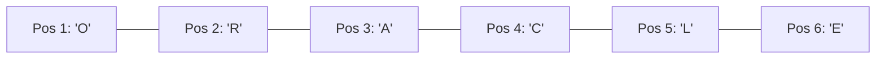
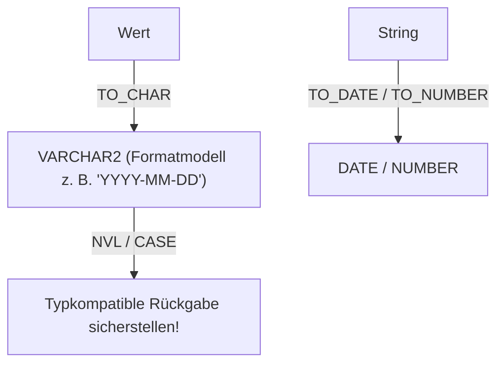

# Phase 3: Single-Row, Conversion & Conditional Functions (`L043`–`L068`)

**Exam Domain**: Domain 3 Teil 1 (*Using Functions*, ca. 18 % der Gesamtprüfung)  
**Verwendete Schemas**: `SCOTT.EMP`, `HR.EMPLOYEES`, `DUAL`  
**Interactive Studio**: [Phase 3 Tracker](https://chatelao.github.io/sql-schulung/#curriculum/phase-3) · [FreeSQL Sandbox](https://chatelao.github.io/sql-schulung/#labs/freesql/phase-3) · [String Slicer](https://chatelao.github.io/sql-schulung/#labs/slicer) · [Flashcards D3](https://chatelao.github.io/sql-schulung/#flashcards/D3)

---

## Case & Basic Character Functions (`L043`–`L046`)

### `L043` — Case Manipulation (`LOWER`, `UPPER`, `INITCAP`)
- **Lernziel**: Du wandelst Groß-/Kleinschreibung in der Ausgabe um und suchst case-insensitiv.
- **Studio-Link**: [Tracker `L043`](https://chatelao.github.io/sql-schulung/#curriculum/L043) · [SQL Ref: LOWER](https://docs.oracle.com/en/database/oracle/oracle-database/26/sqlrf/LOWER.html)
- **Beispiel**:
  ```sql
  SELECT ename, INITCAP(ename) AS proper, LOWER(job) AS job_low FROM scott.emp;
  -- Case-insensitiver Suchfilter:
  SELECT ename FROM scott.emp WHERE UPPER(ename) = 'SMITH'; -- 1 Zeile
  ```
- **Selbstlern-Aufgabe**: Gib alle Mitarbeiter aus `HR.EMPLOYEES` aus, deren `last_name` kleingeschrieben `'king'` lautet (erwartet: 2 Zeilen).
  ??? success "Musterlösung & Erklärung"
      ```sql
      SELECT employee_id, first_name, last_name FROM hr.employees WHERE LOWER(last_name) = 'king';
      ```

### `L044` — `CONCAT` vs. `||` und `LENGTH`
- **Lernziel**: Du kennst die strikte 2-Argument-Grenze von `CONCAT` und misst Stringlängen mit `LENGTH`.
- **Studio-Link**: [Tracker `L044`](https://chatelao.github.io/sql-schulung/#curriculum/L044) · [SQL Ref: CONCAT](https://docs.oracle.com/en/database/oracle/oracle-database/26/sqlrf/CONCAT.html)
- !!! warning "1Z0-171 Exam Trap"
    `CONCAT('A', 'B', 'C')` wirft **`ORA-00909: invalid number of arguments`**, weil `CONCAT` **strikt 2 Argumente** akzeptiert! Für 3+ Teile musst du `CONCAT` verschachteln (`CONCAT(CONCAT('A','B'),'C')`) oder besser `||` verwenden.

- **Selbstlern-Aufgabe:** Lückentext: Verbinde Vor- und Nachname aus `hr.employees` mit `CONCAT` (Achtung: nur 2 Argumente!):
```sql
SELECT ___(first_name, ___(' ', last_name)) AS full_name, LENGTH(last_name) FROM hr.employees;
```
  ??? success "Musterlösung & Erklärung"
      ```sql
      SELECT CONCAT(first_name, CONCAT(' ', last_name)) AS full_name, LENGTH(last_name) FROM hr.employees;
      ```
      `CONCAT` akzeptiert exakt 2 Argumente; für 3+ Teile ist `||` meist lesbarer.

### `L045` — `TRIM`, `LTRIM`, `RTRIM`
- **Lernziel**: Du entfernst führende/nachfolgende Zeichen gezielt und kennst die `ORA-30001`-Regel.
- **Studio-Link**: [Tracker `L045`](https://chatelao.github.io/sql-schulung/#curriculum/L045) · [SQL Ref: TRIM](https://docs.oracle.com/en/database/oracle/oracle-database/26/sqlrf/TRIM.html)
- **Beispiel**:
  ```sql
  SELECT TRIM('S' FROM 'SMITHS') FROM dual;         -- 'MITH'
  SELECT TRIM(LEADING '0' FROM '007499') FROM dual; -- '7499'
  ```
- !!! warning "1Z0-171 Exam Trap"
    `TRIM(char FROM str)` erlaubt als Trim-Zeichen **nur ein einzelnes Zeichen** (`TRIM('AB' FROM 'ABSMITH')` wirft **`ORA-30001`**). Für mehrere Zeichen nutze `LTRIM('ABSMITH', 'AB')` / `RTRIM`.

- **Selbstlern-Aufgabe:** Was liefert `SELECT TRIM('x' FROM 'xxSQLxx') FROM dual;`?
  ??? success "Musterlösung & Erklärung"
      `'SQL'` — `TRIM` entfernt standardmässig von beiden Seiten (`BOTH`). Für nur links nutzt man `LTRIM` oder `TRIM(LEADING 'x' FROM ...)`.

### `L046` — `REPLACE`
- **Lernziel**: Du ersetzt oder löschst Teilstrings innerhalb eines Textes.
- **Studio-Link**: [Tracker `L046`](https://chatelao.github.io/sql-schulung/#curriculum/L046) · [SQL Ref: REPLACE](https://docs.oracle.com/en/database/oracle/oracle-database/26/sqlrf/REPLACE.html)
- **Beispiel**:
  ```sql
  SELECT REPLACE('JACK AND JUE', 'J', 'BL') FROM dual; -- 'BLACK AND BLUE'
  SELECT REPLACE('123-456-789', '-') FROM dual;        -- '123456789' (ohne 3. Arg -> entfernen!)
  ```

---

## String Slicing & Searching (`L047`–`L050`)

- **Selbstlern-Aufgabe:** Lückentext: Ersetze in `'ORACLE 23ai'` die Zeichenfolge `'23ai'` durch `'26ai'`:
```sql
SELECT ___('ORACLE 23ai', '23ai', '26ai') FROM dual;
```
  ??? success "Musterlösung & Erklärung"
      ```sql
      SELECT REPLACE('ORACLE 23ai', '23ai', '26ai') FROM dual;
      ```
      Ergebnis: `'ORACLE 26ai'`.

### `L047` — `SUBSTR` (Positive Startpositionen – 1-basiert!)
- **Lernziel**: Du schneidest Teilstrings mit Oracles 1-basierter Indizierung präzise aus.
- **Studio-Link**: [Tracker `L047`](https://chatelao.github.io/sql-schulung/#curriculum/L047) · [String Slicer öffnen ↗](https://chatelao.github.io/sql-schulung/#labs/slicer)
- **Positionstabelle für `'SALESMAN'`**:

| Zeichen | `S` | `A` | `L` | `E` | `S` | `M` | `A` | `N` |
| :--- | :---: | :---: | :---: | :---: | :---: | :---: | :---: | :---: |
| **Positiv** | `1` | `2` | `3` | `4` | `5` | `6` | `7` | `8` |
| **Negativ** | `-8` | `-7` | `-6` | `-5` | `-4` | `-3` | `-2` | `-1` |

- **Beispiel**: `SUBSTR('SALESMAN', 1, 5)` → `'SALES'`, `SUBSTR('SALESMAN', 6)` → `'MAN'`. *(Start `0` wird wie `1` behandelt!)*

- **Selbstlern-Aufgabe:** Welches Ergebnis liefert `SELECT SUBSTR('ORACLE', 2, 3) FROM dual;` (1-basiert!)?
  ??? success "Musterlösung & Erklärung"
      `'RAC'` — Position 1 = `O`, Position 2 = `R`, ab dort 3 Zeichen (`R`, `A`, `C`).

### `L048` — `SUBSTR` mit negativen Startpositionen
- **Lernziel**: Du zählst Startpositionen sicher vom String-Ende rückwärts.
- **Studio-Link**: [Tracker `L048`](https://chatelao.github.io/sql-schulung/#curriculum/L048) · [String Slicer öffnen ↗](https://chatelao.github.io/sql-schulung/#labs/slicer)
- **Beispiel**: `SELECT SUBSTR('SALESMAN', -3, 2) FROM dual;` → **`'MA'`** (Start `-3` ist `'M'`, dann 2 Zeichen **von links nach rechts**).
- **Selbstlern-Aufgabe**: Sage das Ergebnis von `SUBSTR('ORACLE23AI', -4, 3)` voraus und prüfe es im String Slicer.
  ??? success "Musterlösung & Erklärung"
      Position `-4` ist `'2'` (von hinten: `I=-1, A=-2, 3=-3, 2=-4`). 3 Zeichen nach rechts ergibt **`'23A'`**.

### `L049` — `INSTR` (Suchen & n-tes Vorkommen)
- **Lernziel**: Du bestimmst die exakte Position des 1., 2. oder n-ten Vorkommens eines Substrings.
- **Studio-Link**: [Tracker `L049`](https://chatelao.github.io/sql-schulung/#curriculum/L049) · [SQL Ref: INSTR](https://docs.oracle.com/en/database/oracle/oracle-database/26/sqlrf/INSTR.html)
- **Beispiel**: `SELECT INSTR('CORPORATE FLOOR', 'OR', 3, 2) FROM dual;` → **`14`** (ab Pos. 3 ist das 1. `'OR'` an Pos. 5, das 2. `'OR'` an Pos. 14; nicht gefunden liefert `0`).

- **Selbstlern-Aufgabe:** Lückentext: Finde die Position des **zweiten** `'A'` in `'BANANA'`:
```sql
SELECT ___('BANANA', 'A', 1, ___) FROM dual;
```
  ??? success "Musterlösung & Erklärung"
      ```sql
      SELECT INSTR('BANANA', 'A', 1, 2) FROM dual;
      ```
      Ergebnis: `4` (erstes `A` auf 2, zweites `A` auf 4).

### `L050` — `LPAD`, `RPAD` & Verschachtelung von `SUBSTR` + `INSTR`
- **Lernziel**: Du formatierst Ausgaben mit Padding und liest verschachtelte String-Funktionen von innen nach außen.
- **Studio-Link**: [Tracker `L050`](https://chatelao.github.io/sql-schulung/#curriculum/L050) · [Verschachtelungs-Leitfaden](../cheatsheets/functions-reference.md)
- **Beispiel**:
  ```sql
  SELECT LPAD(sal, 6, '*') FROM scott.emp; -- z. B. '***800'
  SELECT SUBSTR('anna.meier@firma.de', 1, INSTR('anna.meier@firma.de', '@') - 1) FROM dual; -- 'anna.meier'
  ```

---

## Numeric Functions (`L051`–`L054`)

- **Selbstlern-Aufgabe:** Lückentext: Schneide aus `'anna.meier@firma.ch'` nur den Teil **nach** dem `'@'` aus:
```sql
SELECT SUBSTR('anna.meier@firma.ch', ___('anna.meier@firma.ch', '@') + 1) FROM dual;
```
  ??? success "Musterlösung & Erklärung"
      ```sql
      SELECT SUBSTR('anna.meier@firma.ch', INSTR('anna.meier@firma.ch', '@') + 1) FROM dual;
      ```
      `INSTR` liefert `11`, `+ 1` startet bei `12` → `'firma.ch'`.

### `L051` — `ROUND(number, decimals)`
- **Lernziel**: Du rundest Zahlen kaufmännisch auf Nachkomma- und Zehner-/Hunderterstellen.
- **Studio-Link**: [Tracker `L051`](https://chatelao.github.io/sql-schulung/#curriculum/L051) · [SQL Ref: ROUND (number)](https://docs.oracle.com/en/database/oracle/oracle-database/26/sqlrf/ROUND-number.html)
- **Beispiel**: `ROUND(45.926, 2)` → `45.93` | `ROUND(45.926, 0)` → `46` | `ROUND(45.926, -1)` → `50`.

- **Selbstlern-Aufgabe:** Welches Ergebnis liefert `SELECT ROUND(45.926, 2), ROUND(45.926, -1) FROM dual;`?
  ??? success "Musterlösung & Erklärung"
      `45.93` und `50` — negative Nachkommastellen runden links vom Dezimalpunkt (auf Zehner).

### `L052` — `TRUNC(number, decimals)`
- **Lernziel**: Du schneidest Ziffern ohne Rundung Richtung Null ab.
- **Studio-Link**: [Tracker `L052`](https://chatelao.github.io/sql-schulung/#curriculum/L052) · [SQL Ref: TRUNC (number)](https://docs.oracle.com/en/database/oracle/oracle-database/26/sqlrf/TRUNC-number.html)
- **Beispiel**: `TRUNC(45.926, 2)` → `45.92` | `TRUNC(45.926, 0)` → `45` | `TRUNC(45.926, -1)` → `40`.

- **Selbstlern-Aufgabe:** Welches Ergebnis liefert `SELECT TRUNC(45.926, 1), TRUNC(45.926, -1) FROM dual;`?
  ??? success "Musterlösung & Erklärung"
      `45.9` und `40` — `TRUNC` schneidet ab, ohne aufzurunden!

### `L053` — `MOD`, `CEIL` & `FLOOR`
- **Lernziel**: Du berechnest Divisionsreste und rundest strikt auf (`CEIL`) oder ab (`FLOOR`) — auch bei negativen Zahlen.
- **Studio-Link**: [Tracker `L053`](https://chatelao.github.io/sql-schulung/#curriculum/L053) · [SQL Ref: MOD](https://docs.oracle.com/en/database/oracle/oracle-database/26/sqlrf/MOD.html)
- **Beispiel**: `MOD(17, 5)` → `2` | `CEIL(-4.2)` → **`-4`** (`-4 >= -4.2`) | `FLOOR(-4.2)` → **`-5`**.

- **Selbstlern-Aufgabe:** Lückentext: Prüfe per `MOD`, ob `empno` gerade ist, und vergleiche `CEIL(4.1)` mit `FLOOR(4.9)`:
```sql
SELECT ___(7369, 2), ___(4.1), ___(4.9) FROM dual;
```
  ??? success "Musterlösung & Erklärung"
      ```sql
      SELECT MOD(7369, 2), CEIL(4.1), FLOOR(4.9) FROM dual;
      ```
      Ergebnisse: `1` (ungerade), `5`, `4`.

### `L054` — Numeric Practice Clinic auf `SCOTT.EMP`
- **Lernziel**: Du wendest alle numerischen Funktionen in praxisnahen Berechnungen an.
- **Studio-Link**: [Tracker `L054`](https://chatelao.github.io/sql-schulung/#curriculum/L054)
- **Selbstlern-Aufgaben**:
  1. Berechne für `SCOTT.EMP` das auf volle Hunderter **abgeschnittene** Gehalt (`TRUNC`) und den Restbetrag (`MOD(sal, 100)`).
  2. Sage voraus: `SELECT ROUND(156.78, -2), TRUNC(156.78, -2) FROM dual;`
  ??? success "Musterlösungen zu L054"
      ```sql
      -- 1:
      SELECT ename, sal, TRUNC(sal, -2) AS sal_hundreds, MOD(sal, 100) AS remainder FROM scott.emp;
      -- 2: 200 | 100
      ```

---

## Mit Datumsangaben arbeiten (`L055`–`L060`)

### `L055` — Wie Oracle `DATE` & `SYSDATE` speichert
- **Lernziel**: Du weißt, dass `DATE` in Oracle immer auch Uhrzeit (Stunde, Minute, Sekunde) enthält.
- **Studio-Link**: [Tracker `L055`](https://chatelao.github.io/sql-schulung/#curriculum/L055) · [SQL Ref: SYSDATE](https://docs.oracle.com/en/database/oracle/oracle-database/26/sqlrf/SYSDATE.html)

- **Selbstlern-Aufgabe:** Warum zeigt `SELECT hiredate FROM scott.emp;` oft kein Uhrzeit-Teil, obwohl `DATE` immer Stunde/Minute/Sekunde speichert?
  ??? success "Musterlösung & Erklärung"
      Das Anzeigeformat hängt vom Session-Parameter `NLS_DATE_FORMAT` ab (Standard oft `DD-MON-RR`). Mit `TO_CHAR(hiredate, 'YYYY-MM-DD HH24:MI:SS')` wird die Uhrzeit sichtbar.

### `L056` — Date Arithmetic (`+` / `-` Tage)
- **Lernziel**: Du addierst Tage zu einem Datum und berechnest Tagesdifferenzen.
- **Studio-Link**: [Tracker `L056`](https://chatelao.github.io/sql-schulung/#curriculum/L056)
- **Beispiel**: `SYSDATE + 7` liefert das Datum in 7 Tagen (`DATE`); `SYSDATE - hiredate` liefert die Anzahl Tage (`NUMBER`). *(Zwei Daten addieren `d1 + d2` ist verboten → `ORA-00975`!)*

- **Selbstlern-Aufgabe:** Lückentext: Addiere genau **12 Stunden** zu `SYSDATE`:
```sql
SELECT SYSDATE + ___ FROM dual;
```
  ??? success "Musterlösung & Erklärung"
      ```sql
      SELECT SYSDATE + 0.5 FROM dual; -- oder SYSDATE + 12/24
      ```
      In Oracle Date Arithmetic entspricht `1` genau einem Tag (24 Stunden).

### `L057` — `MONTHS_BETWEEN` & `ADD_MONTHS`
- **Lernziel**: Du berechnest exakte Monatsabstände und addierst Kalendermonate inkl. Monatsende-Logik.
- **Studio-Link**: [Tracker `L057`](https://chatelao.github.io/sql-schulung/#curriculum/L057) · [SQL Ref: MONTHS_BETWEEN](https://docs.oracle.com/en/database/oracle/oracle-database/26/sqlrf/MONTHS_BETWEEN.html)
- **Beispiel**:
  ```sql
  SELECT MONTHS_BETWEEN(DATE '1981-11-17', DATE '1980-12-17') FROM dual; -- 11
  SELECT ADD_MONTHS(DATE '2024-01-31', 1) FROM dual;                      -- 2024-02-29
  ```

- **Selbstlern-Aufgabe:** Lückentext: Berechne die vollen Monate zwischen `SYSDATE` und `hiredate` in `scott.emp` und addiere 6 Monate auf `hiredate`:
```sql
SELECT ename, TRUNC(___(SYSDATE, hiredate)), ___(hiredate, 6) FROM scott.emp;
```
  ??? success "Musterlösung & Erklärung"
      ```sql
      SELECT ename, TRUNC(MONTHS_BETWEEN(SYSDATE, hiredate)), ADD_MONTHS(hiredate, 6) FROM scott.emp;
      ```
      `MONTHS_BETWEEN(neu, alt)` liefert positive Monate, wenn das erste Argument neuer ist.

### `L058` — `NEXT_DAY` & `LAST_DAY`
- **Lernziel**: Du ermittelst den nächsten Wochentag und das Monatsende eines Datums.
- **Studio-Link**: [Tracker `L058`](https://chatelao.github.io/sql-schulung/#curriculum/L058) · [SQL Ref: LAST_DAY](https://docs.oracle.com/en/database/oracle/oracle-database/26/sqlrf/LAST_DAY.html)
- **Beispiel**: `NEXT_DAY(DATE '2026-11-19', 'FRIDAY')` → `2026-11-20`; `LAST_DAY(DATE '2026-02-10')` → `2026-02-28`.

- **Selbstlern-Aufgabe:** Lückentext: Bestimme den letzten Tag des aktuellen Monats:
```sql
SELECT ___(SYSDATE) FROM dual;
```
  ??? success "Musterlösung & Erklärung"
      ```sql
      SELECT LAST_DAY(SYSDATE) FROM dual;
      ```
      Für den nächsten Montag nutzt man `NEXT_DAY(SYSDATE, 'MONDAY')` (sprachabhängig nach `NLS_DATE_LANGUAGE`).

### `L059` — `ROUND(date, fmt)` & `TRUNC(date, fmt)`
- **Lernziel**: Du rundest und kappst Datumsangaben auf Monats- und Jahresanfänge.
- **Studio-Link**: [Tracker `L059`](https://chatelao.github.io/sql-schulung/#curriculum/L059)
- **Beispiel**: `ROUND(DATE '1981-07-16', 'MONTH')` → `1981-08-01` (ab Tag 16 aufrunden); `ROUND(DATE '1981-07-01', 'YEAR')` → `1982-01-01` (ab Monat 7 aufrunden).

- **Selbstlern-Aufgabe:** Welches Datum liefert `TRUNC(DATE '2026-05-19', 'MM')` vs. `ROUND(DATE '2026-05-19', 'MM')`?
  ??? success "Musterlösung & Erklärung"
      `TRUNC(..., 'MM')` → `2026-05-01`; `ROUND(..., 'MM')` → `2026-06-01` (da der 19. in der zweiten Monatshälfte liegt).

### `L060` — Date-Calculations-Lab auf `SCOTT.EMP` & `HR.EMPLOYEES`
- **Lernziel**: Du kombinierst Datumsfunktionen für reale HR-Fragestellungen.
- **Studio-Link**: [Tracker `L060`](https://chatelao.github.io/sql-schulung/#curriculum/L060)
- **Selbstlern-Aufgaben**:
  1. Berechne für `SCOTT.EMP` das Ende der 6-monatigen Probezeit (`probation_end`) und den ersten Zahltag (`LAST_DAY(hiredate)`).
  2. Liste alle Mitarbeiter in `HR.EMPLOYEES` auf, die an einem `1.` eines Monats eingestellt wurden (`TRUNC(hire_date, 'MONTH') = hire_date`).
  ??? success "Musterlösungen zu L060"
      ```sql
      -- 1:
      SELECT ename, hiredate, ADD_MONTHS(hiredate, 6) AS probation_end, LAST_DAY(hiredate) AS first_payday FROM scott.emp;
      -- 2:
      SELECT employee_id, last_name, hire_date FROM hr.employees WHERE TRUNC(hire_date, 'MONTH') = hire_date;
      ```

---

## Conversion Functions (`L061`–`L064`)

### `L061` — Implicit vs. Explicit Type Conversion
- **Lernziel**: Du vermeidest fragile implizite Typumwandlungen und nutzt explizit `TO_CHAR`, `TO_DATE`, `TO_NUMBER`.
- **Studio-Link**: [Tracker `L061`](https://chatelao.github.io/sql-schulung/#curriculum/L061) · [Format-Model-Referenz](../cheatsheets/functions-reference.md#date-format-models-to_char-to_date)

- **Selbstlern-Aufgabe:** Warum sollte man bei `WHERE hiredate = '17-DEC-80'` explizite Konvertierung bevorzugen?
  ??? success "Musterlösung & Erklärung"
      Implizite Konvertierung hängt von `NLS_DATE_FORMAT` und `NLS_DATE_LANGUAGE` der jeweiligen Session ab. Explizites `DATE '1980-12-17'` oder `TO_DATE(...)` läuft überall gleich.

### `L062` — `TO_CHAR` mit Dates & `fm` Fill Mode
- **Lernziel**: Du formatierst Datumsangaben lesbar und entfernst überflüssige Leerzeichen mit `fm`.
- **Studio-Link**: [Tracker `L062`](https://chatelao.github.io/sql-schulung/#curriculum/L062)
- **Beispiel**: `SELECT ename, TO_CHAR(hiredate, 'fmDD Month YYYY') AS hired FROM scott.emp;` → z. B. `'17 December 1980'` (ohne `fm`: `'17 December  1980'`).

- **Selbstlern-Aufgabe:** Was bewirkt das Präfix `fm` in `TO_CHAR(SYSDATE, 'fmDay, DD. Month YYYY')`?
  ??? success "Musterlösung & Erklärung"
      `fm` (Fill Mode) entfernt führende Nullen bei Zahlen (`DD` → `5` statt `05`) und überflüssige Leerzeichen nach Monats-/Wochentagsnamen.

### `L063` — `TO_CHAR` mit Numbers & `TO_NUMBER`
- **Lernziel**: Du formatierst Währungsbeträge und wandelst formatierte Strings sicher zurück in Zahlen.
- **Studio-Link**: [Tracker `L063`](https://chatelao.github.io/sql-schulung/#curriculum/L063)
- **Beispiel**: `TO_CHAR(sal, '$99,999.00')` → `'$1,600.00'`; `TO_NUMBER('$1,600.00', '$99,999.00')` → `1600`.
- !!! warning "1Z0-171 Exam Trap"
    Ist die Zahl größer als die Maske (`TO_CHAR(12500, '$9,999')`), gibt Oracle **`#######`** aus!

- **Selbstlern-Aufgabe:** Lückentext: Formatiere `sal` aus `scott.emp` mit Tausendertrennzeichen und zwei Nachkommastellen:
```sql
SELECT ename, ___(sal, '99,990.00') FROM scott.emp;
```
  ??? success "Musterlösung & Erklärung"
      ```sql
      SELECT ename, TO_CHAR(sal, '99,990.00') FROM scott.emp;
      ```
      `0` erzwingt führende/nachgestellte Nullen (`800.00`), `9` unterdrückt führende Nullen.

### `L064` — `TO_DATE`, `RR` vs. `YY` & `fx` Exact Match
- **Lernziel**: Du wendest die `RR`-Jahrhundertregel und den `fx`-Modifier fehlerfrei an.
- **Studio-Link**: [Tracker `L064`](https://chatelao.github.io/sql-schulung/#curriculum/L064) · [SQL Ref: TO_DATE](https://docs.oracle.com/en/database/oracle/oracle-database/26/sqlrf/TO_DATE.html)

| Aktuelles Jahr | Angegebenes 2-stelliges Jahr | `YY` Ergebnis | `RR` Ergebnis |
| :---: | :---: | :---: | :---: |
| `2026` (`00–49`) | `15` (`00–49`) | `2015` | `2015` |
| `2026` (`00–49`) | `85` (`50–99`) | **`2085`** | **`1985`** |

---

## Null-Handling & Conditional Expressions (`L065`–`L068`)

- **Selbstlern-Aufgabe:** Welches Jahr erzeugt `TO_DATE('15-JAN-95', 'DD-MON-RR')` im Jahr 2026 im Vergleich zu `'DD-MON-YY'`?
  ??? success "Musterlösung & Erklärung"
      `RR` liefert **1995** (da `95` in `50..99` und aktuelles Jahr in `00..49`), während `YY` **2095** liefert!

### `L065` — `NVL` & `NVL2` (Datentyp-Fallen!)
- **Lernziel**: Du ersetzt `NULL`-Werte typsicher und vermeidest `ORA-01722`.
- **Studio-Link**: [Tracker `L065`](https://chatelao.github.io/sql-schulung/#curriculum/L065)
- **Beispiel**:
  ```sql
  SELECT ename, sal + NVL(comm, 0) AS total_pay FROM scott.emp;
  -- EXAM TRAP: NVL(comm, 'No Comm') wirft ORA-01722! Fix:
  SELECT ename, NVL(TO_CHAR(comm), 'No Comm') FROM scott.emp;
  SELECT ename, NVL2(comm, 'Has Comm', 'No Comm') FROM scott.emp;
  ```

- **Selbstlern-Aufgabe:** Warum wirft `SELECT ename, NVL(comm, 'keine') FROM scott.emp;` einen Fehler?
  ??? success "Musterlösung & Erklärung"
      `ORA-01722: invalid number` — das erste Argument (`comm`) ist `NUMBER`, daher versucht Oracle `'keine'` in eine Zahl umzuwandeln. Korrekt: `NVL(TO_CHAR(comm), 'keine')`.

### `L066` — `NULLIF` & `COALESCE`
- **Lernziel**: Du nutzt `NULLIF` zum Gleichheits-Nulling und `COALESCE` als Short-Circuit-Kette.
- **Studio-Link**: [Tracker `L066`](https://chatelao.github.io/sql-schulung/#curriculum/L066)
- **Beispiel**: `NULLIF(100, 100)` → `NULL`; `NULLIF(100, 200)` → `100`; `COALESCE(comm, sal, 0)` liefert den ersten Nicht-`NULL`-Wert von links nach rechts.

- **Selbstlern-Aufgabe:** Lückentext: Gib den ersten Nicht-`NULL`-Wert aus `comm`, `sal`, `0` zurück:
```sql
SELECT ename, ___(comm, sal, 0) FROM scott.emp;
```
  ??? success "Musterlösung & Erklärung"
      ```sql
      SELECT ename, COALESCE(comm, sal, 0) FROM scott.emp;
      ```
      `COALESCE` wertet von links nach rechts per Short-Circuit aus (alle Argumente müssen typkompatibel sein).

### `L067` — `CASE` Expressions (Simple vs. Searched)
- **Lernziel**: Du formulierst bedingte Logik mit ANSI-`CASE` lesbar und typsicher.
- **Studio-Link**: [Tracker `L067`](https://chatelao.github.io/sql-schulung/#curriculum/L067)
- **Beispiel**:
  ```sql
  SELECT ename, job, sal,
         CASE job
           WHEN 'ANALYST'  THEN sal * 1.10
           WHEN 'SALESMAN' THEN sal * 1.05
           ELSE sal
         END AS revised_sal
  FROM scott.emp;
  ```

- **Selbstlern-Aufgabe:** Lückentext: Klassifiziere Gehälter in `scott.emp` als `'Hoch'` (`>= 3000`), `'Mittel'` (`>= 1500`) oder `'Basis'`:
```sql
SELECT ename, CASE ___ sal >= 3000 ___ 'Hoch' WHEN sal >= 1500 THEN 'Mittel' ___ 'Basis' END FROM scott.emp;
```
  ??? success "Musterlösung & Erklärung"
      ```sql
      SELECT ename, CASE WHEN sal >= 3000 THEN 'Hoch' WHEN sal >= 1500 THEN 'Mittel' ELSE 'Basis' END FROM scott.emp;
      ```
      Ohne `ELSE` liefert `CASE` bei fehlendem Match `NULL`.

### `L068` — `DECODE` & der `NULL = NULL`-Unterschied
- **Lernziel**: Du erkennst den Unterschied zwischen `DECODE` und `CASE` beim Prüfen auf `NULL`.
- **Studio-Link**: [Tracker `L068`](https://chatelao.github.io/sql-schulung/#curriculum/L068)
- **Beispiel**: `SELECT ename, DECODE(comm, NULL, 'None', 0, 'Zero', 'Paid') FROM scott.emp;`
- !!! warning "1Z0-171 Exam Trap"
    `DECODE` wertet `NULL` gleich `NULL` als **Treffer**! Ein einfaches `CASE comm WHEN NULL THEN ...` greift dagegen **niemals** (nur `CASE WHEN comm IS NULL THEN ...` funktioniert).

---

- **Selbstlern-Aufgabe:** Worin unterscheidet sich `DECODE(comm, NULL, 'Leer', 'Vorhanden')` von `CASE comm WHEN NULL THEN 'Leer' ELSE 'Vorhanden' END`?
  ??? success "Musterlösung & Erklärung"
      `DECODE` behandelt zwei `NULL`-Werte als **gleich** und liefert `'Leer'`! Simple `CASE` prüft `comm = NULL` (ergibt `UNKNOWN`) und springt ins `ELSE` (`'Vorhanden'`).

### Visuelle Orientierung: 1-based Indexing, Zwiebelprinzip & Konvertierung


*Alt-Text: 1-basierte Zeichenindizes in Oracle SQL am Beispiel 'ORACLE': Position 1 ist O, Position 6 ist E.*


*Alt-Text: Auswertung verschachtelter Funktionen von innen nach aussen (Zwiebelprinzip).*


*Alt-Text: Explizite Konvertierung mit TO_CHAR, TO_DATE, TO_NUMBER und Typkompatibilität bei NVL/CASE.*

---

## Gemischtes Training & Differenzierung (Basis / Plus / Challenge)

- **Analyse-Aufgabe (Bloom: Analysieren):** Welche Query wirft `ORA-01722` und warum? (A) `NVL(TO_CHAR(comm), 'N/A')` (B) `NVL(comm, 'N/A')`. *(Lösung: B — `comm` ist `NUMBER`, `'N/A'` lässt sich nicht implizit in eine Zahl wandeln.)*
- **Basis:** `UPPER(ename)`, `LENGTH(ename)` und `SUBSTR(ename, 1, 3)` auf `scott.emp`.
- **Plus:** Berechne das Eintrittsjahr mit `EXTRACT(YEAR FROM hiredate)` und formatiere `sal` mit `TO_CHAR(..., '99,990.00')`.
- **Challenge (Advanced-Ausblick):** Extrahiere E-Mail-Domains per `REGEXP_SUBSTR` ([Modul 2](../advanced/modul-02-regex.md)).

## Hybrid-Paaraufgaben (3 gemischte Paare: Remote + Vor Ort)

1. **Paaraufgabe A (String-Zwiebel):** Extrahiert aus `hr.employees.email` bzw. `scott.emp.ename` per verschachteltem `SUBSTR`/`INSTR` Initialen und Domain-Teile. Der Navigator liest die Funktionsaufrufe **von innen nach aussen** laut vor.
2. **Paaraufgabe B (Datums- und `CASE`-Check):** Berechnet die Betriebszugehörigkeit in vollen Jahren (`MONTHS_BETWEEN`) und ordnet via `CASE` Stufen (`Junior`, `Senior`, `Veteran`) zu — inkl. `NVL` für `commission_pct`.

## Praxis-Transfer in deinen Arbeitsalltag (Firmenbezug)

- **Aufgabe:** Wähle eine unsaubere Text- oder Datumsspalte aus deinen Firmendaten (z. B. Produktcodes, Kostenstellen, Datumsstrings) und schreibe eine Bereinigungs-Query mit `TRIM`, `UPPER`, `SUBSTR`/`INSTR` oder `TO_DATE` + `CASE`.
