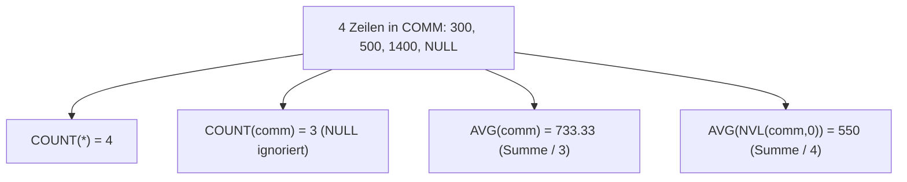
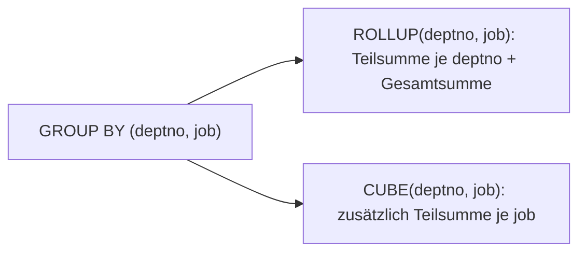

# Phase 4: Grouping & Aggregating Data (`L069`–`L082`)

**Exam Domain**: Domain 3 Teil 2 (*Aggregate Functions*, ca. 7 % der Prüfung)  
**Verwendete Schemas**: `SCOTT.EMP`, `HR.EMPLOYEES`  
**Interactive Studio**: [Phase 4 Tracker](https://chatelao.github.io/sql-schulung/#curriculum/phase-4) · [FreeSQL Sandbox](https://chatelao.github.io/sql-schulung/#labs/freesql/phase-4) · [Human Compiler](https://chatelao.github.io/sql-schulung/#labs/compiler) · [Flashcards D3](https://chatelao.github.io/sql-schulung/#flashcards/D3)

---

## Aggregate Functions & `NULL` Traps (`L069`–`L073`)

### `L069` — `SUM`, `AVG`, `MIN`, `MAX`
- **Lernziel**: Du fasst viele Zeilen zu Kennzahlen zusammen und kennst die zulässigen Datentypen je Funktion.
- **Studio-Link**: [Tracker `L069`](https://chatelao.github.io/sql-schulung/#curriculum/L069) · [SQL Ref: Aggregate Functions](https://docs.oracle.com/en/database/oracle/oracle-database/26/sqlrf/Aggregate-Functions.html)
- **Beispiel**:
  ```sql
  SELECT MIN(sal), MAX(sal), ROUND(AVG(sal), 2), SUM(sal) FROM scott.emp;
  -- Ergebnis: 800 | 5000 | 2073.21 | 29025
  ```
- **Regel**: `MIN` und `MAX` funktionieren auf Zahlen, Strings und Datumsangaben; `SUM` und `AVG` nur auf Zahlen.

- **Selbstlern-Aufgabe:** Lückentext: Berechne Minimum, Maximum und Summe aller Gehälter in `scott.emp`:
```sql
SELECT ___(sal), ___(sal), ___(sal) FROM scott.emp;
```
  ??? success "Musterlösung & Erklärung"
      ```sql
      SELECT MIN(sal), MAX(sal), SUM(sal) FROM scott.emp;
      ```
      Ergebnis: `800`, `5000`, `29025` (1 Zeile).

### `L070` — `COUNT(*)`, `COUNT(col)` & `COUNT(DISTINCT col)`
- **Lernziel**: Du unterscheidest das Zählen aller Zeilen (`COUNT(*)`) vom Zählen gefüllter (`COUNT(col)`) und eindeutiger Werte (`COUNT(DISTINCT col)`).
- **Studio-Link**: [Tracker `L070`](https://chatelao.github.io/sql-schulung/#curriculum/L070) · [SQL Ref: COUNT](https://docs.oracle.com/en/database/oracle/oracle-database/26/sqlrf/COUNT.html)
- **Beispiel**:
  ```sql
  SELECT COUNT(*) AS total_rows,
         COUNT(comm) AS non_null_comms,
         COUNT(DISTINCT job) AS unique_jobs
  FROM scott.emp;
  -- Ergebnis: 14 | 4 | 5
  ```

- **Selbstlern-Aufgabe:** Welche unterschiedlichen Werte liefern `COUNT(*)`, `COUNT(comm)` und `COUNT(DISTINCT deptno)` auf `scott.emp`?
  ??? success "Musterlösung & Erklärung"
      `COUNT(*)` = **14** (alle Zeilen), `COUNT(comm)` = **4** (ohne `NULL`), `COUNT(DISTINCT deptno)` = **3** (`10, 20, 30`).

### `L071` — Die `AVG` + `NULL`-Falle auf `SCOTT.EMP.COMM` beweisen
- **Lernziel**: Du beweist rechnerisch, warum Aggregate Functions (außer `COUNT(*)`) `NULL`-Werte ignorieren.
- **Studio-Link**: [Tracker `L071`](https://chatelao.github.io/sql-schulung/#curriculum/L071)
- **Herleitung**:
  - Provisionen in `SCOTT.EMP`: `300, 500, 1400, 0` (4 Zeilen) + `10× NULL`.
  - `AVG(comm)` = `(300 + 500 + 1400 + 0) / 4` = **`550`** (teilt durch 4!).
  - `AVG(NVL(comm, 0))` = `2200 / 14` = **`157.14`** (teilt durch alle 14 Mitarbeiter!).

- **Selbstlern-Aufgabe:** Beweise per Query auf `scott.emp`: Warum unterscheidet sich `AVG(comm)` von `AVG(NVL(comm, 0))`?
  ??? success "Musterlösung & Erklärung"
      ```sql
      SELECT AVG(comm) AS nur_nicht_null, AVG(NVL(comm, 0)) AS alle_14 FROM scott.emp;
      ```
      `AVG(comm)` teilt `2200 / 4 = 550` (nur 4 Zeilen mit `comm IS NOT NULL`), während `AVG(NVL(comm,0))` `2200 / 14 = 157.14` berechnet!

### `L072` — Group Functions mit Single-Row Columns kombinieren (`ORA-00937`)
- **Lernziel**: Du erkennst und behebst `ORA-00937: not a single-group group function`.
- **Studio-Link**: [Tracker `L072`](https://chatelao.github.io/sql-schulung/#curriculum/L072)
- **Exam Trap**: `SELECT ename, MAX(sal) FROM scott.emp;` liefert 14 Namen, aber nur 1 Maximum — Oracle bricht mit `ORA-00937` ab, solange kein `GROUP BY` oder keine Subquery verwendet wird.

- **Selbstlern-Aufgabe:** Warum wirft `SELECT deptno, MAX(sal) FROM scott.emp;` den Fehler `ORA-00937`?
  ??? success "Musterlösung & Erklärung"
      `deptno` ist eine Einzelspalte ohne Aggregatfunktion und steht nicht im `GROUP BY`. Jede nicht-aggregierte `SELECT`-Spalte muss ins `GROUP BY`.

### `L073` — Aggregate Practice Lab auf `HR.EMPLOYEES`
- **Lernziel**: Du wendest `COUNT`, `SUM`, `AVG`, `MIN`, `MAX` sicher auf `HR.EMPLOYEES` an.
- **Studio-Link**: [Tracker `L073`](https://chatelao.github.io/sql-schulung/#curriculum/L073)
- **Selbstlern-Aufgabe**: Ermittle auf `HR.EMPLOYEES` in einer Query: Gesamtanzahl Mitarbeiter, Anzahl Mitarbeiter mit `commission_pct`, `AVG(commission_pct)` und `ROUND(AVG(NVL(commission_pct, 0)), 4)`.
  ??? success "Musterlösung & Erklärung"
      ```sql
      SELECT COUNT(*) AS total_staff,
             COUNT(commission_pct) AS sales_staff,
             ROUND(AVG(commission_pct), 4) AS avg_sales_comm,
             ROUND(AVG(NVL(commission_pct, 0)), 4) AS avg_company_comm
      FROM hr.employees;
      -- Ergebnis: 107 | 35 | 0.2229 | 0.0729
      ```

---

## `GROUP BY`, `HAVING` & Nested Aggregates (`L074`–`L078`)

### `L074` — Gruppieren nach einer einzelnen Spalte
- **Lernziel**: Du bildest Gruppen mit `GROUP BY` und berechnest Kennzahlen pro Gruppe.
- **Studio-Link**: [Tracker `L074`](https://chatelao.github.io/sql-schulung/#curriculum/L074)
- **Beispiel**:
  ```sql
  SELECT deptno, COUNT(*) AS headcount, SUM(sal) AS payroll
  FROM scott.emp
  GROUP BY deptno
  ORDER BY deptno;
  -- Erwartet: 3 Zeilen (10: 3 | 8750, 20: 5 | 10875, 30: 6 | 9400)
  ```

- **Selbstlern-Aufgabe:** Lückentext: Gib je `job` die Mitarbeiteranzahl in `scott.emp` aus, sortiert nach Anzahl absteigend:
```sql
SELECT job, COUNT(*) AS cnt FROM scott.emp ___ BY job ORDER BY ___ DESC;
```
  ??? success "Musterlösung & Erklärung"
      ```sql
      SELECT job, COUNT(*) AS cnt FROM scott.emp GROUP BY job ORDER BY cnt DESC;
      ```
      `ORDER BY` darf im Gegensatz zu `WHERE`/`HAVING` den Alias `cnt` verwenden (5 Zeilen).

### `L075` — Gruppieren nach mehreren Spalten & `ORA-00979` beheben
- **Lernziel**: Du gruppierst nach mehreren Spalten und hältst die strikte `GROUP BY`-Regel ein.
- **Studio-Link**: [Tracker `L075`](https://chatelao.github.io/sql-schulung/#curriculum/L075)
- **Regel**: Jede nicht aggregierte Spalte in `SELECT` **muss** in `GROUP BY` stehen (Spalten aus `GROUP BY` müssen aber *nicht* zwingend in `SELECT` erscheinen). Verstoß → `ORA-00979`.

- **Selbstlern-Aufgabe:** Behebe `ORA-00979` in `SELECT deptno, job, SUM(sal) FROM scott.emp GROUP BY deptno;`.
  ??? success "Musterlösung & Erklärung"
      ```sql
      SELECT deptno, job, SUM(sal) FROM scott.emp GROUP BY deptno, job;
      ```
      Beide nicht-aggregierten Spalten (`deptno` und `job`) müssen im `GROUP BY` stehen.

### `L076` — `WHERE` vs. `HAVING`
- **Lernziel**: Du unterscheidest Zeilenfilter vor der Gruppierung (`WHERE`) von Gruppenfiltern nach der Gruppierung (`HAVING`).
- **Studio-Link**: [Tracker `L076`](https://chatelao.github.io/sql-schulung/#curriculum/L076)
- **Beispiel**:
  ```sql
  SELECT deptno, ROUND(AVG(sal), 2) AS avg_sal
  FROM scott.emp
  WHERE job <> 'PRESIDENT'          -- Filtert einzelne Zeilen VOR dem Gruppieren
  GROUP BY deptno
  HAVING AVG(sal) > 2000;           -- Filtert fertige Gruppen NACH dem Gruppieren
  -- Erwartet: Dept 20 (2175)
  ```
- !!! warning "1Z0-171 Exam Trap"
    Group Functions (`AVG(sal) > 2000`) dürfen **niemals** in `WHERE` stehen (`ORA-00934`).

- **Selbstlern-Aufgabe:** Lückentext: Berechne das Durchschnittsgehalt je `deptno` nur für `sal >= 1000` und zeige nur Abteilungen mit Schnitt `> 2000`:
```sql
SELECT deptno, AVG(sal) FROM scott.emp ___ sal >= 1000 GROUP BY deptno ___ AVG(sal) > 2000;
```
  ??? success "Musterlösung & Erklärung"
      ```sql
      SELECT deptno, AVG(sal) FROM scott.emp WHERE sal >= 1000 GROUP BY deptno HAVING AVG(sal) > 2000;
      ```
      `WHERE` filtert vor der Gruppierung, `HAVING` filtert Gruppen danach.

### `L077` — Verschachtelte Group Functions (Maximale Tiefe = 2)
- **Lernziel**: Du liest und schreibst 2-stufig verschachtelte Aggregate korrekt.
- **Studio-Link**: [Tracker `L077`](https://chatelao.github.io/sql-schulung/#curriculum/L077)
- **Beispiel**: `SELECT MAX(AVG(sal)) FROM scott.emp GROUP BY deptno;` → `2916.67` (1 Zeile!).
- !!! warning "1Z0-171 Exam Trap"
    Beim Verschachteln zweier Group Functions ist `GROUP BY` Pflicht, und es darf **keine** unaggregierte Spalte (wie `deptno`) in der `SELECT`-Liste stehen (`ORA-00937`)!

- **Selbstlern-Aufgabe:** Was ist das Maximum in `SELECT MAX(AVG(sal)) FROM scott.emp GROUP BY deptno;` — und darf man noch eine dritte Ebene (`SUM(MAX(AVG(sal)))`) schachteln?
  ??? success "Musterlösung & Erklärung"
      Ergebnis ist `2916.67` (Schnitt von `DEPT 10`). Eine **3. Verschachtelungsebene ist verboten** (`ORA-00935: group function is nested too deeply`).

### `L078` — Payroll Summary Lab (`HR.EMPLOYEES`)
- **Lernziel**: Du erstellst mehrstufige Gruppenauswertungen auf `HR.EMPLOYEES`.
- **Studio-Link**: [Tracker `L078`](https://chatelao.github.io/sql-schulung/#curriculum/L078)
- **Selbstlern-Aufgabe**: Gib je `department_id` und `job_id` in `HR.EMPLOYEES` die Anzahl Mitarbeiter sowie `MIN(salary)` und `MAX(salary)` aus — aber nur für Kombinationen mit mindestens `5` Mitarbeitern (erwartet: 4 Zeilen).
  ??? success "Musterlösung & Erklärung"
      ```sql
      SELECT department_id, job_id, COUNT(*) AS cnt, MIN(salary) AS min_sal, MAX(salary) AS max_sal
      FROM hr.employees
      GROUP BY department_id, job_id
      HAVING COUNT(*) >= 5
      ORDER BY cnt DESC;
      ```

---

## Konsolidierung & Checkpoint #2 (`L079`–`L082`)

### `L079` — Konsolidierungs-Lab (Functions + Grouping)
- **Lernziel**: Du kombinierst Single-Row Functions (`TO_CHAR`, `NVL`, `CASE`) mit `GROUP BY` und `HAVING`.
- **Studio-Link**: [Tracker `L079`](https://chatelao.github.io/sql-schulung/#curriculum/L079)
- **Selbstlern-Aufgabe**: Gruppiere `SCOTT.EMP` nach dem Einstellungsjahr (`TO_CHAR(hiredate, 'YYYY')`) und zeige je Jahr die Mitarbeiteranzahl und die Gesamtsumme `sal + NVL(comm, 0)` (erwartet: 4 Zeilen für 1980, 1981, 1982, 1987).
  ??? success "Musterlösung & Erklärung"
      ```sql
      SELECT TO_CHAR(hiredate, 'YYYY') AS hire_year,
             COUNT(*) AS hires,
             SUM(sal + NVL(comm, 0)) AS total_comp
      FROM scott.emp
      GROUP BY TO_CHAR(hiredate, 'YYYY')
      ORDER BY hire_year;
      ```

### `L080` — „Human Compiler“ Drill #1 (Code lesen ohne IDE)
- **Lernziel**: Du beurteilst SQL-Code aus den Phasen 1–4 rein im Kopf auf Zeilen/0 Zeilen/`ORA-`-Fehler.
- **Studio-Link**: [Tracker `L080`](https://chatelao.github.io/sql-schulung/#curriculum/L080) · [Human Compiler (Phasen 1–4) starten ↗](https://chatelao.github.io/sql-schulung/#labs/compiler/phase-1-4)

- **Selbstlern-Aufgabe:** Löse 6 Aufgaben im [Human Compiler Drill (Phasen 1–4)](https://chatelao.github.io/sql-schulung/#labs/compiler/phase-1-4), ohne vorher eine DB zu öffnen.
  ??? success "Musterlösung & Erklärung"
      Achte bei jeder Aufgabe auf die drei Klassiker: `NULL` in Arithmetik/`NOT IN`, `WHERE` vs. `HAVING` und `NVL`-Typkompatibilität.

### `L081` — Identical Checkpoint #2 (Assessment)
- **Lernziel**: Du misst deinen Wissenssprung nach Domain 3 (25 % Prüfungsgewicht!).
- **Studio-Link**: [Tracker `L081`](https://chatelao.github.io/sql-schulung/#curriculum/L081) · [Checkpoint `CP-2` starten ↗](https://chatelao.github.io/sql-schulung/#checkpoints/CP-2)
- **Erwartetes Niveau**: **50–60 %** gesamt.

- **Selbstlern-Aufgabe:** Absolviere [CP-2 im Interactive Studio](https://chatelao.github.io/sql-schulung/#checkpoints/CP-2) (22 Fragen + Part B + Part C).
  ??? success "Musterlösung & Erklärung"
      Zielwert nach Phase 4: **50–60 %** Gesamtscore (grosser Zuwachs durch Functions & Grouping).

### `L082` — Fortschrittsvergleich & Reflexion (`CP-2` vs. `CP-0..1`)
- **Lernziel**: Du wertest dein Delta-Diagramm aus und identifizierst verbleibende Blind Spots in Domains 1–3.
- **Studio-Link**: [Tracker `L082`](https://chatelao.github.io/sql-schulung/#curriculum/L082) · [`CP-2` Reflexion](https://chatelao.github.io/sql-schulung/#checkpoints/CP-2)

---

- **Selbstlern-Aufgabe:** Vergleiche `CP-2` mit `CP-1`: Welche Domain aus Phase 3–4 hat am stärksten zugelegt, und wo liegt noch ein Blind Spot?
  ??? success "Musterlösung & Erklärung"
      Halte mindestens 1 konkrete Übungsmassnahme im Reflexions-Log für Phase 5–6 fest.

### Visuelle Orientierung: Logische Abarbeitung & NULL-Verhalten


*Alt-Text: Logische Abarbeitungsreihenfolge einer SQL-Abfrage von FROM bis ORDER BY.*


*Alt-Text: Unterschied zwischen COUNT(*), COUNT(col), AVG(col) und AVG(NVL(col,0)) bei NULL-Werten.*


*Alt-Text: Vergleich von einfachem GROUP BY mit ROLLUP und CUBE für Zwischen- und Gesamtsummen.*

---

## Hybrid-Paaraufgaben (3 gemischte Paare: Remote + Vor Ort)

1. **Paaraufgabe A (NULL-Verzerrung):** Vergleicht in `scott.emp` `AVG(comm)` mit `AVG(NVL(comm, 0))` sowie `COUNT(*)` mit `COUNT(comm)`. Erklärt in 2 Sätzen, welche Kennzahl für das Management irreführend wäre.
2. **Paaraufgabe B (`WHERE` vs. `HAVING`):** Schreibt eine Auswertung auf `hr.employees`, die nur Mitarbeitende mit `salary >= 3000` berücksichtigt (`WHERE`) und nur Abteilungen mit mindestens 5 solchen Personen und Durchschnittsgehalt > 6000 anzeigt (`HAVING`).

## Praxis-Transfer in deinen Arbeitsalltag (Firmenbezug)

- **Aufgabe:** Baue ein Monats- oder Abteilungs-KPI-Reporting aus deinem Arbeitsalltag nach (`COUNT`, `SUM`, `AVG`, `MIN`, `MAX`, `GROUP BY`, `HAVING`) und dokumentiere explizit, wie `NULL`-Werte in der Kennzahl behandelt werden.
