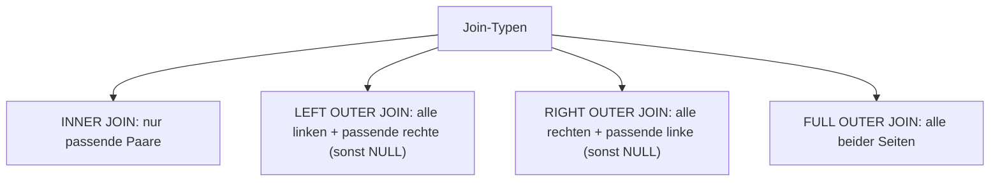
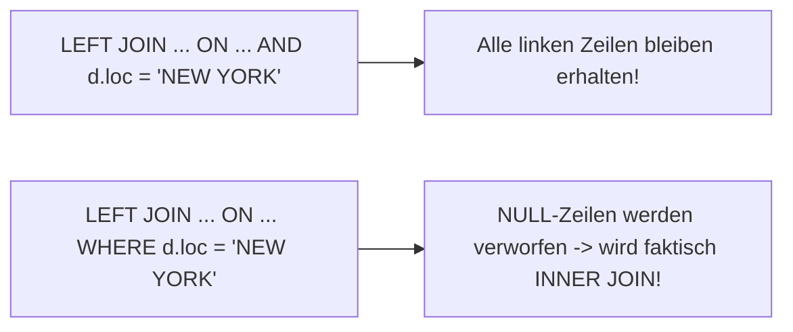
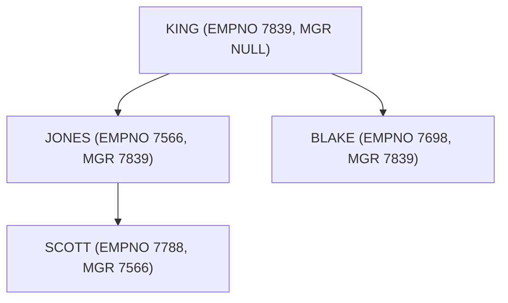

# Phase 5: Displaying Data from Multiple Tables — Joins (`L083`–`L102`)

**Exam Domain**: Domain 4 (*Displaying Data from Multiple Tables*, 10 %)  
**Verwendete Schemas**: `SCOTT` (`EMP`, `DEPT`, `SALGRADE`), `HR` (`EMPLOYEES`, `DEPARTMENTS`, `LOCATIONS`, `COUNTRIES`)  
**Interactive Studio**: [Phase 5 Tracker](https://chatelao.github.io/sql-schulung/#curriculum/phase-5) · [Join Visualizer](https://chatelao.github.io/sql-schulung/#labs/joins) · [FreeSQL Sandbox](https://chatelao.github.io/sql-schulung/#labs/freesql/phase-5) · [Flashcards D4](https://chatelao.github.io/sql-schulung/#flashcards/D4)

---

## Join Mental Model & `CROSS JOIN` (`L083`–`L085`)

### `L083` — Warum Joins existieren & Row-Matching-Intuition
- **Lernziel**: Du verstehst visuell, wie jede Zeile der linken Tabelle über einen Schlüsselwert ihre passende(n) Zeile(n) in der rechten Tabelle findet.
- **Studio-Link**: [Tracker `L083`](https://chatelao.github.io/sql-schulung/#curriculum/L083) · [Join Visualizer öffnen ↗](https://chatelao.github.io/sql-schulung/#labs/joins/INNER)

- **Selbstlern-Aufgabe:** Wie viele Spalten und wie viele Zeilen entstehen theoretisch, wenn `SCOTT.EMP` (14×8) und `SCOTT.DEPT` (4×3) gejoint werden?
  ??? success "Musterlösung & Erklärung"
      `8 + 3 = 11` Spalten; ohne Join-Bedingung `14 × 4 = 56` Zeilen (`CROSS JOIN`), mit `e.deptno = d.deptno` genau **14 Zeilen**.

### `L084` — Cartesian Products (`CROSS JOIN`)
- **Lernziel**: Du erkennst, wann ein Kreuzprodukt (`N × M` Zeilen) entsteht und wie du es mit `CROSS JOIN` explizit schreibst.
- **Studio-Link**: [Tracker `L084`](https://chatelao.github.io/sql-schulung/#curriculum/L084) · [Join Visualizer: CROSS ↗](https://chatelao.github.io/sql-schulung/#labs/joins/CROSS)
- **Beispiel**: `SELECT e.ename, d.dname FROM scott.emp e CROSS JOIN scott.dept d;` → **`14 × 4 = 56` Zeilen**.

- **Selbstlern-Aufgabe:** Lückentext: Erzeuge explizit das kartesische Produkt aus `scott.emp` und `scott.dept` (ANSI-Syntax):
```sql
SELECT e.ename, d.dname FROM scott.emp e ___ scott.dept d;
```
  ??? success "Musterlösung & Erklärung"
      ```sql
      SELECT e.ename, d.dname FROM scott.emp e CROSS JOIN scott.dept d;
      ```
      Ergebnis: `14 × 4 = 56` Zeilen.

### `L085` — Mehrdeutige Spalten auflösen (`ORA-00918`)
- **Lernziel**: Du qualifizierst gleichnamige Spalten konsequent mit Table Aliases.
- **Studio-Link**: [Tracker `L085`](https://chatelao.github.io/sql-schulung/#curriculum/L085)
- **Exam Trap**: `SELECT ename, deptno, dname FROM scott.emp e JOIN scott.dept d ON e.deptno = d.deptno;` wirft **`ORA-00918: column ambiguously defined`**, weil `deptno` in beiden Tabellen existiert. Lösung: `e.deptno` (oder `d.deptno`).

---

## `INNER JOIN ... ON`, `NATURAL JOIN` & `USING` (`L086`–`L092`)

- **Selbstlern-Aufgabe:** Warum wirft `SELECT ename, deptno, dname FROM scott.emp e JOIN scott.dept d ON e.deptno = d.deptno;` den Fehler `ORA-00918`?
  ??? success "Musterlösung & Erklärung"
      `deptno` existiert in beiden Tabellen. In der `SELECT`-Liste muss sie qualifiziert werden (`e.deptno` oder `d.deptno`).

### `L086` — Standard `INNER JOIN ... ON`
- **Lernziel**: Du verknüpfst zwei Tabellen über `INNER JOIN ... ON` und weißt, dass ungematchte Zeilen wegfallen.
- **Studio-Link**: [Tracker `L086`](https://chatelao.github.io/sql-schulung/#curriculum/L086)
- **Beispiel**:
  ```sql
  SELECT e.empno, e.ename, e.deptno, d.dname, d.loc
  FROM scott.emp e
  INNER JOIN scott.dept d ON e.deptno = d.deptno;
  ```
  **Erwartete Ausgabe**: 14 Zeilen — `DEPT 40 (OPERATIONS)` fehlt!

- **Selbstlern-Aufgabe:** Lückentext: Verbinde `scott.emp` und `scott.dept` per `INNER JOIN`, inklusive Abteilungsstandort `loc`:
```sql
SELECT e.ename, d.dname, d.loc FROM scott.emp e ___ scott.dept d ___ e.deptno = d.deptno;
```
  ??? success "Musterlösung & Erklärung"
      ```sql
      SELECT e.ename, d.dname, d.loc FROM scott.emp e INNER JOIN scott.dept d ON e.deptno = d.deptno;
      ```
      Liefert 14 Zeilen (`DEPT 40 OPERATIONS` hat keine Mitarbeitenden und fehlt).

### `L087` — Drei oder mehr Tabellen joinen (`HR`)
- **Lernziel**: Du verkettest 3–4 Tabellen über `JOIN ... ON` entlang des ERD.
- **Studio-Link**: [Tracker `L087`](https://chatelao.github.io/sql-schulung/#curriculum/L087)
- **Beispiel**:
  ```sql
  SELECT e.last_name, d.department_name, l.city, c.country_name
  FROM hr.employees e
  JOIN hr.departments d ON e.department_id = d.department_id
  JOIN hr.locations l   ON d.location_id = l.location_id
  JOIN hr.countries c   ON l.country_id = c.country_id;
  -- Erwartet: 106 Zeilen (Kimberely Grant hat department_id IS NULL!)
  ```

- **Selbstlern-Aufgabe:** Warum liefert der 4-Tabellen-`INNER JOIN` auf `hr.employees` (107 Zeilen) mit `hr.departments` nur **106 Zeilen**?
  ??? success "Musterlösung & Erklärung"
      `Kimberely Grant` hat `department_id IS NULL` — beim `INNER JOIN` gibt es keinen Match in `hr.departments`, also fällt sie heraus.

### `L088` — `WHERE` & `GROUP BY` mit Joins kombinieren
- **Lernziel**: Du filterst und aggregierst über gejointe Tabellen hinweg.
- **Studio-Link**: [Tracker `L088`](https://chatelao.github.io/sql-schulung/#curriculum/L088)
- **Selbstlern-Aufgabe**: Berechne je `d.dname` und `d.loc` in `SCOTT` die Mitarbeiteranzahl und Gehaltssumme für Mitarbeiter mit `e.sal >= 1000` (erwartet: 3 Zeilen).
  ??? success "Musterlösung & Erklärung"
      ```sql
      SELECT d.dname, d.loc, COUNT(*) AS cnt, SUM(e.sal) AS total_sal
      FROM scott.emp e
      JOIN scott.dept d ON e.deptno = d.deptno
      WHERE e.sal >= 1000
      GROUP BY d.dname, d.loc;
      ```

### `L089` — `NATURAL JOIN` & seine versteckte Multi-Column-Falle
- **Lernziel**: Du durchschaust die Risiken von `NATURAL JOIN` bei mehreren gleichnamigen Spalten.
- **Studio-Link**: [Tracker `L089`](https://chatelao.github.io/sql-schulung/#curriculum/L089)
- **Beispiel**:
  ```sql
  -- In SCOTT ok (nur DEPTNO stimmt überein -> 14 Zeilen):
  SELECT empno, ename, dname FROM scott.emp NATURAL JOIN scott.dept;

  -- FALLE IN HR: Sowohl DEPARTMENT_ID als auch MANAGER_ID sind gleichnamig!
  SELECT employee_id, last_name, department_name
  FROM hr.employees NATURAL JOIN hr.departments; -- Nur 32 statt 106 Zeilen!
  ```

- **Selbstlern-Aufgabe:** Welche versteckte Gefahr birgt `SELECT * FROM hr.employees NATURAL JOIN hr.departments;`?
  ??? success "Musterlösung & Erklärung"
      `NATURAL JOIN` joint automatisch über **alle** gleichnamigen Spalten — hier sowohl `department_id` als auch `manager_id`! Dadurch verschwinden fast alle Mitarbeitenden (nur 32 Zeilen statt 106).

### `L090` — `JOIN ... USING (col)`
- **Lernziel**: Du verknüpfst explizit benannte gleichnamige Spalten mit `USING`.
- **Studio-Link**: [Tracker `L090`](https://chatelao.github.io/sql-schulung/#curriculum/L090)
- **Beispiel**: `SELECT e.ename, deptno, d.dname FROM scott.emp e JOIN scott.dept d USING (deptno);` → 14 Zeilen.

- **Selbstlern-Aufgabe:** Lückentext: Schreibe den Join auf `scott.emp` und `scott.dept` mit `USING`:
```sql
SELECT e.ename, deptno, d.dname FROM scott.emp e JOIN scott.dept d ___ (deptno);
```
  ??? success "Musterlösung & Erklärung"
      ```sql
      SELECT e.ename, deptno, d.dname FROM scott.emp e JOIN scott.dept d USING (deptno);
      ```
      `deptno` steht **ohne** Tabellen-Qualifier.

### `L091` — Die `ORA-25154`-Regel (`USING`-Qualifier-Falle)
- **Lernziel**: Du vermeidest den häufigsten Prüfungsfehler bei `USING`.
- **Studio-Link**: [Tracker `L091`](https://chatelao.github.io/sql-schulung/#curriculum/L091)
- !!! warning "1Z0-171 Exam Trap (`ORA-25154`)"
    Setze vor eine in `USING (...)` aufgeführte Spalte **niemals** einen Tabellennamen oder Alias – weder in `SELECT`, `WHERE`, `GROUP BY` noch in `ORDER BY`! `SELECT e.deptno ... USING (deptno)` wirft **`ORA-25154`**.

- **Selbstlern-Aufgabe:** Korrigiere den `ORA-25154`-Fehler in `SELECT e.ename, e.deptno FROM scott.emp e JOIN scott.dept d USING (deptno);`.
  ??? success "Musterlösung & Erklärung"
      ```sql
      SELECT e.ename, deptno FROM scott.emp e JOIN scott.dept d USING (deptno);
      ```
      Eine in `USING (...)` genannte Spalte darf nirgends im Statement (auch nicht in `SELECT`/`WHERE`/`ORDER BY`) mit einem Tabellen-Alias qualifiziert werden!

### `L092` — Vergleich: `ON`, `USING` und `NATURAL JOIN`
- **Lernziel**: Du wählst für jede Anforderung die passende Join-Variante.
- **Studio-Link**: [Tracker `L092`](https://chatelao.github.io/sql-schulung/#curriculum/L092)

| Join-Art | Verknüpfte Spalten | Qualifier auf Join-Spalte erlaubt? | Ungleiche Spaltennamen möglich? |
| :--- | :--- | :---: | :---: |
| `JOIN ... ON` | Explizite Bedingung | **Ja** (Pflicht!) | **Ja** (`e.mgr = m.empno`) |
| `JOIN ... USING (c)` | Explizit benannte Spalte `c` | **Nein** (`ORA-25154`) | Nein |
| `NATURAL JOIN` | *Alle* gleichnamigen Spalten | **Nein** (`ORA-25155`) | Nein |

---

## Outer Joins (`LEFT`, `RIGHT`, `FULL`) (`L093`–`L096`)

- **Selbstlern-Aufgabe:** Wann musst du `JOIN ... ON` statt `USING` oder `NATURAL JOIN` verwenden?
  ??? success "Musterlösung & Erklärung"
      Immer dann, wenn die Join-Spalten **unterschiedlich heissen** (z. B. `e.mgr = m.empno`), bei **Non-Equijoins** (`BETWEEN`), oder wenn man mehrere gleichnamige Spalten kontrolliert auseinanderhalten will.

### `L093` — `LEFT OUTER JOIN` (`HR` Unassigned Employees)
- **Lernziel**: Du bewahrst alle Zeilen der linken Tabelle, auch ohne Treffer rechts.
- **Studio-Link**: [Tracker `L093`](https://chatelao.github.io/sql-schulung/#curriculum/L093) · [Join Visualizer: LEFT ↗](https://chatelao.github.io/sql-schulung/#labs/joins/LEFT)
- **Beispiel**: `SELECT e.last_name, d.department_name FROM hr.employees e LEFT OUTER JOIN hr.departments d ON e.department_id = d.department_id;` → 107 Zeilen (inkl. Kimberely Grant mit `NULL`).

- **Selbstlern-Aufgabe:** Lückentext: Zeige alle 107 `hr.employees` inklusive `Kimberely Grant` (ohne Abteilung):
```sql
SELECT e.last_name, d.department_name FROM hr.employees e ___ hr.departments d ON e.department_id = d.department_id;
```
  ??? success "Musterlösung & Erklärung"
      ```sql
      SELECT e.last_name, d.department_name FROM hr.employees e LEFT OUTER JOIN hr.departments d ON e.department_id = d.department_id;
      ```
      `Kimberely Grant` erscheint mit `department_name = NULL` (`107 Zeilen`).

### `L094` — `RIGHT OUTER JOIN` (`SCOTT.DEPT` #40 `OPERATIONS` erhalten)
- **Lernziel**: Du bewahrst alle Zeilen der rechten Tabelle.
- **Studio-Link**: [Tracker `L094`](https://chatelao.github.io/sql-schulung/#curriculum/L094) · [Join Visualizer: RIGHT ↗](https://chatelao.github.io/sql-schulung/#labs/joins/RIGHT)
- **Beispiel**: `SELECT e.ename, d.deptno, d.dname FROM scott.emp e RIGHT OUTER JOIN scott.dept d ON e.deptno = d.deptno;` → 15 Zeilen (14 Employees + `NULL | 40 | OPERATIONS`).

- **Selbstlern-Aufgabe:** Lückentext: Zeige alle Abteilungen aus `scott.dept` (inklusive `40 OPERATIONS`), auch wenn keine Mitarbeitenden zugeordnet sind:
```sql
SELECT d.dname, e.ename FROM scott.emp e ___ scott.dept d ON e.deptno = d.deptno;
```
  ??? success "Musterlösung & Erklärung"
      ```sql
      SELECT d.dname, e.ename FROM scott.emp e RIGHT OUTER JOIN scott.dept d ON e.deptno = d.deptno;
      ```
      Ergebnis: `15 Zeilen` (14 Mitarbeitende + `OPERATIONS` mit `ename = NULL`).

### `L095` — `FULL OUTER JOIN`
- **Lernziel**: Du bewahrst ungematchte Zeilen von **beiden** Seiten.
- **Studio-Link**: [Tracker `L095`](https://chatelao.github.io/sql-schulung/#curriculum/L095) · [Join Visualizer: FULL ↗](https://chatelao.github.io/sql-schulung/#labs/joins/FULL)

- **Selbstlern-Aufgabe:** Was leistet `FULL OUTER JOIN` zwischen `hr.employees` und `hr.departments`?
  ??? success "Musterlösung & Erklärung"
      Es bleiben sowohl Mitarbeitende ohne Abteilung (`Kimberely Grant`) als auch leere Abteilungen (mit `NULL` bei den Mitarbeiter-Spalten) im Ergebnis erhalten.

### `L096` — Outer Join `ON`- vs. `WHERE`-Filter-Falle
- **Lernziel**: Du platzierst optionale Filter auf die äußere Tabelle korrekt in `ON` statt `WHERE`.
- **Studio-Link**: [Tracker `L096`](https://chatelao.github.io/sql-schulung/#curriculum/L096)
- **Beispiel**:
  ```sql
  -- RICHTIG: Alle 4 Departments bleiben, nur CLERKs werden gejoint (7 Zeilen inkl. 30/40):
  SELECT d.dname, e.ename
  FROM scott.dept d
  LEFT JOIN scott.emp e ON d.deptno = e.deptno AND e.job = 'CLERK';

  -- FALLE: WHERE e.job = 'CLERK' entfernt DEPT 40 wieder -> nur 4 Zeilen!
  ```

---

## Self-Joins, Non-Equijoins & Reporting (`L097`–`L102`)

- **Selbstlern-Aufgabe:** Warum macht `LEFT JOIN scott.dept d ON ... WHERE d.loc = 'NEW YORK'` den Outer Join wirkungslos?
  ??? success "Musterlösung & Erklärung"
      Der `WHERE`-Filter läuft **nach** dem Join und verwirft alle erzeugten `NULL`-Zeilen (`d.loc IS NULL`). Filter auf die äussere Tabelle gehören in die **`ON`-Klausel** (`AND d.loc = 'NEW YORK'`).

### `L097` — Self-Join (`EMP` → `MGR`)
- **Lernziel**: Du verknüpfst eine Tabelle mit sich selbst über zwei verschiedene Table Aliases.
- **Studio-Link**: [Tracker `L097`](https://chatelao.github.io/sql-schulung/#curriculum/L097) · [Join Visualizer: SELF ↗](https://chatelao.github.io/sql-schulung/#labs/joins/SELF)
- **Beispiel**:
  ```sql
  SELECT e.ename AS employee, m.ename AS manager
  FROM scott.emp e
  LEFT JOIN scott.emp m ON e.mgr = m.empno;
  -- 14 Zeilen: KING hat manager = NULL
  ```

- **Selbstlern-Aufgabe:** Lückentext: Gib jeden Mitarbeiter aus `scott.emp` mit seinem Vorgesetzten (inkl. `KING`) aus:
```sql
SELECT e.ename AS mitarbeiter, NVL(m.ename, 'TOP') AS chef FROM scott.emp e ___ scott.emp m ON e.mgr = m.___;
```
  ??? success "Musterlösung & Erklärung"
      ```sql
      SELECT e.ename AS mitarbeiter, NVL(m.ename, 'TOP') AS chef FROM scott.emp e LEFT JOIN scott.emp m ON e.mgr = m.empno;
      ```
      `LEFT JOIN` bewahrt `KING` (`mgr IS NULL`, `14 Zeilen`).

### `L098` — Non-Equijoin (`SCOTT.EMP` + `SCOTT.SALGRADE`)
- **Lernziel**: Du joinst Tabellen über Wertebereiche (`BETWEEN`, `<`, `>`) statt `=`.
- **Studio-Link**: [Tracker `L098`](https://chatelao.github.io/sql-schulung/#curriculum/L098) · [Join Visualizer: NONEQUI ↗](https://chatelao.github.io/sql-schulung/#labs/joins/NONEQUI)
- **Beispiel**: `SELECT e.ename, e.sal, s.grade FROM scott.emp e JOIN scott.salgrade s ON e.sal BETWEEN s.losal AND s.hisal;` → 14 Zeilen.

- **Selbstlern-Aufgabe:** Lückentext: Ordne jedem Mitarbeiter in `scott.emp` seine Gehaltsstufe aus `scott.salgrade` zu:
```sql
SELECT e.ename, e.sal, s.grade FROM scott.emp e JOIN scott.salgrade s ON e.sal ___ s.losal ___ s.hisal;
```
  ??? success "Musterlösung & Erklärung"
      ```sql
      SELECT e.ename, e.sal, s.grade FROM scott.emp e JOIN scott.salgrade s ON e.sal BETWEEN s.losal AND s.hisal;
      ```
      Klassischer Non-Equijoin (`14 Zeilen`).

### `L099` — Legacy Oracle `(+)` Join-Syntax erkennen
- **Lernziel**: Du liest die ältere Oracle-`(+)`-Syntax sicher und übersetzt sie in ANSI-Outer-Joins.
- **Studio-Link**: [Tracker `L099`](https://chatelao.github.io/sql-schulung/#curriculum/L099)
- **Merkregel**: Das `(+)` steht immer auf der **optionalen/fehlenden** Seite (`WHERE e.deptno(+) = d.deptno` → alle `DEPT`-Zeilen bleiben erhalten = `RIGHT OUTER JOIN`). Ein `FULL OUTER JOIN` ist mit `(+)` **nicht** direkt möglich.

- **Selbstlern-Aufgabe:** Übersetze in ANSI-Syntax: `SELECT e.ename, d.dname FROM scott.emp e, scott.dept d WHERE e.deptno = d.deptno(+);`
  ??? success "Musterlösung & Erklärung"
      ```sql
      SELECT e.ename, d.dname FROM scott.emp e LEFT OUTER JOIN scott.dept d ON e.deptno = d.deptno;
      ```
      Das `(+)` steht bei Oracle-Legacy-Syntax auf der **optionalen** (NULL-ergänzten) Seite.

### `L100` — Multi-Way Join aus `EMP`, `DEPT`, `MGR` & `SALGRADE`
- **Lernziel**: Du kombinierst Equi-Join, Self-Join und Non-Equijoin in einer einzigen Query.
- **Studio-Link**: [Tracker `L100`](https://chatelao.github.io/sql-schulung/#curriculum/L100)
- **Selbstlern-Aufgabe**: Schreibe eine Query, die je Mitarbeiter in `SCOTT.EMP` seinen Namen, `d.dname`, den Namen seines Managers (`LEFT JOIN`), sein Gehalt und seinen `s.grade` ausgibt (erwartet: 14 Zeilen).
  ??? success "Musterlösung & Erklärung"
      ```sql
      SELECT e.ename, d.dname, m.ename AS manager, e.sal, s.grade
      FROM scott.emp e
      JOIN scott.dept d ON e.deptno = d.deptno
      LEFT JOIN scott.emp m ON e.mgr = m.empno
      JOIN scott.salgrade s ON e.sal BETWEEN s.losal AND s.hisal
      ORDER BY s.grade DESC, e.ename;
      ```

### `L101`–`L102` — Multi-Table Reporting Lab (`SCOTT` & `HR`)
- **Lernziel**: Du erstellst vollständige Fachberichte mit Joins, Aggregation und Outer-Join-Vollständigkeit.
- **Studio-Link**: [Tracker `L101`](https://chatelao.github.io/sql-schulung/#curriculum/L101) · [Tracker `L102`](https://chatelao.github.io/sql-schulung/#curriculum/L102)
- **Selbstlern-Aufgaben**:
  1. (`L101`) Liste **alle 4** `SCOTT.DEPT`-Abteilungen mit ihrer Mitarbeiteranzahl (inkl. `OPERATIONS = 0`!) und durchschnittlichem Gehalt (`0` bei leerer Abteilung) auf.
  2. (`L102`) Liste alle `HR`-Abteilungen (`department_name`) auf, inklusive der Abteilungen ohne Mitarbeiter, und zähle je Abteilung die Mitarbeiteranzahl (erwartet: 27 Zeilen).
  ??? success "Musterlösungen zu L101–L102"
      ```sql
      -- L101:
      SELECT d.dname, COUNT(e.empno) AS headcount, ROUND(AVG(NVL(e.sal, 0)), 2) AS avg_sal
      FROM scott.dept d
      LEFT JOIN scott.emp e ON d.deptno = e.deptno
      GROUP BY d.dname
      ORDER BY d.dname;

      -- L102:
      SELECT d.department_name, COUNT(e.employee_id) AS headcount
      FROM hr.departments d
      LEFT JOIN hr.employees e ON d.department_id = e.department_id
      GROUP BY d.department_name
      ORDER BY headcount DESC, d.department_name;
      ```

---
### Visuelle Orientierung: Join-Typen, Outer-Filter & Self-Join


*Alt-Text: Übersicht der vier ANSI-Join-Typen INNER, LEFT OUTER, RIGHT OUTER und FULL OUTER JOIN.*


*Alt-Text: Unterschied zwischen Filterung in der ON-Klausel vs. WHERE-Klausel bei einem LEFT OUTER JOIN.*


*Alt-Text: Self-Join-Hierarchie in SCOTT.EMP über die Spalten EMPNO und MGR.*

---

## Gemischtes Training & Differenzierung (Basis / Plus / Challenge)

- **Analyse-Aufgabe (Bloom: Analysieren):** Warum verwandelt `LEFT JOIN scott.dept d ON e.deptno = d.deptno WHERE d.loc = 'NEW YORK'` den Outer Join faktisch in einen Inner Join? *(Lösung: `WHERE` verwirft alle Zeilen mit `d.loc IS NULL`; der Filter muss ins `ON`.)*
- **Basis:** `INNER JOIN` zwischen `scott.emp` und `scott.dept`.
- **Plus:** `LEFT OUTER JOIN` auf `hr.employees` + `hr.departments` + `hr.locations` (alle 107 Zeilen erhalten!).
- **Challenge (Advanced-Ausblick):** Baue den Self-Join `EMP -> MGR` zu einer vollständigen Hierarchie mit `CONNECT BY` aus ([Modul 1](../advanced/modul-01-hierarchies.md)).

## Hybrid-Paaraufgaben (3 gemischte Paare: Remote + Vor Ort)

1. **Paaraufgabe A (Verschwundene Zeilen):** Führt auf `hr.employees` und `hr.departments` zuerst einen `INNER JOIN`, dann `LEFT OUTER JOIN` und schliesslich einen `LEFT OUTER JOIN` mit `WHERE d.location_id = 1700` aus. Markiert gemeinsam `Kimberely Grant` und erklärt, wann sie verschwindet.
2. **Paaraufgabe B (Self-Join Organigramm):** Erstellt in `scott.emp` eine Manager-Mitarbeiter-Liste (`e.ename || ' -> ' || NVL(m.ename, 'TOP')`), bei der auch `KING` erhalten bleibt.

## Praxis-Transfer in deinen Arbeitsalltag (Firmenbezug)

- **Aufgabe:** Skizziere zwei Tabellen aus deinem Fachbereich (z. B. *Aufträge* + *Kunden* oder *Tickets* + *Bearbeiter*), entscheide bewusst zwischen `INNER` und `LEFT OUTER JOIN` und prüfe, ob unzugeordnete Datensätze sichtbar bleiben müssen.
