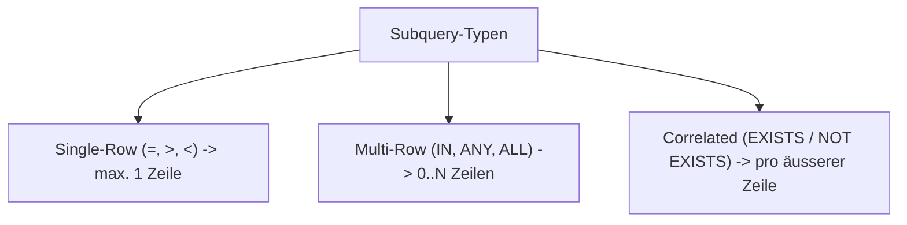
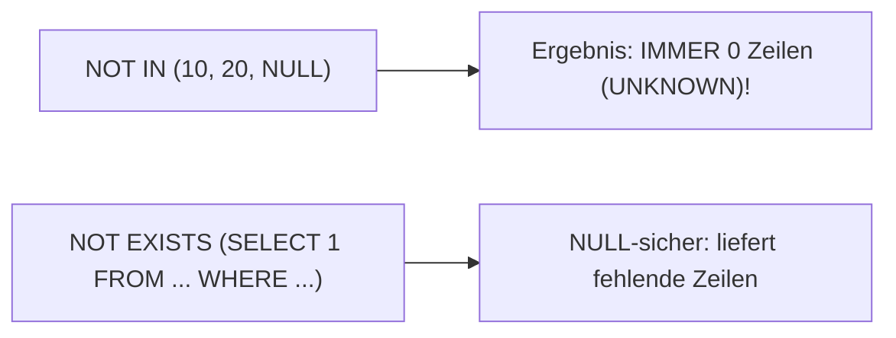
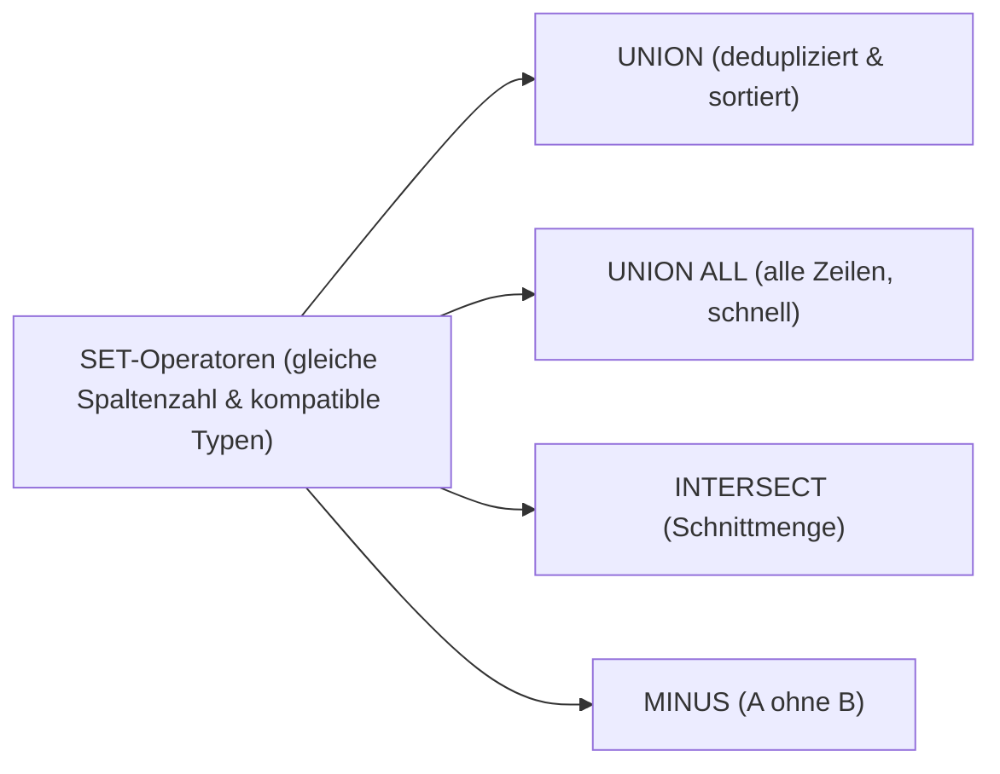

# Phase 6: Subqueries & Compound Queries (`L103`–`L122`)

**Exam Domains**: Domain 5 (*Using Subqueries*, 5 %) + Domain 6 (*Using SET Operators*, 5 %)  
**Verwendete Schemas**: `SCOTT.EMP`, `SCOTT.DEPT`, `HR.EMPLOYEES`, `HR.JOB_HISTORY`  
**Interactive Studio**: [Phase 6 Tracker](https://chatelao.github.io/sql-schulung/#curriculum/phase-6) · [FreeSQL Sandbox](https://chatelao.github.io/sql-schulung/#labs/freesql/phase-6) · [Join & SET Visualizer](https://chatelao.github.io/sql-schulung/#labs/joins/MINUS) · [Flashcards D5](https://chatelao.github.io/sql-schulung/#flashcards/D5) · [Flashcards D6](https://chatelao.github.io/sql-schulung/#flashcards/D6)

---

## Single-Row Subqueries (`L103`–`L107`)

### `L103` — Was ist eine Subquery? („Wer verdient mehr als `JONES`?“)
- **Lernziel**: Du verwendest verschachtelte `SELECT`-Abfragen in `WHERE`, wenn ein Vergleichswert zuerst aus der Datenbank ermittelt werden muss. *(Bloom: Anwenden)*
- **Studio-Link**: [Tracker `L103`](https://chatelao.github.io/sql-schulung/#curriculum/L103) · [SQL Ref: Using Subqueries](https://docs.oracle.com/en/database/oracle/oracle-database/26/sqlrf/Using-Subqueries.html)
- **Beispiel**:
  ```sql
  SELECT ename, sal
  FROM scott.emp
  WHERE sal > (SELECT sal FROM scott.emp WHERE ename = 'JONES');
  -- Erwartet: 3 Zeilen (SCOTT 3000, KING 5000, FORD 3000)
  ```

- **Selbstlern-Aufgabe:** Lückentext: Finde alle Mitarbeitenden in `scott.emp`, die mehr verdienen als `JONES`:
```sql
SELECT ename, sal FROM scott.emp WHERE sal > (SELECT ___ FROM scott.emp WHERE ename = 'JONES');
```
  ??? success "Musterlösung & Erklärung"
      ```sql
      SELECT ename, sal FROM scott.emp WHERE sal > (SELECT sal FROM scott.emp WHERE ename = 'JONES');
      ```
      `JONES` verdient `2975`; die äussere Query liefert `KING`, `FORD`, `SCOTT` (`3 Zeilen`).

### `L104` — Subqueries in `HAVING` und Scalar Subqueries in `SELECT`
- **Lernziel**: Du vergleichst Gruppenaggregate gegen einen Subquery-Wert (`HAVING`) und bettest skalare Subqueries in `SELECT`. *(Bloom: Anwenden)*
- **Studio-Link**: [Tracker `L104`](https://chatelao.github.io/sql-schulung/#curriculum/L104)
- **Beispiel**:
  ```sql
  -- Abteilungen, deren Mindestgehalt über dem Mindestgehalt von Dept 30 (950) liegt:
  SELECT deptno, MIN(sal) AS min_sal
  FROM scott.emp
  GROUP BY deptno
  HAVING MIN(sal) > (SELECT MIN(sal) FROM scott.emp WHERE deptno = 30);
  -- Erwartet: Dept 10 (1300)
  ```

- **Selbstlern-Aufgabe:** Lückentext: Zeige nur Abteilungen in `scott.emp`, deren Durchschnittsgehalt über dem Gesamtdurchschnitt liegt:
```sql
SELECT deptno, AVG(sal) FROM scott.emp GROUP BY deptno ___ AVG(sal) > (SELECT AVG(sal) FROM scott.emp);
```
  ??? success "Musterlösung & Erklärung"
      ```sql
      SELECT deptno, AVG(sal) FROM scott.emp GROUP BY deptno HAVING AVG(sal) > (SELECT AVG(sal) FROM scott.emp);
      ```
      Nur `DEPT 10` (`2916.67 > 2073.21`) bleibt übrig.

### `L105` — Der `ORA-01427`-Fehler (Single-Row Operator, Multi-Row Result)
- **Lernziel**: Du erkennst und behebst `ORA-01427: single-row subquery returns more than one row`. *(Bloom: Anwenden)*
- **Studio-Link**: [Tracker `L105`](https://chatelao.github.io/sql-schulung/#curriculum/L105)
- **Exam Trap**: `WHERE deptno = (SELECT deptno FROM scott.dept WHERE loc IN ('DALLAS', 'CHICAGO'))` schlägt mit `ORA-01427` fehl, weil `=` nur 1 Wert erwartet, die Subquery aber 2 liefert (`20`, `30`). Lösung: `IN` verwenden.

- **Selbstlern-Aufgabe:** Warum wirft `SELECT ename FROM scott.emp WHERE sal = (SELECT MIN(sal) FROM scott.emp GROUP BY deptno);` einen `ORA-01427`?
  ??? success "Musterlösung & Erklärung"
      Die Subquery liefert **3 Zeilen** (je ein Minimum pro `deptno`), aber `=` ist ein Single-Row-Operator. Korrekt wäre `IN` statt `=`.

### `L106` — Verhalten leerer Subqueries (liefert `NULL`)
- **Lernziel**: Du sagst das Verhalten einer Subquery mit 0 Ergebniszeilen korrekt voraus. *(Bloom: Anwenden)*
- **Studio-Link**: [Tracker `L106`](https://chatelao.github.io/sql-schulung/#curriculum/L106)
- **Konzept**: Gibt die innere Query 0 Zeilen zurück (`WHERE ename = 'NOBODY'`), liefert sie `NULL`. Das äußere `WHERE sal > NULL` wertet zu `UNKNOWN` aus → **0 Zeilen (kein Fehler!)**.

- **Selbstlern-Aufgabe:** Was liefert `SELECT ename FROM scott.emp WHERE sal > (SELECT sal FROM scott.emp WHERE ename = 'NOBODY');`?
  ??? success "Musterlösung & Erklärung"
      **0 Zeilen** (keinen Fehler!). Eine leere Single-Row-Subquery gibt `NULL` zurück, und `sal > NULL` ist `UNKNOWN`.

### `L107` — Single-Row Subquery Practice Lab
- **Lernziel**: Du kombinierst mehrere Single-Row Subqueries in einer Abfrage. *(Bloom: Anwenden)*
- **Studio-Link**: [Tracker `L107`](https://chatelao.github.io/sql-schulung/#curriculum/L107)
- **Selbstlern-Aufgabe**: Finde alle Mitarbeiter in `SCOTT.EMP`, die denselben `job` wie `SCOTT` haben, aber weniger verdienen als `KING` (erwartet: 2 Zeilen — `SCOTT` und `FORD`).
  ??? success "Musterlösung & Erklärung"
      ```sql
      SELECT ename, job, sal
      FROM scott.emp
      WHERE job = (SELECT job FROM scott.emp WHERE ename = 'SCOTT')
        AND sal < (SELECT sal FROM scott.emp WHERE ename = 'KING');
      ```

---

## Multi-Row Subqueries & die `NOT IN` + `NULL`-Falle (`L108`–`L112`)

### `L108` — `IN`, `ANY` und `ALL` Operators
- **Lernziel**: Du wendest Mengenoperatoren auf Subqueries mit mehreren Zeilen an. *(Bloom: Anwenden)*
- **Studio-Link**: [Tracker `L108`](https://chatelao.github.io/sql-schulung/#curriculum/L108) · [SQL Ref: IN Condition](https://docs.oracle.com/en/database/oracle/oracle-database/26/sqlrf/IN-Condition.html)
- **Merksatz**: `> ANY` = größer als das **Minimum**; `> ALL` = größer als das **Maximum**; `< ANY` = kleiner als das **Maximum**; `< ALL` = kleiner als das **Minimum**.
- **Beispiel**: `SELECT ename, sal FROM scott.emp WHERE sal > ALL (SELECT sal FROM scott.emp WHERE job = 'SALESMAN');` → 5 Zeilen (`> 1600`).

- **Selbstlern-Aufgabe:** Worin liegt der Unterschied zwischen `sal > ANY (1000, 2000, 3000)` und `sal > ALL (1000, 2000, 3000)`?
  ??? success "Musterlösung & Erklärung"
      `> ANY` bedeutet grösser als das **Minimum** (`> 1000`); `> ALL` bedeutet grösser als das **Maximum** (`> 3000`).

### `L109` — Die `NOT IN` + `NULL`-Falle auf `SCOTT.EMP` beweisen
- **Lernziel**: Du beweist und löst eine der berühmtesten `1Z0-171`-Prüfungsfallen. *(Bloom: Analysieren)*
- **Studio-Link**: [Tracker `L109`](https://chatelao.github.io/sql-schulung/#curriculum/L109)
- **Beispiel**:
  ```sql
  -- FALLE: Liefert 0 Zeilen, weil KING mgr = NULL hat!
  SELECT ename FROM scott.emp
  WHERE empno NOT IN (SELECT mgr FROM scott.emp);

  -- FIX: NULLs in der Subquery ausschließen -> liefert 8 Nicht-Manager!
  SELECT ename FROM scott.emp
  WHERE empno NOT IN (SELECT mgr FROM scott.emp WHERE mgr IS NOT NULL);
  ```

- **Selbstlern-Aufgabe:** Lückentext: Finde alle Mitarbeitenden in `scott.emp`, die **keine** Manager sind — einmal fehlerhaft mit `NOT IN` und einmal `NULL`-sicher:
```sql
SELECT ename FROM scott.emp WHERE empno NOT IN (SELECT mgr FROM scott.emp WHERE mgr ___);
```
  ??? success "Musterlösung & Erklärung"
      ```sql
      SELECT ename FROM scott.emp WHERE empno NOT IN (SELECT mgr FROM scott.emp WHERE mgr IS NOT NULL);
      ```
      Ohne `WHERE mgr IS NOT NULL` liefert `NOT IN` **0 Zeilen**, weil `KING` `mgr IS NULL` hat!

### `L110` — Warum `IN` mit `NULL` funktioniert, `NOT IN` aber scheitert
- **Lernziel**: Du leitest die 3-wertige Logik hinter `IN` vs. `NOT IN` exakt her. *(Bloom: Anwenden)*
- **Studio-Link**: [Tracker `L110`](https://chatelao.github.io/sql-schulung/#curriculum/L110)
- **Herleitung**:
  - `x IN (7839, NULL)` ≡ `(x = 7839) OR (x = NULL)` → `TRUE OR UNKNOWN` = **`TRUE`** (für Treffer).
  - `x NOT IN (7839, NULL)` ≡ `(x <> 7839) AND (x <> NULL)` → `TRUE AND UNKNOWN` = **`UNKNOWN`** (für *alle* Zeilen → 0 Treffer!).

- **Selbstlern-Aufgabe:** Erkläre kurz: Warum funktioniert `WHERE empno IN (7839, NULL)`, während `NOT IN (7839, NULL)` scheitert?
  ??? success "Musterlösung & Erklärung"
      `IN` nutzt `OR` (`= 7839 OR = NULL` → `TRUE OR UNKNOWN` = `TRUE`). `NOT IN` nutzt `AND` (`!= 7839 AND != NULL` → `TRUE AND UNKNOWN` = `UNKNOWN`).

### `L111`–`L112` — Multi-Row Subquery Drills (`HR.EMPLOYEES`)
- **Lernziel**: Du wendest `< ANY`, `> ALL` und Null-sicheres `NOT IN` sicher auf `HR.EMPLOYEES` an. *(Bloom: Anwenden)*
- **Studio-Link**: [Tracker `L111`](https://chatelao.github.io/sql-schulung/#curriculum/L111) · [Tracker `L112`](https://chatelao.github.io/sql-schulung/#curriculum/L112)
- **Selbstlern-Aufgaben**:
  1. (`L111`) Finde alle `HR.EMPLOYEES`, die weniger verdienen als *irgendein* `IT_PROG` (`< ANY`, erwartet: 47 Zeilen).
  2. (`L112`) Finde alle `HR.EMPLOYEES`, die keine Manager sind (`employee_id NOT IN (SELECT manager_id FROM hr.employees WHERE manager_id IS NOT NULL)`, erwartet: 89 Zeilen).
  ??? success "Musterlösungen zu L111–L112"
      ```sql
      -- L111:
      SELECT employee_id, last_name, salary FROM hr.employees
      WHERE salary < ANY (SELECT salary FROM hr.employees WHERE job_id = 'IT_PROG');
      -- L112:
      SELECT employee_id, last_name FROM hr.employees
      WHERE employee_id NOT IN (SELECT manager_id FROM hr.employees WHERE manager_id IS NOT NULL);
      ```

---

## Inline Views, Multi-Column & Correlated Subqueries (`L113`–`L116`)

### `L113` — Inline Views (Subqueries in `FROM`) & `WITH` Factoring
- **Lernziel**: Du berechnest Vor-Aggregationen in einer Inline View oder CTE (`WITH`) und joinst sie. *(Bloom: Anwenden)*
- **Studio-Link**: [Tracker `L113`](https://chatelao.github.io/sql-schulung/#curriculum/L113)
- **Beispiel**:
  ```sql
  SELECT e.ename, e.sal, d.avg_sal
  FROM scott.emp e
  JOIN (SELECT deptno, ROUND(AVG(sal), 2) AS avg_sal
        FROM scott.emp GROUP BY deptno) d
    ON e.deptno = d.deptno
  WHERE e.sal > d.avg_sal;
  -- Erwartet: 6 Zeilen
  ```

- **Selbstlern-Aufgabe:** Lückentext: Berechne mit einer `WITH`-CTE das Durchschnittsgehalt je Abteilung und filtere in der Hauptabfrage auf `avg_sal > 2000`:
```sql
___ dept_avg AS (SELECT deptno, AVG(sal) AS avg_sal FROM scott.emp GROUP BY deptno)
SELECT * FROM dept_avg WHERE avg_sal > 2000;
```
  ??? success "Musterlösung & Erklärung"
      ```sql
      WITH dept_avg AS (SELECT deptno, AVG(sal) AS avg_sal FROM scott.emp GROUP BY deptno)
      SELECT * FROM dept_avg WHERE avg_sal > 2000;
      ```
      Liefert `DEPT 10` und `DEPT 20`.

### `L114` — Pairwise vs. Non-Pairwise Multi-Column Subqueries
- **Lernziel**: Du unterscheidest tupelweisen Vergleich `(a, b) IN (...)` von unabhängigen Einzelvergleichen. *(Bloom: Analysieren)*
- **Studio-Link**: [Tracker `L114`](https://chatelao.github.io/sql-schulung/#curriculum/L114)
- **Beispiel**:
  ```sql
  -- Pairwise: exaktes Paar (job, deptno) aus der inneren Query
  SELECT ename, job, deptno FROM scott.emp
  WHERE (job, deptno) IN (SELECT job, deptno FROM scott.emp WHERE sal > 2900);
  ```

- **Selbstlern-Aufgabe:** Worin unterscheidet sich `WHERE (mgr, deptno) IN (SELECT mgr, deptno FROM ...)` (Pairwise) von zwei getrennten `IN`-Prädikaten (Non-Pairwise)?
  ??? success "Musterlösung & Erklärung"
      **Pairwise** verlangt, dass `mgr` und `deptno` aus **derselben** Subquery-Zeile stammen. **Non-Pairwise** kombiniert alle `mgr`-Werte unabhängig mit allen `deptno`-Werten (Kreuzkombinationen möglich).

### `L115` — Correlated Subqueries
- **Lernziel**: Du schreibst korrelierte Subqueries, die auf Spalten der äußeren Query verweisen. *(Bloom: Anwenden)*
- **Studio-Link**: [Tracker `L115`](https://chatelao.github.io/sql-schulung/#curriculum/L115)
- **Beispiel**:
  ```sql
  SELECT e.ename, e.sal, e.deptno FROM scott.emp e
  WHERE e.sal > (SELECT AVG(sal) FROM scott.emp i WHERE i.deptno = e.deptno);
  -- Erwartet: 6 Zeilen (ALLEN, JONES, BLAKE, SCOTT, KING, FORD)
  ```

- **Selbstlern-Aufgabe:** Lückentext: Finde per korrelierter Subquery alle Mitarbeitenden in `scott.emp`, die mehr verdienen als der Durchschnitt ihrer eigenen Abteilung:
```sql
SELECT e.ename, e.deptno, e.sal FROM scott.emp e
WHERE e.sal > (SELECT AVG(i.sal) FROM scott.emp i WHERE i.deptno = ___);
```
  ??? success "Musterlösung & Erklärung"
      ```sql
      SELECT e.ename, e.deptno, e.sal FROM scott.emp e
      WHERE e.sal > (SELECT AVG(i.sal) FROM scott.emp i WHERE i.deptno = e.deptno);
      ```
      Die innere Query referenziert `e.deptno` aus der äusseren Query (`6 Zeilen`).

### `L116` — `EXISTS` und `NOT EXISTS` (Null-Safe!)
- **Lernziel**: Du prüfst Existenz sicher mit `EXISTS`/`NOT EXISTS` statt `NOT IN`. *(Bloom: Anwenden)*
- **Studio-Link**: [Tracker `L116`](https://chatelao.github.io/sql-schulung/#curriculum/L116) · [SQL Ref: EXISTS](https://docs.oracle.com/en/database/oracle/oracle-database/26/sqlrf/EXISTS-Condition.html)
- **Beispiel**:
  ```sql
  SELECT d.deptno, d.dname FROM scott.dept d
  WHERE NOT EXISTS (SELECT 1 FROM scott.emp e WHERE e.deptno = d.deptno);
  -- Erwartet: 1 Zeile (40 OPERATIONS)
  ```

---

## `SET` Operators (`L117`–`L120`)

- **Selbstlern-Aufgabe:** Lückentext: Finde per `NOT EXISTS` alle Abteilungen in `scott.dept` ohne Mitarbeitende:
```sql
SELECT d.deptno, d.dname FROM scott.dept d
WHERE ___ (SELECT 1 FROM scott.emp e WHERE e.deptno = d.deptno);
```
  ??? success "Musterlösung & Erklärung"
      ```sql
      SELECT d.deptno, d.dname FROM scott.dept d
      WHERE NOT EXISTS (SELECT 1 FROM scott.emp e WHERE e.deptno = d.deptno);
      ```
      Liefert `40 OPERATIONS` — vollständig `NULL`-sicher!

### `L117` — `UNION` vs. `UNION ALL`
- **Lernziel**: Du kombinierst Ergebnismengen vertikal und kennst die Performance-/Duplikat-Unterschiede. *(Bloom: Analysieren)*
- **Studio-Link**: [Tracker `L117`](https://chatelao.github.io/sql-schulung/#curriculum/L117) · [SET Visualizer: UNION ↗](https://chatelao.github.io/sql-schulung/#labs/joins/UNION)

- **Selbstlern-Aufgabe:** Welcher Performance- und Ergebnisunterschied besteht zwischen `UNION` und `UNION ALL`?
  ??? success "Musterlösung & Erklärung"
      `UNION` sortiert beide Ergebnismengen und entfernt Duplikate. `UNION ALL` hängt alles direkt aneinander, behält Duplikate und ist deutlich schneller.

### `L118` — `INTERSECT` & `MINUS` (`EXCEPT` in 26ai/23ai)
- **Lernziel**: Du bildest Schnittmengen (`INTERSECT`) und Differenzmengen (`MINUS` / 26ai/23ai `EXCEPT`). *(Bloom: Anwenden)*
- **Studio-Link**: [Tracker `L118`](https://chatelao.github.io/sql-schulung/#curriculum/L118) · [SET Visualizer: MINUS ↗](https://chatelao.github.io/sql-schulung/#labs/joins/MINUS)
- **Beispiel**:
  ```sql
  -- Aktuelle Jobs in HR, die genau so auch in JOB_HISTORY stehen:
  SELECT employee_id, job_id FROM hr.employees
  INTERSECT
  SELECT employee_id, job_id FROM hr.job_history; -- 2 Zeilen
  ```

- **Selbstlern-Aufgabe:** Lückentext: Finde alle `job`-Bezeichnungen, die in `DEPT 10` **und** in `DEPT 30` vorkommen:
```sql
SELECT job FROM scott.emp WHERE deptno = 10
___
SELECT job FROM scott.emp WHERE deptno = 30;
```
  ??? success "Musterlösung & Erklärung"
      ```sql
      SELECT job FROM scott.emp WHERE deptno = 10
      INTERSECT
      SELECT job FROM scott.emp WHERE deptno = 30;
      ```
      Ergebnis: `CLERK` und `MANAGER`.

### `L119` — Spaltenabgleich, Dummy Columns & `ORDER BY`-Platzierung
- **Lernziel**: Du hältst alle 3 Syntax-Regeln für Compound Queries fehlerfrei ein. *(Bloom: Analysieren)*
- **Studio-Link**: [Tracker `L119`](https://chatelao.github.io/sql-schulung/#curriculum/L119)
- **Die 3 Regeln**:
  1. Gleiche **Spaltenanzahl** in jedem `SELECT` (fehlende Spalten über `TO_CHAR(NULL)`, `TO_NUMBER(NULL)` ergänzen).
  2. Kompatible **Datentyp-Gruppen** je Spaltenposition.
  3. Spaltenüberschriften stammen vom **1. `SELECT`**; `ORDER BY` darf **nur einmal ganz am Ende** stehen (`ORA-00933` sonst).

- **Selbstlern-Aufgabe:** Wo darf `ORDER BY` bei einer Compound Query stehen und welche Spaltennamen gelten?
  ??? success "Musterlösung & Erklärung"
      `ORDER BY` darf **nur ganz am Ende** nach der letzten Query stehen; es gelten ausschliesslich die Spaltennamen/Aliase der **ersten** `SELECT`-Liste.

### `L120` — Compound Query Lab (`HR.EMPLOYEES` + `HR.JOB_HISTORY`)
- **Lernziel**: Du kombinierst reale Historien- und Stammdaten mit `UNION ALL` und `MINUS`. *(Bloom: Anwenden)*
- **Studio-Link**: [Tracker `L120`](https://chatelao.github.io/sql-schulung/#curriculum/L120)
- **Selbstlern-Aufgabe**: Liste alle `employee_id` aus `HR.EMPLOYEES` auf, die **keinen** Eintrag in `HR.JOB_HISTORY` haben (`MINUS`, erwartet: 100 Zeilen), sortiert nach `employee_id`.
  ??? success "Musterlösung & Erklärung"
      ```sql
      SELECT employee_id FROM hr.employees
      MINUS
      SELECT employee_id FROM hr.job_history
      ORDER BY employee_id;
      ```

---

## Checkpoint #3 (`L121`–`L122`)

### `L121` — Identical Checkpoint #3 (Assessment)
- **Lernziel**: Du erreichst erstmals die Bestehensgrenze von **65 %**! *(Bloom: Anwenden)*
- **Studio-Link**: [Tracker `L121`](https://chatelao.github.io/sql-schulung/#curriculum/L121) · [Checkpoint `CP-3` starten ↗](https://chatelao.github.io/sql-schulung/#checkpoints/CP-3)
- **Erwartetes Niveau**: **65–72 %** gesamt.

- **Selbstlern-Aufgabe:** Absolviere [CP-3 im Studio](https://chatelao.github.io/sql-schulung/#checkpoints/CP-3) (22 Fragen + Part B + Part C).
  ??? success "Musterlösung & Erklärung"
      Meilenstein nach Phase 6: Erstmaliges Überschreiten der **65–72-%**-Prüfungsschwelle.

### `L122` — Fortschrittsvergleich & Reflexion (`CP-3` vs. `CP-0..2`)
- **Lernziel**: Du prüfst deine Wachstumskurve auf GitHub Pages und dokumentierst den Fokus für DML/DDL (Phasen 7–8). *(Bloom: Anwenden)*
- **Studio-Link**: [Tracker `L122`](https://chatelao.github.io/sql-schulung/#curriculum/L122) · [`CP-3` Reflexion](https://chatelao.github.io/sql-schulung/#checkpoints/CP-3)

---

- **Selbstlern-Aufgabe:** Prüfe nach `CP-3`, ob Joins (`Domain 4`) und Subqueries (`Domain 5`) über 65 % liegen; falls nicht, wiederhole `L096` und `L109`.
  ??? success "Musterlösung & Erklärung"
      Notiere die 2 wichtigsten Erkenntnisse im Reflexions-Log und exportiere ein Backup (`.json`).

### Visuelle Orientierung: Subqueries, NOT IN vs. NOT EXISTS & SET-Operatoren


*Alt-Text: Klassifikation von Subqueries in Single-Row, Multi-Row und Correlated Subqueries.*


*Alt-Text: Die NOT-IN-NULL-Falle im Vergleich zur NULL-sicheren NOT-EXISTS-Variante.*


*Alt-Text: Übersicht der vier SET-Operatoren UNION, UNION ALL, INTERSECT und MINUS.*

---

## Gemischtes Training & Differenzierung (Basis / Plus / Challenge)

- **Analyse-Aufgabe (Bloom: Analysieren):** Warum liefert `WHERE empno NOT IN (SELECT mgr FROM scott.emp)` 0 Zeilen, obwohl nur 6 Personen Manager sind? *(Lösung: `KING` hat `mgr IS NULL`, und `x != NULL` ergibt `UNKNOWN`.)*
- **Basis:** Single-Row Subquery (`sal > (SELECT AVG(sal) FROM scott.emp)`).
- **Plus:** Correlated Subquery + `NOT EXISTS` für Abteilungen ohne Mitarbeitende.
- **Challenge (Advanced-Ausblick):** Vergleiche `WITH`-CTE mit einer rekursiven CTE ([Modul 1](../advanced/modul-01-hierarchies.md)) oder `ROW_NUMBER()` ([Modul 5](../advanced/modul-05-window-pivoting.md)).

## Hybrid-Paaraufgaben (3 gemischte Paare: Remote + Vor Ort)

1. **Paaraufgabe A (`NOT IN` vs. `NOT EXISTS`):** Testet auf `scott.emp`: Warum liefert `WHERE empno NOT IN (SELECT mgr FROM emp)` **0 Zeilen**? Schreibt die sichere `NOT EXISTS`-Alternative.
2. **Paaraufgabe B (`SET`-Abgleich):** Findet mit `MINUS` (und alternativ mit `LEFT JOIN ... IS NULL`) alle `hr.departments`, die aktuell keine Mitarbeitenden haben.

## Praxis-Transfer in deinen Arbeitsalltag (Firmenbezug)

- **Aufgabe:** Formuliere eine typische Abweichungs- oder Ausreisser-Analyse aus deinem Job (*„Welche Kunden haben dieses Jahr bestellt, aber nicht letztes Jahr?“* oder *„Welche Positionen liegen über dem Gruppen-Durchschnitt?“*) mit `NOT EXISTS` / `MINUS` oder korrelierter Subquery.
