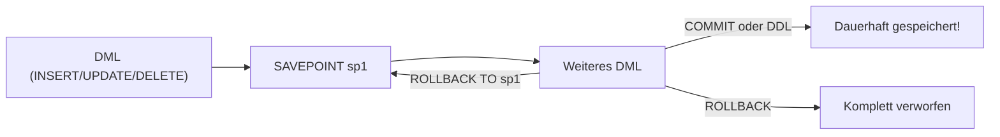
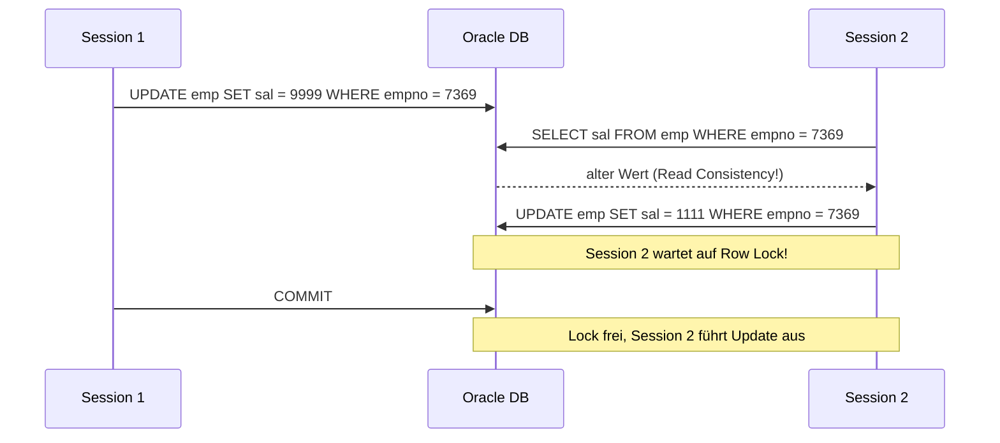
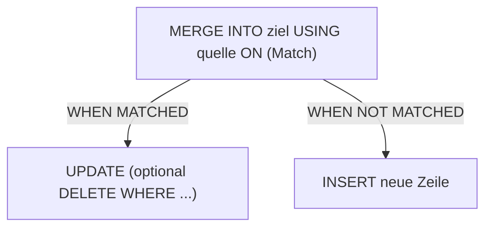

# Phase 7: Data Manipulation (DML) & Transactions (`L123`–`L138`)

**Exam Domain**: Domain 7 (*Managing Tables with DML*, 5 %)  
**Verwendete Schemas**: Persönliche beschreibbare Kopien von `SCOTT` (`my_dept`, `my_emp`)  
**Interactive Studio**: [Phase 7 Tracker](https://chatelao.github.io/sql-schulung/#curriculum/phase-7) · [FreeSQL Sandbox](https://chatelao.github.io/sql-schulung/#labs/freesql/phase-7) · [Flashcards D7](https://chatelao.github.io/sql-schulung/#flashcards/D7)

---

## `INSERT`, `UPDATE`, `DELETE` Grundlagen (`L123`–`L126`)

### `L123` — Deine beschreibbare Sandbox einrichten (`my_emp` & `my_dept`)
- **Lernziel**: Du legst eigene schreibbare Tabellenkopien an, um DML gefahrlos zu üben.
- **Studio-Link**: [Tracker `L123`](https://chatelao.github.io/sql-schulung/#curriculum/L123) · [SQL Ref: CREATE TABLE](https://docs.oracle.com/en/database/oracle/oracle-database/26/sqlrf/CREATE-TABLE.html)
- **Setup**:
  ```sql
  CREATE TABLE my_dept AS SELECT * FROM scott.dept;
  CREATE TABLE my_emp  AS SELECT * FROM scott.emp;
  ```

- **Selbstlern-Aufgabe:** Lückentext: Erstelle eine eigene Sandbox-Kopie `my_emp` von `scott.emp`:
```sql
CREATE TABLE my_emp ___ SELECT * FROM scott.emp;
```
  ??? success "Musterlösung & Erklärung"
      ```sql
      CREATE TABLE my_emp AS SELECT * FROM scott.emp;
      ```
      Achtung: `CTAS` führt ein implizites `COMMIT` aus!

### `L124` — `INSERT INTO ... VALUES` (Explizites & implizites `NULL`, `DEFAULT`)
- **Lernziel**: Du fügst neue Zeilen mit expliziten Spaltenlisten und `NULL`/`DEFAULT`-Werten ein.
- **Studio-Link**: [Tracker `L124`](https://chatelao.github.io/sql-schulung/#curriculum/L124) · [SQL Ref: INSERT](https://docs.oracle.com/en/database/oracle/oracle-database/26/sqlrf/INSERT.html)
- **Beispiel**:
  ```sql
  INSERT INTO my_dept (deptno, dname, loc) VALUES (50, 'ENGINEERING', 'BERLIN');
  INSERT INTO my_dept (deptno, dname) VALUES (60, 'DESIGN'); -- loc wird implizit NULL
  ```

- **Selbstlern-Aufgabe:** Lückentext: Füge einen neuen Mitarbeiter (`empno = 9001`, `ename = 'MUSTER'`, `sal = 2500`, `deptno = 10`) in `my_emp` ein und bestätige mit `SELECT`:
```sql
INSERT INTO my_emp (empno, ename, sal, deptno) ___ (9001, 'MUSTER', 2500, 10);
```
  ??? success "Musterlösung & Erklärung"
      ```sql
      INSERT INTO my_emp (empno, ename, sal, deptno) VALUES (9001, 'MUSTER', 2500, 10);
      ```
      Nicht genannte Spalten erhalten `NULL` (oder ihren `DEFAULT`-Wert).

### `L125` — `UPDATE` Statements & `WHERE`-Sicherheitsgewohnheiten
- **Lernziel**: Du änderst Datensätze gezielt und prüfst den Filter vorab mit `SELECT`.
- **Studio-Link**: [Tracker `L125`](https://chatelao.github.io/sql-schulung/#curriculum/L125)
- **Praxisregel**: Teste die `WHERE`-Bedingung immer zuerst mit `SELECT * FROM my_emp WHERE deptno = 20;`, bevor du `UPDATE my_emp SET sal = sal * 1.10 WHERE deptno = 20;` ausführst! Ohne `WHERE` werden **alle** Zeilen geändert.

- **Selbstlern-Aufgabe:** Erhöhe das Gehalt in `my_emp` nur für `deptno = 20` um 10 % — wie schützt du dich vor einem Update ohne `WHERE`?
  ??? success "Musterlösung & Erklärung"
      ```sql
      UPDATE my_emp SET sal = sal * 1.10 WHERE deptno = 20;
      ```
      Schutzregel: Immer zuerst `SELECT * FROM my_emp WHERE deptno = 20;` testen, erst danach `UPDATE` ausführen (und im Notfall `ROLLBACK;`).

### `L126` — `DELETE` vs. Referential Integrity Errors (`ORA-02292`)
- **Lernziel**: Du löschst Zeilen sicher und verstehst `ORA-02292` bei Foreign-Key-Beziehungen.
- **Studio-Link**: [Tracker `L126`](https://chatelao.github.io/sql-schulung/#curriculum/L126) · [SQL Ref: DELETE](https://docs.oracle.com/en/database/oracle/oracle-database/26/sqlrf/DELETE.html)
- **Exam Trap**: Das Löschen einer Parent Row in `DEPT` (z. B. `deptno = 10`), solange noch Child Rows in `EMP` existieren, wirft `ORA-02292: integrity constraint violated - child record found`. *(Hinweis: `my_dept`/`my_emp` aus `CTAS` haben noch keinen FK; in Phase 8 baust du diesen explizit ein.)*

---

## Subquery-gestütztes & Correlated DML (`L127`–`L128`)

- **Selbstlern-Aufgabe:** Warum scheitert `DELETE FROM my_dept WHERE deptno = 10;` mit `ORA-02292`, wenn ein Foreign Key aus `my_emp` existiert?
  ??? success "Musterlösung & Erklärung"
      `ORA-02292` (*integrity constraint violated - child record found*): Solange noch Mitarbeitende auf `deptno = 10` verweisen, verhindert Oracle ohne `ON DELETE CASCADE`/`SET NULL` das Löschen.

### `L127` — `INSERT INTO ... SELECT`
- **Lernziel**: Du überträgst Zeilen aus einer Abfrage direkt in eine Zieltabelle.
- **Studio-Link**: [Tracker `L127`](https://chatelao.github.io/sql-schulung/#curriculum/L127)
- **Beispiel**:
  ```sql
  INSERT INTO my_emp (empno, ename, job, sal, deptno)
  SELECT employee_id, UPPER(SUBSTR(last_name, 1, 10)), 'STAFF', salary, 50
  FROM hr.employees
  WHERE department_id = 60;
  ```

- **Selbstlern-Aufgabe:** Lückentext: Kopiere alle Zeilen aus `scott.emp` mit `sal >= 3000` in eine vorbereitete Tabelle `high_earners(empno, ename, sal)`:
```sql
INSERT INTO high_earners (empno, ename, sal) ___ empno, ename, sal FROM scott.emp WHERE sal >= 3000;
```
  ??? success "Musterlösung & Erklärung"
      ```sql
      INSERT INTO high_earners (empno, ename, sal) SELECT empno, ename, sal FROM scott.emp WHERE sal >= 3000;
      ```
      Bei `INSERT INTO ... SELECT` wird **kein** `VALUES` geschrieben!

### `L128` — Correlated `UPDATE` und Correlated `DELETE`
- **Lernziel**: Du aktualisierst oder löschst Zeilen dynamisch auf Basis von Werten derselben oder einer anderen Tabelle.
- **Studio-Link**: [Tracker `L128`](https://chatelao.github.io/sql-schulung/#curriculum/L128)
- **Beispiel**:
  ```sql
  UPDATE my_emp e
  SET sal = (SELECT MAX(sal) FROM my_emp m WHERE m.deptno = e.deptno)
  WHERE job = 'CLERK';

  DELETE FROM my_dept d
  WHERE NOT EXISTS (SELECT 1 FROM my_emp e WHERE e.deptno = d.deptno);
  ```

---

## Multi-Table `INSERT` & `MERGE` (`L129`–`L132`)

- **Selbstlern-Aufgabe:** Lückentext: Setze in `my_emp` das Gehalt von `SMITH` auf das Durchschnittsgehalt der `DEPT 10`:
```sql
UPDATE my_emp SET sal = (SELECT ___ FROM scott.emp WHERE deptno = 10) WHERE ename = 'SMITH';
```
  ??? success "Musterlösung & Erklärung"
      ```sql
      UPDATE my_emp SET sal = (SELECT AVG(sal) FROM scott.emp WHERE deptno = 10) WHERE ename = 'SMITH';
      ```
      Immer prüfen, dass die Subquery höchstens 1 Zeile liefert.

### `L129` — Unconditional `INSERT ALL`
- **Lernziel**: Du schreibst eine Quellzeile gleichzeitig in mehrere Zieltabellen.
- **Studio-Link**: [Tracker `L129`](https://chatelao.github.io/sql-schulung/#curriculum/L129)
- **Beispiel**:
  ```sql
  -- Zieltabellen einmalig anlegen:
  CREATE TABLE high_earners (empno NUMBER(4), ename VARCHAR2(10), sal NUMBER(7,2));
  CREATE TABLE emp_audit    (empno NUMBER(4), audit_date DATE);

  INSERT ALL
    INTO high_earners (empno, ename, sal) VALUES (empno, ename, sal)
    INTO emp_audit    (empno, audit_date)  VALUES (empno, SYSDATE)
  SELECT empno, ename, sal FROM scott.emp WHERE sal >= 2500;
  -- Fügt 5 Zeilen in high_earners UND 5 Zeilen in emp_audit ein (10 rows inserted)!
  ```

- **Selbstlern-Aufgabe:** Wie lautet die Grundsyntax eines bedingungslosen `INSERT ALL` in Oracle?
  ??? success "Musterlösung & Erklärung"
      ```sql
      INSERT ALL
        INTO high_earners (empno, ename, sal) VALUES (empno, ename, sal)
        INTO emp_audit (empno, audit_note) VALUES (empno, 'Imported')
      SELECT empno, ename, sal FROM scott.emp WHERE deptno = 10;
      ```

### `L130` — Conditional `INSERT ALL` vs. `INSERT FIRST`
- **Lernziel**: Du unterscheidest Mehrfach-Treffer (`INSERT ALL`) von Ersttreffer-Stopp (`INSERT FIRST`).
- **Studio-Link**: [Tracker `L130`](https://chatelao.github.io/sql-schulung/#curriculum/L130)
- **Regel**:
  - `INSERT ALL`: wertet **jede `WHEN`**-Klausel für jede Zeile aus (eine Zeile kann in mehreren Zieltabellen landen).
  - `INSERT FIRST`: stoppt beim **ersten zutreffenden `WHEN`** (optional mit `ELSE`).

- **Selbstlern-Aufgabe:** Worin unterscheidet sich `INSERT ALL` (conditional) von `INSERT FIRST`?
  ??? success "Musterlösung & Erklärung"
      `INSERT ALL` prüft **alle** `WHEN`-Zweige und kann eine Quellzeile in mehrere Zieltabellen einfügen. `INSERT FIRST` stoppt nach dem **ersten** passenden `WHEN`-Zweig.

### `L131` — Das `MERGE` Statement (Upsert)
- **Lernziel**: Du kombinierst `UPDATE`, `DELETE` und `INSERT` atomar in einem `MERGE`.
- **Studio-Link**: [Tracker `L131`](https://chatelao.github.io/sql-schulung/#curriculum/L131) · [SQL Ref: MERGE](https://docs.oracle.com/en/database/oracle/oracle-database/26/sqlrf/MERGE.html)
- **Beispiel**:
  ```sql
  MERGE INTO my_emp tgt
  USING scott.emp src ON (tgt.empno = src.empno)
  WHEN MATCHED THEN
    UPDATE SET tgt.sal = src.sal, tgt.comm = src.comm
    DELETE WHERE tgt.job = 'CLERK'
  WHEN NOT MATCHED THEN
    INSERT (empno, ename, job, sal, deptno)
    VALUES (src.empno, src.ename, src.job, src.sal, src.deptno);
  ```
- !!! warning "1Z0-171 Exam Trap"
    `DELETE WHERE` innerhalb eines `MERGE` löscht ausschließlich Zeilen, die in genau diesem `MERGE` **gematcht und aktualisiert** wurden (ausgewertet anhand ihrer *neuen* Werte nach dem `UPDATE`).

- **Selbstlern-Aufgabe:** Lückentext: Vervollständige das `MERGE`-Statement (Update bei Match, sonst Insert):
```sql
MERGE INTO my_emp t USING scott.emp s ON (t.empno = s.empno)
WHEN ___ THEN UPDATE SET t.sal = s.sal
WHEN ___ THEN INSERT (empno, ename, sal) VALUES (s.empno, s.ename, s.sal);
```
  ??? success "Musterlösung & Erklärung"
      ```sql
      MERGE INTO my_emp t USING scott.emp s ON (t.empno = s.empno)
      WHEN MATCHED THEN UPDATE SET t.sal = s.sal
      WHEN NOT MATCHED THEN INSERT (empno, ename, sal) VALUES (s.empno, s.ename, s.sal);
      ```
      Achtung: `ON`-Spalten (`t.empno`) dürfen im `UPDATE SET` nicht verändert werden!

### `L132` — `MERGE` & Multi-Table Insert Lab
- **Lernziel**: Du wendest `INSERT FIRST` und `MERGE` selbstständig an.
- **Studio-Link**: [Tracker `L132`](https://chatelao.github.io/sql-schulung/#curriculum/L132)
- **Selbstlern-Aufgabe**: Erstelle zwei Tabellen `tier_top (empno, ename, sal)` und `tier_rest (empno, ename, sal)` und verteile `SCOTT.EMP` per `INSERT FIRST`: `WHEN sal >= 3000 THEN INTO tier_top ... ELSE INTO tier_rest ...`. Prüfe danach die Zeilenzahlen (erwartet: 3 in `tier_top`, 11 in `tier_rest`).
  ??? success "Musterlösung & Erklärung"
      ```sql
      CREATE TABLE tier_top  (empno NUMBER(4), ename VARCHAR2(10), sal NUMBER(7,2));
      CREATE TABLE tier_rest (empno NUMBER(4), ename VARCHAR2(10), sal NUMBER(7,2));

      INSERT FIRST
        WHEN sal >= 3000 THEN INTO tier_top  VALUES (empno, ename, sal)
        ELSE                  INTO tier_rest VALUES (empno, ename, sal)
      SELECT empno, ename, sal FROM scott.emp;
      ```

---

## Transactions, Implicit Commits & Locking (`L133`–`L138`)

### `L133` — `COMMIT`, `ROLLBACK` & `SAVEPOINT`
- **Lernziel**: Du steuerst Transaktionen gezielt und rollst Teiländerungen auf einen `SAVEPOINT` zurück.
- **Studio-Link**: [Tracker `L133`](https://chatelao.github.io/sql-schulung/#curriculum/L133) · [SQL Ref: COMMIT](https://docs.oracle.com/en/database/oracle/oracle-database/26/sqlrf/COMMIT.html)
- **Beispiel**:
  ```sql
  UPDATE my_emp SET sal = 9999 WHERE empno = 7369;
  SAVEPOINT sp_raise;
  DELETE FROM my_emp WHERE deptno = 30;
  ROLLBACK TO SAVEPOINT sp_raise; -- Macht nur DELETE rückgängig, UPDATE bleibt!
  COMMIT;
  ```

- **Selbstlern-Aufgabe:** Was passiert nach `INSERT ...; SAVEPOINT sp1; DELETE ...; ROLLBACK TO sp1;`?
  ??? success "Musterlösung & Erklärung"
      Das `DELETE` wird rückgängig gemacht, das `INSERT` bleibt **uncommitted** bestehen! Die Transaktion ist noch offen bis `COMMIT` oder `ROLLBACK`.

### `L134` — Implicit `COMMIT` & `ROLLBACK` Triggers
- **Lernziel**: Du weißt exakt, wann Oracle eine Transaktion automatisch festschreibt oder zurückrollt.
- **Studio-Link**: [Tracker `L134`](https://chatelao.github.io/sql-schulung/#curriculum/L134) · [SQL Ref: ROLLBACK](https://docs.oracle.com/en/database/oracle/oracle-database/26/sqlrf/ROLLBACK.html)
- **Auto-`COMMIT`**: Jedes DDL (`CREATE`, `ALTER`, `DROP`, `TRUNCATE`), jedes DCL (`GRANT`, `REVOKE`), reguläres `EXIT` aus `sqlplus`.
- **Auto-`ROLLBACK`**: Verbindungsabbruch, Session-Absturz, explizites `ROLLBACK`.

- **Selbstlern-Aufgabe:** Nenne zwei Ereignisse, die ein **implizites `COMMIT`** auslösen.
  ??? success "Musterlösung & Erklärung"
      1. Jedes **DDL**-Statement (`CREATE`, `ALTER`, `DROP`, `TRUNCATE`).
      2. Normales Beenden von `sqlplus`/`sqlcl` mit `EXIT` (Absturz führt dagegen zu implizitem `ROLLBACK`).

### `L135` — Read Consistency (Readers Never Block Writers)
- **Lernziel**: Du verstehst Oracles Undo-basiertes Snapshot-Modell für parallele Sessions.
- **Studio-Link**: [Tracker `L135`](https://chatelao.github.io/sql-schulung/#curriculum/L135)

- **Selbstlern-Aufgabe:** Session 1 führt `UPDATE my_emp SET sal = 9999 WHERE empno = 7369;` ohne `COMMIT` aus. Was sieht Session 2 bei `SELECT sal`?
  ??? success "Musterlösung & Erklärung"
      Session 2 sieht weiterhin den **alten Wert** (`800`) — Oracle garantiert *Read Consistency* („Readers never block writers“).

### `L136` — Row-Level Locking & `SELECT ... FOR UPDATE`
- **Lernziel**: Du weißt, dass Oracle nur geänderte Zeilen sperrt, und nutzt `FOR UPDATE [NOWAIT | WAIT n | SKIP LOCKED]`.
- **Studio-Link**: [Tracker `L136`](https://chatelao.github.io/sql-schulung/#curriculum/L136)

- **Selbstlern-Aufgabe:** Wozu dient `SELECT * FROM my_emp WHERE deptno = 10 FOR UPDATE NOWAIT;`?
  ??? success "Musterlösung & Erklärung"
      Es sperrt alle Zeilen der `DEPT 10` exklusiv bis zum `COMMIT`/`ROLLBACK` und bricht sofort mit `ORA-00054` ab, falls eine andere Session bereits einen Lock hält.

### `L137`–`L138` — Two-Session Concurrency Lab (Schritt-für-Schritt-Anleitung)
- **Lernziel**: Du beobachtest Read Consistency und Row Locking live zwischen zwei Sessions.
- **Studio-Link**: [Tracker `L137`](https://chatelao.github.io/sql-schulung/#curriculum/L137) · [Tracker `L138`](https://chatelao.github.io/sql-schulung/#curriculum/L138)
- **Durchführung** (*Variante A*: `sqlcl` + VS Code; *Variante B*: 2 Tabs in **OCI Always Free Database Actions**):

| Schritt | Session 1 (Writer) | Session 2 (Reader / zweiter Writer) | Beobachtung |
| :---: | :--- | :--- | :--- |
| **1** | `UPDATE my_emp SET sal = 9999 WHERE empno = 7369;` *(ohne COMMIT!)* | — | Row `7369` ist für andere Writer gesperrt |
| **2** | — | `SELECT sal FROM my_emp WHERE empno = 7369;` | Sieht noch **`800`** (Read Consistency!) |
| **3** | — | `UPDATE my_emp SET sal = 1111 WHERE empno = 7369;` | **Blockiert / wartet**, bis Session 1 entscheidet |
| **4** | `COMMIT;` | *(läuft sofort weiter)* | Erst nach `COMMIT` wird Session 2 entsperrt |

---

- **Selbstlern-Aufgabe:** Führe das Two-Session-Drehbuch in zwei Tabs (oder im Hybrid-Paar) durch und beobachte, wann der Lock in Session 2 freigegeben wird.
  ??? success "Musterlösung & Erklärung"
      Session 2 hängt genau so lange, bis Session 1 `COMMIT` oder `ROLLBACK` ausführt — erst dann wird das `UPDATE` in Session 2 ausgeführt.

### Visuelle Orientierung: Transaktionen, Savepoints & Zwei-Session-Locking


*Alt-Text: Transaktions-Lebenszyklus mit SAVEPOINT, ROLLBACK TO SAVEPOINT, ROLLBACK und COMMIT inklusive implizitem DDL-Commit.*


*Alt-Text: Sequenzdiagramm zum Zwei-Session-Verhalten mit Read Consistency und Row-Level-Locking.*


*Alt-Text: Verzweigungslogik von MERGE INTO für Upsert-Operationen.*

---

## Hybrid-Paaraufgaben (3 gemischte Paare: Remote + Vor Ort)

1. **Paaraufgabe A (Zwei-Session-Locking live):** Beide Partner arbeiten mit demselben Test-Datensatz bzw. beobachten Session 1 (`UPDATE` ohne `COMMIT`) und Session 2 (`SELECT` vor/nach `COMMIT`, danach `UPDATE` auf dieselbe Zeile). Protokolliert Lese-Konsistenz und Lock-Verhalten.
2. **Paaraufgabe B (`SAVEPOINT` & impliziter `COMMIT`):** Führt `INSERT` → `SAVEPOINT sp1` → `UPDATE` → `ROLLBACK TO sp1` aus und testet anschliessend die Wirkung eines `CREATE TABLE`-Statements auf die offene Transaktion.

## Praxis-Transfer in deinen Arbeitsalltag (Firmenbezug)

- **Aufgabe:** Entwirf für eine regelmässige Datenübernahme in deinem Umfeld einen `MERGE INTO`-Ablauf (Upsert) und definiere, wo `COMMIT`, `ROLLBACK` und Fehlerbehandlung greifen müssen.
