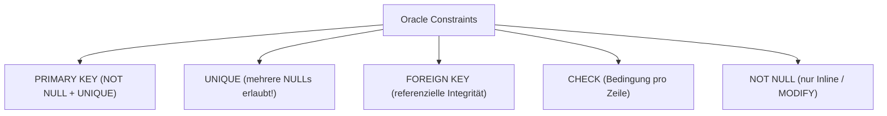
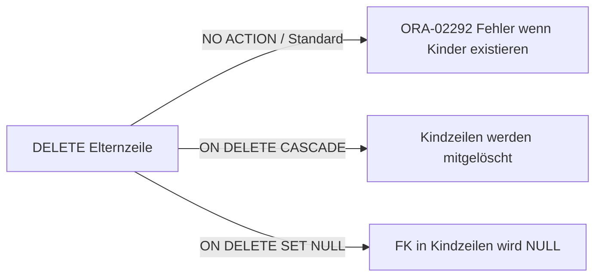
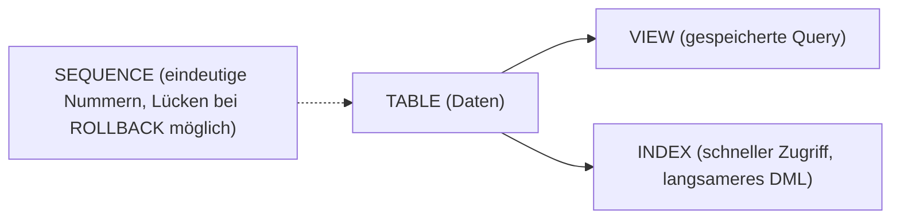

# Phase 8: DDL, Constraints, Views, Sequences, Indexes & Synonyms (`L139`–`L162`)

**Exam Domains**: Domain 8 (*DDL for Tables & Relationships*, 15 %) + Domain 9 (*Indexes, Synonyms & Sequences*, 5 %)  
**Interactive Studio**: [Phase 8 Tracker](https://chatelao.github.io/sql-schulung/#curriculum/phase-8) · [FreeSQL Sandbox](https://chatelao.github.io/sql-schulung/#labs/freesql/phase-8) · [Flashcards D8](https://chatelao.github.io/sql-schulung/#flashcards/D8) · [Flashcards D9](https://chatelao.github.io/sql-schulung/#flashcards/D9)

---

## Data Types, `CREATE TABLE`, `CTAS` & `ALTER TABLE` (`L139`–`L144`)

### `L139` — Object Naming Rules & zentrale Oracle Data Types
- **Lernziel**: Du wählst passende Datentypen (`VARCHAR2`, `CHAR`, `NUMBER(p,s)`, `DATE`, `CLOB`, `BLOB`, 23ai `BOOLEAN`) und kennst Namensregeln. *(Bloom: Erinnern)*
- **Studio-Link**: [Tracker `L139`](https://chatelao.github.io/sql-schulung/#curriculum/L139) · [SQL Ref: Data Types](https://docs.oracle.com/en/database/oracle/oracle-database/26/sqlrf/Data-Types.html)
- **Exam Trap**: Bei `NUMBER(5, -2)` rundet eine negative Scale `-2` auf den nächsten **Hunderter**: `1256` wird als **`1300`** gespeichert!

- **Selbstlern-Aufgabe:** Welche zwei Aussagen über Oracle-Objektnamen und `VARCHAR2` vs. `CHAR` sind richtig?
  ??? success "Musterlösung & Erklärung"
      1. Standard-Bezeichner beginnen mit einem Buchstaben und sind (ab 12.2+) bis **128 Bytes** lang.
      2. `VARCHAR2(20)` speichert variable Länge, `CHAR(20)` füllt immer rechts mit Leerzeichen auf 20 auf.

### `L140` — `CREATE TABLE` & `DEFAULT` Values
- **Lernziel**: Du erstellst eigene Tabellen mit Spaltendefinitionen und Standardwerten. *(Bloom: Anwenden)*
- **Studio-Link**: [Tracker `L140`](https://chatelao.github.io/sql-schulung/#curriculum/L140)
- **Beispiel**:
  ```sql
  CREATE TABLE projects (
      proj_id    NUMBER(6),
      proj_name  VARCHAR2(50) NOT NULL,
      start_date DATE DEFAULT SYSDATE,
      is_active  BOOLEAN DEFAULT TRUE
  );
  ```

- **Selbstlern-Aufgabe:** Lückentext: Lege eine Tabelle `projekte` mit Standardwert `SYSDATE` für `erstellt_am` an:
```sql
CREATE TABLE projekte (id NUMBER(6), name VARCHAR2(50), erstellt_am DATE ___ SYSDATE);
```
  ??? success "Musterlösung & Erklärung"
      ```sql
      CREATE TABLE projekte (id NUMBER(6), name VARCHAR2(50), erstellt_am DATE DEFAULT SYSDATE);
      ```

### `L141` — `CREATE TABLE ... AS SELECT` (`CTAS`) Falle
- **Lernziel**: Du weißt exakt, welche Metadaten `CTAS` übernimmt und welche verloren gehen. *(Bloom: Anwenden)*
- **Studio-Link**: [Tracker `L141`](https://chatelao.github.io/sql-schulung/#curriculum/L141)
- !!! warning "1Z0-171 Exam Trap"
    `CTAS` kopiert Spaltennamen, Datentypen, Zeilen und **nur explizite `NOT NULL`-Constraints**. Es kopiert **keine** `PRIMARY KEY`-, `FOREIGN KEY`-, `UNIQUE`-, `CHECK`- oder `DEFAULT`-Definitionen!

- **Selbstlern-Aufgabe:** Welche Constraints übernimmt `CREATE TABLE emp_copy AS SELECT * FROM hr.employees;` **nicht**?
  ??? success "Musterlösung & Erklärung"
      `CTAS` übernimmt **nur `NOT NULL`**-Constraints (und Datentypen), aber **keine** `PRIMARY KEY`, `FOREIGN KEY`, `UNIQUE` oder `CHECK` Constraints!

### `L142` — `ALTER TABLE` (`ADD`, `MODIFY`, `DROP`, `RENAME`)
- **Lernziel**: Du passt bestehende Tabellenstrukturen nachträglich an. *(Bloom: Anwenden)*
- **Studio-Link**: [Tracker `L142`](https://chatelao.github.io/sql-schulung/#curriculum/L142) · [SQL Ref: ALTER TABLE](https://docs.oracle.com/en/database/oracle/oracle-database/26/sqlrf/ALTER-TABLE.html)
- **Regel**: Die Länge einer `VARCHAR2`-Spalte lässt sich nur verkleinern, wenn die Tabelle leer ist oder alle vorhandenen Werte in die neue Größe passen.

- **Selbstlern-Aufgabe:** Lückentext: Füge der Tabelle `projekte` eine Spalte `budget NUMBER(10,2)` hinzu und benenne sie anschliessend in `max_budget` um:
```sql
ALTER TABLE projekte ___ (budget NUMBER(10,2));
ALTER TABLE projekte ___ COLUMN budget TO max_budget;
```
  ??? success "Musterlösung & Erklärung"
      ```sql
      ALTER TABLE projekte ADD (budget NUMBER(10,2));
      ALTER TABLE projekte RENAME COLUMN budget TO max_budget;
      ```

### `L143` — `SET UNUSED` & `DROP UNUSED COLUMNS`
- **Lernziel**: Du blendest große Spalten sofort aus und gibst Speicherplatz später wartungsfreundlich frei. *(Bloom: Anwenden)*
- **Studio-Link**: [Tracker `L143`](https://chatelao.github.io/sql-schulung/#curriculum/L143)
- **Beispiel**:
  ```sql
  ALTER TABLE projects SET UNUSED (start_date);
  ALTER TABLE projects DROP UNUSED COLUMNS;
  ```

- **Selbstlern-Aufgabe:** Warum nutzt man auf grossen Produktivtabellen `ALTER TABLE ... SET UNUSED (col)` statt sofort `DROP COLUMN`?
  ??? success "Musterlösung & Erklärung"
      `SET UNUSED` markiert die Spalte logisch sofort als entfernt (ohne teure I/O-Sperre). Das physische Löschen erfolgt später im Wartungsfenster mit `ALTER TABLE ... DROP UNUSED COLUMNS;`.

### `L144` — `TRUNCATE TABLE` vs. `DELETE` vs. `DROP TABLE ... PURGE`
- **Lernziel**: Du unterscheidest DDL-Leeren (`TRUNCATE`), DML-Löschen (`DELETE`) und Objekt-Löschen (`DROP`). *(Bloom: Verstehen)*
- **Studio-Link**: [Tracker `L144`](https://chatelao.github.io/sql-schulung/#curriculum/L144)

| Befehl | Typ | Rollback möglich? | Tabellenstruktur bleibt? |
| :--- | :---: | :---: | :---: |
| `DELETE FROM t;` | DML | **Ja** | **Ja** |
| `TRUNCATE TABLE t;` | DDL | Nein (Auto-Commit) | **Ja** (setzt HWM zurück) |
| `DROP TABLE t PURGE;` | DDL | Nein (umgeht Recycle Bin) | Nein |

---

## Constraints Deep Dive (`L145`–`L150`)

- **Selbstlern-Aufgabe:** Vergleiche `DELETE FROM t`, `TRUNCATE TABLE t` und `DROP TABLE t PURGE` bezüglich Rollback.
  ??? success "Musterlösung & Erklärung"
      - `DELETE`: DML, per `ROLLBACK` rückgängig machbar.
      - `TRUNCATE`: DDL, leert Tabelle sofort + **Auto-Commit** (kein `ROLLBACK`).
      - `DROP ... PURGE`: entfernt Tabelle endgültig ohne Recycle Bin.

### `L145` — `NOT NULL`, `UNIQUE` & `PRIMARY KEY`
- **Lernziel**: Du setzt Eindeutigkeit und Pflichtfelder sauber durch. *(Bloom: Anwenden)*
- **Studio-Link**: [Tracker `L145`](https://chatelao.github.io/sql-schulung/#curriculum/L145)
- **Exam Trap**: `UNIQUE` legt einen Unique Index an und erlaubt **mehrere `NULL`-Werte** (da in Oracle `NULL != NULL`). `PRIMARY KEY` = `NOT NULL + UNIQUE`.

- **Selbstlern-Aufgabe:** Wie viele `NULL`-Werte darf eine Spalte mit `UNIQUE`-Constraint in Oracle enthalten?
  ??? success "Musterlösung & Erklärung"
      **Beliebig viele!** In Oracle gilt `NULL != NULL` bei `UNIQUE`-Indizes (im Gegensatz zum `PRIMARY KEY`, der `NOT NULL` erzwingt).

### `L146` — `FOREIGN KEY` (`ON DELETE CASCADE` vs. `ON DELETE SET NULL`)
- **Lernziel**: Du modellierst referenzielle Integrität und Löschweitergabe. *(Bloom: Anwenden)*
- **Studio-Link**: [Tracker `L146`](https://chatelao.github.io/sql-schulung/#curriculum/L146)
- **Beispiel**:
  ```sql
  CREATE TABLE tasks (
      task_id NUMBER CONSTRAINT pk_tasks PRIMARY KEY,
      proj_id NUMBER CONSTRAINT fk_tasks_proj
              REFERENCES projects(proj_id) ON DELETE CASCADE,
      status  VARCHAR2(12) CONSTRAINT chk_status CHECK (status IN ('OPEN', 'DONE'))
  );
  ```

- **Selbstlern-Aufgabe:** Lückentext: Erstelle einen Foreign Key auf `deptno`, der beim Löschen der Abteilung das Feld auf `NULL` setzt:
```sql
CONSTRAINT fk_emp_dept FOREIGN KEY (deptno) REFERENCES dept(deptno) ___ DELETE ___
```
  ??? success "Musterlösung & Erklärung"
      ```sql
      CONSTRAINT fk_emp_dept FOREIGN KEY (deptno) REFERENCES dept(deptno) ON DELETE SET NULL
      ```

### `L147` — Inline- vs. Out-of-Line-Constraint-Syntax
- **Lernziel**: Du kennst die Syntaxgrenzen beider Varianten. *(Bloom: Anwenden)*
- **Studio-Link**: [Tracker `L147`](https://chatelao.github.io/sql-schulung/#curriculum/L147)
- **Regel**: `NOT NULL` kann **nur** inline definiert werden (oder per `ALTER TABLE ... MODIFY`); Multi-Column Constraints (`PRIMARY KEY (a, b)`) müssen out-of-line stehen.

- **Selbstlern-Aufgabe:** Wann **musst** du ein Constraint Out-of-Line (auf Tabellenebene) definieren statt Inline?
  ??? success "Musterlösung & Erklärung"
      Immer bei **zusammengesetzten Constraints** über mehrere Spalten (z. B. `PRIMARY KEY (order_id, line_id)` oder `CHECK (end_date >= start_date)`).

### `L148` — `CHECK` Constraints & verbotene Ausdrücke
- **Lernziel**: Du vermeidest `ORA-02436` bei Geschäftsregeln. *(Bloom: Erinnern)*
- **Studio-Link**: [Tracker `L148`](https://chatelao.github.io/sql-schulung/#curriculum/L148)
- **Exam Trap**: `CHECK` Constraints **dürfen nicht** auf `SYSDATE`, `USER`, `CURRVAL`/`NEXTVAL` oder Subqueries verweisen (`ORA-02436`).

- **Selbstlern-Aufgabe:** Warum scheitert `CHECK (hiredate <= SYSDATE)` beim `CREATE TABLE`?
  ??? success "Musterlösung & Erklärung"
      `ORA-02436`: Funktionen wie `SYSDATE`, `USER` oder Subqueries sind in `CHECK`-Constraints verboten, weil ihr Ergebnis nicht deterministisch von der Zeile allein abhängt.

### `L149` — `ENABLE`, `DISABLE`, `NOVALIDATE` & `DEFERRABLE`
- **Lernziel**: Du steuerst, wann Constraints geprüft werden (sofort vs. beim `COMMIT`). *(Bloom: Anwenden)*
- **Studio-Link**: [Tracker `L149`](https://chatelao.github.io/sql-schulung/#curriculum/L149)
- **Beispiel**:
  ```sql
  CREATE TABLE budgets (
      id NUMBER CONSTRAINT pk_budgets PRIMARY KEY DEFERRABLE INITIALLY DEFERRED,
      amount NUMBER CHECK (amount >= 0)
  );
  -- Doppelte IDs werden erst bei COMMIT geprüft (nicht sofort beim INSERT)!
  ```

- **Selbstlern-Aufgabe:** Was bewirkt `ALTER TABLE my_emp ENABLE NOVALIDATE CONSTRAINT chk_sal;`?
  ??? success "Musterlösung & Erklärung"
      Bestehende (ggf. fehlerhafte) Altdaten werden **nicht** geprüft, aber alle **neuen** `INSERT`/`UPDATE`-Operationen müssen das Constraint erfüllen.

### `L150` — `DROP TABLE ... CASCADE CONSTRAINTS` & Schema-Build-Lab
- **Lernziel**: Du baust verknüpfte Tabellen inklusive Constraints auf und räumst Parent Tables sauber ab. *(Bloom: Anwenden)*
- **Studio-Link**: [Tracker `L150`](https://chatelao.github.io/sql-schulung/#curriculum/L150)
- **Selbstlern-Aufgabe**: Erstelle `lab_depts (deptno PK, dname NOT NULL UNIQUE)` und `lab_staff (empno PK, deptno FK ON DELETE SET NULL, sal CHECK (sal > 0))`. Füge 1 Dept + 1 Staff ein, lösche das Dept und prüfe, dass `lab_staff.deptno` zu `NULL` wird. Räume mit `DROP TABLE lab_depts CASCADE CONSTRAINTS PURGE;` auf.
  ??? success "Musterlösung & Erklärung"
      ```sql
      CREATE TABLE lab_depts (
          deptno NUMBER(2) CONSTRAINT pk_ld PRIMARY KEY,
          dname  VARCHAR2(20) NOT NULL CONSTRAINT uq_ld_name UNIQUE
      );
      CREATE TABLE lab_staff (
          empno  NUMBER(4) CONSTRAINT pk_ls PRIMARY KEY,
          deptno NUMBER(2) CONSTRAINT fk_ls_dept REFERENCES lab_depts(deptno) ON DELETE SET NULL,
          sal    NUMBER(7,2) CONSTRAINT chk_ls_sal CHECK (sal > 0)
      );
      INSERT INTO lab_depts VALUES (10, 'IT');
      INSERT INTO lab_staff VALUES (1001, 10, 3500);
      DELETE FROM lab_depts WHERE deptno = 10;
      SELECT * FROM lab_staff; -- deptno ist jetzt NULL!
      DROP TABLE lab_staff PURGE;
      DROP TABLE lab_depts CASCADE CONSTRAINTS PURGE;
      ```

---

## Global Temporary Tables & External Tables (`L151`–`L153`)

### `L151` — Global Temporary Tables (`GTT`)
- **Lernziel**: Du unterscheidest transaktions- vs. session-gebundene temporäre Daten. *(Bloom: Verstehen)*
- **Studio-Link**: [Tracker `L151`](https://chatelao.github.io/sql-schulung/#curriculum/L151)
- **Beispiel**:
  ```sql
  CREATE GLOBAL TEMPORARY TABLE cart_items (
      item_id NUMBER, qty NUMBER
  ) ON COMMIT PRESERVE ROWS; -- Standard ohne Angabe ist ON COMMIT DELETE ROWS!
  ```

- **Selbstlern-Aufgabe:** Worin unterscheidet sich `ON COMMIT DELETE ROWS` von `ON COMMIT PRESERVE ROWS` bei einer Global Temporary Table?
  ??? success "Musterlösung & Erklärung"
      `DELETE ROWS` (Standard) leert die Session-Daten bei jedem `COMMIT`; `PRESERVE ROWS` behält sie für die gesamte Session bis zum Logout.

### `L152` — Private Temporary Tables (`ORA$PTT_`)
- **Lernziel**: Du kennst In-Memory-Tabellen, deren **Definition** selbst nach Transaktion/Session verschwindet (`ON COMMIT DROP DEFINITION` vs. `ON COMMIT PRESERVE DEFINITION`). *(Bloom: Anwenden)*
- **Studio-Link**: [Tracker `L152`](https://chatelao.github.io/sql-schulung/#curriculum/L152)

- **Selbstlern-Aufgabe:** Welche feste Namenskonvention gilt für Private Temporary Tables in Oracle (seit 18c/23ai/26ai)?
  ??? success "Musterlösung & Erklärung"
      Der Tabellenname **muss** mit `ORA$PTT_` beginnen (z. B. `CREATE PRIVATE TEMPORARY TABLE ora$ptt_tmp (...)`).

### `L153` — External Tables (`ORGANIZATION EXTERNAL`)
- **Lernziel**: Du liest die DDL-Syntax für `ORACLE_LOADER` sicher und kennst ihre Einschränkungen. *(Bloom: Anwenden)*
- **Studio-Link**: [Tracker `L153`](https://chatelao.github.io/sql-schulung/#curriculum/L153)
- **Beispiel**:
  ```sql
  CREATE TABLE ext_emps (empno NUMBER(4), ename VARCHAR2(10))
  ORGANIZATION EXTERNAL (
    TYPE ORACLE_LOADER
    DEFAULT DIRECTORY data_dir
    ACCESS PARAMETERS (RECORDS DELIMITED BY NEWLINE FIELDS TERMINATED BY ',')
    LOCATION ('emps.csv')
  );
  ```
- **Regel**: Read-only über `ORACLE_LOADER` (unterstützt `SELECT`, **kein** `INSERT`/`UPDATE`/`DELETE` und **keine** Indexes). *(Variante B: reine Syntax- & Exam-Fragen-Übung, da Cloud-Sandboxes keinen OS-Dateizugriff bieten.)*

---

## Views (`L154`–`L157`)

- **Selbstlern-Aufgabe:** Können Daten in einer External Table (`ORGANIZATION EXTERNAL`) per `INSERT` oder `UPDATE` geändert werden?
  ??? success "Musterlösung & Erklärung"
      **Nein** (standardmässig Read-Only über `SELECT`; DML auf External Tables ist nicht unterstützt).

### `L154` — `CREATE OR REPLACE [FORCE] VIEW`
- **Lernziel**: Du legst wiederverwendbare gespeicherte Abfragen an (auch mit `FORCE`, falls die Basistabelle noch fehlt). *(Bloom: Anwenden)*
- **Studio-Link**: [Tracker `L154`](https://chatelao.github.io/sql-schulung/#curriculum/L154)

- **Selbstlern-Aufgabe:** Lückentext: Erstelle (oder ersetze) eine View `v_dept10`, die nur Mitarbeitende aus `deptno = 10` zeigt:
```sql
CREATE ___ VIEW v_dept10 AS SELECT empno, ename, sal FROM scott.emp WHERE deptno = 10;
```
  ??? success "Musterlösung & Erklärung"
      ```sql
      CREATE OR REPLACE VIEW v_dept10 AS SELECT empno, ename, sal FROM scott.emp WHERE deptno = 10;
      ```

### `L155` — Simple vs. Complex Views & DML-Regeln
- **Lernziel**: Du erkennst sofort, wann DML über eine View verboten ist (`DISTINCT`, `GROUP BY`, Group Functions, `SET` Operators, `ROWNUM` oder Joins ohne Key-Preserved-Regel). *(Bloom: Anwenden)*
- **Studio-Link**: [Tracker `L155`](https://chatelao.github.io/sql-schulung/#curriculum/L155)

- **Selbstlern-Aufgabe:** Warum erlaubt eine View mit `GROUP BY` oder `DISTINCT` kein `UPDATE` oder `DELETE`?
  ??? success "Musterlösung & Erklärung"
      Oracle kann eine aggregierte oder deduplizierte View-Zeile nicht eindeutig einer einzelnen Basis-Tabellenzeile zuordnen (`ORA-01732`).

### `L156` — `WITH CHECK OPTION` & `WITH READ ONLY`
- **Lernziel**: Du schützt Views vor unerwünschten Datenänderungen. *(Bloom: Anwenden)*
- **Studio-Link**: [Tracker `L156`](https://chatelao.github.io/sql-schulung/#curriculum/L156)
- **Beispiel**:
  ```sql
  CREATE OR REPLACE VIEW dept20_emps AS
  SELECT empno, ename, sal, deptno FROM my_emp WHERE deptno = 20
  WITH CHECK OPTION CONSTRAINT chk_dept20;
  -- INSERT INTO dept20_emps VALUES (9001, 'TEST', 2000, 30) -> ORA-01402!
  ```

- **Selbstlern-Aufgabe:** Was verhindert `WITH CHECK OPTION` bei `CREATE VIEW v_dept10 AS SELECT ... WHERE deptno = 10 WITH CHECK OPTION;`?
  ??? success "Musterlösung & Erklärung"
      Es verhindert `INSERT` oder `UPDATE` durch die View, die dazu führen würden, dass die Zeile die `WHERE`-Bedingung (`deptno = 10`) nicht mehr erfüllt (`ORA-01402`).

### `L157` — View Management & `DROP VIEW` Lab
- **Lernziel**: Du testest `WITH CHECK OPTION` und `WITH READ ONLY` praktisch. *(Bloom: Anwenden)*
- **Studio-Link**: [Tracker `L157`](https://chatelao.github.io/sql-schulung/#curriculum/L157)
- **Selbstlern-Aufgabe**: Lege `v_ro_emp` mit `WITH READ ONLY` auf `my_emp` an, teste `SELECT COUNT(*) FROM v_ro_emp;` und versuche ein `DELETE FROM v_ro_emp;` (erwartet: `ORA-42399: cannot perform a DML operation on a read-only view`). Lösche die View anschließend mit `DROP VIEW v_ro_emp;`.
  ??? success "Musterlösung & Erklärung"
      ```sql
      CREATE OR REPLACE VIEW v_ro_emp AS
      SELECT empno, ename, sal FROM my_emp WITH READ ONLY;
      SELECT COUNT(*) FROM v_ro_emp;
      -- DELETE FROM v_ro_emp; -> ORA-42399
      DROP VIEW v_ro_emp;
      ```

---

## Sequences, Indexes & Synonyms (`L158`–`L160`)

### `L158` — Sequences & `IDENTITY` Columns
- **Lernziel**: Du erzeugst eindeutige IDs mit Sequences (`NEXTVAL`/`CURRVAL`) und `IDENTITY`-Spalten. *(Bloom: Anwenden)*
- **Studio-Link**: [Tracker `L158`](https://chatelao.github.io/sql-schulung/#curriculum/L158)
- **Beispiel**:
  ```sql
  CREATE SEQUENCE emp_seq START WITH 8000 INCREMENT BY 10 NOCACHE;
  SELECT emp_seq.NEXTVAL FROM dual; -- 8000 (muss VOR CURRVAL in der Session laufen!)
  SELECT emp_seq.CURRVAL FROM dual; -- 8000 (ohne vorheriges NEXTVAL -> ORA-08002!)
  ```
- **23ai / 12c+ Identity Columns**: `GENERATED ALWAYS AS IDENTITY` verbietet eigene IDs im `INSERT` (`ORA-32795`), während `GENERATED BY DEFAULT ON NULL AS IDENTITY` eigene Werte zulässt und nur bei fehlendem/NULL-Wert generiert.

- **Selbstlern-Aufgabe:** Warum entstehen bei einer `SEQUENCE` manchmal Lücken (z. B. `1, 2, 21`)?
  ??? success "Musterlösung & Erklärung"
      1. Nach einem `ROLLBACK` wird ein bereits bezogener `NEXTVAL` **nicht** zurückgerollt.
      2. Bei Cache-Verlust (Shutdown/Aging) gehen gecachte Sequenzwerte verloren.

### `L159` — Indexes (B-Tree, Unique, Composite, Function-Based, Invisible)
- **Lernziel**: Du weißt, wann Oracle Indexes automatisch anlegt und wann du sie manuell erstellst. *(Bloom: Anwenden)*
- **Studio-Link**: [Tracker `L159`](https://chatelao.github.io/sql-schulung/#curriculum/L159)
- **Regel**: Oracle erstellt Unique Indexes **automatisch** für `PRIMARY KEY` und `UNIQUE` Constraints (nicht für `FOREIGN KEY`!).
- **Beispiel**: `CREATE INDEX idx_upper_ename ON my_emp(UPPER(ename)) INVISIBLE;`

- **Selbstlern-Aufgabe:** Welche Auswirkung hat `CREATE INDEX idx_emp_upper ON my_emp(UPPER(ename));`?
  ??? success "Musterlösung & Erklärung"
      Es ist ein **Function-Based Index**, der Queries mit `WHERE UPPER(ename) = 'SMITH'` beschleunigt (während ein normaler Index auf `ename` durch `UPPER(...)` umgangen würde).

### `L160` — Private & Public Synonyms
- **Lernziel**: Du verkürzt lange Objektnamen mit Synonymen und weißt, dass Synonyme keine Rechte ersetzen. *(Bloom: Anwenden)*
- **Studio-Link**: [Tracker `L160`](https://chatelao.github.io/sql-schulung/#curriculum/L160)
- **Beispiel**: `CREATE SYNONYM e FOR scott.emp;` vs. `CREATE PUBLIC SYNONYM dept FOR scott.dept;`

---

## Checkpoint #4 (`L161`–`L162`)

- **Selbstlern-Aufgabe:** Worin unterscheidet sich ein `PRIVATE SYNONYM` von einem `PUBLIC SYNONYM`?
  ??? success "Musterlösung & Erklärung"
      Ein `PRIVATE SYNONYM` gehört nur dem eigenen Schema (`CREATE SYNONYM`); ein `PUBLIC SYNONYM` gilt datenbankweit für alle User (erfordert das Systemprivileg `CREATE PUBLIC SYNONYM`).

### `L161` — Identical Checkpoint #4 (Assessment)
- **Lernziel**: Du prüfst deine DDL-, Constraint-, View- und Sequence-Sicherheit. *(Bloom: Anwenden)*
- **Studio-Link**: [Tracker `L161`](https://chatelao.github.io/sql-schulung/#curriculum/L161) · [Checkpoint `CP-4` starten ↗](https://chatelao.github.io/sql-schulung/#checkpoints/CP-4)
- **Erwartetes Niveau**: **75–85 %** gesamt.

- **Selbstlern-Aufgabe:** Absolviere [CP-4 im Interactive Studio](https://chatelao.github.io/sql-schulung/#checkpoints/CP-4) (22 Fragen + Part B + Part C).
  ??? success "Musterlösung & Erklärung"
      Ziel nach Phase 8: **75–85 %** Gesamtscore über alle 11 Domains.

### `L162` — Fortschrittsvergleich & Reflexion (`CP-4` vs. `CP-0..3`)
- **Lernziel**: Du prüfst dein Verlaufsdiagramm auf GitHub Pages und planst den Endspurt (Phase 9 & 10). *(Bloom: Anwenden)*
- **Studio-Link**: [Tracker `L162`](https://chatelao.github.io/sql-schulung/#curriculum/L162) · [`CP-4` Reflexion](https://chatelao.github.io/sql-schulung/#checkpoints/CP-4)

---

- **Selbstlern-Aufgabe:** Prüfe nach `CP-4` insbesondere deine Ergebnisse in den DDL-/DML-Domains (7–9) und bearbeite Part B (Schema Task).
  ??? success "Musterlösung & Erklärung"
      Achte bei Part B auf die korrekte `ON DELETE SET NULL`-Syntax und benannte Constraints.

### Visuelle Orientierung: Constraints, Löschregeln & Schema-Objekte


*Alt-Text: Übersicht der fünf Constraint-Typen in Oracle SQL.*


*Alt-Text: Verhalten der drei Foreign-Key-Löschregeln beim Entfernen einer Elternzeile.*


*Alt-Text: Zusammenspiel von Tabelle, View, Index und Sequence im Schema.*

---

## Gemischtes Training & Differenzierung (Basis / Plus / Challenge)

- **Analyse-Aufgabe (Bloom: Analysieren):** Nach `CREATE TABLE e_copy AS SELECT * FROM hr.employees;` lässt sich eine doppelte `employee_id` einfügen. Warum? *(Lösung: `CTAS` kopiert keine `PRIMARY KEY`/`UNIQUE`-Constraints, sondern nur `NOT NULL`.)*
- **Basis:** `CREATE TABLE` mit `PRIMARY KEY` und `CHECK`.
- **Plus:** `VIEW` mit `WITH CHECK OPTION` + `SEQUENCE` + Function-Based Index.
- **Challenge:** Teste `ON DELETE SET NULL` vs. `ON DELETE CASCADE` an zwei verknüpften Tabellen.

## Hybrid-Paaraufgaben (3 gemischte Paare: Remote + Vor Ort)

1. **Paaraufgabe A (Schema-Design):** Entwerft gemeinsam zwei verknüpfte Tabellen (`projekte` + `zuweisungen`) mit `PRIMARY KEY`, `FOREIGN KEY (ON DELETE SET NULL)`, `CHECK` und `DEFAULT` und testet bewusst Constraint-Verletzungen.
2. **Paaraufgabe B (View & Sequence):** Erstellt eine `VIEW` mit `WITH CHECK OPTION` und eine `SEQUENCE`; prüft gemeinsam, was nach einem `ROLLBACK` mit `NEXTVAL` passiert.

## Praxis-Transfer in deinen Arbeitsalltag (Firmenbezug)

- **Aufgabe:** Definiere für eine deiner typischen Arbeits-Abfragen eine wiederverwendbare `VIEW` (saubere Spaltennamen, `NULL`-Absicherung) und prüfe, welche Spalten für häufige `WHERE`-Filter indiziert werden sollten.
