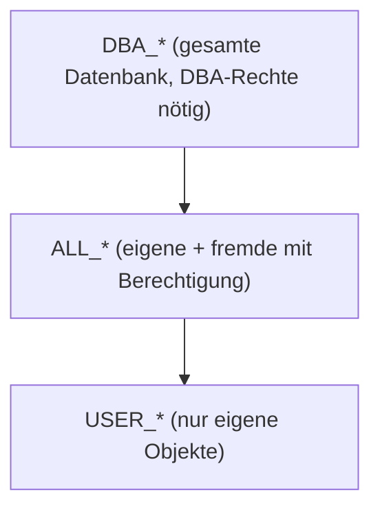
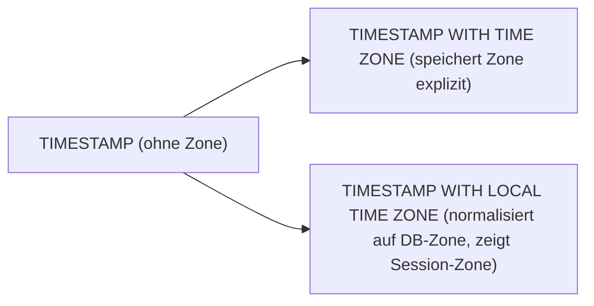
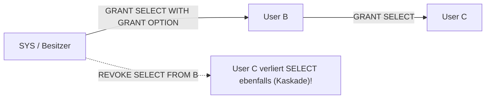

# Phase 9: Data Dictionary, Time Zones & Controlling User Access (`L163`–`L178`)

**Exam Domains**: Domain 10 (*Data Dictionary & Time Zones*, 5 %) + Domain 11 (*Controlling User Access*, 5 %)  
**Interactive Studio**: [Phase 9 Tracker](https://chatelao.github.io/sql-schulung/#curriculum/phase-9) · [FreeSQL Sandbox](https://chatelao.github.io/sql-schulung/#labs/freesql/phase-9) · [Flashcards D10](https://chatelao.github.io/sql-schulung/#flashcards/D10) · [Flashcards D11](https://chatelao.github.io/sql-schulung/#flashcards/D11)

---

## Oracle Data Dictionary (`L163`–`L166`)

### `L163` — `USER_*`, `ALL_*`, `DBA_*` und `DICTIONARY` (`DICT`)
- **Lernziel**: Du wählst für jede Metadaten-Abfrage das passende Data-Dictionary-Präfix.
- **Studio-Link**: [Tracker `L163`](https://chatelao.github.io/sql-schulung/#curriculum/L163)

| Präfix | Bereich (Scope) | Wer darf abfragen? |
| :--- | :--- | :--- |
| `USER_*` | Objekte im **Besitz** des aktuellen Users (ohne `OWNER`-Spalte!) | Jeder User |
| `ALL_*` | Eigene Objekte **plus** für den aktuellen User freigegebene Objekte (mit `OWNER`) | Jeder User |
| `DBA_*` | **Alle** Objekte in der gesamten Datenbank | DBA / `SELECT_CATALOG_ROLE` |

- **Selbstlern-Aufgabe:** Lückentext: Suche im Data Dictionary nach allen Views, die das Wort `'CONSTRAINT'` im Namen enthalten:
```sql
SELECT table_name FROM ___ WHERE table_name LIKE '%CONSTRAINT%';
```
  ??? success "Musterlösung & Erklärung"
      ```sql
      SELECT table_name FROM dictionary WHERE table_name LIKE '%CONSTRAINT%';
      ```
      `DICT` ist das Public Synonym für `DICTIONARY`.

### `L164` — Tables, Columns & Objects inspizieren
- **Lernziel**: Du prüfst bestehende Tabellen, Spalten und Objektstatus per SQL.
- **Studio-Link**: [Tracker `L164`](https://chatelao.github.io/sql-schulung/#curriculum/L164)
- **Beispiel**:
  ```sql
  SELECT object_name, object_type, status FROM user_objects;
  SELECT table_name, column_name, data_type, nullable
  FROM user_tab_columns WHERE table_name = 'MY_EMP';
  ```
- **Hinweis**: Tabellennamen stehen im Data Dictionary standardmäßig in **GROSSBUCHSTABEN** (`'MY_EMP'`, nicht `'my_emp'`).

- **Selbstlern-Aufgabe:** Worin unterscheiden sich `USER_TABLES` und `ALL_TABLES`?
  ??? success "Musterlösung & Erklärung"
      `USER_TABLES` zeigt nur Tabellen, die **dir selbst** gehören (`OWNER = USER`). `ALL_TABLES` zeigt zusätzlich fremde Tabellen, auf die du Leserechte hast (z. B. `SCOTT.EMP`).

### `L165` — Constraints, Views, Sequences & Indexes inspizieren
- **Lernziel**: Du liest Constraint-Typen und Metadaten aus `USER_CONSTRAINTS`, `USER_VIEWS`, `USER_SEQUENCES` und `USER_IND_COLUMNS`.
- **Studio-Link**: [Tracker `L165`](https://chatelao.github.io/sql-schulung/#curriculum/L165)
- **Beispiel**:
  ```sql
  SELECT constraint_name, constraint_type, search_condition, delete_rule
  FROM user_constraints WHERE table_name = 'LAB_TASKS';
  ```
- **Constraint-Typen**: `P` (Primary Key), `R` (Referential / FK), `U` (Unique), `C` (Check **oder** `NOT NULL`!).

- **Selbstlern-Aufgabe:** Lückentext: Prüfe den Typ (`P`, `R`, `U`, `C`) aller Constraints deiner Tabelle `MY_EMP`:
```sql
SELECT constraint_name, constraint_type FROM ___ WHERE table_name = 'MY_EMP';
```
  ??? success "Musterlösung & Erklärung"
      ```sql
      SELECT constraint_name, constraint_type FROM user_constraints WHERE table_name = 'MY_EMP';
      ```
      Wichtig: Objektnamen stehen im Dictionary immer in **GROSSBUCHSTABEN**!

### `L166` — Metadaten-Kommentare hinzufügen (`COMMENT ON`)
- **Lernziel**: Du dokumentierst Tabellen und Spalten direkt in der Datenbank.
- **Studio-Link**: [Tracker `L166`](https://chatelao.github.io/sql-schulung/#curriculum/L166) · [SQL Ref: COMMENT](https://docs.oracle.com/en/database/oracle/oracle-database/26/sqlrf/COMMENT.html)
- **Beispiel**:
  ```sql
  COMMENT ON TABLE my_emp IS 'Writable copy of classic SCOTT.EMP for training';
  SELECT comments FROM user_tab_comments WHERE table_name = 'MY_EMP';
  ```

---

## Time Zones & Interval Data Types (`L167`–`L172`)

- **Selbstlern-Aufgabe:** Lückentext: Hinterlege einen Tabellenkommentar für `my_emp` und lies ihn aus `USER_TAB_COMMENTS` aus:
```sql
___ TABLE my_emp IS 'Uebungstabelle fuer DML-Labs';
```
  ??? success "Musterlösung & Erklärung"
      ```sql
      COMMENT ON TABLE my_emp IS 'Uebungstabelle fuer DML-Labs';
      SELECT comments FROM user_tab_comments WHERE table_name = 'MY_EMP';
      ```

### `L167` — `TIMESTAMP`, `TIMESTAMP WITH TIME ZONE`, `TIMESTAMP WITH LOCAL TIME ZONE`
- **Lernziel**: Du unterscheidest Oracles drei Timestamp-Varianten sicher.
- **Studio-Link**: [Tracker `L167`](https://chatelao.github.io/sql-schulung/#curriculum/L167) · [SQL Ref: Data Types](https://docs.oracle.com/en/database/oracle/oracle-database/26/sqlrf/Data-Types.html)
- `TIMESTAMP(p)`: Genauigkeit der Sekundenbruchteile (`0`–`9`, Standard `6`).
- `TIMESTAMP WITH TIME ZONE`: speichert exakt die Zeitzonenregion oder den Offset (`+02:00`, `Europe/Berlin`).
- `TIMESTAMP WITH LOCAL TIME ZONE`: normalisiert beim Speichern auf **`DBTIMEZONE`** und rechnet bei der Abfrage dynamisch in **`SESSIONTIMEZONE`** um!

- **Selbstlern-Aufgabe:** Welcher Unterschied besteht zwischen `TIMESTAMP WITH TIME ZONE` und `TIMESTAMP WITH LOCAL TIME ZONE`?
  ??? success "Musterlösung & Erklärung"
      `WITH TIME ZONE` speichert die übergebene Zeitzone mit ab. `WITH LOCAL TIME ZONE` normalisiert auf die DB-Zeitzone und zeigt beim `SELECT` immer die Zeitzone der abfragenden Session.

### `L168` — `CURRENT_DATE`, `CURRENT_TIMESTAMP` & `LOCALTIMESTAMP`
- **Lernziel**: Du erkennst, welche Funktion Serverzeit vs. Session-Zeit liefert.
- **Studio-Link**: [Tracker `L168`](https://chatelao.github.io/sql-schulung/#curriculum/L168) · [SQL Ref: CURRENT_TIMESTAMP](https://docs.oracle.com/en/database/oracle/oracle-database/26/sqlrf/CURRENT_TIMESTAMP.html)

| Function | Rückgabetyp | Verwendete Time Zone |
| :--- | :--- | :--- |
| `SYSDATE` | `DATE` | Host-OS-Uhr des Datenbankservers |
| `CURRENT_DATE` | `DATE` | `SESSIONTIMEZONE` |
| `SYSTIMESTAMP` | `TIMESTAMP WITH TIME ZONE` | Host-OS-Uhr des Datenbankservers |
| `CURRENT_TIMESTAMP` | `TIMESTAMP WITH TIME ZONE` | `SESSIONTIMEZONE` |
| `LOCALTIMESTAMP` | `TIMESTAMP` (ohne TZ!) | `SESSIONTIMEZONE` |

- **Selbstlern-Aufgabe:** Warum unterscheiden sich `SYSDATE` und `CURRENT_DATE` manchmal um mehrere Stunden?
  ??? success "Musterlösung & Erklärung"
      `SYSDATE` liefert Datum/Uhrzeit des **Datenbank-Servers**; `CURRENT_DATE` liefert Datum/Uhrzeit in der **`SESSIONTIMEZONE`** des Clients.

### `L169` — `DBTIMEZONE`, `SESSIONTIMEZONE`, `TZ_OFFSET` & `FROM_TZ`
- **Lernziel**: Du änderst Session-Zeitzonen und versiehst Timestamps mit Zeitzonen.
- **Studio-Link**: [Tracker `L169`](https://chatelao.github.io/sql-schulung/#curriculum/L169) · [SQL Ref: FROM_TZ](https://docs.oracle.com/en/database/oracle/oracle-database/26/sqlrf/FROM_TZ.html)
- **Beispiel**:
  ```sql
  ALTER SESSION SET TIME_ZONE = '+02:00';
  SELECT SESSIONTIMEZONE, TZ_OFFSET('America/New_York'),
         FROM_TZ(TIMESTAMP '2026-11-19 09:00:00', 'UTC')
  FROM dual;
  ```

- **Selbstlern-Aufgabe:** Lückentext: Setze die Session-Zeitzone auf `'Europe/Zurich'` und prüfe `CURRENT_TIMESTAMP`:
```sql
ALTER SESSION SET ___ = 'Europe/Zurich';
SELECT CURRENT_TIMESTAMP FROM dual;
```
  ??? success "Musterlösung & Erklärung"
      ```sql
      ALTER SESSION SET TIME_ZONE = 'Europe/Zurich';
      SELECT CURRENT_TIMESTAMP FROM dual;
      ```

### `L170` — `INTERVAL YEAR TO MONTH` & `INTERVAL DAY TO SECOND`
- **Lernziel**: Du addierst und subtrahierst Zeitspannen exakt per Intervall-Literal.
- **Studio-Link**: [Tracker `L170`](https://chatelao.github.io/sql-schulung/#curriculum/L170)
- **Beispiel**:
  ```sql
  SELECT DATE '2026-01-15' + INTERVAL '1-6' YEAR TO MONTH AS plus_18m,
         SYSTIMESTAMP + INTERVAL '3 04:30:00' DAY TO SECOND AS plus_3d_4h30m
  FROM dual;
  ```

- **Selbstlern-Aufgabe:** Lückentext: Addiere genau **1 Jahr und 6 Monate** zu `SYSDATE` mithilfe eines Intervall-Literals:
```sql
SELECT SYSDATE + INTERVAL '1-6' ___ FROM dual;
```
  ??? success "Musterlösung & Erklärung"
      ```sql
      SELECT SYSDATE + INTERVAL '1-6' YEAR TO MONTH FROM dual;
      ```

### `L171` — `EXTRACT`, `TO_TIMESTAMP`, `TO_YMINTERVAL` & `TO_DSINTERVAL`
- **Lernziel**: Du extrahierst Datumsteile mit `EXTRACT` und konvertierst Strings in Timestamps/Intervalle.
- **Studio-Link**: [Tracker `L171`](https://chatelao.github.io/sql-schulung/#curriculum/L171) · [SQL Ref: TO_TIMESTAMP](https://docs.oracle.com/en/database/oracle/oracle-database/26/sqlrf/TO_TIMESTAMP.html)
- **Beispiel**:
  ```sql
  SELECT EXTRACT(YEAR FROM hiredate) AS yr, EXTRACT(MONTH FROM hiredate) AS mo FROM scott.emp;
  SELECT DATE '2026-01-15' + TO_YMINTERVAL('02-03') FROM dual; -- 2028-04-15
  ```

- **Selbstlern-Aufgabe:** Lückentext: Extrahiere nur das Jahr aus `SYSDATE` per ANSI-Funktion:
```sql
SELECT ___(YEAR FROM SYSDATE) FROM dual;
```
  ??? success "Musterlösung & Erklärung"
      ```sql
      SELECT EXTRACT(YEAR FROM SYSDATE) FROM dual;
      ```
      Für `HOUR`/`MINUTE`/`SECOND` benötigt `EXTRACT` einen `TIMESTAMP` (nicht `DATE`).

### `L172` — Global Flight Schedule Time-Zone Lab
- **Lernziel**: Du berechnest internationale Abflug- und Ankunftszeiten über Zeitzonen hinweg.
- **Studio-Link**: [Tracker `L172`](https://chatelao.github.io/sql-schulung/#curriculum/L172)
- **Selbstlern-Aufgabe**: Ein Flug startet am `2026-11-19 10:00:00` in `'Europe/Berlin'` und dauert `9 Stunden 15 Minuten` (`TO_DSINTERVAL('0 09:15:00')`). Berechne die Ankunftszeit in `'America/New_York'` mittels `FROM_TZ`, `+ TO_DSINTERVAL(...)` und `AT TIME ZONE`.
  ??? success "Musterlösung & Erklärung"
      ```sql
      SELECT (FROM_TZ(TIMESTAMP '2026-11-19 10:00:00', 'Europe/Berlin')
              + TO_DSINTERVAL('0 09:15:00'))
             AT TIME ZONE 'America/New_York' AS arrival_ny
      FROM dual;
      -- Ergebnis: 2026-11-19 13:15:00 AMERICA/NEW_YORK (6h Zeitdifferenz!)
      ```

---

## Controlling User Access — DCL (`L173`–`L178`)

### `L173` — System Privileges vs. Object Privileges
- **Lernziel**: Du unterscheidest Datenbank-Fähigkeiten (`CREATE SESSION`, `CREATE TABLE`) von Objekt-Rechten (`SELECT`, `UPDATE (sal)`).
- **Studio-Link**: [Tracker `L173`](https://chatelao.github.io/sql-schulung/#curriculum/L173) · [SQL Ref: GRANT](https://docs.oracle.com/en/database/oracle/oracle-database/26/sqlrf/GRANT.html)

- **Selbstlern-Aufgabe:** Ordne zu: Ist `CREATE VIEW` ein System- oder ein Objektprivileg? Und `SELECT ON scott.emp`?
  ??? success "Musterlösung & Erklärung"
      - `CREATE VIEW` → **Systemprivileg** (Fähigkeit, ein Objekt zu erstellen)
      - `SELECT ON scott.emp` → **Objektprivileg** (Zugriff auf ein bestimmtes Objekt)

### `L174` — Users anlegen, Passwörter ändern & Roles
- **Lernziel**: Du erstellst User und Roles und weist Rechte gebündelt zu.
- **Studio-Link**: [Tracker `L174`](https://chatelao.github.io/sql-schulung/#curriculum/L174)
- **Beispiel**:
  ```sql
  CREATE USER alice IDENTIFIED BY Secret123!;
  CREATE ROLE hr_reader;
  GRANT CREATE SESSION TO hr_reader;
  GRANT hr_reader TO alice;
  ALTER USER alice IDENTIFIED BY NewSecret456!;
  ```

- **Selbstlern-Aufgabe:** Was fehlt nach `CREATE USER u1 IDENTIFIED BY secret;` noch, damit `u1` sich einloggen kann?
  ??? success "Musterlösung & Erklärung"
      Das Systemprivileg **`GRANT CREATE SESSION TO u1;`** (oder eine Role wie `CONNECT`, die `CREATE SESSION` enthält).

### `L175` — `WITH GRANT OPTION` vs. `WITH ADMIN OPTION`
- **Lernziel**: Du vergibst weitergebbare Rechte mit der jeweils richtigen Klausel.
- **Studio-Link**: [Tracker `L175`](https://chatelao.github.io/sql-schulung/#curriculum/L175)
- `GRANT SELECT ON my_emp TO alice WITH GRANT OPTION;` (**Object Privilege**).
- `GRANT CREATE TABLE TO alice WITH ADMIN OPTION;` (**System Privilege / Role**).

- **Selbstlern-Aufgabe:** Welche Option gehört zu Systemprivilegien und welche zu Objektprivilegien?
  ??? success "Musterlösung & Erklärung"
      - Systemprivilegien: **`WITH ADMIN OPTION`**
      - Objektprivilegien: **`WITH GRANT OPTION`**

### `L176` — Die kritische `REVOKE`-Kaskadenregel (Prüfungsliebling!)
- **Lernziel**: Du sagst bei mehrstufigen Rechteketten sofort voraus, wer sein Recht behält und wer es verliert.
- **Studio-Link**: [Tracker `L176`](https://chatelao.github.io/sql-schulung/#curriculum/L176) · [SQL Ref: REVOKE](https://docs.oracle.com/en/database/oracle/oracle-database/26/sqlrf/REVOKE.html)
- !!! warning "1Z0-171 Exam Trap (Kaskadenregel)"
    - **Object Privilege (`WITH GRANT OPTION`)**: Bei `SYS → Alice → Bob` **KASKADIERT** `REVOKE SELECT ON ... FROM alice` und entzieht das Recht automatisch auch **Bob**!
    - **System Privilege (`WITH ADMIN OPTION`)**: Bei `SYS → Alice → Bob` **KASKADIERT** `REVOKE CREATE TABLE FROM alice` **NICHT** – **Bob behält `CREATE TABLE`**!

- **Selbstlern-Aufgabe:** User A gibt `SELECT ON t` `WITH GRANT OPTION` an B; B gibt `SELECT ON t` an C. Was passiert nach `REVOKE SELECT ON t FROM B`?
  ??? success "Musterlösung & Erklärung"
      **Kaskade:** Sowohl **B als auch C** verlieren `SELECT ON t` sofort! (Bei einem Systemprivileg mit `WITH ADMIN OPTION` würde C sein Recht hingegen behalten.)

### `L177`–`L178` — Multi-User Privilege Cascade Lab (3-User-Drehbuch)
- **Lernziel**: Du testest die Kaskadenregel praktisch in zwei Varianten (PDB / OCI Always Free) oder vollziehst das Drehbuch im Kopf nach.
- **Studio-Link**: [Tracker `L177`](https://chatelao.github.io/sql-schulung/#curriculum/L177) · [Tracker `L178`](https://chatelao.github.io/sql-schulung/#curriculum/L178)

| Schritt | Ausgeführt als | SQL-Befehl | Erwartetes Ergebnis |
| :---: | :---: | :--- | :--- |
| **1** | `ADMIN` / `SYS` | `GRANT CREATE TABLE TO alice WITH ADMIN OPTION;` | `alice` darf Tabellen erstellen & Recht weitergeben |
| **2** | `alice` | `GRANT CREATE TABLE TO bob;` | `bob` darf Tabellen erstellen |
| **3** | `ADMIN` / `SYS` | `REVOKE CREATE TABLE FROM alice;` | `alice` verliert es, **`bob` behält es!** |
| **4** | `ADMIN` / `SYS` | `GRANT SELECT ON scott.emp TO alice WITH GRANT OPTION;` | `alice` darf `scott.emp` abfragen & weitergeben |
| **5** | `alice` | `GRANT SELECT ON scott.emp TO bob;` | `bob` darf `scott.emp` abfragen |
| **6** | `ADMIN` / `SYS` | `REVOKE SELECT ON scott.emp FROM alice;` | **Sowohl `alice` als auch `bob` verlieren `SELECT`!** |

---

- **Selbstlern-Aufgabe:** Spiele das 3-User-DCL-Drehbuch in `docs/labs/phase-09-dict-tz-dcl.sql` durch (oder mit `student_0X_peer`) und prüfe `USER_TAB_PRIVS`.
  ??? success "Musterlösung & Erklärung"
      Nach dem `REVOKE` bei Objektprivilegien verschwindet der Eintrag von User C ebenfalls aus den Privileg-Views.

### Visuelle Orientierung: Data Dictionary, Zeitzonen & DCL-Kaskaden


*Alt-Text: Schichtenmodell des Oracle Data Dictionary von USER_* über ALL_* bis DBA_*.*


*Alt-Text: Unterschied zwischen TIMESTAMP, TIMESTAMP WITH TIME ZONE und TIMESTAMP WITH LOCAL TIME ZONE.*


*Alt-Text: Kaskadierendes REVOKE bei Objektprivilegien mit WITH GRANT OPTION (im Gegensatz zu Systemprivilegien).*

---

## Hybrid-Paaraufgaben (3 gemischte Paare: Remote + Vor Ort)

1. **Paaraufgabe A (Data-Dictionary-Schnitzeljagd):** Findet ausschliesslich über `USER_TABLES`, `USER_TAB_COLUMNS` und `USER_CONSTRAINTS` heraus, welche Fremdschlüssel auf eure Testtabellen zeigen.
2. **Paaraufgabe B (DCL-Kaskade mit `student_0X_peer`):** Ein Partner loggt sich als `student_0X` ein, der andere als `student_0X_peer`. Testet `GRANT SELECT ... WITH GRANT OPTION` und beobachtet das Verhalten nach `REVOKE`.

## Praxis-Transfer in deinen Arbeitsalltag (Firmenbezug)

- **Aufgabe:** Analysiere ein globales Zeitzonen-Szenario aus deiner Firma (z. B. UTC-Server vs. Lokalzeit Zürich/Berlin) mit `TIMESTAMP WITH TIME ZONE` vs. `WITH LOCAL TIME ZONE` und prüfe über `ALL_TAB_COLUMNS` die Datentypen eurer Produktiv-Tabellen.
