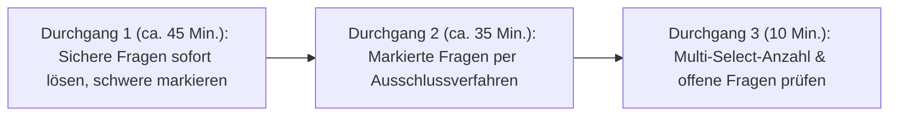
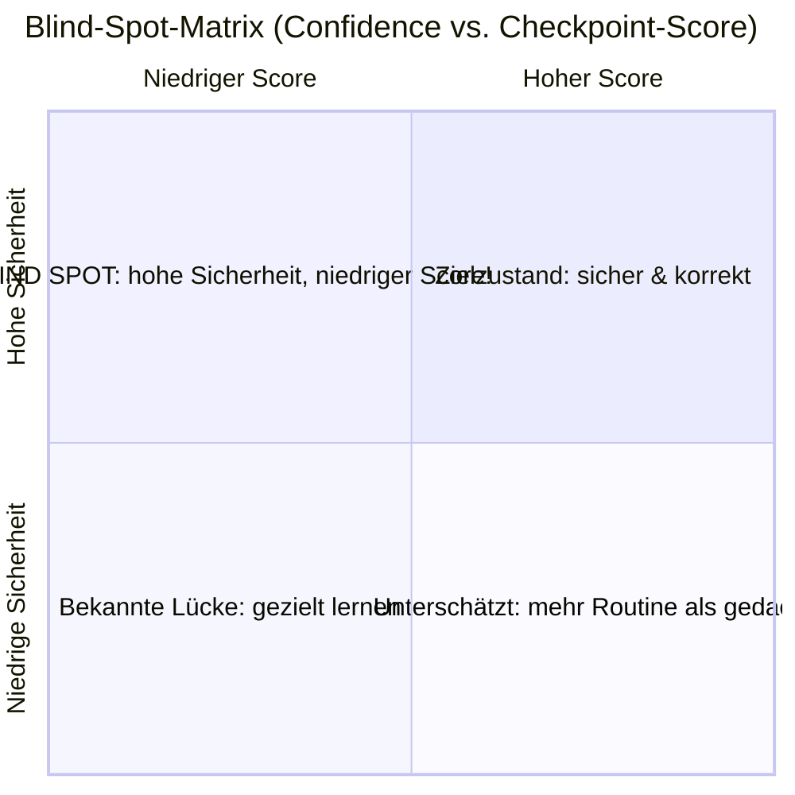
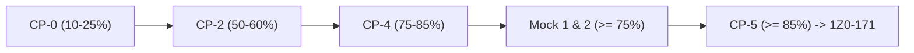

# Phase 10: Exam Mastery, Mock Exams & Final Readiness (`L179`–`L200`)

**Fokus**: Praktisches SQL-Wissen ohne IDE in schnelle, präzise Prüfungsleistung umsetzen.  
**Interactive Studio**: [Phase 10 Tracker](https://chatelao.github.io/sql-schulung/#curriculum/phase-10) · [Human Compiler](https://chatelao.github.io/sql-schulung/#labs/compiler) · [Mock Exams](https://chatelao.github.io/sql-schulung/#mock) · [Checkpoint `CP-5`](https://chatelao.github.io/sql-schulung/#checkpoints/CP-5)

---

## „Human Compiler“ Clinics (`L179`–`L184`)

Absolviere alle 6 Clinics im **Human Compiler**-Modus auf GitHub Pages (**ohne vorherige Live-Datenbank**!):

- **`L179` — [Clinic 1: `NULL` & 3-Valued-Logic-Fallen ↗](https://chatelao.github.io/sql-schulung/#labs/compiler/clinic-1)** (`= NULL`, `NOT IN` + `NULL`, `BETWEEN`, `LIKE`)
- **`L180` — [Clinic 2: Nested Functions & Conversion Masks ↗](https://chatelao.github.io/sql-schulung/#labs/compiler/clinic-2)** (`NVL`/`NVL2`/`DECODE`, `TRIM`, `CONCAT`, `TO_CHAR`-Überlauf)
- **`L181` — [Clinic 3: Joins, `USING` & Outer-Filter ↗](https://chatelao.github.io/sql-schulung/#labs/compiler/clinic-3)** (`ORA-25154`, `NATURAL JOIN`, `LEFT JOIN` + `WHERE`)
- **`L182` — [Clinic 4: Subqueries & `SET` Operators ↗](https://chatelao.github.io/sql-schulung/#labs/compiler/clinic-4)** (`ANY`/`ALL`/`EXISTS`, `ORDER BY` in `UNION`, leere Subqueries)
- **`L183` — [Clinic 5: DDL, `CTAS`, Views & Sequences ↗](https://chatelao.github.io/sql-schulung/#labs/compiler/clinic-5)** (`CTAS`, `TRUNCATE` Auto-Commit, `CHECK`-Grenzen, `WITH CHECK OPTION`, `CURRVAL`)
- **`L184` — [Clinic 6: Dictionary, Time Zones & DCL ↗](https://chatelao.github.io/sql-schulung/#labs/compiler/clinic-6)** (`USER_`/`ALL_`/`DBA_`, `TIMESTAMP WITH LOCAL TIME ZONE`, `REVOKE`-Kaskaden)

---

## Mock Exam #1 & Aufarbeitung (`L185`–`L193`)

### `L185`–`L187` — Vollständiges Timed Mock Exam #1 (60 Fragen / 120 Minuten)
- **Lernziel**: Du beherrschst und nutzt das Thema dieser Lektion sicher in der Praxis. *(Bloom: Anwenden)*
Starte **[Mock Exam #1 ↗](https://chatelao.github.io/sql-schulung/#mock/exam-1)** und trainiere die **3-Pass Exam Pacing Strategy**:
1. **Durchgang 1 (Minuten 0–75)**: Beantworte alle eindeutigen Syntax- und Konzeptfragen (ca. 1 Min. je Frage). Markiere lange Multi-Table- oder DDL-Fragen (*Markieren*).
2. **Durchgang 2 (Minuten 75–105)**: Verfolge markierte Queries Schritt für Schritt auf Schmierzettel nach.
3. **Durchgang 3 (Minuten 105–120)**: Prüfe jede *„Wähle zwei“*/*„Wähle drei“*-Frage noch einmal genau (Oracle vergibt bei Multi-Select-Fragen **keine Teilpunkte**!).

- **Selbstlern-Aufgabe:** Starte [Mock Exam #1 im Studio](https://chatelao.github.io/sql-schulung/#mock) (60 Fragen, Timer 90/120 Min.) und arbeite im 2-Durchgangs-Verfahren.
  ??? success "Musterlösung & Erklärung"
      Zielwert für sichere Prüfungsreife: **≥ 75 %** (Bestehensgrenze `1Z0-171`: ~65 %).

### `L188`–`L189` — Strukturierte Selbst-Nachbesprechung (Debrief)
- **Lernziel**: Du beherrschst und nutzt das Thema dieser Lektion sicher in der Praxis. *(Bloom: Bewerten)*
Notiere für jede falsche oder glücklich geratene Frage aus Mock Exam #1:

| Frage-ID | Domain | Mein Fehler / Denkfalle | Richtige Oracle-Regel / `ORA-`-Code | Kapitel-Link |
| :--- | :---: | :--- | :--- | :--- |
| *z. B. M14* | *D3* | *`ROUND(156.78, -2)` als `160` gelesen* | *`-2` rundet auf Hunderter → `200`* | *Phase 3 (`L051`)* |

- **Selbstlern-Aufgabe:** Klassifiziere jede falsche Frage aus Mock #1 als *Wissenslücke*, *Lesefehler* oder *Exam Trap*.
  ??? success "Musterlösung & Erklärung"
      Erfahrungswert: Über 30 % der Fehler im ersten Mock sind Lesefehler („NOT“, „SELECT two“, fehlendes `NULL` in Beispielzeilen).

### `L190`–`L193` — Gezielte Remediation Labs
- **Lernziel**: Du beherrschst und nutzt das Thema dieser Lektion sicher in der Praxis. *(Bloom: Anwenden)*
- Identifiziere die **2 schwächsten Domains** aus der Mock-Exam-#1-Auswertung.
- Starte im Studio den **Domain-Fokus-Drill** ([Mock / Domain-Drill ↗](https://chatelao.github.io/sql-schulung/#mock)) für diese Domains und führe die passenden Live-Beispiele noch einmal in Oracle FreeSQL / deiner PDB aus.
- Wiederhole in `L193` alle unsicheren Karten im [Flashcard Rapid Review ↗](https://chatelao.github.io/sql-schulung/#flashcards).

---

## Mock Exam #2 & Prüfungslogistik (`L194`–`L198`)

- **Selbstlern-Aufgabe:** Lückentext-Warmup (`SELECT e.ename, d.dname FROM scott.emp e ___ scott.dept d ON e.deptno = d.deptno WHERE e.comm ___`) und öffne anschliessend die zwei schwächsten Domains aus Mock #1 im [Flashcard-Deck](https://chatelao.github.io/sql-schulung/#flashcards) und übe sie bis Status „Sicher“.
  ??? success "Musterlösung & Erklärung"
      Wiederhole dazu mindestens 10 Aufgaben aus dem jeweiligen `docs/labs/phase-XX-*.sql`.

### `L194`–`L196` — Vollständiges Timed Mock Exam #2 (Unabhängiger 60-Fragen-Pool!)
- **Lernziel**: Du beherrschst und nutzt das Thema dieser Lektion sicher in der Praxis. *(Bloom: Anwenden)*
Starte **[Mock Exam #2 ↗](https://chatelao.github.io/sql-schulung/#mock/exam-2)** unter strengen 120-Minuten-Bedingungen.
- **Zielvorgabe für die Prüfungsreife**: **≥ 75 % (45/60)** (10 Prozentpunkte Sicherheitspuffer über den offiziellen 65 %).

- **Selbstlern-Aufgabe:** Starte [Mock Exam #2 im Studio](https://chatelao.github.io/sql-schulung/#mock/exam-2) (unabhängiger 60-Fragen-Pool).
  ??? success "Musterlösung & Erklärung"
      Zielwert: **≥ 78–80 %** ohne Zeitnot (mind. 10 Min. Restzeit für Multi-Select-Check).

### `L197` — Debrief & Blind-Spot Final Check
- **Lernziel**: Du beherrschst und nutzt das Thema dieser Lektion sicher in der Praxis. *(Bloom: Bewerten)*
- Prüfe alle falsch beantworteten Fragen aus Mock Exam #2 gegen das [Exam-Traps-Cheatsheet](../cheatsheets/exam-traps.md).

- **Selbstlern-Aufgabe:** Prüfe nach Mock #2, ob die verbleibenden Fehler sich in einer bestimmten Domain häufen, und wiederhole die zugehörige [Human Compiler Clinic](https://chatelao.github.io/sql-schulung/#labs/compiler).
  ??? success "Musterlösung & Erklärung"
      Wenn alle Domains über 70 % liegen, bist du bereit für `CP-5`.

### `L198` — Buchung & Exam-Day Checklist
- **Lernziel**: Du beherrschst und nutzt das Thema dieser Lektion sicher in der Praxis. *(Bloom: Anwenden)*
- Erstelle/prüfe deinen Oracle-SSO-Account auf **Oracle MyLearn**.
- Führe den Pearson/Oracle-Systemcheck für Online-Proctoring exakt auf dem Computer, mit der Webcam und im Netzwerk aus, die du am Prüfungstag nutzt.
- Räume deinen Schreibtisch vollständig frei (nur ein gültiger amtlicher Lichtbildausweis ist erlaubt).

---

## Identical Checkpoint #5 — Final Graduation (`L199`–`L200`)

- **Selbstlern-Aufgabe:** Gehe die Proctoring-Checkliste durch: Lichtbildausweis, Systemtest (`OnVUE`/Oracle), ruhiger Raum, leere Schreibtischoberfläche.
  ??? success "Musterlösung & Erklärung"
      Plane den Systemtest mindestens 48 Stunden vor dem Prüfungstermin ein.

### `L199` — Identical Checkpoint #5 (Abschlusslauf + Answer Key freigeschaltet!)
- **Lernziel**: Du beherrschst und nutzt das Thema dieser Lektion sicher in der Praxis. *(Bloom: Bewerten)*
- Absolviere **[Checkpoint `CP-5` ↗](https://chatelao.github.io/sql-schulung/#checkpoints/CP-5)** ein letztes Mal (Ziel: **≥ 85 %**).
- Bei `CP-5` werden der vollständige **Answer Key und alle ausgearbeiteten Erklärungen** automatisch freigeschaltet!

- **Selbstlern-Aufgabe:** Absolviere [CP-5 im Studio](https://chatelao.github.io/sql-schulung/#checkpoints/CP-5) — der vollständige Answer Key wird jetzt automatisch freigeschaltet!
  ??? success "Musterlösung & Erklärung"
      Zielwert: **≥ 85 %** Gesamtscore. Lies nach Abgabe alle 22 Erklärungen zu Fragen, bei denen du unsicher warst.

### `L200` — `CP-0 → CP-5` Longitudinal Retrospective & Weiterbildung
- **Lernziel**: Du beherrschst und nutzt das Thema dieser Lektion sicher in der Praxis. *(Bloom: Anwenden)*
- Öffne dein vollständiges Verlaufsdiagramm auf GitHub Pages und verfolge deinen Weg von **CP-0 (10–25 %)** bis **CP-5 (≥ 85 %)**.
- Exportiere dein finales Lernportfolio (`.json` und `.md`).
- **Wie geht es nach `1Z0-171` weiter?** Starte direkt im Aufbau-Modul **[Advanced Oracle SQL (`A001`–`A060`)](../advanced/modul-01-hierarchies.md)** (Hierarchien, Regex, JSON, XML, Window Functions, `MATCH_RECOGNIZE`).

---

- **Selbstlern-Aufgabe:** Exportiere dein finales `CP-0 → CP-5` Portfolio (`.json` + `.md`) und starte optional mit [Advanced SQL (`A001–A060`)](../advanced/modul-01-hierarchies.md).
  ??? success "Musterlösung & Erklärung"
      Herzlichen Glückwunsch zum Abschluss des 200-Lektionen-Curriculums!

### Visuelle Orientierung: Prüfungsstrategie & Blind-Spot-Matrix

*Alt-Text: Drei-Phasen-Zeitstrategie für die 90-minütige 1Z0-171-Prüfung mit 60 Fragen.*

*Alt-Text: Vier-Quadranten-Matrix zur Identifikation gefährlicher Blind Spots (hohe Selbsteinschätzung bei niedrigem Score).*

*Alt-Text: Lernpfad vom Einstiegs-Benchmark CP-0 über CP-2, CP-4 und Mock Exams bis zum Abschluss CP-5.*

---

## Gemischtes Training & Differenzierung (Basis / Plus / Challenge)

- **Analyse-Aufgabe (Bloom: Bewerten):** Wähle eine falsche Antwort aus Mock #1/#2 und formuliere schriftlich, **warum jede der anderen Optionen falsch ist** (Ausschlussbegründung).
- **Basis:** Alle 6 Human Compiler Clinics durchgehen.
- **Plus:** Mock Exam #2 mit ≥ 78 % abschliessen.
- **Challenge:** Starte nach `CP-5` direkt mit [Advanced SQL Modul 1–6](../advanced/modul-01-hierarchies.md).

## Hybrid-Paaraufgaben (3 gemischte Paare: Remote + Vor Ort)

1. **Paaraufgabe A (Human Compiler ohne DB):** Jeder Partner wählt 3 Drills aus den Clinics 1–6, lässt den anderen laut Zeile für Zeile auswerten (ohne IDE!) und deckt erst danach die Lösung auf.
2. **Paaraufgabe B (Mock-Debrief):** Besprecht zu zweit eure 3 schwierigsten Fragen aus Mock Exam #1/#2 und formuliert für jede eine 1-Satz-Faustregel.

## Praxis-Transfer in deinen Arbeitsalltag (Firmenbezug)

- **Aufgabe (Transfer-Plan):** Lege fest, welche **3 konkreten SQL-Auswertungen oder Datenprüfungen** du in den nächsten 4 Wochen in deinem Arbeitsalltag umsetzt, und notiere den Termin für das 60-Minuten-Follow-up mit der Gruppe.
