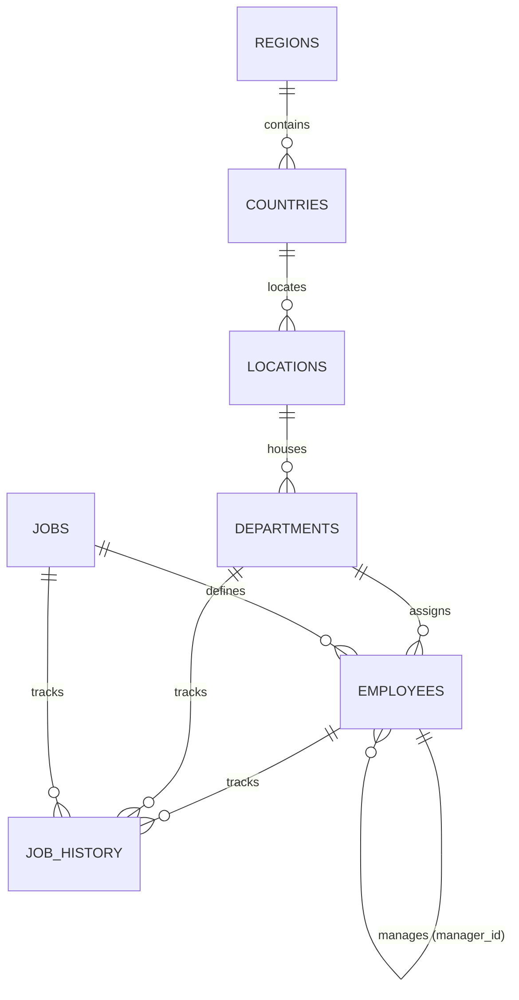

# Modernes `HR` Sample Schema (Überblick)

Sobald Einsteiger ein SQL-Konzept auf der 14-zeiligen Tabelle `SCOTT.EMP` sicher beherrschen, skaliert jede Phase auf das offizielle Oracle-Standardschema **`HR` (Human Resources)** (107 Employees, 27 Departments, Standorte in mehreren Ländern sowie `JOB_HISTORY`).

---

## Entity-Relationship Diagram (ERD)

---

## Wichtige Prüfungsbesonderheiten in `HR`

1. **`NATURAL JOIN` Trap (`EMPLOYEES` & `DEPARTMENTS`)**:
   - Sowohl `EMPLOYEES` als auch `DEPARTMENTS` besitzen **zwei** gleichnamige Columns: `DEPARTMENT_ID` **und** `MANAGER_ID`.
   - `SELECT * FROM hr.employees NATURAL JOIN hr.departments` verknüpft über **beide** Spalten – und liefert nur Employees, die in einem Department arbeiten, das von ihrem *eigenen direkten Manager* geleitet wird!
2. **Kimberely Grant (`EMPLOYEE_ID = 178`)**:
   - Hat `DEPARTMENT_ID IS NULL` – der klassische Testfall für `LEFT OUTER JOIN` und `FULL OUTER JOIN` mit `HR.DEPARTMENTS`.
3. **`JOB_HISTORY` + `EMPLOYEES` für `SET` Operators**:
   - `EMPLOYEE_ID` + `JOB_ID` kommen sowohl in `EMPLOYEES` als auch in `JOB_HISTORY` vor und eignen sich ideal für `UNION`-, `UNION ALL`-, `INTERSECT`- und `MINUS`-Übungen.
