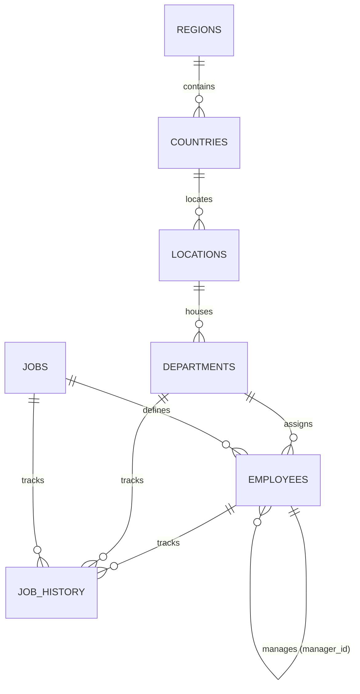

# Modern `HR` Sample Schema Overview

Once beginners master a SQL concept on the 14-row `SCOTT.EMP` table, every phase scales up to Oracle's standard **`HR` (Human Resources)** schema (107 employees, 27 departments, multi-country locations, and `JOB_HISTORY`).

---

## Entity-Relationship Diagram

---

## Key Exam Quirks in `HR`

1. **`NATURAL JOIN` Trap (`EMPLOYEES` & `DEPARTMENTS`)**:
   - Both `EMPLOYEES` and `DEPARTMENTS` share **two** identically named columns: `DEPARTMENT_ID` **and** `MANAGER_ID`.
   - Running `SELECT * FROM hr.employees NATURAL JOIN hr.departments` joins on **both** columns—returning only employees who work in a department managed by their *own direct manager*!
2. **Kimberely Grant (`EMPLOYEE_ID = 178`)**:
   - Has `DEPARTMENT_ID IS NULL`—making her the classic test case for `LEFT OUTER JOIN` and `FULL OUTER JOIN` against `HR.DEPARTMENTS`.
3. **`JOB_HISTORY` + `EMPLOYEES` for `SET` Operators**:
   - `EMPLOYEE_ID` + `JOB_ID` appear in both `EMPLOYEES` and `JOB_HISTORY`, making them ideal for `UNION`, `UNION ALL`, `INTERSECT`, and `MINUS` labs.
