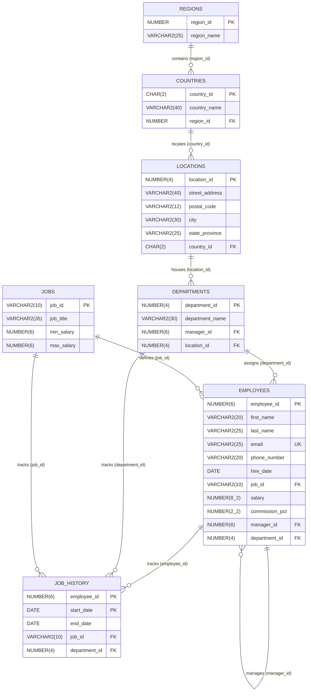

# Modernes `HR` Sample Schema (Referenz)

Sobald Einsteiger ein SQL-Konzept auf der 14-zeiligen Tabelle `SCOTT.EMP` sicher beherrschen, skaliert jede Phase auf das offizielle Oracle-Standardschema **`HR` (Human Resources)** (107 Employees, 27 Departments, 19 Jobs, 10 Job-History-Einträge, 23 Locations, 25 Countries, 4 Regions).

---

## Entity-Relationship Diagram (ERD)

---

## Tabellen- & Spaltenreferenz

### `HR.EMPLOYEES` (107 Rows)
| Spalte | Datentyp | Nullable | Besonderheit / Prüfungshinweis |
| :--- | :--- | :---: | :--- |
| `EMPLOYEE_ID` | `NUMBER(6)` | `NOT NULL` | **Primary Key** (`100` = Steven King bis `206` = William Gietz) |
| `FIRST_NAME` | `VARCHAR2(20)` | `NULL` | Vorname |
| `LAST_NAME` | `VARCHAR2(25)` | `NOT NULL` | Nachname |
| `EMAIL` | `VARCHAR2(25)` | `NOT NULL` | `UNIQUE` (enthält meist nur Großbuchstaben ohne `@`, z. B. `SKING`) |
| `PHONE_NUMBER` | `VARCHAR2(20)` | `NULL` | Punktgetrennte Telefonnummern (`515.123.4567`) |
| `HIRE_DATE` | `DATE` | `NOT NULL` | Einstellungsdatum |
| `JOB_ID` | `VARCHAR2(10)` | `NOT NULL` | **FK** → `JOBS(JOB_ID)` (z. B. `AD_PRES`, `IT_PROG`, `SA_REP`) |
| `SALARY` | `NUMBER(8,2)` | `NULL` | Monatsgehalt (`2100` bis `24000`) |
| `COMMISSION_PCT` | `NUMBER(2,2)` | `NULL` | Provisionssatz (`0.10`–`0.40`, nur bei `35` Sales-Mitarbeitern gesetzt, sonst `NULL`!) |
| `MANAGER_ID` | `NUMBER(6)` | `NULL` | **Self-FK** → `EMPLOYEES(EMPLOYEE_ID)` (`NULL` bei `employee_id = 100`, Steven King) |
| `DEPARTMENT_ID` | `NUMBER(4)` | `NULL` | **FK** → `DEPARTMENTS(DEPARTMENT_ID)` (`NULL` bei `employee_id = 178`, Kimberely Grant!) |

### `HR.DEPARTMENTS` (27 Rows)
| Spalte | Datentyp | Nullable | Besonderheit / Prüfungshinweis |
| :--- | :--- | :---: | :--- |
| `DEPARTMENT_ID` | `NUMBER(4)` | `NOT NULL` | **Primary Key** (`10`..`270` in 10er-Schritten; viele ohne Mitarbeiter!) |
| `DEPARTMENT_NAME` | `VARCHAR2(30)` | `NOT NULL` | Abteilungsname (`Administration`, `IT`, `Sales`, `Executive`, ...) |
| `MANAGER_ID` | `NUMBER(6)` | `NULL` | **FK** → `EMPLOYEES(EMPLOYEE_ID)` (**Achtung bei `NATURAL JOIN`!**) |
| `LOCATION_ID` | `NUMBER(4)` | `NULL` | **FK** → `LOCATIONS(LOCATION_ID)` |

### `HR.JOBS` (19 Rows) & `HR.JOB_HISTORY` (10 Rows)
- **`HR.JOBS`**: `JOB_ID` (`VARCHAR2(10)`, PK), `JOB_TITLE` (`VARCHAR2(35)`), `MIN_SALARY` (`NUMBER(6)`), `MAX_SALARY` (`NUMBER(6)`).
- **`HR.JOB_HISTORY`**: Zusammengesetzter PK `(EMPLOYEE_ID, START_DATE)`, dazu `END_DATE` (`DATE`), `JOB_ID` (`VARCHAR2(10)` FK), `DEPARTMENT_ID` (`NUMBER(4)` FK).

### `HR.LOCATIONS` (23 Rows), `HR.COUNTRIES` (25 Rows) & `HR.REGIONS` (4 Rows)
- **`HR.LOCATIONS`**: `LOCATION_ID` (`NUMBER(4)`, PK), `STREET_ADDRESS`, `POSTAL_CODE`, `CITY` (`NOT NULL`), `STATE_PROVINCE`, `COUNTRY_ID` (`CHAR(2)` FK).
- **`HR.COUNTRIES`**: `COUNTRY_ID` (`CHAR(2)`, PK), `COUNTRY_NAME` (`VARCHAR2(40)`), `REGION_ID` (`NUMBER` FK).
- **`HR.REGIONS`**: `REGION_ID` (`NUMBER`, PK), `REGION_NAME` (`VARCHAR2(25)`).

---

## Wichtige Prüfungsbesonderheiten in `HR`

1. **`NATURAL JOIN` Trap (`EMPLOYEES` & `DEPARTMENTS`)**:
   - Sowohl `EMPLOYEES` als auch `DEPARTMENTS` besitzen **zwei** gleichnamige Columns: `DEPARTMENT_ID` **und** `MANAGER_ID`.
   - `SELECT * FROM hr.employees NATURAL JOIN hr.departments` verknüpft über **beide** Spalten – und liefert nur Employees, die in einem Department arbeiten, das von ihrem *eigenen direkten Manager* geleitet wird!
2. **Kimberely Grant (`EMPLOYEE_ID = 178`)**:
   - Hat `DEPARTMENT_ID IS NULL` – der klassische Testfall für `LEFT OUTER JOIN` und `FULL OUTER JOIN` mit `HR.DEPARTMENTS`.
3. **Unterstriche in `JOB_ID` (`SA_REP`, `SA_MAN`, `IT_PROG`)**:
   - Perfekt für `LIKE 'SA\_%' ESCAPE '\'` (ohne `ESCAPE` würde `_` auf jedes beliebige Zeichen matchen).
4. **`JOB_HISTORY` + `EMPLOYEES` für `SET` Operators**:
   - `EMPLOYEE_ID` + `JOB_ID` kommen sowohl in `EMPLOYEES` als auch in `JOB_HISTORY` vor und eignen sich ideal für `UNION`-, `UNION ALL`-, `INTERSECT`- und `MINUS`-Übungen.
