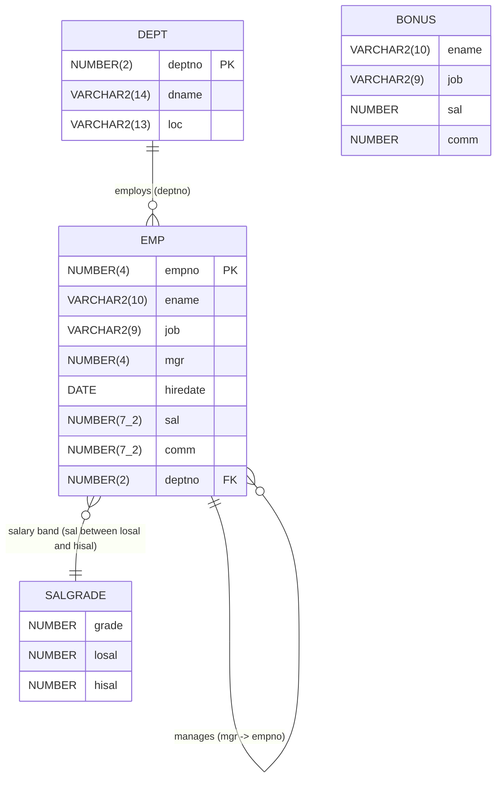

# Klassisches `SCOTT/TIGER` Schema

Das Schema **`SCOTT/TIGER`** (benannt nach Bruce Scott, einem der ersten Mitarbeiter von Oracle, und der Katze seiner Tochter, Tiger) hat Generationen von Entwicklern Oracle SQL beigebracht. In diesem Curriculum wird jedes neue Konzept zuerst an `SCOTT` eingeführt, weil alle **14 Employees** und **4 Departments** auf einen einzigen Bildschirm passen – so können echte Einsteiger Joins, `NULL`-Arithmetik und `GROUP BY`-Summen direkt mit dem Auge nachrechnen.

---

## Entity-Relationship Diagram (ERD)

---

## Warum `SCOTT` didaktisches Gold für `1Z0-171` ist

1. **`DEPT 40 (OPERATIONS, BOSTON)` hat null Employees**: Perfekt zum Testen von `LEFT OUTER JOIN` / `RIGHT OUTER JOIN` / `NOT EXISTS`.
2. **`EMP.COMM` enthält `NULL`, `0` und positive Beträge**:
   - `TURNER` hat `comm = 0` (nicht `NULL`!)
   - `ALLEN`, `WARD`, `MARTIN` haben positive Commissions
   - Die übrigen 10 Employees haben `comm IS NULL`
   - Beweist anschaulich: `AVG(comm)` ignoriert die 10 `NULL`s (teilt durch 4!), während `AVG(NVL(comm, 0))` durch 14 teilt!
3. **`KING` (`EMPNO 7839`) hat `MGR IS NULL`**:
   - Entscheidend für die klassische **`NOT IN` + `NULL` Trap**: `WHERE empno NOT IN (SELECT mgr FROM emp)` liefert **0 Rows**!
4. **`SALGRADE` (5 Rows)**: Speziell gedacht für **Non-Equijoins** (`BETWEEN losal AND hisal`).

---

## Vollständige Datenreferenz

### `DEPT` (4 Rows)
| `DEPTNO` | `DNAME` | `LOC` |
| :---: | :--- | :--- |
| `10` | `ACCOUNTING` | `NEW YORK` |
| `20` | `RESEARCH` | `DALLAS` |
| `30` | `SALES` | `CHICAGO` |
| `40` | `OPERATIONS` | `BOSTON` |

### `EMP` (14 Rows)
| `EMPNO` | `ENAME` | `JOB` | `MGR` | `HIREDATE` | `SAL` | `COMM` | `DEPTNO` |
| :---: | :--- | :--- | :---: | :---: | :---: | :---: | :---: |
| `7369` | `SMITH` | `CLERK` | `7902` | `1980-12-17` | `800` | *NULL* | `20` |
| `7499` | `ALLEN` | `SALESMAN` | `7698` | `1981-02-20` | `1600` | `300` | `30` |
| `7521` | `WARD` | `SALESMAN` | `7698` | `1981-02-22` | `1250` | `500` | `30` |
| `7566` | `JONES` | `MANAGER` | `7839` | `1981-04-02` | `2975` | *NULL* | `20` |
| `7654` | `MARTIN` | `SALESMAN` | `7698` | `1981-09-28` | `1250` | `1400` | `30` |
| `7698` | `BLAKE` | `MANAGER` | `7839` | `1981-05-01` | `2850` | *NULL* | `30` |
| `7782` | `CLARK` | `MANAGER` | `7839` | `1981-06-09` | `2450` | *NULL* | `10` |
| `7788` | `SCOTT` | `ANALYST` | `7566` | `1987-04-19` | `3000` | *NULL* | `20` |
| `7839` | `KING` | `PRESIDENT` | *NULL* | `1981-11-17` | `5000` | *NULL* | `10` |
| `7844` | `TURNER` | `SALESMAN` | `7698` | `1981-09-08` | `1500` | `0` | `30` |
| `7876` | `ADAMS` | `CLERK` | `7788` | `1987-05-23` | `1100` | *NULL* | `20` |
| `7900` | `JAMES` | `CLERK` | `7698` | `1981-12-03` | `950` | *NULL* | `30` |
| `7902` | `FORD` | `ANALYST` | `7566` | `1981-12-03` | `3000` | *NULL* | `20` |
| `7934` | `MILLER` | `CLERK` | `7782` | `1982-01-23` | `1300` | *NULL* | `10` |

### `SALGRADE` (5 Rows)
| `GRADE` | `LOSAL` | `HISAL` |
| :---: | :---: | :---: |
| `1` | `700` | `1200` |
| `2` | `1201` | `1400` |
| `3` | `1401` | `2000` |
| `4` | `2001` | `3000` |
| `5` | `3001` | `9999` |

Eigenständiges Setup-Skript herunterladen: [`scott_tiger.sql`](scott_tiger.sql)
