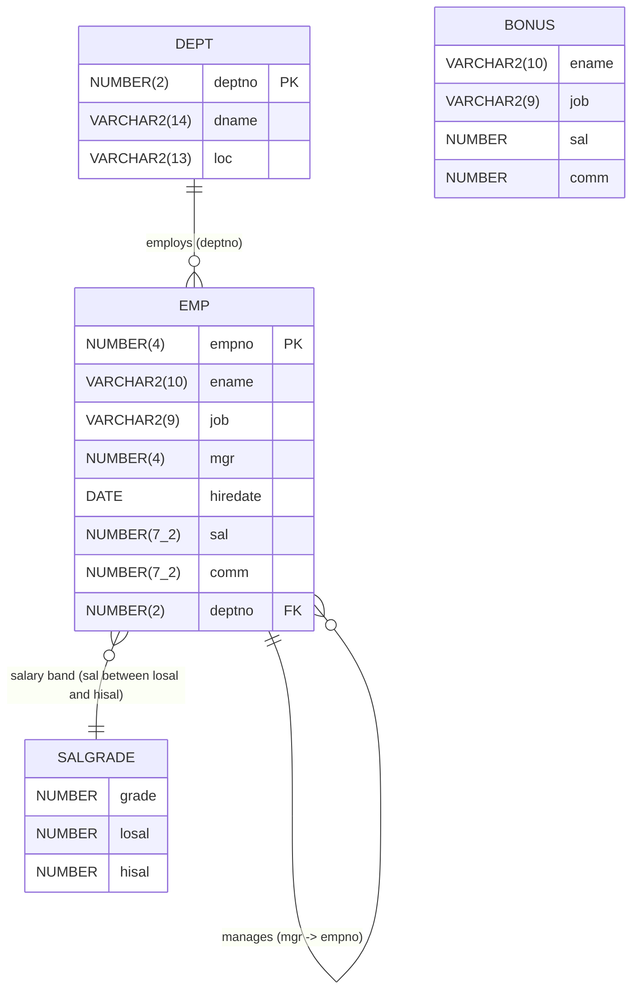

# Classic `SCOTT/TIGER` Schema

The **`SCOTT/TIGER`** schema (named after Bruce Scott, one of Oracle's earliest employees, and his daughter's cat, Tiger) has taught generations of developers Oracle SQL. In this curriculum, every concept is introduced on `SCOTT` first because all **14 employees** and **4 departments** fit on a single screen—letting true beginners verify joins, `NULL` arithmetic, and `GROUP BY` sums by eye.

---

## Entity-Relationship Diagram

---

## Why `SCOTT` Is Pedagogical Gold for `1Z0-171`

1. **`DEPT 40 (OPERATIONS, BOSTON)` has zero employees**: Perfect for testing `LEFT OUTER JOIN` / `RIGHT OUTER JOIN` / `NOT EXISTS`.
2. **`EMP.COMM` contains `NULL`, `0`, and positive numbers**:
   - `TURNER` has `comm = 0` (not `NULL`!)
   - `ALLEN`, `WARD`, `MARTIN` have positive commissions
   - The other 10 employees have `comm IS NULL`
   - Proves `AVG(comm)` ignores the 10 `NULL`s (divides by 4!), whereas `AVG(NVL(comm, 0))` divides by 14!
3. **`KING` (`EMPNO 7839`) has `MGR IS NULL`**:
   - Crucial for the classic **`NOT IN` + `NULL` trap**: `WHERE empno NOT IN (SELECT mgr FROM emp)` returns **0 rows**!
4. **`SALGRADE` (5 rows)**: Designed specifically for **Non-Equijoins** (`BETWEEN losal AND hisal`).

---

## Complete Dataset Reference

### `DEPT` (4 Rows)
| `DEPTNO` | `DNAME` | `LOC` |
| :---: | :--- | :--- |
| `10` | `ACCOUNTING` | `NEW YORK` |
| `20` | `RESEARCH` | `DALLAS` |
| `30` | `SALES` | `CHICAGO` |
| `40` | `OPERATIONS` | `BOSTON` |

### `EMP` (14 Rows)
| `EMPNO` | `ENAME` | `JOB` | `MGR` | `HIREDATE` | `SAL` | `COMM` | `DEPTNO` |
| :---: | :--- | :--- | :---: | :---: | :---: | :---: | :---: |
| `7369` | `SMITH` | `CLERK` | `7902` | `1980-12-17` | `800` | *NULL* | `20` |
| `7499` | `ALLEN` | `SALESMAN` | `7698` | `1981-02-20` | `1600` | `300` | `30` |
| `7521` | `WARD` | `SALESMAN` | `7698` | `1981-02-22` | `1250` | `500` | `30` |
| `7566` | `JONES` | `MANAGER` | `7839` | `1981-04-02` | `2975` | *NULL* | `20` |
| `7654` | `MARTIN` | `SALESMAN` | `7698` | `1981-09-28` | `1250` | `1400` | `30` |
| `7698` | `BLAKE` | `MANAGER` | `7839` | `1981-05-01` | `2850` | *NULL* | `30` |
| `7782` | `CLARK` | `MANAGER` | `7839` | `1981-06-09` | `2450` | *NULL* | `10` |
| `7788` | `SCOTT` | `ANALYST` | `7566` | `1987-04-19` | `3000` | *NULL* | `20` |
| `7839` | `KING` | `PRESIDENT` | *NULL* | `1981-11-17` | `5000` | *NULL* | `10` |
| `7844` | `TURNER` | `SALESMAN` | `7698` | `1981-09-08` | `1500` | `0` | `30` |
| `7876` | `ADAMS` | `CLERK` | `7788` | `1987-05-23` | `1100` | *NULL* | `20` |
| `7900` | `JAMES` | `CLERK` | `7698` | `1981-12-03` | `950` | *NULL* | `30` |
| `7902` | `FORD` | `ANALYST` | `7566` | `1981-12-03` | `3000` | *NULL* | `20` |
| `7934` | `MILLER` | `CLERK` | `7782` | `1982-01-23` | `1300` | *NULL* | `10` |

### `SALGRADE` (5 Rows)
| `GRADE` | `LOSAL` | `HISAL` |
| :---: | :---: | :---: |
| `1` | `700` | `1200` |
| `2` | `1201` | `1400` |
| `3` | `1401` | `2000` |
| `4` | `2001` | `3000` |
| `5` | `3001` | `9999` |

Download the standalone setup script: [`scott_tiger.sql`](scott_tiger.sql)
