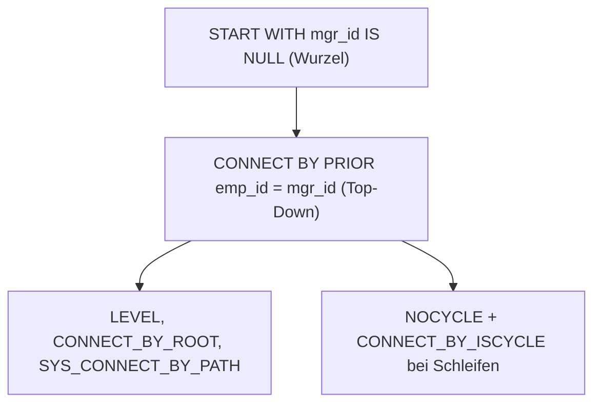

# Modul 1: Self-Joins, Hierarchien & Rekursive Joins (`A001`–`A010`)

**Voraussetzung**: `1Z0-171` Phasen 1–6 (insbesondere Self-Joins aus `L097`)  
**Sandbox-Tabellen**: `adv_org_emp`, `adv_bom` aus [advanced-queries-sandbox.sql](labs/advanced-queries-sandbox.sql)

---

## 1. Mehrstufige Self-Joins vs. beliebige Baumtiefe (`A001`–`A005`)

Ein klassischer Self-Join (`e LEFT JOIN m ON e.mgr_id = m.emp_id`) kennt nur **eine** feste Ebene. Sobald Organigramme oder Stücklisten beliebig tief werden, nutzt Oracle entweder **`CONNECT BY`** (Oracle-Klassiker) oder den **ANSI-Standard (rekursive `WITH`-CTE)**.

### `CONNECT BY PRIOR` & Hierarchie-Funktionen
```sql
SELECT emp_id,
       LEVEL AS lvl,
       LPAD(' ', (LEVEL - 1) * 2) || emp_name AS org_tree,
       CONNECT_BY_ROOT emp_name AS ceo_name,
       SYS_CONNECT_BY_PATH(emp_name, ' -> ') AS path_from_ceo,
       CONNECT_BY_ISLEAF AS is_leaf
FROM adv_org_emp
START WITH mgr_id IS NULL
CONNECT BY PRIOR emp_id = mgr_id
ORDER SIBLINGS BY emp_name;
```
- **`PRIOR emp_id = mgr_id`**: Top-Down (vom Chef zum Mitarbeiter). Umgekehrt (`PRIOR mgr_id = emp_id`) läuft Bottom-Up.
- **`ORDER SIBLINGS BY`**: Sortiert Geschwisterknoten auf derselben Ebene, **ohne** die Baumstruktur zu zerstören.
- **Zyklen (`ORA-01436`)**: Bei fehlerhaften Schleifen (`A -> B -> A`) verhindert `CONNECT BY NOCYCLE` den Abbruch und `CONNECT_BY_ISCYCLE` markiert die Schleife (`1`).

---

## 2. ANSI-Standard: Rekursive `WITH`-CTE (`A006`–`A009`)

```sql
WITH bom_tree (part_name, total_qty, lvl) AS (
  -- Anchor Member (Wurzel)
  SELECT child_part, qty, 1
  FROM adv_bom
  WHERE parent_part IS NULL
  UNION ALL
  -- Recursive Member
  SELECT b.child_part, t.total_qty * b.qty, t.lvl + 1
  FROM adv_bom b
  JOIN bom_tree t ON b.parent_part = t.part_name
)
SEARCH DEPTH FIRST BY part_name SET order_seq
SELECT part_name, SUM(total_qty) AS total_needed
FROM bom_tree
GROUP BY part_name
ORDER BY part_name;
```
- **Pflichtregel**: Nach dem CTE-Namen (`bom_tree (...)`) müssen in Oracle die Spaltennamen explizit aufgeführt werden!
- **`SEARCH DEPTH FIRST`** vs. **`SEARCH BREADTH FIRST`**: Steuert Tiefen- vs. Breitensuche.
- **`CYCLE col SET is_cycle TO 'Y' DEFAULT 'N'`**: ANSI-Pendant zu `NOCYCLE`.

---

### Visuelle Orientierung: Hierarchie-Traversierung

*Alt-Text: Ablauf einer hierarchischen Abfrage mit START WITH, CONNECT BY PRIOR, Pseudospalten und NOCYCLE.*

---

## Lektionen im Detail

### `A001` — Mehrstufige Self-Joins & Peer-Vergleiche
- **Lernziel:** 2- bis 3-stufige Self-Joins (`Mitarbeiter -> Manager -> Abteilungsleiter`), Paare innerhalb derselben Gruppe ohne Duplikate (`a.empno < b.empno`), Lücken- und Überlappungsprüfung *(Bloom: Anwenden)*
- **Selbstlern-Aufgabe (Lückentext/Check):** `SELECT a.ename, b.ename FROM scott.emp a JOIN scott.emp b ON a.deptno = b.deptno AND a.empno ___ b.empno;`

??? success "Musterlösung & Erklärung"
    a.empno < b.empno verhindert Selbst-Paare und doppelte (B,A)-Paare.

### `A002` — Klassische Oracle-Hierarchien: `START WITH` & `CONNECT BY PRIOR`
- **Lernziel:** Wurzelknoten definieren, Richtung der Rekursion (`PRIOR empno = mgr` Top-Down vs. `PRIOR mgr = empno` Bottom-Up), Pseudospalte `LEVEL` *(Bloom: Anwenden)*
- **Selbstlern-Aufgabe (Lückentext/Check):** `SELECT LPAD(' ', (LEVEL-1)*2) || emp_name FROM adv_org_emp START WITH mgr_id ___ CONNECT BY ___ emp_id = mgr_id;`

??? success "Musterlösung & Erklärung"
    START WITH mgr_id IS NULL CONNECT BY PRIOR emp_id = mgr_id (Top-Down).

### `A003` — Hierarchie-Visualisierung & Pfadbildung
- **Lernziel:** Einrückung mit `LPAD(' ', (LEVEL - 1) * 2) \ *(Bloom: Anwenden)*
- **Selbstlern-Aufgabe (Lückentext/Check):** `SELECT emp_name, ___ emp_name AS wurzel, SYS_CONNECT_BY_PATH(emp_name, '/') AS pfad FROM adv_org_emp START WITH mgr_id IS NULL CONNECT BY PRIOR emp_id = mgr_id;`

??? success "Musterlösung & Erklärung"
    CONNECT_BY_ROOT liefert den Namen des Wurzelknotens für jeden Ast.

### `A004` — Sortieren & Filtern in `CONNECT BY`-Hierarchien
- **Lernziel:** `ORDER SIBLINGS BY` (Geschwisterknoten sortieren, ohne Baumstruktur zu zerstören), Unterschied zwischen `WHERE`-Filter (nach Baumaufbau) und `CONNECT BY ... AND`-Filter (Ast abschneiden) *(Bloom: Analysieren)*
- **Selbstlern-Aufgabe (Lückentext/Check):** `SELECT emp_name FROM adv_org_emp START WITH mgr_id IS NULL CONNECT BY PRIOR emp_id = mgr_id ___ BY emp_name;`

??? success "Musterlösung & Erklärung"
    ORDER SIBLINGS BY sortiert Geschwisterknoten, ohne die Baumstruktur zu zerstören.

### `A005` — Zyklen erkennen & abfangen (`NOCYCLE`)
- **Lernziel:** Fehler `ORA-01436: CONNECT BY loop in user data` gezielt provozieren und mit `CONNECT BY NOCYCLE` + `CONNECT_BY_ISCYCLE` sauber auflösen *(Bloom: Analysieren)*
- **Selbstlern-Aufgabe (Lückentext/Check):** `SELECT emp_name, ___ FROM adv_org_emp START WITH emp_id = 1 CONNECT BY ___ PRIOR emp_id = mgr_id;`

??? success "Musterlösung & Erklärung"
    CONNECT BY NOCYCLE verhindert ORA-01436; CONNECT_BY_ISCYCLE markiert Schleifen (1).

### `A006` — ANSI-Standard: Rekursive Subquery Factoring (`WITH` CTE)
- **Lernziel:** Aufbau einer rekursiven `WITH`-Klausel (`Anchor Member UNION ALL Recursive Member`), Pflicht zur Spaltenliste nach dem CTE-Namen *(Bloom: Anwenden)*
- **Selbstlern-Aufgabe (Lückentext/Check):** `WITH tree (emp_id, mgr_id, lvl) AS (SELECT emp_id, mgr_id, 1 FROM adv_org_emp WHERE mgr_id IS NULL ___ SELECT e.emp_id, e.mgr_id, t.lvl+1 FROM adv_org_emp e JOIN tree t ON e.mgr_id = t.emp_id) SELECT * FROM tree;`

??? success "Musterlösung & Erklärung"
    UNION ALL verbindet Anchor Member und Recursive Member.

### `A007` — Tiefen- vs. Breitensuche in rekursiven CTEs
- **Lernziel:** `SEARCH DEPTH FIRST BY ... SET order_col` vs. `SEARCH BREADTH FIRST BY ... SET order_col`, Pfad-Akkumulation per String-Konkatenation *(Bloom: Anwenden)*
- **Selbstlern-Aufgabe (Lückentext/Check):** `... SEARCH ___ FIRST BY emp_name SET ord_seq SELECT * FROM tree ORDER BY ord_seq;`

??? success "Musterlösung & Erklärung"
    SEARCH DEPTH FIRST (Tiefensuche) oder SEARCH BREADTH FIRST (Breitensuche).

### `A008` — Zykluserkennung in rekursiven CTEs (`CYCLE`)
- **Lernziel:** `CYCLE empno SET is_cycle TO 'Y' DEFAULT 'N'`, Vergleich von `NOCYCLE` vs. `CYCLE`-Klausel *(Bloom: Anwenden)*
- **Selbstlern-Aufgabe (Lückentext/Check):** `... ___ emp_id SET is_cyc TO 'Y' DEFAULT 'N' SELECT * FROM tree;`

??? success "Musterlösung & Erklärung"
    CYCLE emp_id SET is_cyc TO 'Y' DEFAULT 'N' erkennt Zyklen im ANSI-CTE.

### `A009` — Stücklisten (Bill of Materials) & Mengen-Aggregation
- **Lernziel:** Multiplikation von Stückzahlen über mehrere Ebenen in einer rekursiven CTE und anschließende Aggregation der Gesamtkomponenten *(Bloom: Anwenden)*
- **Selbstlern-Aufgabe (Lückentext/Check):** `WITH bom (part, qty) AS (... UNION ALL SELECT c.child, b.qty * c.qty FROM ...) SELECT part, ___(qty) FROM bom GROUP BY part;`

??? success "Musterlösung & Erklärung"
    Multiplikation je Ebene, am Ende SUM(qty) je Komponente.

### `A010` — Modul-1-Lab: Org-Chart- & BOM-Reporting
- **Lernziel:** Vergleich derselben Problemstellung in `CONNECT BY` und rekursiver `WITH`-CTE inkl. Pfad, Ebene und Blatt-Kennzeichnung *(Bloom: Anwenden)*
- **Selbstlern-Aufgabe (Lückentext/Check):** `Vergleiche CONNECT BY vs. rekursive WITH-CTE in advanced-queries-sandbox.sql (Anzahl Zeilen & Pfadformat).`

??? success "Musterlösung & Erklärung"
    Beide liefern identische Baumtiefe; WITH-CTE ist ANSI-portabel.

---

## Selbstlern-Aufgaben (Modul 1)

1. **(★)** Gib mit `CONNECT BY` die gesamte Berichtskette **Bottom-Up** ausgehend von `'Becker'` (`emp_id = 5`) bis zum CEO aus.
2. **(★★)** Finde in `adv_org_emp` alle Mitarbeiter, die **keine** eigenen Untergebenen haben (`CONNECT_BY_ISLEAF = 1`).
3. **(★★★)** Schreibe eine **rekursive `WITH`-CTE** auf `adv_org_emp`, die für jeden Mitarbeiter seinen Pfad (`'Dr. Weber / Schmidt / ...'`) und die Ebene `lvl` ausgibt.

??? success "Musterlösungen zu Modul 1"
    ```sql
    -- 1 (Bottom-Up ab Becker):
    SELECT LEVEL, emp_name, role_name
    FROM adv_org_emp
    START WITH emp_name = 'Becker'
    CONNECT BY PRIOR mgr_id = emp_id;

    -- 2 (Nur Blattknoten):
    SELECT emp_name, role_name
    FROM adv_org_emp
    WHERE CONNECT_BY_ISLEAF = 1
    START WITH mgr_id IS NULL
    CONNECT BY PRIOR emp_id = mgr_id;

    -- 3 (Rekursive WITH-CTE mit Pfad):
    WITH org_cte (emp_id, emp_name, lvl, org_path) AS (
      SELECT emp_id, emp_name, 1, emp_name
      FROM adv_org_emp
      WHERE mgr_id IS NULL
      UNION ALL
      SELECT e.emp_id, e.emp_name, c.lvl + 1, c.org_path || ' / ' || e.emp_name
      FROM adv_org_emp e
      JOIN org_cte c ON e.mgr_id = c.emp_id
    )
    SELECT lvl, emp_name, org_path FROM org_cte;
    ```

## Oracle-Referenz (26ai)

- [Hierarchical Queries](https://docs.oracle.com/en/database/oracle/oracle-database/26/sqlrf/Hierarchical-Queries.html)
- [SELECT (inkl. Subquery Factoring / rekursive WITH)](https://docs.oracle.com/en/database/oracle/oracle-database/26/sqlrf/SELECT.html)
