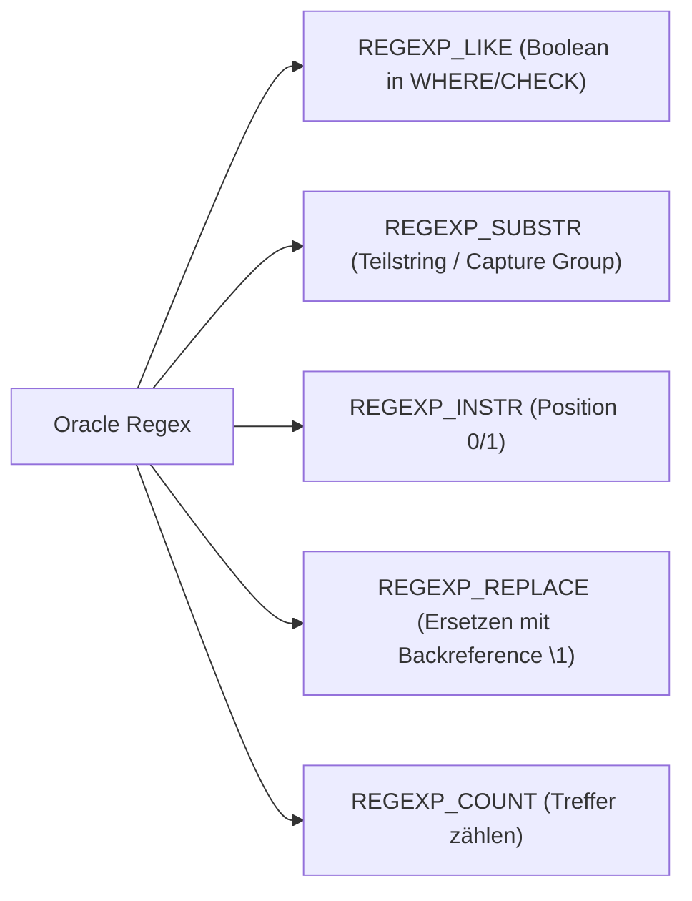

# Modul 2: Regular Expressions in Oracle SQL (`A011`–`A020`)

**Sandbox-Tabellen**: `adv_logs` aus [advanced-queries-sandbox.sql](labs/advanced-queries-sandbox.sql)

---

## 1. Die fünf `REGEXP_*`-Funktionen im Überblick

| Funktion | Zweck | Besonderheit |
| :--- | :--- | :--- |
| `REGEXP_LIKE(src, pat [, match_param])` | Wahrheitswert in `WHERE` oder `CHECK` | Ersetzt komplexe `LIKE`-Ketten |
| `REGEXP_INSTR(src, pat [, pos, occ, ret_opt, param, subexpr])` | Position des Treffers | `ret_opt = 0` (Start), `1` (nach Ende) |
| `REGEXP_SUBSTR(src, pat [, pos, occ, param, subexpr])` | Teilstring extrahieren | `subexpr = 1` liest 1. Capture Group `(...)` |
| `REGEXP_REPLACE(src, pat [, repl, pos, occ, param])` | Suchen & Ersetzen | Backreferences `\1`, `\2` im Ersatztext |
| `REGEXP_COUNT(src, pat [, pos, param])` | Anzahl Treffer zählen | Ideal für Wort-/Token-Zählungen |

### Capture Groups (`subexpr`) in Aktion
```sql
SELECT log_id,
       REGEXP_SUBSTR(raw_line, '\[([A-Z]+)\]', 1, 1, NULL, 1) AS severity,
       REGEXP_SUBSTR(raw_line, 'user=([a-z0-9_]+)', 1, 1, NULL, 1) AS username,
       TO_NUMBER(REGEXP_SUBSTR(raw_line, 'status=([0-9]{3})', 1, 1, NULL, 1)) AS http_status
FROM adv_logs
WHERE REGEXP_LIKE(raw_line, '\[(WARN|ERROR)\]');
```
- **Match-Parameter**: `'i'` (case-insensitive), `'c'` (case-sensitive), `'n'` (`.` matcht auch Zeilenumbruch), `'m'` (`^`/`$` je Zeile).
- **Greedy vs. Non-Greedy**: `.*` frisst so viel wie möglich; `.*?` stoppt beim ersten Treffer des Folgezeichens.

---

### Visuelle Orientierung: Oracle Regex-Funktionen

*Alt-Text: Übersicht der fünf Oracle Regular-Expression-Funktionen und ihrer Einsatzgebiete.*

---

## Lektionen im Detail

### `A011` — Regex-Grundlagen & Match-Parameter
- **Lernziel:** Metazeichen (`.`, `^`, `$`, `*`, `+`, `?`, `{m,n}`), Zeichenklassen (`[0-9]`, `[:digit:]`, `[:alpha:]`), Match-Parameter (`'i'`, `'c'`, `'n'`, `'m'`, `'x'`) *(Bloom: Anwenden)*
- **Selbstlern-Aufgabe (Lückentext/Check):** `SELECT * FROM dual WHERE REGEXP_LIKE('Oracle26', '^[A-Z]+[0-9]+$', '___');`
  ??? success "Musterlösung & Erklärung"
      Match-Parameter 'i' macht den Ausdruck case-insensitiv.

### `A012` — `REGEXP_LIKE` in `WHERE` und `CHECK` Constraints
- **Lernziel:** Komplexe Filter (z. B. gültige E-Mail-, PLZ- oder Kennzeichenmuster), Einsatz in `CHECK (REGEXP_LIKE(...))` *(Bloom: Anwenden)*
- **Selbstlern-Aufgabe (Lückentext/Check):** `ALTER TABLE adv_logs ADD CONSTRAINT chk_ip CHECK (___(msg, '^[0-9]{1,3}\.'));`
  ??? success "Musterlösung & Erklärung"
      REGEXP_LIKE prüft Muster direkt in WHERE oder CHECK Constraints.

### `A013` — `REGEXP_INSTR`: Treffer-Positionen exakt bestimmen
- **Lernziel:** Parameter `position`, `occurrence`, `return_option` (`0` = Start des Treffers, `1` = Position *nach* dem Treffer) und `subexpr` *(Bloom: Anwenden)*
- **Selbstlern-Aufgabe (Lückentext/Check):** `SELECT REGEXP_INSTR('Err:404 Not Found', '[0-9]+', 1, 1, ___) FROM dual;`
  ??? success "Musterlösung & Erklärung"
      return_option 0 = Startposition (5), 1 = Position direkt nach dem Treffer (8).

### `A014` — `REGEXP_SUBSTR`: Text- und Log-Extraktion
- **Lernziel:** Teilstrings per Muster extrahieren, Auftrennen von CSV-/Tag-Listen per `CONNECT BY LEVEL <= REGEXP_COUNT(...) + 1` *(Bloom: Anwenden)*
- **Selbstlern-Aufgabe (Lückentext/Check):** `SELECT REGEXP_SUBSTR('A,B,C', '[^,]+', 1, ___) FROM dual CONNECT BY LEVEL <= 3;`
  ??? success "Musterlösung & Erklärung"
      LEVEL als occurrence-Argument zerlegt CSV-Strings in Zeilen.

### `A015` — Capture Groups (`(...)`) & der `subexpr`-Parameter
- **Lernziel:** Gezieltes Auslesen einzelner Klammergruppen in `REGEXP_SUBSTR` (z. B. Hostname aus URL, Fehlercode aus Logzeile) *(Bloom: Analysieren)*
- **Selbstlern-Aufgabe (Lückentext/Check):** `SELECT REGEXP_SUBSTR('https://db.firma.ch/api', 'https://([^/]+)/', 1, 1, NULL, ___) FROM dual;`
  ??? success "Musterlösung & Erklärung"
      subexpr = 1 extrahiert nur Capture Group 1 ('db.firma.ch').

### `A016` — `REGEXP_REPLACE`: Bereinigung & Backreferences (`\1`, `\2`)
- **Lernziel:** Mehrfach-Leerzeichen normalisieren, Datums- oder Telefonnummernformate per Backreferences umbauen, Daten maskieren *(Bloom: Erschaffen)*
- **Selbstlern-Aufgabe (Lückentext/Check):** `SELECT REGEXP_REPLACE('2026-11-21', '(\d{4})-(\d{2})-(\d{2})', '\3.\2.___') FROM dual;`
  ??? success "Musterlösung & Erklärung"
      Backreference \1 fügt das Jahr ein → '21.11.2026'.

### `A017` — `REGEXP_COUNT` & Wort-/Token-Analysen
- **Lernziel:** Zählen von Treffern ohne Zeilenvervielfachung, Kombination mit `REGEXP_SUBSTR` für Token-Splitting *(Bloom: Anwenden)*
- **Selbstlern-Aufgabe (Lückentext/Check):** `SELECT REGEXP_COUNT('SQL und PL/SQL und SQL', '___') FROM dual;`
  ??? success "Musterlösung & Erklärung"
      'SQL' → zählt 3 Treffer (mit Wortgrenze '\bSQL\b' bzw. '(^| )SQL').

### `A018` — Greedy vs. Non-Greedy (Lazy) Quantifiers
- **Lernziel:** Unterschied zwischen `.*` (gierig) und `.*?` (genügsam) beim Parsen von HTML/JSON/Log-Fragmenten in Oracle SQL *(Bloom: Analysieren)*
- **Selbstlern-Aufgabe (Lückentext/Check):** `SELECT REGEXP_SUBSTR('<b>a</b><b>b</b>', '<b>___</b>') FROM dual;`
  ??? success "Musterlösung & Erklärung"
      '.*?' (non-greedy) liefert nur '<b>a</b>' statt bis zum letzten '</b>'.

### `A019` — Regex-Performance & Alternativen
- **Lernziel:** CPU-Kosten von Regex vs. `LIKE`/`INSTR`/`SUBSTR`, Einsatz von Function-Based Indexes bei `REGEXP_LIKE`/`REGEXP_SUBSTR` *(Bloom: Anwenden)*
- **Selbstlern-Aufgabe (Lückentext/Check):** `Wann ersetzt man REGEXP_LIKE(col, '^ABC') durch LIKE 'ABC%'?`
  ??? success "Musterlösung & Erklärung"
      Immer wenn ein Standard-Muster reicht: LIKE nutzt normale B-Tree-Indizes ohne Regex-CPU-Overhead.

### `A020` — Modul-2-Lab: Logfile- & Stammdaten-Bereinigung
- **Lernziel:** Extrahieren von IP-Adressen, HTTP-Statuscodes und fehlerhaften E-Mail-Einträgen aus unstrukturierten Textspalten *(Bloom: Analysieren)*
- **Selbstlern-Aufgabe (Lückentext/Check):** `Extrahiere aus adv_logs alle HTTP-Statuscodes >= 400 mit REGEXP_SUBSTR.`
  ??? success "Musterlösung & Erklärung"
      REGEXP_SUBSTR(log_line, 'HTTP/1\.1 ([45]\d{2})', 1, 1, NULL, 1).

---

## Selbstlern-Aufgaben (Modul 2)

1. **(★)** Extrahiere aus `adv_logs` den API-Pfad nach `path=` (z. B. `/api/orders`).
2. **(★★)** Maskiere in `adv_logs` die letzten beiden Oktette jeder IP-Adresse per `REGEXP_REPLACE` durch `x.x` (z. B. `192.168.x.x`).
3. **(★★★)** Zerlege den CSV-String `'SQL,PLSQL,APEX,JSON'` per `REGEXP_SUBSTR` + `CONNECT BY LEVEL <= REGEXP_COUNT(...) + 1` in 4 einzelne Zeilen.

??? success "Musterlösungen zu Modul 2"
    ```sql
    -- 1:
    SELECT log_id, REGEXP_SUBSTR(raw_line, 'path=([^ ]+)', 1, 1, NULL, 1) AS api_path
    FROM adv_logs;

    -- 2:
    SELECT log_id,
           REGEXP_REPLACE(raw_line, 'ip=([0-9]+\.[0-9]+)\.[0-9]+\.[0-9]+', 'ip=\1.x.x') AS masked_log
    FROM adv_logs;

    -- 3:
    SELECT LEVEL AS pos,
           REGEXP_SUBSTR('SQL,PLSQL,APEX,JSON', '[^,]+', 1, LEVEL) AS token
    FROM dual
    CONNECT BY LEVEL <= REGEXP_COUNT('SQL,PLSQL,APEX,JSON', ',') + 1;
    ```

## Oracle-Referenz (26ai)

- [REGEXP_SUBSTR](https://docs.oracle.com/en/database/oracle/oracle-database/26/sqlrf/REGEXP_SUBSTR.html)
- [SQL Language Reference](https://docs.oracle.com/en/database/oracle/oracle-database/26/sqlrf/index.html)
