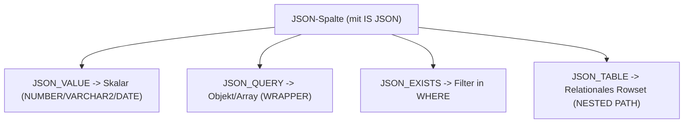

# Modul 3: JSON in Oracle SQL (`A021`–`A032`)

**Sandbox-Tabellen**: `adv_orders_json` aus [advanced-queries-sandbox.sql](labs/advanced-queries-sandbox.sql)

---

## 1. JSON abfragen: Dot-Notation, `JSON_VALUE`, `JSON_QUERY`, `JSON_TABLE`

In Oracle 21c/23ai gibt es den nativen binären **`JSON`**-Datentyp sowie `CLOB`/`VARCHAR2` mit `CHECK (col IS JSON)`.

| Funktion | Rückgabe | Typischer Einsatz |
| :--- | :--- | :--- |
| **Simple Dot Notation** | Skalar oder JSON-Fragment | `SELECT o.payload.customer.name FROM adv_orders_json o;` *(Tabellenalias Pflicht!)* |
| `JSON_VALUE` | **Einzelner SQL-Skalar** (`VARCHAR2`, `NUMBER`, `DATE`) | `JSON_VALUE(payload, '$.customer.tier' RETURNING VARCHAR2(20))` |
| `JSON_QUERY` | **JSON-Objekt oder Array** | `JSON_QUERY(payload, '$.items[*]' WITH WRAPPER)` |
| `JSON_EXISTS` | Wahrheitswert in `WHERE` | `WHERE JSON_EXISTS(payload, '$.items?(@.qty >= 5)')` |
| `JSON_TABLE` | **Virtuelle relationale Tabelle** | Master-Detail-Auflösung mit `NESTED PATH '$.items[*]'` |

### `JSON_TABLE` mit `NESTED PATH`
```sql
SELECT o.order_id, jt.customer_name, jt.item_pos, jt.sku, jt.qty * jt.price AS line_total
FROM adv_orders_json o,
     JSON_TABLE(
       o.payload, '$'
       COLUMNS (
         customer_name VARCHAR2(50) PATH '$.customer.name',
         NESTED PATH '$.items[*]'
         COLUMNS (
           item_pos FOR ORDINALITY,
           sku      VARCHAR2(30) PATH '$.sku',
           qty      NUMBER       PATH '$.qty',
           price    NUMBER(10,2) PATH '$.price'
         )
       )
     ) jt;
```

---

## 2. JSON aus relationalen Tabellen erzeugen & ändern (`A028`–`A031`)
- **`JSON_OBJECT` / `JSON_ARRAY` / `JSON_ARRAYAGG`**: Erzeugen strukturierte JSON-Payloads direkt aus `SCOTT.EMP` und `SCOTT.DEPT`.
- **`JSON_TRANSFORM`**: Deklarative Teil-Updates (`SET`, `INSERT`, `REMOVE`, `APPEND`) ohne das gesamte Dokument neu zu schreiben.
- **23ai JSON Relational Duality Views**: Verbinden relationale Normalisierung mit direktem Dokumenten-Zugriff (REST/Mongo-kompatibel).

---

### Visuelle Orientierung: JSON-Zugriffspfade in Oracle

*Alt-Text: Entscheidungsbaum für JSON_VALUE, JSON_QUERY, JSON_EXISTS und JSON_TABLE.*

---

## Lektionen im Detail

### `A021` — JSON-Speicherung & `IS JSON` Constraints
- **Lernziel:** Nativer binärer `JSON`-Datentyp (21c/23ai) vs. `VARCHAR2`/`CLOB` mit `CHECK (col IS JSON)`, `STRICT` vs. `LAX` Syntax *(Bloom: Anwenden)*
- **Selbstlern-Aufgabe (Lückentext/Check):** `CREATE TABLE t_json (id NUMBER, doc VARCHAR2(4000) CHECK (doc ___));`
  ??? success "Musterlösung & Erklärung"
      IS JSON (oder nativer Datentyp JSON in 21c+/26ai).

### `A022` — JSON Path Expressions & Simple Dot Notation
- **Lernziel:** Pfadsyntax (`$`, `.feld`, `[0]`, `[*]`, Filter `?(@.qty > 1)`), direkte Dot-Notation (`t.doc.customer.name`) mit Tabellenalias-Pflicht *(Bloom: Anwenden)*
- **Selbstlern-Aufgabe (Lückentext/Check):** `SELECT t.doc.___.name FROM adv_orders t;`
  ??? success "Musterlösung & Erklärung"
      Simple Dot Notation benötigt zwingend einen Tabellenalias (t).

### `A023` — `JSON_VALUE`: Skalarwerte typsicher extrahieren
- **Lernziel:** `RETURNING NUMBER/DATE/VARCHAR2`, Fehler- und Leer-Verhalten (`NULL ON ERROR`, `ERROR ON ERROR`, `DEFAULT ... ON EMPTY`) *(Bloom: Analysieren)*
- **Selbstlern-Aufgabe (Lückentext/Check):** `SELECT JSON_VALUE(doc, '$.total' ___ NUMBER ___ ON ERROR) FROM adv_orders;`
  ??? success "Musterlösung & Erklärung"
      RETURNING NUMBER NULL ON ERROR liefert typsichere Zahlen oder NULL bei Fehler.

### `A024` — `JSON_QUERY`: Objekte & Arrays extrahieren
- **Lernziel:** Teil-Dokumente und Arrays zurückgeben, `WITH [UNCONDITIONAL\ *(Bloom: Anwenden)*
- **Selbstlern-Aufgabe (Lückentext/Check):** `SELECT JSON_QUERY(doc, '$.items[*].sku' ___ WRAPPER) FROM adv_orders;`
  ??? success "Musterlösung & Erklärung"
      WITH WRAPPER (bzw. WITH CONDITIONAL WRAPPER) verpackt mehrere Treffer als JSON-Array.

### `A025` — `JSON_EXISTS`: Filtern auf JSON-Inhalte
- **Lernziel:** Existenz- und Wertprüfungen in `WHERE`, `PASSING`-Klausel für Bind-Variablen und SQL-Spalten im Pfad-Filter *(Bloom: Anwenden)*
- **Selbstlern-Aufgabe (Lückentext/Check):** `SELECT * FROM adv_orders WHERE JSON_EXISTS(doc, '$.items?(@.qty > $q)' ___ 2 AS "q");`
  ??? success "Musterlösung & Erklärung"
      PASSING 2 AS "q" übergibt SQL-Werte sicher in den JSON-Filter.

### `A026` — `JSON_TABLE`: JSON relational abfragen (Teil 1)
- **Lernziel:** Umwandeln von JSON-Dokumenten in virtuelle relationale Tabellen (`COLUMNS (...)`, `PATH`, `EXISTS PATH`) *(Bloom: Anwenden)*
- **Selbstlern-Aufgabe (Lückentext/Check):** `SELECT o.id, jt.* FROM adv_orders o, JSON_TABLE(o.doc, '$.items[*]' COLUMNS (sku VARCHAR2(20) PATH '$.sku', qty NUMBER PATH '$.qty')) jt;`
  ??? success "Musterlösung & Erklärung"
      JSON_TABLE wandelt Arrays relational in Zeilen (1 Zeile je Array-Element).

### `A027` — `JSON_TABLE`: Verschachtelte Arrays & `NESTED PATH` (Teil 2)
- **Lernziel:** Master-Detail-Auflösung (z. B. Bestellung + Bestellpositionen) mit `NESTED PATH '$.items[*]'` und `FOR ORDINALITY` *(Bloom: Anwenden)*
- **Selbstlern-Aufgabe (Lückentext/Check):** `SELECT JSON_TABLE(doc, '$' COLUMNS (cust PATH '$.cust', NESTED PATH '$.items[*]' COLUMNS (sku PATH '$.sku'))) FROM adv_orders;`
  ??? success "Musterlösung & Erklärung"
      NESTED PATH flacht geschachtelte Kopf-/Positionsdaten in einem Durchgang ab.

### `A028` — JSON aus relationalen Tabellen erzeugen (`JSON_OBJECT`, `JSON_ARRAY`)
- **Lernziel:** Aufbau strukturierter JSON-Dokumente aus `SCOTT`/`HR`, `ABSENT ON NULL` vs. `NULL ON NULL` *(Bloom: Anwenden)*
- **Selbstlern-Aufgabe (Lückentext/Check):** `SELECT JSON_OBJECT('empno' VALUE empno, 'ename' VALUE ename) FROM scott.emp;`
  ??? success "Musterlösung & Erklärung"
      JSON_OBJECT(...) + JSON_ARRAYAGG(...) erzeugen JSON aus relationalen Daten.

### `A029` — JSON-Aggregation (`JSON_OBJECTAGG`, `JSON_ARRAYAGG`)
- **Lernziel:** Gruppierte JSON-Arrays und Key-Value-Objekte (`ORDER BY` innerhalb von `JSON_ARRAYAGG`, `RETURNING CLOB`/`JSON`) *(Bloom: Anwenden)*
- **Selbstlern-Aufgabe (Lückentext/Check):** `UPDATE adv_orders SET doc = JSON_TRANSFORM(doc, ___ '$.status' = 'SHIPPED') WHERE id = 1;`
  ??? success "Musterlösung & Erklärung"
      SET '$.status' = 'SHIPPED' aktualisiert oder ergänzt ein JSON-Feld atomar.

### `A030` — JSON gezielt ändern: `JSON_TRANSFORM` & `JSON_MERGEPATCH`
- **Lernziel:** Deklarative Updates auf JSON-Feldern (`SET`, `INSERT`, `REMOVE`, `APPEND`, `RENAME`) in `UPDATE`- und `SELECT`-Statements *(Bloom: Anwenden)*
- **Selbstlern-Aufgabe (Lückentext/Check):** `Erstelle einen JSON Search Index: CREATE ___ INDEX idx_j ON adv_orders(doc) FOR JSON;`
  ??? success "Musterlösung & Erklärung"
      CREATE SEARCH INDEX ... FOR JSON beschleunigt flexible JSON_EXISTS-Filter.

### `A031` — JSON Search Indexes & 23ai JSON Relational Duality Views
- **Lernziel:** Überblick über `CREATE SEARCH INDEX ... FOR JSON` sowie das 23ai-Konzept von JSON Relational Duality Views *(Bloom: Verstehen)*
- **Selbstlern-Aufgabe (Lückentext/Check):** `Wann nutzt man eine JSON Relational Duality View (23ai/26ai)?`
  ??? success "Musterlösung & Erklärung"
      Wenn Anwendungen ein JSON-Dokument lesen/schreiben, die Daten aber normalisiert in relationalen Tabellen liegen sollen.

### `A032` — Modul-3-Lab: E-Commerce-Order-Pipeline
- **Lernziel:** Relationale `HR`/`SCOTT`-Daten als JSON-API-Payload exportieren, verschachtelte Bestell-JSONs mit `JSON_TABLE` auswerten und aggregieren *(Bloom: Anwenden)*
- **Selbstlern-Aufgabe (Lückentext/Check):** `Zerlege adv_orders mit JSON_TABLE + NESTED PATH und berechne den Bestellwert pro Kunde.`
  ??? success "Musterlösung & Erklärung"
      SUM(jt.qty * jt.price) GROUP BY o.customer.

---

## Selbstlern-Aufgaben (Modul 3)

1. **(★)** Gib mit `JSON_VALUE` für jede Bestellung aus `adv_orders_json` die `order_id`, den Kundennamen und das `orderDate` (als `DATE`) aus.
2. **(★★)** Berechne per `JSON_TABLE` den **Gesamtbestellwert** (`SUM(qty * price)`) je `order_id` und `customer_name`.
3. **(★★★)** Erzeuge aus `SCOTT.DEPT` und `SCOTT.EMP` für jede Abteilung ein JSON-Objekt mit `dname` und einem `employees`-Array (`JSON_ARRAYAGG`).

??? success "Musterlösungen zu Modul 3"
    ```sql
    -- 1:
    SELECT order_id,
           JSON_VALUE(payload, '$.customer.name') AS cust_name,
           JSON_VALUE(payload, '$.orderDate' RETURNING DATE) AS order_dt
    FROM adv_orders_json;

    -- 2:
    SELECT o.order_id, jt.customer_name, SUM(jt.qty * jt.price) AS order_total
    FROM adv_orders_json o,
         JSON_TABLE(o.payload, '$' COLUMNS (
           customer_name VARCHAR2(50) PATH '$.customer.name',
           NESTED PATH '$.items[*]' COLUMNS (qty NUMBER PATH '$.qty', price NUMBER(10,2) PATH '$.price')
         )) jt
    GROUP BY o.order_id, jt.customer_name;

    -- 3:
    SELECT JSON_OBJECT(
             'department' VALUE d.dname,
             'employees'  VALUE JSON_ARRAYAGG(e.ename ORDER BY e.ename)
           ) AS dept_json
    FROM scott.dept d
    LEFT JOIN scott.emp e ON d.deptno = e.deptno
    GROUP BY d.dname;
    ```

## Oracle-Referenz (26ai)

- [JSON_TABLE](https://docs.oracle.com/en/database/oracle/oracle-database/26/sqlrf/JSON_TABLE.html)
- [JSON Developer's Guide](https://docs.oracle.com/en/database/oracle/oracle-database/26/adjsn/index.html)
