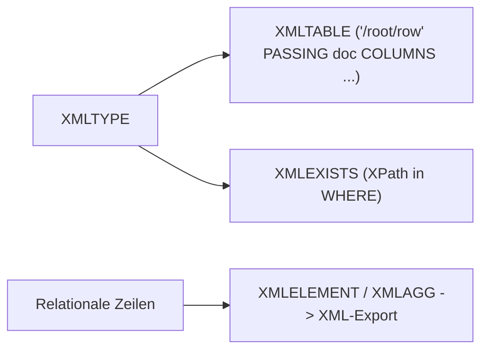

# Modul 4: XML in Oracle SQL (`A033`–`A042`)

**Sandbox-Tabellen**: `adv_catalog_xml` aus [advanced-queries-sandbox.sql](labs/advanced-queries-sandbox.sql)

---

## 1. XML generieren & abfragen (`XMLType`, `XMLELEMENT`, `XMLTABLE`)

| Konstrukt | Zweck |
| :--- | :--- |
| `XMLELEMENT("emp", XMLATTRIBUTES(empno AS "id"), ename)` | Erzeugt XML-Elemente & Attribute |
| `XMLFOREST(ename, job, sal)` | Erzeugt mehrere Kind-Elemente (lässt `NULL`s weg) |
| `XMLAGG(XMLELEMENT(...) ORDER BY ...)` | Aggregiert mehrere Zeilen in einen XML-Baum |
| `XMLEXISTS` / `XMLQUERY` / `XMLCAST` | XPath-/XQuery-Filter & skalare Extraktion |
| `XMLTABLE` | Zerlegt XML-Knoten in relationale Zeilen & Spalten |

### `XMLTABLE`-Beispiel
```sql
SELECT c.cat_id, xt.dept, xt.prod_id, xt.prod_name, xt.price, xt.currency
FROM adv_catalog_xml c,
     XMLTABLE(
       '/catalog/product'
       PASSING c.xml_doc
       COLUMNS
         dept      VARCHAR2(20) PATH '../@dept',
         prod_id   VARCHAR2(10) PATH '@id',
         prod_name VARCHAR2(60) PATH 'name',
         price     NUMBER(10,2) PATH 'price',
         currency  VARCHAR2(5)  PATH 'price/@currency'
     ) xt;
```

---

### Visuelle Orientierung: XML in Oracle SQL

*Alt-Text: Relationale Zerlegung mit XMLTABLE/XMLEXISTS und XML-Generierung mit XMLELEMENT/XMLAGG.*

---

## Lektionen im Detail

### `A033` — `XMLType` Grundlagen & `XMLPARSE`
- **Lernziel:** Speicherung als `XMLType`, Wohlgeformtheit prüfen (`XMLPARSE(DOCUMENT ... WELLFORMED)`), `XMLISVALID`
- **Selbstlern-Aufgabe (Lückentext/Check):** `Was ist der Unterschied zwischen einem wohlgeformten XML und einem Schema-validierten XMLTYPE?`
  ??? success "Musterlösung & Erklärung"
      XMLTYPE prüft Wohlgeformtheit; mit registriertem XSD erzwingt XMLTYPE zusätzlich Struktur- und Typvalidierung.

### `A034` — XML generieren: `XMLELEMENT` & `XMLATTRIBUTES`
- **Lernziel:** Relationale Zeilen in XML-Tags und Attribute umwandeln, Umgang mit Sonderzeichen und `NULL`-Werten
- **Selbstlern-Aufgabe (Lückentext/Check):** `SELECT XMLTABLE('/dept/emp' ___ x.doc COLUMNS ename VARCHAR2(20) PATH 'name') FROM adv_xml x;`
  ??? success "Musterlösung & Erklärung"
      PASSING x.doc übergibt die XMLTYPE-Spalte an XMLTABLE.

### `A035` — `XMLFOREST` & `XMLCONCAT` für kompaktes XML
- **Lernziel:** Mehrere Spalten elegant als Kind-Elemente erzeugen (`XMLFOREST`), Unterdrückung leerer Tags bei `NULL`
- **Selbstlern-Aufgabe (Lückentext/Check):** `... COLUMNS empno NUMBER PATH '___', sal NUMBER PATH 'salary';`
  ??? success "Musterlösung & Erklärung"
      '@id' liest das XML-Attribut id aus (<emp id="7369">).

### `A036` — `XMLAGG` & hierarchisches XML (Department -> Employees)
- **Lernziel:** Mehrere Zeilen zu einem XML-Baum aggregieren (`XMLAGG(XMLELEMENT(...) ORDER BY ...)`), Verschachtelung mit Subqueries
- **Selbstlern-Aufgabe (Lückentext/Check):** `SELECT * FROM adv_xml WHERE XMLEXISTS('/dept[loc="NEW YORK"]' ___ doc);`
  ??? success "Musterlösung & Erklärung"
      PASSING doc prüft per XPath in der WHERE-Klausel.

### `A037` — XPath & XQuery mit `XMLQUERY` und `XMLEXISTS`
- **Lernziel:** Filtern von XML-Dokumenten in `WHERE` mit `XMLEXISTS`, Extraktion über `XMLQUERY(... PASSING ... RETURNING CONTENT)`
- **Selbstlern-Aufgabe (Lückentext/Check):** `SELECT XMLELEMENT("dept", XMLATTRIBUTES(deptno AS "id"), XMLELEMENT("dname", dname)) FROM scott.dept;`
  ??? success "Musterlösung & Erklärung"
      Erzeugt <dept id="10"><dname>ACCOUNTING</dname></dept>.

### `A038` — `XMLCAST` & `XMLSERIALIZE`
- **Lernziel:** Konvertierung von XML-Fragmenten in SQL-Skalare (`XMLCAST(XMLQUERY(...) AS VARCHAR2(100))`) und formatierte Ausgabe (`INDENT`)
- **Selbstlern-Aufgabe (Lückentext/Check):** `SELECT XMLELEMENT("emps", ___(XMLELEMENT("emp", ename))) FROM scott.emp GROUP BY deptno;`
  ??? success "Musterlösung & Erklärung"
      XMLAGG aggregiert mehrere XML-Kindelemente je Gruppe.

### `A039` — `XMLTABLE`: XML in relationale Zeilen & Spalten zerlegen
- **Lernziel:** XQuery-Row-Generator + `COLUMNS`-Definition (`PATH`, Datentypen, `FOR ORDINALITY`), Master-Detail über verschachtelte `XMLTABLE`-Joins
- **Selbstlern-Aufgabe (Lückentext/Check):** `Wie bindet man einen XML-Namespace in XMLTABLE ein?`
  ??? success "Musterlösung & Erklärung"
      Mit XMLNAMESPACES('http://...' AS "ns"), direkt vor dem XQuery-Ausdruck.

### `A040` — XML Namespaces in `XMLTABLE` & `XMLEXISTS`
- **Lernziel:** Deklaration von `XMLNAMESPACES(DEFAULT '...', '...' AS "ns")` beim Abfragen realer Schnittstellen-XMLs
- **Selbstlern-Aufgabe (Lückentext/Check):** `Welche Performance-Massnahme hilft bei häufigen XPath-Abfragen auf grossen XMLTYPE-Spalten?`
  ??? success "Musterlösung & Erklärung"
      Binary XML Storage + XMLIndex (unstructured oder structured XMLIndex).

### `A041` — `XMLTRANSFORM` (XSLT) & XML-vs.-JSON-Vergleich
- **Lernziel:** Transformation von XML mittels XSLT-Stylesheet direkt in SQL, Gegenüberstellung `XMLTABLE` vs. `JSON_TABLE`
- **Selbstlern-Aufgabe (Lückentext/Check):** `Wann ist JSON gegenüber XML vorzuziehen, wann XML?`
  ??? success "Musterlösung & Erklärung"
      JSON für leichtgewichtige APIs/Events; XML bei strikten XSD-Verträgen, Attributen, Namespaces und Dokument-Standards (ISO 20022, UBL).

### `A042` — Modul-4-Lab: Produktkatalog- & Rechnungs-Parsing
- **Lernziel:** Komplexes XML mit Namespaces per `XMLTABLE` relational aufbereiten und aggregierte Auswertungen wieder als XML exportieren
- **Selbstlern-Aufgabe (Lückentext/Check):** `Zerlege adv_xml per XMLTABLE und joine das Ergebnis mit scott.dept.`
  ??? success "Musterlösung & Erklärung"
      XMLTABLE als virtuelle Tabelle im FROM-Teil direkt per JOIN verknüpfen.

---

## Selbstlern-Aufgaben (Modul 4)

1. **(★)** Filtere `adv_catalog_xml` mit `XMLEXISTS`, sodass nur Kataloge gefunden werden, die ein Produkt mit `price > 80` enthalten.
2. **(★★)** Berechne per `XMLTABLE` den Durchschnittspreis aller Produkte in `adv_catalog_xml`.
3. **(★★★)** Exportiere `SCOTT.DEPT` (mit verschachtelten `EMP`-Elementen per `XMLAGG`) als wohlgeformtes XML-Dokument.

??? success "Musterlösungen zu Modul 4"
    ```sql
    -- 1:
    SELECT cat_id FROM adv_catalog_xml
    WHERE XMLEXISTS('/catalog/product[price > 80]' PASSING xml_doc);

    -- 2:
    SELECT AVG(xt.price) AS avg_price
    FROM adv_catalog_xml c,
         XMLTABLE('/catalog/product' PASSING c.xml_doc COLUMNS price NUMBER(10,2) PATH 'price') xt;

    -- 3:
    SELECT XMLELEMENT("department",
             XMLATTRIBUTES(d.deptno AS "id", d.dname AS "name"),
             XMLAGG(XMLELEMENT("employee", e.ename) ORDER BY e.ename)
           ).getClobVal() AS dept_xml
    FROM scott.dept d
    LEFT JOIN scott.emp e ON d.deptno = e.deptno
    GROUP BY d.deptno, d.dname;
    ```

## Oracle-Referenz (26ai)

- [XMLTABLE](https://docs.oracle.com/en/database/oracle/oracle-database/26/sqlrf/XMLTABLE.html)
- [XML DB Developer's Guide](https://docs.oracle.com/en/database/oracle/oracle-database/26/adxdb/index.html)
