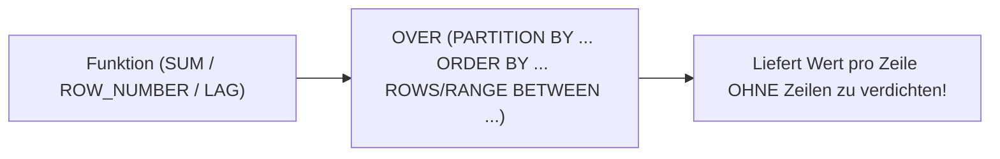

# Modul 5: Analytic / Window Functions & Pivoting (`A043`–`A052`)

**Sandbox-Tabellen**: `adv_org_emp`, `SCOTT.EMP`

---

## 1. Mental Model: `GROUP BY` vs. `OVER (PARTITION BY ...)`

- **`GROUP BY`** reduziert Zeilen (aus 14 Employees werden 3 Department-Zeilen).
- **Analytic Functions (`OVER (...)`)** behalten **alle 14 Zeilen** bei und berechnen Gruppenwerte, Rankings oder laufende Summen daneben. Sie laufen logisch *nach* `WHERE`/`GROUP BY`/`HAVING` und *vor* `ORDER BY`.

### Wichtige Window Functions
- **Ranking**: `ROW_NUMBER()` (eindeutig 1,2,3,4), `RANK()` (Lücken bei Gleichstand: 1,2,2,4), `DENSE_RANK()` (ohne Lücken: 1,2,2,3), `NTILE(n)`.
- **Navigation**: `LAG(col, offset, default)` (vorherige Zeile), `LEAD(col, offset, default)` (nächste Zeile).
- **Windowing Clause (`ROWS` vs. `RANGE`)**:
  > **Exam Trap (`LAST_VALUE`)**: Wenn `ORDER BY` in `OVER (...)` steht, ist das Standard-Window `RANGE BETWEEN UNBOUNDED PRECEDING AND CURRENT ROW`. Deshalb liefert `LAST_VALUE(sal) OVER (ORDER BY sal)` den aktuellen Wert statt des echten Endwerts — für das volle Fenster brauchst du `ROWS BETWEEN UNBOUNDED PRECEDING AND UNBOUNDED FOLLOWING`!
- **`LISTAGG`**: `LISTAGG(ename, ', ') WITHIN GROUP (ORDER BY ename) ON OVERFLOW TRUNCATE '...' WITH COUNT`.
- **`PIVOT` / `UNPIVOT`**: Drehen Zeilen zu Kreuztabellen-Spalten und umgekehrt.

---

### Visuelle Orientierung: Analytic Window-Klausel

*Alt-Text: Aufbau einer Analytic Function mit OVER (PARTITION BY, ORDER BY und Window Frame).*

---

## Lektionen im Detail

### `A043` — Mental Model: `GROUP BY` vs. `OVER (PARTITION BY ...)`
- **Lernziel:** Ausführungsreihenfolge (Analytic Functions laufen *nach* `WHERE`, `GROUP BY`, `HAVING`, *vor* `ORDER BY`), `SUM(sal) OVER (PARTITION BY deptno)`
- **Selbstlern-Aufgabe (Lückentext/Check):** `SELECT ename, sal, SUM(sal) OVER () AS gesamt FROM scott.emp;`
  ??? success "Musterlösung & Erklärung"
      Leeres OVER () berechnet die Gesamtsumme über alle 14 Zeilen, ohne Zeilen zu verdichten.

### `A044` — Ranking Functions: `ROW_NUMBER`, `RANK`, `DENSE_RANK`, `NTILE`
- **Lernziel:** Verhalten bei Gleichstand (Ties), Top-N-per-Group-Muster (z. B. Top 2 Gehälter je Department), Duplikate deduplizieren
- **Selbstlern-Aufgabe (Lückentext/Check):** `SELECT ename, deptno, sal, AVG(sal) OVER (___ deptno) FROM scott.emp;`
  ??? success "Musterlösung & Erklärung"
      PARTITION BY deptno bildet das Fenster pro Abteilung.

### `A045` — Windowing Clauses: `ROWS BETWEEN` vs. `RANGE BETWEEN`
- **Lernziel:** Laufende Summen (`UNBOUNDED PRECEDING AND CURRENT ROW`), gleitende Durchschnitte (`2 PRECEDING AND CURRENT ROW`), Default-Falle bei `ORDER BY` (`RANGE`)
- **Selbstlern-Aufgabe (Lückentext/Check):** `SELECT ename, deptno, sal, ___() OVER (PARTITION BY deptno ORDER BY sal DESC) AS rn FROM scott.emp;`
  ??? success "Musterlösung & Erklärung"
      ROW_NUMBER() vergibt eindeutige Ränge 1,2,3... (im Gegensatz zu RANK/DENSE_RANK bei Gleichstand).

### `A046` — Navigation: `LAG` & `LEAD`
- **Lernziel:** Zugriff auf vorherige/nächste Zeile (`LAG(sal, 1, 0) OVER (...)`), Differenzen zum Vormonat oder zum Vorgänger berechnen
- **Selbstlern-Aufgabe (Lückentext/Check):** `SELECT ename, sal, SUM(sal) OVER (ORDER BY empno ROWS BETWEEN ___ PRECEDING AND CURRENT ROW) FROM scott.emp;`
  ??? success "Musterlösung & Erklärung"
      UNBOUNDED PRECEDING berechnet die laufende Summe (Running Total).

### `A047` — `FIRST_VALUE`, `LAST_VALUE` & `NTH_VALUE`
- **Lernziel:** Typische `LAST_VALUE`-Falle (Standard-Window endet bei `CURRENT ROW` → `ROWS BETWEEN UNBOUNDED PRECEDING AND UNBOUNDED FOLLOWING` nötig!)
- **Selbstlern-Aufgabe (Lückentext/Check):** `Welcher Unterschied besteht zwischen ROWS BETWEEN ... und RANGE BETWEEN ...?`
  ??? success "Musterlösung & Erklärung"
      ROWS zählt physische Zeilen; RANGE fasst logisch gleiche ORDER-BY-Werte zusammen (Standard bei ORDER BY ohne Frame!).

### `A048` — String-Aggregation mit `LISTAGG`
- **Lernziel:** `LISTAGG(ename, ', ') WITHIN GROUP (ORDER BY ename)`, `ON OVERFLOW TRUNCATE '...' WITH COUNT`, Einsatz als Analytic Function
- **Selbstlern-Aufgabe (Lückentext/Check):** `SELECT ename, sal, ___(sal, 1, 0) OVER (ORDER BY hiredate) AS prev_sal FROM scott.emp;`
  ??? success "Musterlösung & Erklärung"
      LAG(sal, 1, 0) liest den vorherigen Wert (LEAD den nächsten).

### `A049` — Zeilen zu Spalten drehen: `PIVOT`
- **Lernziel:** Kreuztabellen direkt in SQL (`PIVOT (SUM(sal) FOR deptno IN (10, 20, 30))`), mehrere Aggregate im `PIVOT`
- **Selbstlern-Aufgabe (Lückentext/Check):** `SELECT ename, sal, FIRST_VALUE(ename) OVER (ORDER BY sal DESC) AS top_earner FROM scott.emp;`
  ??? success "Musterlösung & Erklärung"
      Achtung bei LAST_VALUE: ohne ROWS BETWEEN UNBOUNDED PRECEDING AND UNBOUNDED FOLLOWING endet das Standardfenster bei CURRENT ROW!

### `A050` — Spalten zu Zeilen drehen: `UNPIVOT`
- **Lernziel:** Normalisierung breiter Tabellen (`UNPIVOT [INCLUDE\
- **Selbstlern-Aufgabe (Lückentext/Check):** `SELECT * FROM (SELECT deptno, job, sal FROM scott.emp) ___ (SUM(sal) FOR deptno IN (10, 20, 30));`
  ??? success "Musterlösung & Erklärung"
      PIVOT dreht Zeilenwerte (10, 20, 30) in Spalten.

### `A051` — Ratio-to-Report & statistische Analytic Functions
- **Lernziel:** `RATIO_TO_REPORT(sal) OVER (PARTITION BY deptno)`, `PERCENT_RANK`, `CUME_DIST`, `MEDIAN`
- **Selbstlern-Aufgabe (Lückentext/Check):** `SELECT * FROM umsatz_breit ___ (betrag FOR monat IN (jan, feb, mar));`
  ??? success "Musterlösung & Erklärung"
      UNPIVOT wandelt Spalten zurück in Zeilen (Standard: EXCLUDE NULLS).

### `A052` — Modul-5-Lab: HR-Gehaltsanalyse & Zeitreihen-Reporting
- **Lernziel:** Kombinierte Abfrage mit Ranking, laufender Summe, Abteilungsanteil und `LAG`-Abstand
- **Selbstlern-Aufgabe (Lückentext/Check):** `Erstelle ein Top-2-Gehaltsranking pro Abteilung inkl. Vormonats-/Nachbar-Differenz auf scott.emp.`
  ??? success "Musterlösung & Erklärung"
      CTE mit DENSE_RANK() OVER (PARTITION BY deptno ORDER BY sal DESC) AS rnk, aussen WHERE rnk <= 2.

---

## Selbstlern-Aufgaben (Modul 5)

1. **(★)** Finde in `SCOTT.EMP` die **Top 2 Bestverdiener je `deptno`** mittels `DENSE_RANK() OVER (PARTITION BY deptno ORDER BY sal DESC)`.
2. **(★★)** Berechne für `SCOTT.EMP` den prozentualen Anteil jedes Mitarbeiters am Gehalt seiner Abteilung (`ROUND(RATIO_TO_REPORT(sal) OVER (PARTITION BY deptno) * 100, 1)`).
3. **(★★★)** Erstelle mit `PIVOT` eine Kreuztabelle, die für jedes `job` in `SCOTT.EMP` die Gehaltssumme je `deptno IN (10, 20, 30)` als eigene Spalte anzeigt.

??? success "Musterlösungen zu Modul 5"
    ```sql
    -- 1:
    SELECT deptno, ename, sal, rnk
    FROM (
      SELECT deptno, ename, sal,
             DENSE_RANK() OVER (PARTITION BY deptno ORDER BY sal DESC) AS rnk
      FROM scott.emp
    )
    WHERE rnk <= 2;

    -- 2:
    SELECT deptno, ename, sal,
           ROUND(RATIO_TO_REPORT(sal) OVER (PARTITION BY deptno) * 100, 1) AS dept_pct
    FROM scott.emp
    ORDER BY deptno, sal DESC;

    -- 3:
    SELECT *
    FROM (SELECT job, deptno, sal FROM scott.emp)
    PIVOT (
      SUM(sal) FOR deptno IN (10 AS d10, 20 AS d20, 30 AS d30)
    )
    ORDER BY job;
    ```

## Oracle-Referenz (26ai)

- [Analytic Functions](https://docs.oracle.com/en/database/oracle/oracle-database/26/sqlrf/Analytic-Functions.html)
- [SELECT (PIVOT / UNPIVOT)](https://docs.oracle.com/en/database/oracle/oracle-database/26/sqlrf/SELECT.html)
