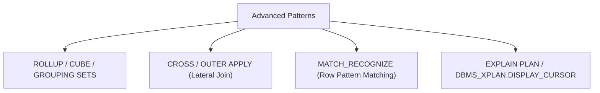

# Modul 6: Erweiterte Query-Patterns & Performance (`A053`–`A060`)

**Sandbox-Tabellen**: `SCOTT.EMP`, `SCOTT.DEPT`, `adv_org_emp`

---

## 1. Mehrdimensionale Aggregation (`ROLLUP`, `CUBE`, `GROUPING SETS`)
- **`GROUP BY ROLLUP(a, b)`**: Erzeugt `(a, b)`, `(a)`-Zwischensummen und `()`-Gesamtsumme.
- **`GROUP BY CUBE(a, b)`**: Erzeugt alle 4 Kombinationen `(a, b)`, `(a)`, `(b)`, `()`.
- **`GROUPING(col)`**: Liefert `1`, wenn `NULL` durch eine Subtotal-/Total-Zeile entstanden ist, und `0` bei echten Datenwerten.

## 2. `CROSS APPLY` / `OUTER APPLY` (`A055`)
Korrelierte Tabellenfunktionen direkt in der `FROM`-Klausel — z. B. „Top 2 Mitarbeiter pro Department“ ohne umständliche Subquery-Verschachtelung:
```sql
SELECT d.dname, t.ename, t.sal
FROM scott.dept d
OUTER APPLY (
  SELECT e.ename, e.sal
  FROM scott.emp e
  WHERE e.deptno = d.deptno
  ORDER BY e.sal DESC
  FETCH FIRST 2 ROWS ONLY
) t;
```

## 3. Row Pattern Matching: `MATCH_RECOGNIZE` (`A056`–`A057`)
Erkennt Muster über sortierte Zeilen hinweg (z. B. Gehaltsanstiege, Islands & Gaps, Sessionization) mit `PARTITION BY`, `ORDER BY`, `MEASURES`, `PATTERN` und `DEFINE`.

## 4. Execution Plans lesen (`EXPLAIN PLAN` & `DBMS_XPLAN.DISPLAY`) (`A059`)
```sql
EXPLAIN PLAN FOR
SELECT e.ename, d.dname FROM scott.emp e JOIN scott.dept d ON e.deptno = d.deptno;

SELECT * FROM TABLE(DBMS_XPLAN.DISPLAY);
```
Achte besonders auf: **Operation** (`TABLE ACCESS FULL` vs. `INDEX RANGE SCAN`), **Rows (Cardinality)**, **Cost** sowie **Access vs. Filter Predicates** im unteren Abschnitt.

---

### Visuelle Orientierung: Advanced Patterns & Execution Plan

*Alt-Text: Vier Kernthemen in Modul 6: erweiterte Gruppierung, Lateral Joins, MATCH_RECOGNIZE und Execution Plans.*

---

## Lektionen im Detail

### `A053` — Mehrdimensionale Aggregation: `ROLLUP`, `CUBE` & `GROUPING SETS`
- **Lernziel:** Zwischen- und Gesamtsummen in einem einzigen Tabellenscan, gezielte Kombinationen mit `GROUPING SETS` *(Bloom: Anwenden)*
- **Selbstlern-Aufgabe (Lückentext/Check):** `SELECT deptno, job, SUM(sal) FROM scott.emp GROUP BY ___ (deptno, job);`

??? success "Musterlösung & Erklärung"
    ROLLUP(deptno, job) liefert Detailzeilen, Abteilungssummen und Gesamtsumme (CUBE zusätzlich Job-Summen).

### `A054` — `GROUPING()` & `GROUPING_ID()`
- **Lernziel:** Echte `NULL`-Werte von Subtotal-`NULL`s unterscheiden und sprechende Labels (`'Gesamt'`) erzeugen *(Bloom: Verstehen)*
- **Selbstlern-Aufgabe (Lückentext/Check):** `Wozu dient GROUPING(deptno) in einer ROLLUP-Abfrage?`

??? success "Musterlösung & Erklärung"
    Liefert 1 für die künstlich erzeugte NULL-Zeile einer Zwischen-/Gesamtsumme und 0 für echte Datenzeilen.

### `A055` — `LATERAL` Inline Views & `CROSS APPLY` / `OUTER APPLY`
- **Lernziel:** Korrelierte Subqueries in der `FROM`-Klausel (z. B. Top-2-Mitarbeiter pro Department per `APPLY` + `FETCH FIRST 2 ROWS ONLY`) *(Bloom: Anwenden)*
- **Selbstlern-Aufgabe (Lückentext/Check):** `SELECT d.dname, e.ename FROM scott.dept d ___ APPLY (SELECT ename FROM scott.emp e WHERE e.deptno = d.deptno FETCH FIRST 2 ROWS ONLY) e;`

??? success "Musterlösung & Erklärung"
    CROSS APPLY (bzw. OUTER APPLY um DEPT 40 zu behalten) erlaubt korrelierte Top-N-Subqueries in FROM.

### `A056` — Row Pattern Matching: `MATCH_RECOGNIZE` (Teil 1)
- **Lernziel:** Grundaufbau (`PARTITION BY`, `ORDER BY`, `MEASURES`, `PATTERN`, `DEFINE`) für V-/W-Muster und Trend-Erkennung *(Bloom: Anwenden)*
- **Selbstlern-Aufgabe (Lückentext/Check):** `Wozu dient MATCH_RECOGNIZE in Oracle SQL?`

??? success "Musterlösung & Erklärung"
    Zur Erkennung sequenzieller Muster über sortierte Zeilen (z. B. V-förmige Kurse, Session-Timeouts) direkt in SQL.

### `A057` — `MATCH_RECOGNIZE` (Teil 2): Islands & Gaps / Sessionization
- **Lernziel:** Zusammenhängende Zeiträume oder fehlende Sequenznummern elegant mit `MATCH_RECOGNIZE` erkennen *(Bloom: Erinnern)*
- **Selbstlern-Aufgabe (Lückentext/Check):** `Welche Klauseln gehören mindestens in MATCH_RECOGNIZE (ORDER BY ..., MEASURES ..., PATTERN ..., DEFINE ...)?`

??? success "Musterlösung & Erklärung"
    ORDER BY für die Reihenfolge, PATTERN für den Regex auf Zeilenvariablen (z. B. A B+ C) und DEFINE für deren Bedingungen.

### `A058` — Komplexe `WITH`-Pipelines & CTE-Optimierung
- **Lernziel:** Mehrstufige Transformationen sauber strukturieren, Hinweise zu `MATERIALIZE` vs. `INLINE` *(Bloom: Anwenden)*
- **Selbstlern-Aufgabe (Lückentext/Check):** `Warum verhindert WHERE UPPER(ename) = 'SMITH' oft einen Standard-Index auf ename?`

??? success "Musterlösung & Erklärung"
    Weil die Spalte in einer Funktion steckt — Lösung: Function-Based Index auf UPPER(ename).

### `A059` — Execution Plans lesen (`EXPLAIN PLAN` & `DBMS_XPLAN.DISPLAY`)
- **Lernziel:** Kosten, Cardinality, Access Predicates vs. Filter Predicates bei Joins, `JSON_TABLE`, `XMLTABLE` und Regex verstehen *(Bloom: Verstehen)*
- **Selbstlern-Aufgabe (Lückentext/Check):** `Welche zwei Befehle zeigen den geschätzten vs. den tatsächlich gelaufenen Execution Plan?`

??? success "Musterlösung & Erklärung"
    Geschätzt: EXPLAIN PLAN FOR ... + DBMS_XPLAN.DISPLAY; Tatsächlich: SELECT * FROM TABLE(DBMS_XPLAN.DISPLAY_CURSOR(NULL, NULL, 'ALLSTATS LAST')).

### `A060` — Capstone-Projekt: End-to-End-Analyse-Query
- **Lernziel:** Kombinierte Auswertung über hierarchische Daten, JSON/XML-Nutzlast, Regex-Bereinigung und Window Functions *(Bloom: Anwenden)*
- **Selbstlern-Aufgabe (Lückentext/Check):** `Löse das Capstone-Szenario in advanced-queries-sandbox.sql (Hierarchie + JSON/Regex + Window-Ranking).`

??? success "Musterlösung & Erklärung"
    Prüfe mit EXPLAIN PLAN, dass unnötige Full Table Scans / kartesische Joins vermieden werden.

---

## Selbstlern-Aufgaben (Modul 6)

1. **(★)** Erstelle auf `SCOTT.EMP` eine `ROLLUP(deptno, job)`-Auswertung mit `GROUPING(deptno)` und sprechendem Label `'GESAMT'` für die Gesamtsumme.
2. **(★★)** Nutze `OUTER APPLY`, um zu jedem Department in `SCOTT.DEPT` den bestbezahlten Mitarbeiter auszugeben (inkl. `DEPT 40 OPERATIONS` mit `NULL`).
3. **(★★★)** Finde in einer Zahlenfolge (`1, 2, 3, 5, 6, 9`) per `MATCH_RECOGNIZE` alle zusammenhängenden „Inseln“ (Startwert, Endwert, Länge).

??? success "Musterlösungen zu Modul 6"
    ```sql
    -- 1:
    SELECT CASE WHEN GROUPING(deptno) = 1 THEN 'GESAMT' ELSE TO_CHAR(deptno) END AS dept,
           CASE WHEN GROUPING(job) = 1    THEN 'SUBTOTAL' ELSE job END AS job_grp,
           SUM(sal) AS total_sal
    FROM scott.emp
    GROUP BY ROLLUP(deptno, job);

    -- 2:
    SELECT d.dname, top_emp.ename, top_emp.sal
    FROM scott.dept d
    OUTER APPLY (
      SELECT e.ename, e.sal FROM scott.emp e
      WHERE e.deptno = d.deptno
      ORDER BY e.sal DESC FETCH FIRST 1 ROW ONLY
    ) top_emp;

    -- 3:
    WITH nums AS (
      SELECT 1 n FROM dual UNION ALL SELECT 2 FROM dual UNION ALL SELECT 3 FROM dual
      UNION ALL SELECT 5 FROM dual UNION ALL SELECT 6 FROM dual UNION ALL SELECT 9 FROM dual
    )
    SELECT start_n, end_n, island_len
    FROM nums
    MATCH_RECOGNIZE (
      ORDER BY n
      MEASURES FIRST(n) AS start_n, LAST(n) AS end_n, COUNT(*) AS island_len
      PATTERN (strt consec*)
      DEFINE consec AS n = PREV(n) + 1
    );
    ```

## Oracle-Referenz (26ai)

- [SELECT (MATCH_RECOGNIZE)](https://docs.oracle.com/en/database/oracle/oracle-database/26/sqlrf/SELECT.html)
- [SQL Tuning Guide](https://docs.oracle.com/en/database/oracle/oracle-database/26/tgsql/index.html)
