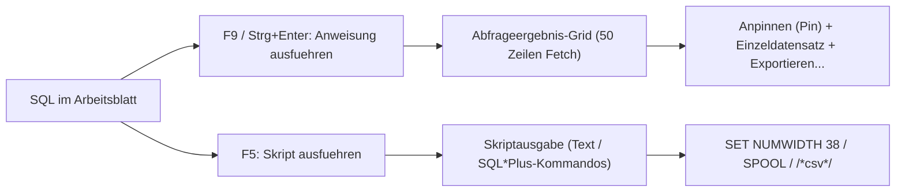

# Modul 1: Oberfläche, Schachbrettmuster, Grid & NLS (`D001`–`D005`)

**Voraussetzung**: Installation oder Zugang zu Oracle SQL Developer (oder VS Code Extension / Database Actions)  
**Sandbox-Tabellen**: `sd_customers`, `sd_transactions` aus [sqldeveloper-sandbox.sql](labs/sqldeveloper-sandbox.sql)

---

## 1. Schachbrett-/Zebramuster, `NULL`-Farbe & Lesbarkeit (`D002`)

Im Auslieferungszustand zeigt das Ergebnis-Grid von Oracle SQL Developer alle Zeilen weiss in weiss und `NULL`-Werte als unauffälliges `(null)`. Bei breiten Tabellen verrutscht das Auge leicht in die falsche Zeile, und `NULL` wird mit Leerstrings verwechselt.

| Einstellung | Menüpfad (DE / EN) | Empfohlener Praxiswert | Nutzen |
| :--- | :--- | :--- | :--- |
| **Schachbrett- / Zebramuster** | `Extras → Voreinstellungen → Datenbank → Arbeitsblatt → Raster in Schachbrett- oder Zebramuster` / `Tools → Preferences → Database → Worksheet → Grid in checker board or zebra pattern` | **Aktiviert (Haken setzen)** | Wechselt die Zeilenhintergründe im Grid kontrastreich ab; kein Verrutschen bei 15+ Spalten |
| **`NULL`-Anzeige & Farbe** | `Extras → Voreinstellungen → Datenbank → Erweitert → Null-Wert anzeigen als` / `Tools → Preferences → Database → Advanced → Display Null Value As` | `(null)` + **zartes Gelb/Grau** als Hintergrundfarbe | Macht fehlende Werte (`tax_note`, `memo_text`) sofort von `''` unterscheidbar |
| **Zeilennummern im Editor** | `Code-Editor → Anzeige → Zeilennummern anzeigen` / `Code Editor → Display → Show Line Numbers` | **Aktiviert** | Unverzichtbar bei `ORA-`-Fehlermeldungen mit Zeilenangabe |
| **Schriftgrösse** | `Code-Editor → Schriftarten → Schriftgrad` / `Code Editor → Fonts → Font Size` | **12–14 pt** (einzeln), **≥ 16–18 pt** (Beamer / Teams) | Lesbarkeit im hybriden Frontunterricht und beim Screen-Sharing |

!!! tip "VS Code Extension & SQL Developer Web"
    In der **Oracle SQL Developer Extension for VS Code** erbt das Grid die Theme-Kontraste von VS Code; Zebra-Striping und Schriftgrösse steuerst du dort über `Settings → Editor: Font Size` und dein VS Code Color Theme. In **Database Actions (SQL Developer Web)** sind Zebra-Streifen standardmässig aktiv.

---

## 2. NLS-Einstellungen: Datum & Zahlen sauber darstellen (`D003`)

Oracle `DATE` enthält immer auch Uhrzeiten (Stunde/Minute/Sekunde), die Standard-NLS-Maske (`DD.MM.RR` oder `DD-MON-RR`) blendet sie aber aus!

- **Menüpfad (DE / EN):** `Extras → Voreinstellungen → Datenbank → NLS` / `Tools → Preferences → Database → NLS`
- **Empfohlenes Datumsformat (`Date Format`):** `YYYY-MM-DD HH24:MI:SS`
- **Empfohlenes Timestamp-Format (`Timestamp Format`):** `YYYY-MM-DD HH24:MI:SSXFF`
- **Dezimaltrennzeichen (`Decimal Separator`):** `.` (Punkt) oder `,` (Komma) — **wichtig**: beeinflusst die Darstellung im Script Output und beim CSV-Export!

---

## 3. `F9` (Grid) vs. `F5` (Skript), Fetch-Size & Pinning (`D004`)

*Alt-Text: Vergleich der beiden Ausführungsmodi in SQL Developer: F9 lädt 50 Zeilen ins interaktive Grid mit Pin- und Exportfunktion, F5 schreibt in die textuelle Skriptausgabe und unterstützt SQL-Plus-Kommandos.*

!!! warning "Die 50-Zeilen-Fetch-Falle"
    Bei `F9` lädt SQL Developer aus Performance-Gründen zunächst **nur die ersten 50 Zeilen** (`SQL Array Fetch Size` unter `Datenbank → Erweitert`). Wenn du im Grid `Strg+A` → `Strg+C` drückst, ohne vorher bis ganz nach unten zu scrollen (oder `Strg+Ende`), kopierst du **nur 50 von 65 Zeilen**! Für vollständige Datenübernahmen immer `Rechtsklick → Exportieren...` nutzen.

---

## Lektionen im Detail

### `D001` — SQL Developer im Überblick: Classic Desktop vs. VS Code Extension vs. Web
- **Lernziel:** Du ordnest ein, wann der klassische SQL Developer Desktop, die VS Code Extension oder SQL Developer Web am besten geeignet sind *(Bloom: Verstehen)*
- **Menüpfad / Shortcut (DE / EN):** `Startseite` / `Connections` + `SQL Worksheet` (`Alt+F10`)
- **Selbstlern-Aufgabe (Lückentext/Check):** `Welcher Client bietet den grafischen Abfrage-Generator (Query Builder) und direkten .xlsx-Export aus dem Grid: Classic Desktop oder VS Code Extension?`

??? success "Musterlösung & Erklärung"
    Der klassische **Oracle SQL Developer (Desktop)** bietet sowohl den grafischen Query Builder als auch den direkten `.xlsx`-Export aus dem Ergebnis-Grid.

### `D002` — Schachbrett- & Zebramuster, NULL-Markierung & Lesbarkeit im Grid
- **Lernziel:** Du aktivierst das Schachbrett-/Zebramuster im Ergebnis-Grid, hebst `NULL`-Werte farblich hervor und stellst editor- und präsentationstaugliche Schriftgrössen ein *(Bloom: Anwenden)*
- **Menüpfad / Shortcut (DE / EN):** `Extras → Voreinstellungen → Datenbank → Arbeitsblatt → Raster in Schachbrett- oder Zebramuster` / `Tools → Preferences → Database → Worksheet → Grid in checker board or zebra pattern`
- **Selbstlern-Aufgabe (Lückentext/Check):** `Pfad für das Schachbrettmuster im Grid: Extras → Voreinstellungen → Datenbank → ___ → Raster in Schachbrett- oder Zebramuster.`

??? success "Musterlösung & Erklärung"
    **Arbeitsblatt** (engl. `Worksheet`). Anschliessend `SELECT * FROM sd_customers;` mit `F9` ausführen: `tax_note` zeigt `NULL`-Werte farbig markiert und die Zeilen wechseln im Zebramuster ab.

### `D003` — NLS-Einstellungen: ISO-Datum, Dezimaltrennzeichen & Session-Sprache
- **Lernziel:** Du konfigurierst ISO-Datumsformate (`YYYY-MM-DD HH24:MI:SS`) in den NLS-Voreinstellungen, damit Uhrzeiten nicht stillschweigend abgeschnitten werden *(Bloom: Anwenden)*
- **Menüpfad / Shortcut (DE / EN):** `Extras → Voreinstellungen → Datenbank → NLS` / `Tools → Preferences → Database → NLS`
- **Selbstlern-Aufgabe (Lückentext/Check):** `Welche NLS-Formatmaske zeigt Datum UND Uhrzeit bis auf die Sekunde im 24-Stunden-Format an: DD.MM.RR oder ___?`

??? success "Musterlösung & Erklärung"
    `YYYY-MM-DD HH24:MI:SS` — damit werden Verwechslungen von Tag/Monat sowie unsichtbare Uhrzeiten (`08:15:30` vs. `00:00:00`) zuverlässig vermieden.

### `D004` — Fetch-Size (`F9` vs. `F5`), Ergebnisse anpinnen & Single Record View
- **Lernziel:** Du unterscheidest `F9` (Grid mit 50-Zeilen-Fetch) und `F5` (Skriptausgabe), pinnst Ergebnis-Tabs an und inspizierst lange Zeilen in der Einzeldatensatz-Ansicht *(Bloom: Analysieren)*
- **Menüpfad / Shortcut (DE / EN):** `F9` (Statement) vs. `F5` (Script); Pin-Nadel-Icon im Ergebnis-Tab; Rechtsklick im Grid → `Einzeldatensatz-Ansicht` / `Single Record View`
- **Selbstlern-Aufgabe (Lückentext/Check):** `Führe SELECT tx_id, memo_text FROM sd_transactions ORDER BY tx_id; mit F9 aus. Wie viele Zeilen sind zunächst geladen, bevor du ganz nach unten scrollst?`

??? success "Musterlösung & Erklärung"
    Standardmässig **50 Zeilen** (erkennbar an „50 Zeilen abgerufen“ in der Grid-Statusleiste), obwohl die Tabelle **65 Zeilen** enthält. Erst beim Herunterscrollen oder `Strg+Ende` werden die restlichen 15 Zeilen nachgeladen.

### `D005` — Modul-1-Lab: Arbeitsplatz produktiv & präsentationstauglich einrichten
- **Lernziel:** Du richtest deinen SQL Developer vollständig ein (Schachbrettmuster, `NULL`-Farbe, Zeilennummern, ISO-NLS) und verifizierst das Verhalten an `sd_customers` und `sd_transactions` *(Bloom: Anwenden)*
- **Menüpfad / Shortcut (DE / EN):** `Extras → Voreinstellungen` + `F9` + Pin-Icon
- **Selbstlern-Aufgabe (Lückentext/Check):** `Pinne das Ergebnis von sd_customers an, führe danach SELECT * FROM sd_transactions mit F9 aus und öffne für tx_id = 1 die Einzeldatensatz-Ansicht.`

??? success "Musterlösung & Erklärung"
    Durch das Anpinnen (`Pin`) bleibt das erste Grid-Tab erhalten und wird nicht überschrieben. In der Einzeldatensatz-Ansicht von `tx_id = 1` ist auch der zweizeilige `memo_text` (`CHR(10)`) vollständig lesbar.

---

## Selbstlern-Aufgaben (Modul 1)

1. **(★)** Aktiviere das Schachbrettmuster und stelle die `NULL`-Farbe um. Prüfe mit `SELECT customer_id, tax_note FROM sd_customers;`, welche drei Kunden `NULL` haben.
2. **(★★)** Stelle `Date Format` auf `YYYY-MM-DD HH24:MI:SS`, führe `SELECT account_id, opened_date FROM sd_accounts;` aus und vergleiche mit `SELECT booking_ts FROM sd_transactions WHERE tx_id = 1;`.
3. **(★★★)** Provoziere die 50-Zeilen-Fetch-Falle auf `sd_transactions` (65 Zeilen): Markiere im Grid mit `Strg+A` ohne zu scrollen, zähle die kopierten Zeilen in einem Texteditor und vergleiche mit dem Ergebnis nach `Strg+Ende`.

??? success "Musterlösungen zu Modul 1"
    1. Kunden `101`, `103` und `105` haben `tax_note IS NULL`.
    2. `opened_date` zeigt jeweils `00:00:00`, `booking_ts` bei `tx_id = 1` zeigt `2026-11-01 08:15:30`.
    3. Ohne Scrollen werden nur **50** Datenzeilen kopiert; nach `Strg+Ende` (bzw. per `Exportieren...`) sind es alle **65** Zeilen.

---

## Hybrid-Paaraufgabe (3+3) & Praxis-Transfer

- **Hybrid-Paaraufgabe (Driver/Navigator, 10 Min.):** Die Remote-Person teilt ihren SQL Developer per Screen-Share; die Person vor Ort prüft als Navigator, ob Code-Schriftgrösse (≥ 16 pt), Schachbrettmuster, `NULL`-Farbe und ISO-Datum im Teams-Meeting auch auf einem kleinen Laptop-Bildschirm klar ablesbar sind. Danach Rollenwechsel.
- **Praxis-Transfer:** Prüfe bei deiner nächsten Abfrage in der Firmendatenbank, ob Datumsspalten versteckte Uhrzeiten (`14:22:05` statt `00:00:00`) enthalten, die vorher durch `DD.MM.RR` unsichtbar waren.

## Oracle-Referenz

- [Oracle SQL Developer User's Guide — Concepts and Usage (Preferences & Worksheet)](https://docs.oracle.com/en/database/oracle/sql-developer/24.3/rptug/sql-developer-concepts-usage.html)
- [Oracle Database 26ai SQL Language Reference — Datetime Format Models](https://docs.oracle.com/en/database/oracle/oracle-database/26/sqlrf/Format-Models.html)
