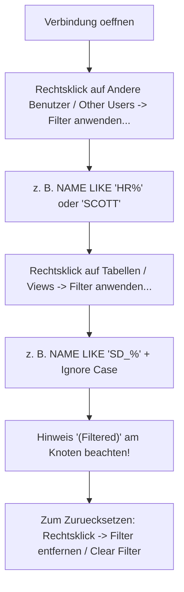

# Modul 2: Verbindungen, Import/Export & Schemenfilter (`D006`–`D010`)

**Voraussetzung**: Modul 1 (`D001`–`D005`)  
**Sandbox-Tabellen**: `sd_customers`, `sd_accounts`, `sd_transactions`, `sd_v_tx_export` aus [sqldeveloper-sandbox.sql](labs/sqldeveloper-sandbox.sql)

---

## 1. Verbindungen organisieren, farbcodieren & importieren/exportieren (`D006`–`D008`)

Wer täglich zwischen Entwicklungs- (`DEV`), Test- (`TEST`) und Produktionsdatenbanken (`PROD`) wechselt, schützt sich vor fatalen Verwechslungen durch **Ordnerstruktur + Farbcodierung** — und spart beim Laptop-Wechsel oder Team-Onboarding durch **JSON-Verbindungs-Export/-Import** viel Zeit.

### Sicherheitsmatrix beim Export von Verbindungen

| Export-Option (DE / EN) | Inhalt der `.json`-Datei | Wann verwenden? |
| :--- | :--- | :--- |
| **Passwörter entfernen** / *Remove passwords* | Host, Port, Service Name, Username — **ohne Passwort** | **Empfohlen für Teams**, Git-Repos, Onboarding-Pakete für Kolleg:innen |
| **Mit Schlüssel verschlüsseln** / *Encrypt with key* | Verschlüsselte Passwörter (benötigt Passphrase beim Import) | **Persönliches Backup** für neuen Firmen-Laptop |
| **Klartext** *(falls verfügbar)* | Unverschlüsselte Passwörter | **Verboten** in der Firma — Sicherheitsrisiko! |

!!! tip "Migration in die VS Code Extension"
    In der **Oracle SQL Developer Extension for VS Code** kannst du klassische SQL-Developer-Verbindungen direkt über das Connections-Panel importieren oder `tnsnames.ora` aus demselben Verzeichnis (`TNS_ADMIN`) mitnutzen.

---

## 2. Schemenfilter (`Andere Benutzer`) & Objektfilter (`D009`)

In grossen Firmen-Datenbanken liegen oft hunderte Schemas unter `Andere Benutzer` (`Other Users`) und tausende Tabellen unter `Tabellen` (`Tables`). Ohne Filter lädt der Navigator langsam und wird unübersichtlich.

*Alt-Text: Zweistufiges Filtern im SQL-Developer-Navigator: zuerst Schema-Filter auf Andere Benutzer, danach Objektfilter auf Tabellen oder Views mit abschliessendem Hinweis auf das Entfernen des Filters.*

!!! warning "Die `(Filtered)`-Falle"
    Sobald ein Filter aktiv ist, zeigt der Knoten `Tabellen (Filtered)` bzw. `Tabellen (SD_%)`. Wer später eine neue Tabelle sucht und vergisst, dass noch ein Filter aktiv ist, hält sie fälschlich für gelöscht! Abhilfe: **Rechtsklick → Filter entfernen** (`Clear Filter`).

---

## Lektionen im Detail

### `D006` — Verbindungen anlegen, in Ordnern strukturieren & farbcodieren
- **Lernziel:** Du legst Verbindungen sauber in Ordnern an und hinterlegst DEV/TEST/PROD-Farbcodes für Editor-Rahmen und Statusleiste *(Bloom: Anwenden)*
- **Menüpfad / Shortcut (DE / EN):** `Rechtsklick auf Verbindung → Eigenschaften → Verbindungsfarbe` / `Properties → Connection Color`; `Zur Gruppe hinzufügen` / `Add to Folder`
- **Selbstlern-Aufgabe (Lückentext/Check):** `Welche Farbe empfiehlt sich im Connection-Dialog für produktive Datenbanken (PROD), um versehentliche Schreibbefehle sofort optisch zu bremsen?`

??? success "Musterlösung & Erklärung"
    **Rot** für PROD (Gelb/Orange für TEST/QS, Grün für DEV/Sandbox). Die Farbe färbt den Rahmen des SQL-Worksheets und der Ergebnis-Tabs sichtbar ein.

### `D007` — Verbindungen exportieren & importieren (JSON, Passwort-Sicherheit & Konflikte)
- **Lernziel:** Du exportierst ausgewählte Verbindungen als `.json`-Datei mit sicherer Passwort-Option und importierst sie konfliktfrei auf einem zweiten Profil/Rechner *(Bloom: Anwenden)*
- **Menüpfad / Shortcut (DE / EN):** `Rechtsklick auf Verbindungen → Verbindungen exportieren... / Verbindungen importieren...` (`Connections → Export Connections... / Import Connections...`)
- **Selbstlern-Aufgabe (Lückentext/Check):** `Welche Passwort-Option wählst du beim Export, wenn du eine Verbindungsdatei per Teams oder E-Mail an 5 Kolleg:innen weitergibst: ___?`

??? success "Musterlösung & Erklärung"
    **Passwörter entfernen** (*Remove passwords*). So erhält jedes Teammitglied exakt dieselben Host-/Port-/Service-Daten, gibt beim ersten Connect aber sein eigenes persönliches Passwort ein.

### `D008` — Zentrale Verbindungsverwaltung mit `tnsnames.ora` & Fehlerdiagnose
- **Lernziel:** Du bindest eine zentrale `tnsnames.ora` in SQL Developer ein und unterscheidest die häufigsten Verbindungsfehler (`ORA-12154`, `ORA-12514`, `ORA-01017`) *(Bloom: Verstehen)*
- **Menüpfad / Shortcut (DE / EN):** `Extras → Voreinstellungen → Datenbank → Erweitert → Tnsnames-Verzeichnis` / `Tools → Preferences → Database → Advanced → Tnsnames Directory`
- **Selbstlern-Aufgabe (Lückentext/Check):** `Ordne zu: Welcher Fehler bedeutet „TNS-Alias nicht in tnsnames.ora gefunden“ und welcher „Ungültiger Benutzername/Passwort“ (ORA-12154 vs. ORA-01017)?`

??? success "Musterlösung & Erklärung"
    `ORA-12154`: TNS-Connect-Identifier konnte nicht aufgelöst werden (Pfad/Tippfehler in `tnsnames.ora`). `ORA-01017`: Invalid username/password (Anmeldedaten falsch).

### `D009` — Schemenfilter (`Andere Benutzer`) & Objektfilter anwenden/zurücksetzen
- **Lernziel:** Du filterst sowohl Schemas unter `Andere Benutzer` als auch Tabellen/Views über `Filter anwenden...` und setzt Filter gezielt wieder zurück *(Bloom: Anwenden)*
- **Menüpfad / Shortcut (DE / EN):** `Rechtsklick auf Andere Benutzer / Tabellen → Filter anwenden...` / `Other Users / Tables → Apply Filter...` bzw. `Filter entfernen` / `Clear Filter`
- **Selbstlern-Aufgabe (Lückentext/Check):** `Du möchtest unter „Tabellen“ nur die Sandbox-Tabellen sehen, die mit SD_ beginnen. Welchen Operator und welches Muster trägst du im Filter-Dialog ein: NAME ___ 'SD_%'?`

??? success "Musterlösung & Erklärung"
    Operator **`LIKE`** und Muster **`SD_%`** (mit aktivierter Option `Groß-/Kleinschreibung ignorieren` / `Ignore Case`, falls man klein tippt). Der Knoten zeigt danach `Tabellen (SD_%)`.

### `D010` — Modul-2-Lab: Team-Verbindungspaket & Schema-Filter-Workflow
- **Lernziel:** Du kombinierst Ordner-Gruppierung, sicheren JSON-Export und zweistufige Schema-/Objektfilter in einem durchgängigen Praxis-Workflow *(Bloom: Anwenden)*
- **Menüpfad / Shortcut (DE / EN):** `Verbindungen → Verbindungen exportieren...` + `Andere Benutzer → Filter anwenden...`
- **Selbstlern-Aufgabe (Lückentext/Check):** `Erstelle einen Ordner „Schulung“, exportiere deine Trainingsverbindung ohne Passwörter als JSON und filtere „Andere Benutzer“ auf SCOTT und HR.`

??? success "Musterlösung & Erklärung"
    Im Export-Assistenten nur die Schulungs-Verbindung anhaken und „Passwörter entfernen“ wählen. Unter `Andere Benutzer → Filter anwenden...` lassen sich mehrere Kriterien mit `OR` (`NAME = 'SCOTT' OR NAME = 'HR'`) kombinieren.

---

## Selbstlern-Aufgaben (Modul 2)

1. **(★)** Färbe deine Sandbox-/Trainingsverbindung grün ein und prüfe, wo die Farbe im SQL Worksheet erscheint.
2. **(★★)** Exportiere deine Trainingsverbindung **ohne Passwörter** in eine `.json`-Datei, öffne sie in einem Texteditor und prüfe, dass kein Passwort enthalten ist.
3. **(★★★)** Setze auf `Tabellen` den Filter `NAME LIKE 'SD_%'`, prüfe die angezeigten Tabellen (`SD_ACCOUNTS`, `SD_CUSTOMERS`, `SD_TRANSACTIONS`), und entferne den Filter danach wieder über `Filter entfernen`.

??? success "Musterlösungen zu Modul 2"
    1. Verbindungsfarbe erscheint als farbiger Rahmen um das Worksheet-Tab und in der Statuszeile.
    2. In der JSON-Datei stehen `hostname`, `port`, `serviceName`/`sid` und `user`, aber kein `password`-Klartext.
    3. Nach `Filter entfernen` verschwindet `(SD_%)` und der Standardzustand `Tabellen (Filtered)` (ohne Recycle-Bin-Objekte) kehrt zurück.

---

## Hybrid-Paaraufgabe (3+3) & Praxis-Transfer

- **Hybrid-Paaraufgabe (Driver/Navigator, 10 Min.):** Person A exportiert eine Trainingsverbindung ohne Passwörter als `.json` und sendet sie per Teams-Chat an Person B. Person B importiert sie in ihrem SQL Developer und testet die Verbindung mit dem eigenen Passwort.
- **Praxis-Transfer:** Richte in deinem Firmen-SQL-Developer für `PROD`-Verbindungen konsequent eine rote Rahmenfarbe ein und speichere für dein Team eine gemeinsame `.json`-Verbindungsdatei (ohne Passwörter) im Team-Sharepoint/Wiki.

## Oracle-Referenz

- [Oracle SQL Developer Dialog Boxes and Wizards — Export/Import Connections](https://docs.oracle.com/en/database/oracle/sql-developer/26.2/rptug/sql-developer-dialogs.html)
- [Oracle SQL Developer for VS Code — Using Filters](https://docs.oracle.com/en/database/oracle/sql-developer-vscode/26.2/sqdnx/using-filters.html)
- [Oracle Database 26ai Error Help — ORA-12154](https://docs.oracle.com/en/error-help/db/ora-12154/)
