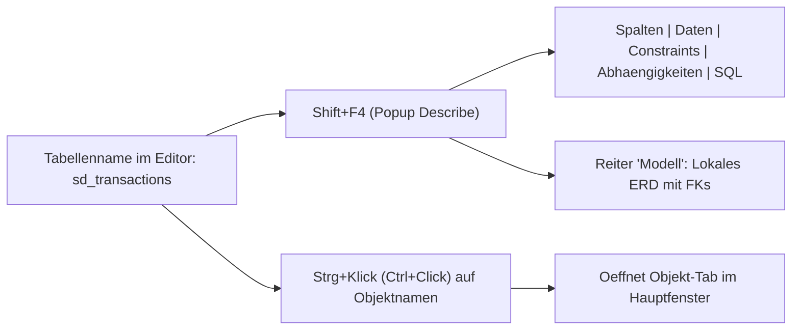

# Modul 3: Objekte suchen, inspizieren & Metadaten verstehen (`D011`–`D015`)

**Voraussetzung**: Module 1–2 (`D001`–`D010`)  
**Sandbox-Tabellen**: `sd_customers`, `sd_accounts`, `sd_transactions`, `sd_v_tx_export` aus [sqldeveloper-sandbox.sql](labs/sqldeveloper-sandbox.sql)

---

## 1. `Datenbankobjekt suchen` (`Find DB Object`) (`D011`–`D012`)

Statt im Navigator dutzende Ordner aufzuklappen, öffnet das **Fernglas-Icon** (oder `Ansicht → Datenbankobjekt suchen` / `View → Find DB Object`) ein Suchfenster, das direkt das Oracle Data Dictionary abfragt.

| Suchtyp | Was wird gefunden? | Praxisbeispiel auf der Sandbox |
| :--- | :--- | :--- |
| **`ALL` / `TABLE` / `VIEW`** | Tabellennamen, Views, Synonyme | `%TX%` findet `SD_TRANSACTIONS` und `SD_V_TX_EXPORT` |
| **`COLUMN`** | Jede Tabelle/View, die eine bestimmte Spalte enthält | `%POSTAL%` oder `%REF_33%` findet Herkunftsspalten sofort |
| **`SOURCE`** | Textfragmente in **Views, Packages, Prozeduren, Triggern** | `TX_REF_33` findet alle Stellen im PL/SQL-/View-Code, die diese Spalte nutzen! |
| **`CONSTRAINT` / `INDEX`** | Namen von PKs, FKs, Check-Constraints | `FK_SD_%` zeigt Fremdschlüssel zwischen Kunden, Konten und Buchungen |

!!! tip "Alternative per SQL (automatisierbar & Client-unabhängig)"
    Die GUI-Suche nutzt intern genau diese Data-Dictionary-Views, die du auch direkt abfragen kannst (funktioniert auch in VS Code, SQLcl und FreeSQL):
    ```sql
    SELECT table_name, column_name, data_type
    FROM all_tab_columns
    WHERE column_name LIKE '%REF_33%';
    ```

---

## 2. Schnelle Inspektion: `Shift+F4`, `Ctrl+Click`, `Modell`-ERD & Berichte (`D013`–`D014`)


*Alt-Text: Schnelle Inspektionswege im SQL-Editor: Shift+F4 öffnet das kompakte Describe-Popup inklusive Abhängigkeiten und Modell-ERD, während Strg+Klick das Objekt direkt im Hauptfenster öffnet.*

---

## Lektionen im Detail

### `D011` — Datenbankobjekte suchen (`Ansicht → Datenbankobjekt suchen`)
- **Lernziel:** Du nutzt `Datenbankobjekt suchen` gezielt mit Verbindung, Schema-Auswahl und `%`-Wildcards, um Tabellen, Views und Constraints sofort zu finden *(Bloom: Anwenden)*
- **Menüpfad / Shortcut (DE / EN):** `Ansicht → Datenbankobjekt suchen` / `View → Find DB Object` (Fernglas-Symbol)
- **Selbstlern-Aufgabe (Lückentext/Check):** `Welchen Suchbegriff nutzt du in „Datenbankobjekt suchen“, um alle Objekte zu finden, die irgendwo das Wort TX enthalten: ___?`
  ??? success "Musterlösung & Erklärung"
      **`%TX%`** (mit Prozentzeichen als Wildcard vor und nach `TX`). Je nach Version ist „Alle“ oder `TABLE` + `VIEW` aktiviert.

### `D012` — Spalten- & Quelltextsuche (`COLUMN`, `SOURCE`) vs. Data Dictionary (`ALL_*`)
- **Lernziel:** Du unterscheidest die Suche nach Spaltennamen von der Quelltextsuche in Views/PL-SQL und überträgst beide auf `ALL_TAB_COLUMNS` bzw. `ALL_SOURCE` *(Bloom: Analysieren)*
- **Menüpfad / Shortcut (DE / EN):** `Find DB Object → Typ: COLUMN / SOURCE` bzw. SQL auf `ALL_TAB_COLUMNS` / `ALL_VIEWS` / `ALL_SOURCE`
- **Selbstlern-Aufgabe (Lückentext/Check):** `Welche Data-Dictionary-View durchsucht SQL Developer intern bei einer Quelltextsuche über Packages, Prozeduren und Funktionen: ___?`
  ??? success "Musterlösung & Erklärung"
      **`ALL_SOURCE`** (bzw. `USER_SOURCE` für das eigene Schema). Für View-Definitionen wird zusätzlich `ALL_VIEWS` (`TEXT`) herangezogen.

### `D013` — Schnelle Objekt-Inspektion: `Shift+F4`, `Ctrl+Click` & `Dependencies`
- **Lernziel:** Du inspizierst Tabellen und Views direkt aus dem SQL-Editor heraus per `Shift+F4` ohne den Fokus auf das Arbeitsblatt zu verlieren *(Bloom: Anwenden)*
- **Menüpfad / Shortcut (DE / EN):** Cursor auf Objektnamen → `Umschalt+F4` (`Shift+F4`) oder `Strg+Klick` (`Ctrl+Click`)
- **Selbstlern-Aufgabe (Lückentext/Check):** `Markiere in einem Worksheet sd_accounts und drücke Shift+F4. Welcher Reiter zeigt dir, welche View und welche Tabelle von sd_accounts abhängen?`
  ??? success "Musterlösung & Erklärung"
      Der Reiter **`Abhängigkeiten`** (`Dependencies`) zeigt sowohl referenzierte Objekte (`sd_customers`) als auch abhängige Objekte (`sd_transactions`, `sd_v_tx_export`).

### `D014` — Datenmodell im Reiter `Modell` (ERD) & eingebaute Berichte (`Reports`)
- **Lernziel:** Du lässt dir im Reiter `Modell` das lokale Entity-Relationship-Diagramm einer Tabelle generieren und nutzt eingebaute Berichte zur Qualitätsprüfung *(Bloom: Analysieren)*
- **Menüpfad / Shortcut (DE / EN):** Objekt öffnen → Reiter `Modell` (`Model`); `Ansicht → Berichte` (`View → Reports → Data Dictionary Reports`)
- **Selbstlern-Aufgabe (Lückentext/Check):** `Öffne sd_accounts per Strg+Klick und wechsle auf den Reiter „Modell“. Welche zwei Tabellen sind dort über FK-Pfeile mit sd_accounts verbunden?`
  ??? success "Musterlösung & Erklärung"
      **`SD_CUSTOMERS`** (über `FK_SD_ACC_CUST`) und **`SD_TRANSACTIONS`** (über `FK_SD_TX_ACC`).

### `D015` — Modul-3-Lab: Unbekanntes Fachschema in 10 Minuten kartieren
- **Lernziel:** Du kombinierst `Find DB Object`, `Shift+F4`, `Modell` und eine `USER_TAB_COLUMNS`-Abfrage, um ein unbekanntes Schema systematisch zu erschliessen *(Bloom: Analysieren)*
- **Menüpfad / Shortcut (DE / EN):** `Find DB Object` + `Shift+F4` + `SQL Worksheet`
- **Selbstlern-Aufgabe (Lückentext/Check):** `Finde per Spaltensuche alle Tabellen und Views, die die Spalte POSTAL_CODE oder TX_REF_33 enthalten, und prüfe den Datentyp von TX_REF_33.`
  ??? success "Musterlösung & Erklärung"
      `POSTAL_CODE` liegt in `SD_CUSTOMERS` (`VARCHAR2(10)`) und `SD_V_TX_EXPORT`; `TX_REF_33` liegt in `SD_TRANSACTIONS` (`NUMBER(38)`) und `SD_V_TX_EXPORT`.

---

## Selbstlern-Aufgaben (Modul 3)

1. **(★)** Öffne `Datenbankobjekt suchen` und suche nach allen Objekten mit Muster `%SD_%`.
2. **(★★)** Nutze `Shift+F4` auf `sd_v_tx_export` und wechsle auf den Reiter `SQL`, um das vollständige `CREATE VIEW`-Statement einzusehen.
3. **(★★★)** Schreibe eine Abfrage auf `user_tab_columns`, die alle Spalten aller `SD_%`-Tabellen mit Datentyp, Länge/Precision und `NULLABLE` ausgibt (siehe auch [sqldeveloper-solutions.sql](labs/sqldeveloper-solutions.sql)).

??? success "Musterlösungen zu Modul 3"
    ```sql
    -- Aufgabe 3:
    SELECT table_name, column_id, column_name, data_type, data_precision, data_scale, nullable
    FROM user_tab_columns
    WHERE table_name LIKE 'SD_%'
    ORDER BY table_name, column_id;
    ```

---

## Hybrid-Paaraufgabe (3+3) & Praxis-Transfer

- **Hybrid-Paaraufgabe (Driver/Navigator, 10 Min.):** Person A gibt ein Spalten-Stichwort vor (`IBAN`, `REF`, `POSTAL`), Person B findet innerhalb von 60 Sekunden per `Find DB Object` + `Shift+F4` die Tabelle, den Datentyp und die abhängige View.
- **Praxis-Transfer:** Suche in deiner Produktiv-/Test-DB mit `Find DB Object` (`Typ: SOURCE`) nach einem bekannten Tabellen- oder Spaltennamen aus deinem Arbeitsalltag, um herauszufinden, welche Views oder Reports diese Spalte bereits verwenden.

## Oracle-Referenz

- [Oracle SQL Developer User's Guide — Concepts and Usage (DB Object Search & Reports)](https://docs.oracle.com/en/database/oracle/sql-developer/24.3/rptug/sql-developer-concepts-usage.html)
- [Oracle Database 26ai Reference — ALL_TAB_COLUMNS](https://docs.oracle.com/en/database/oracle/oracle-database/26/refrn/ALL_TAB_COLUMNS.html)
