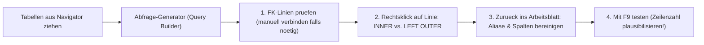

# Modul 4: Drag-and-Drop-Joins & visueller Query Builder (`D016`–`D020`)

**Voraussetzung**: `1Z0-171` Phase 5 (Joins) oder Grundverständnis von `JOIN ... ON`  
**Sandbox-Tabellen**: `sd_customers`, `sd_accounts`, `sd_transactions` aus [sqldeveloper-sandbox.sql](labs/sqldeveloper-sandbox.sql)

---

## 1. Drag & Drop aus dem Navigator ins Worksheet (`D016`)

Markiere im Connections-Navigator **mehrere Tabellen gleichzeitig** (`Strg+Klick` / `Ctrl+Click` auf `SD_CUSTOMERS`, `SD_ACCOUNTS`, `SD_TRANSACTIONS`) und ziehe sie gemeinsam in das geöffnete SQL-Worksheet.

- **Einstellungs-Menü (DE / EN):** `Extras → Voreinstellungen → Datenbank → Drag-and-Drop` / `Tools → Preferences → Database → Drag And Drop`
- **Was passiert?** SQL Developer liest die hinterlegten **Foreign Keys** (`FK_SD_ACC_CUST`, `FK_SD_TX_ACC`) aus dem Data Dictionary und generiert automatisch ein fertiges `SELECT`-Statement inklusive `JOIN ... ON`-Klauseln!

---

## 2. Der visuelle Query Builder (`Abfrage-Generator`) (`D017`–`D019`)


*Alt-Text: Vier Schritte beim Einsatz des visuellen Query Builders: Tabellen platzieren, Join-Linien und -Typen prüfen, generiertes SQL im Worksheet bereinigen und Zeilenzahl verifizieren.*

| Aktion im `Abfrage-Generator` (`Query Builder`) | Wie? | Worauf achten? |
| :--- | :--- | :--- |
| **Tabellen hinzufügen** | Aus dem Navigator auf die Zeichenfläche ziehen | Bestehende FKs erscheinen sofort als Verbindungslinien |
| **Fehlenden Join manuell zeichnen** | Spalte in Tabelle A anklicken → auf Zielspalte in Tabelle B ziehen | Wenn keine Linie existiert, entsteht ein **Kartesisches Produkt** (`N × M` Zeilen)! |
| **Join-Typ ändern (`LEFT OUTER`)** | Rechtsklick auf die Join-Linie → *Alle Zeilen von … einschliessen* | Prüfe im erzeugten SQL, ob **ANSI `LEFT OUTER JOIN`** statt altem Oracle-`(+)` erzeugt wurde |
| **Code-Review im `Arbeitsblatt`** | Auf den Reiter `Arbeitsblatt` (`Worksheet`) zurückwechseln | Auto-Aliase (`SD_CUSTOMERS1`) durch kurze Aliase (`c`, `a`, `t`) ersetzen und `SELECT *` auflösen |

!!! tip "VS Code Extension Hinweis"
    In der **Oracle SQL Developer Extension for VS Code** kannst du Tabellen- und Spaltennamen per Drag & Drop als Text/Snippets in den Editor ziehen — ein klassischer grafischer Query Builder existiert dort jedoch nicht. Wer ANSI-`JOIN` sauber schreibt, ist in beiden Clients produktiv.

---

## Lektionen im Detail

### `D016` — Drag & Drop aus dem Navigator konfigurieren & nutzen
- **Lernziel:** Du konfigurierst das Drag-and-Drop-Verhalten und erzeugst per Mehrfachauswahl (`Strg+Klick`) einen automatischen Mehr-Tabellen-Join im Worksheet *(Bloom: Anwenden)*
- **Menüpfad / Shortcut (DE / EN):** `Extras → Voreinstellungen → Datenbank → Drag-and-Drop` / `Tools → Preferences → Database → Drag And Drop`
- **Selbstlern-Aufgabe (Lückentext/Check):** `Markiere SD_CUSTOMERS und SD_ACCOUNTS gleichzeitig mit Strg+Klick und ziehe sie ins Worksheet. Welche Option im Drag-and-Drop-Dialog erzeugt ein SELECT mit Join?`
  ??? success "Musterlösung & Erklärung"
      Die Aktion **`Select`** (mit Option für Join-Erzeugung anhand definierter Foreign Keys). SQL Developer verknüpft `SD_CUSTOMERS.CUSTOMER_ID = SD_ACCOUNTS.CUSTOMER_ID` automatisch.

### `D017` — Visueller Query Builder (`Abfrage-Generator`): Tabellen & Join-Linien
- **Lernziel:** Du wechselst in den `Abfrage-Generator`, platzierst verknüpfte Tabellen und verbindest bei Bedarf zwei Spalten manuell per Drag-and-Drop *(Bloom: Anwenden)*
- **Menüpfad / Shortcut (DE / EN):** Reiter `Abfrage-Generator` / `Query Builder` direkt über dem SQL-Worksheet
- **Selbstlern-Aufgabe (Lückentext/Check):** `Ziehe SD_CUSTOMERS, SD_ACCOUNTS und SD_TRANSACTIONS in den Abfrage-Generator. Wie viele Join-Linien erscheinen automatisch zwischen den 3 Tabellen?`
  ??? success "Musterlösung & Erklärung"
      Genau **2 Join-Linien** (`FK_SD_ACC_CUST` und `FK_SD_TX_ACC`), weil die Sandbox-Tabellen explizite Foreign-Key-Constraints besitzen.

### `D018` — Join-Typen (`INNER`/`OUTER`), Filter & ANSI-vs.-`(+)`-Ausgabe
- **Lernziel:** Du stellst im Query Builder einen `LEFT OUTER JOIN` ein und prüfst im generierten SQL den Unterschied zwischen ANSI-Syntax und Oracle-`(+)`-Syntax *(Bloom: Analysieren)*
- **Menüpfad / Shortcut (DE / EN):** Rechtsklick auf Join-Linie im `Abfrage-Generator` → Join-Eigenschaften
- **Selbstlern-Aufgabe (Lückentext/Check):** `Welcher Kunde aus der Sandbox hat ein Konto (1005), aber 0 Transaktionen — erscheint also nur bei einem ___ JOIN zwischen SD_ACCOUNTS und SD_TRANSACTIONS?`
  ??? success "Musterlösung & Erklärung"
      **`LEFT`** (bzw. `LEFT OUTER JOIN`): Konto `1005` (`Nordlicht Reederei`) hat keine Zeilen in `sd_transactions` und würde beim `INNER JOIN` verschwinden.

### `D019` — Grenzen & Gefahren von Drag-and-Drop-Joins
- **Lernziel:** Du erkennst die Risiken visuell generierter Queries (kartesisches Produkt bei fehlender Linie, kryptische Aliase, fehlende CTEs) und entscheidest, wann Hand-Coding überlegen ist *(Bloom: Bewerten)*
- **Menüpfad / Shortcut (DE / EN):** Wechsel zwischen `Abfrage-Generator` und `Arbeitsblatt` (`Query Builder` ↔ `Worksheet`)
- **Selbstlern-Aufgabe (Lückentext/Check):** `Was passiert in der Sandbox (5 Kunden × 5 Konten × 65 Transaktionen), wenn du im Query Builder vergisst, eine Join-Linie zwischen SD_ACCOUNTS und SD_TRANSACTIONS zu ziehen?`
  ??? success "Musterlösung & Erklärung"
      Es entsteht ein **kartesisches Produkt** (`CROSS JOIN`): Jedes Konto wird mit allen 65 Transaktionen kombiniert (5 × 65 = **325 Zeilen** statt 65)!

### `D020` — Modul-4-Lab: Vom Drag-and-Drop-Entwurf zur sauberen Produktions-Query
- **Lernziel:** Du überführst einen Query-Builder-Entwurf durch Umbenennen von Aliasen, explizite Spaltenliste und `LEFT JOIN`-Kontrolle in produktionsreifen SQL-Code *(Bloom: Bewerten)*
- **Menüpfad / Shortcut (DE / EN):** `Abfrage-Generator` → `Arbeitsblatt` + `Strg+F7`
- **Selbstlern-Aufgabe (Lückentext/Check):** `Erzeuge den 3-Tabellen-Join im Abfrage-Generator, stelle SD_ACCOUNTS -> SD_TRANSACTIONS auf LEFT JOIN um und bereinige die Aliase auf c, a, t.`
  ??? success "Musterlösung & Erklärung"
      Siehe [sqldeveloper-solutions.sql](labs/sqldeveloper-solutions.sql) (Modul 4): `COUNT(t.tx_id)` liefert für `Nordlicht Reederei` (`account_id = 1005`) korrekt `0`.

---

## Selbstlern-Aufgaben (Modul 4)

1. **(★)** Ziehe `SD_CUSTOMERS` und `SD_ACCOUNTS` per Drag & Drop ins Worksheet und führe das generierte `SELECT` mit `F9` aus.
2. **(★★)** Baue im `Abfrage-Generator` eine Abfrage über alle 3 `SD_%`-Tabellen mit Filter `currency_code = 'EUR'` und prüfe das generierte SQL im `Arbeitsblatt`.
3. **(★★★)** Entferne im `Abfrage-Generator` testweise die Join-Linie zwischen `SD_ACCOUNTS` und `SD_TRANSACTIONS`, prüfe die Zeilenexplosion und korrigiere sie danach wieder als sauberes ANSI-`LEFT JOIN` mit `GROUP BY` (Lösung in [sqldeveloper-solutions.sql](labs/sqldeveloper-solutions.sql)).

??? success "Musterlösungen zu Modul 4"
    ```sql
    -- Bereinigtes Ziel-SQL (Aufgabe 3):
    SELECT c.customer_name,
           a.iban_like,
           COUNT(t.tx_id)        AS tx_count,
           NVL(SUM(t.amount), 0) AS total_amount
    FROM sd_customers c
    JOIN sd_accounts a
      ON c.customer_id = a.customer_id
    LEFT JOIN sd_transactions t
      ON a.account_id = t.account_id
    GROUP BY c.customer_name, a.iban_like
    ORDER BY c.customer_name;
    ```

---

## Hybrid-Paaraufgabe (3+3) & Praxis-Transfer

- **Hybrid-Paaraufgabe (Driver/Navigator, 10 Min.):** Person A baut einen Join über `SCOTT.EMP` und `SCOTT.DEPT` im `Abfrage-Generator` absichtlich mit einem versteckten Fehler (z. B. `INNER` statt `LEFT` oder fehlende Linie); Person B übernimmt im Code-Review-Modus (`Worksheet`) und benennt den Fehler innerhalb von 2 Minuten.
- **Praxis-Transfer:** Teste bei deiner nächsten Auswertung auf zwei unbekannten Tabellen in der Firma den Drag-and-Drop-Start — und nimm dir danach bewusst 60 Sekunden für das Alias- und Join-Review.

## Oracle-Referenz

- [Oracle SQL Developer User's Guide — Using the Query Builder](https://docs.oracle.com/en/database/oracle/sql-developer/24.3/rptug/sql-developer-concepts-usage.html)
- [Oracle Database 26ai SQL Language Reference — Joins](https://docs.oracle.com/en/database/oracle/oracle-database/26/sqlrf/Joins.html)
