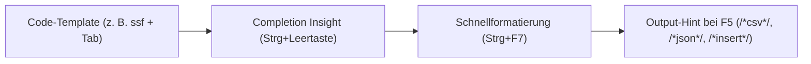

# Modul 5: Schnellformatierungen, Shortcuts & Output-Hints (`D021`–`D025`)

**Voraussetzung**: Module 1–4 (`D001`–`D020`)  
**Sandbox-Tabellen**: `sd_customers`, `sd_accounts`, `sd_transactions` aus [sqldeveloper-sandbox.sql](labs/sqldeveloper-sandbox.sql)

---

## 1. Editor-Schnellformatierungen & Tastenkürzel (`D021`–`D023`)

*Alt-Text: Produktivitäts-Pipeline im SQL-Developer-Editor von Code-Templates über Autovervollständigung und Schnellformatierung bis zu Output-Formatierungs-Hints.*

| Shortcut / Funktion | Wirkung | Menüpfad (DE / EN) |
| :--- | :--- | :--- |
| **`Strg+F7`** (`Ctrl+F7`) | Formatiert das gesamte Worksheet oder die **aktuelle Markierung** | Rechtsklick im Editor → `Format` |
| **`Alt+'`** | Schaltet markierten Text durch `UPPER` → `lower` → `InitCap` | `Bearbeiten → Groß-/Kleinschreibung` / `Edit → Toggle Case` |
| **`Strg+/`** (`Ctrl+/`) | Kommentiert markierte Zeilen mit `--` aus oder wieder ein | `Quelle → Zeilenkommentar umschalten` / `Toggle Line Comments` |
| **`Strg+Leertaste`** | Öffnet Spalten- & Tabellen-Vorschläge (`Completion Insight`) | Automatisch oder manuell per `Ctrl+Space` |
| **`F8`** | Öffnet die durchsuchbare **SQL-Historie** (auch nach Neustart!) | `Ansicht → SQL-Historie` / `View → SQL History` |
| **Team-Styleguide (`.xml`)** | Einheitliche Einrückung, Keywords `UPPER`, Komma vorne/hinten | `Code-Editor → Format → Erweiterte Formatierung → Exportieren/Importieren` |

!!! tip "Code-Templates (`ssf`, `ct`)"
    Unter `Extras → Voreinstellungen → Datenbank → SQL-Editor-Codevorlagen` (`SQL Editor Code Templates`) kannst du Abkürzungen definieren — z. B. `ssf` → `SELECT * FROM ` oder `sdx` → ein fertiges Export-Gerüst. Tippe im Editor `ssf` und drücke `Strg+Leertaste` (oder `Tab`).

---

## 2. Schnellformatierung der Ausgabe über `F5`-Hints (`D024`)

Mit eingebauten **Formatter-Kommentaren** direkt nach `SELECT` formatiert SQL Developer (genau wie SQLcl) die Ausgabe bei **`F5` (Skript ausführen)** ohne jeden Klick-Assistenten:

| Hint im `SELECT` | Ausgabeformat in der Skriptausgabe (`F5`) | Typischer Einsatzzweck |
| :--- | :--- | :--- |
| `SELECT /*csv*/ ...` | Kommagetrenntes CSV mit Anführungszeichen | Schneller `SPOOL`-Export in Automatisierungen |
| `SELECT /*insert*/ ...` | Fertige `INSERT INTO ... VALUES (...);`-Statements | Testdaten aus DEV in ein Skript übernehmen |
| `SELECT /*json*/ ...` | Strukturiertes JSON-Objekt mit Zeilen-Array | API-Mocks & Weiterverarbeitung in Skripten |
| `SELECT /*xml*/ ...` | `<RESULTS><ROW>...</ROW></RESULTS>` | XML-Schnittstellenprüfung |
| `SELECT /*html*/ ...` | Komplette HTML-Tabelle | Schneller Bericht für E-Mail/Intranet |
| `SELECT /*ansiconsole*/ ...` | Sauber ausgerichtete Text-Tabelle | Lesbare Doku & Terminal-Transkripte |

---

## Lektionen im Detail

### `D021` — Schnellformatierung (`Strg+F7`), Case-Toggle (`Alt+'`) & Blockkommentare (`Strg+/`)
- **Lernziel:** Du formatierst unübersichtliche SQL-Statements mit `Strg+F7`, passt Gross-/Kleinschreibung mit `Alt+'` an und kommentierst Blöcke mit `Strg+/` ein/aus *(Bloom: Anwenden)*
- **Menüpfad / Shortcut (DE / EN):** `Strg+F7`, `Alt+'`, `Strg+/` (auch auf markierten Teilblöcken)
- **Selbstlern-Aufgabe (Lückentext/Check):** `Welcher Shortcut formatiert im SQL-Developer-Editor entweder das gesamte Skript oder nur den aktuell markierten Block: ___?`

??? success "Musterlösung & Erklärung"
    **`Strg+F7`** (engl. `Ctrl+F7`). Tipp: Markiere bei einem sehr langen Skript nur ein einzelnes `SELECT`, damit `Strg+F7` nicht ungewollt alte Kommentare anderer Blöcke verschiebt.

### `D022` — Eigene Formatter-Regeln (`Format → Advanced`) & Team-Styleguide als XML
- **Lernziel:** Du konfigurierst eigene Formatter-Regeln (Keywords `UPPER`, Bezeichner `lower`, Einrückung) und exportierst das Profil als `.xml` für dein Team *(Bloom: Anwenden)*
- **Menüpfad / Shortcut (DE / EN):** `Extras → Voreinstellungen → Code-Editor → Format → Erweiterte Formatierung` / `Code Editor → Format → Advanced Format`
- **Selbstlern-Aufgabe (Lückentext/Check):** `In welchem Format werden benutzerdefinierte SQL-Developer-Formatter-Profile exportiert und im Team geteilt (.json, .xml oder .sql)?`

??? success "Musterlösung & Erklärung"
    Als **`.xml`**-Datei (über den Button *Exportieren* direkt im Einstellungsfenster *Erweiterte Formatierung*).

### `D023` — Code-Templates (`ssf`, `ct`), Completion Insight (`Strg+Leertaste`) & SQL History (`F8`)
- **Lernziel:** Du legst ein eigenes Code-Template an, nutzt Completion Insight für fehlerfreie Spaltennamen und findest frühere Statements in `F8` wieder *(Bloom: Anwenden)*
- **Menüpfad / Shortcut (DE / EN):** `Datenbank → SQL-Editor-Codevorlagen`; `Strg+Leertaste`; `F8`
- **Selbstlern-Aufgabe (Lückentext/Check):** `Mit welcher Funktionstaste öffnest du die durchsuchbare Historie aller bisher ausgeführten SQL-Statements: ___?`

??? success "Musterlösung & Erklärung"
    **`F8`** (öffnet `SQL-Historie` / `SQL History` mit Suchfeld für Tabellennamen oder Datum).

### `D024` — Output-Formatierungs-Hints bei `F5` (`/*csv*/`, `/*insert*/`, `/*json*/`, `/*ansiconsole*/`)
- **Lernziel:** Du nutzt die eingebauten Output-Hints in `SELECT`-Statements, um per `F5` direkt CSV, JSON oder `INSERT`-Skripte zu erzeugen *(Bloom: Anwenden)*
- **Menüpfad / Shortcut (DE / EN):** Hint direkt hinter `SELECT` im SQL-Worksheet + `F5` (`Skript ausführen`)
- **Selbstlern-Aufgabe (Lückentext/Check):** `Welchen Hint schreibst du direkt nach SELECT, um bei F5 sofort ausführbare INSERT-Statements für Testdaten zu erhalten?`

??? success "Musterlösung & Erklärung"
    `SELECT /*insert*/ * FROM sd_customers;` — ideal, um kleine Referenztabellen als reproduzierbares SQL-Skript zu sichern.

### `D025` — Modul-5-Lab: Chaotische Legacy-Query in 2 Minuten standardisieren
- **Lernziel:** Du bereinigst eine unleserliche Einzeiler-Query per `Strg+F7` und gibst das Ergebnis wahlweise per `/*csv*/` und `/*json*/` über `F5` aus *(Bloom: Anwenden)*
- **Menüpfad / Shortcut (DE / EN):** `Strg+F7` + `F5`
- **Selbstlern-Aufgabe (Lückentext/Check):** `Formatiere SELECT c.customer_name,t.tx_id,t.amount FROM sd_customers c join sd_accounts a on c.customer_id=a.customer_id join sd_transactions t on a.account_id=t.account_id where t.amount>1000; mit Strg+F7 und ergänze /*csv*/ für F5.`

??? success "Musterlösung & Erklärung"
    Siehe [sqldeveloper-solutions.sql](labs/sqldeveloper-solutions.sql) (Modul 5). Achte darauf, dass der Kommentar `/*csv*/` direkt nach `SELECT` steht.

---

## Selbstlern-Aufgaben (Modul 5)

1. **(★)** Teste `Strg+F7` und `Alt+'` an einer unformatierten Abfrage auf `sd_customers`.
2. **(★★)** Lege ein Code-Template `sdc` für `SELECT * FROM sd_customers ORDER BY customer_id;` an und teste es im Editor.
3. **(★★★)** Führe `SELECT /*insert*/ customer_id, customer_name, postal_code, city FROM sd_customers;` und `SELECT /*json*/ ...` mit `F5` aus und vergleiche die Ausgaben.

??? success "Musterlösungen zu Modul 5"
    `F5` erzeugt beim `/*insert*/`-Hint vier vollständige `INSERT INTO SD_CUSTOMERS (...) VALUES (...);`-Zeilen inklusive `NULL`-Behandlung und beim `/*json*/`-Hint ein valides JSON-Objekt.

---

## Hybrid-Paaraufgabe (3+3) & Praxis-Transfer

- **Hybrid-Paaraufgabe (Driver/Navigator, 10 Min.):** Beide Teilnehmende formatieren dieselbe komplexe Query: Person A mit Standard-Formatter, Person B mit angepassten `Advanced Format`-Regeln (Keywords `UPPER`, Komma am Zeilenanfang). Vergleicht per Screen-Share die Lesbarkeit.
- **Praxis-Transfer:** Exportiere eine kleine Lookup-Tabelle aus deiner Entwicklungs-DB mit `SELECT /*insert*/ ...` (`F5`) als wiederverwendbares Setup-Skript für dein Team.

## Oracle-Referenz

- [Oracle SQL Developer User's Guide — Formatting SQL and PL/SQL Code & SQLcl Formatting](https://docs.oracle.com/en/database/oracle/sql-developer/24.3/rptug/sql-developer-concepts-usage.html)
- [Oracle SQLcl User's Guide — Formatting Query Results (`/*csv*/`, `/*json*/`)](https://docs.oracle.com/en/database/oracle/sql-developer/24.3/sqcug/formatting-query-results.html)
