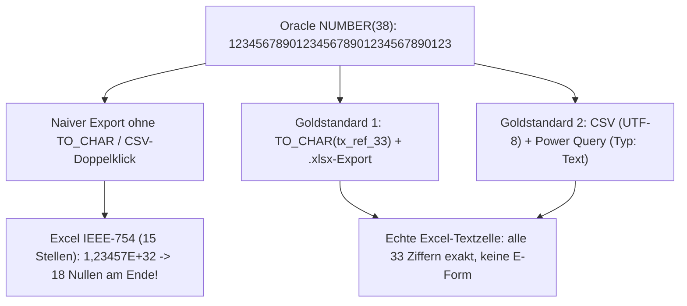
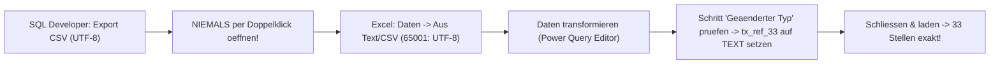

# Modul 6: Daten nach Excel überführen — insb. 33-stellige Zahlen ohne E-Form (`D026`–`D030`)

**Voraussetzung**: Module 1–5 (`D001`–`D025`)  
**Sandbox-Tabellen**: `sd_customers`, `sd_accounts`, `sd_transactions`, `sd_v_tx_export` aus [sqldeveloper-sandbox.sql](labs/sqldeveloper-sandbox.sql)

---

## 1. Warum Excel 33-stellige Zahlen zerstört (IEEE-754-Grenze) (`D026`)

Oracle speichert `NUMBER(38)` mit bis zu **38 exakten Dezimalziffern** — z. B. eine 33-stellige Transaktionsreferenz `123456789012345678901234567890123`.  
Microsoft Excel speichert Zahlen intern als **64-Bit-Gleitkommazahl nach IEEE 754**. Dieses Format kennt **maximal 15 signifikante Ziffern**!

| Schritt | Was passiert mit `123456789012345678901234567890123` (33 Stellen)? | Schaden |
| :--- | :--- | :--- |
| **1. Oracle `NUMBER(38)`** | Exakt `123456789012345678901234567890123` | Kein Verlust |
| **2. Script Output (`F5`) ohne `SET NUMWIDTH`** | Kürzt auf `1,2346E+32` (Abhilfe in SQL Developer: `SET NUMWIDTH 38`) | Nur Anzeige in `F5` |
| **3. Naiver `.xlsx`-Export / CSV-Doppelklick** | Excel liest den Wert als Zahl: zeigt `1,23457E+32` (ab 12 Stellen `E`-Form!) | Darstellung unlesbar |
| **4. Umformatieren auf „Zahl“ in Excel** | `123456789012345000000000000000000` | **Die letzten 18 Stellen wurden unwiderruflich durch `0` ersetzt!** |


*Alt-Text: Datenverlust-Pfad beim naiven Excel-Export durch die 15-stellige IEEE-754-Grenze versus die beiden verlustfreien Goldstandards TO_CHAR nach xlsx und CSV mit Power Query.*

---

## 2. Goldstandard 1: Direkter `.xlsx`-Export mit `TO_CHAR(...)` (`D027`)

Auch beim direkten Export als **`excel 2003+ (xlsx)`** aus dem SQL-Developer-Grid schreibt SQL Developer eine `NUMBER`-Spalte als **numerische Excel-Zelle** — und Excel rundet die 33 Stellen sofort beim Öffnen auf 15 Stellen ab!

**Die sichere Lösung direkt im SQL:** Wandle jede 33-stellige ID (und jede Nummer mit führenden Nullen) **vor dem Export** explizit per `TO_CHAR(...)` in `VARCHAR2` um:

```sql
SELECT t.tx_id,
       TO_CHAR(t.tx_ref_33) AS tx_ref_33_txt,                 -- -> Echte Textzelle in .xlsx!
       c.postal_code,                                         -- VARCHAR2 ('01067' bleibt erhalten)
       t.product_code,                                        -- VARCHAR2 ('03-04' wird NICHT zu 03. Apr!)
       t.amount,                                              -- Echtes NUMBER -> rechnet in Excel!
       TO_CHAR(t.booking_ts, 'YYYY-MM-DD HH24:MI:SS') AS ts_iso,
       REPLACE(REPLACE(t.memo_text, CHR(13), ' '), CHR(10), ' ') AS memo_clean
FROM sd_customers c
JOIN sd_accounts a     ON c.customer_id = a.customer_id
JOIN sd_transactions t ON a.account_id  = t.account_id
ORDER BY t.tx_id;
```

**Klickpfad in SQL Developer:**
1. Abfrage mit **`F9`** ausführen.
2. **Rechtsklick ins Ergebnis-Grid → `Exportieren...`** (`Export...`).
3. Format: **`excel 2003+ (xlsx)`**, Encoding: `UTF-8`.
4. Empfohlen: Haken bei **„SQL-Abfrage in Arbeitsblatt exportieren“** setzen (erstellt ein zweites Excel-Tab mit der exakten Query als Audit-Trail!).

---

## 3. Goldstandard 2: `CSV (UTF-8)` + Excel Power Query (`D028`)


*Alt-Text: Sicherer CSV-Import in Excel über Power Query: Export als UTF-8, Import über Daten Aus Text/CSV, explizites Umstellen des Spaltentyps auf Text vor dem Laden.*

!!! warning "Anti-Patterns unbedingt vermeiden"
    - **CSV per Doppelklick öffnen:** Excel rät Typen automatisch, schneidet `01067` auf `1067` ab, macht `'03-04'` zu `03. Apr` und zerstört 33-stellige Zahlen!
    - **Trick `="1234567890..."` im CSV:** Erzeugt Excel-Formeln (CSV-Injection-Risiko / Sicherheitswarnungen, erschwert SVERWEIS/XVERWEIS und Filter).
    - **Trick `'1234567890...` mit Hochkomma im CSV:** In CSV wird das führende `'` als sichtbares Zeichen Teil des Werts (`34` Zeichen statt `33`).
    - **Excel-365-Option „Automatische Datenkonvertierung“:** Hilft nur lokal auf deinem eigenen PC, nicht wenn du die CSV-Datei an Kolleg:innen weitergibst.

---

## 4. Entscheidungsmatrix für alle Datentypen & Zeilenzahlen (`D029`)

| Datentyp / Sonderfall | Problem bei naivem Export | Empfohlene Lösung |
| :--- | :--- | :--- |
| **33-stellige ID (`NUMBER(38)`)** | `E+32` + Rundung nach 15 Stellen | `TO_CHAR(...)` + `.xlsx` **oder** `CSV` + Power Query (`Text`) |
| **Führende Nullen (`'01067'`)** | Wird in CSV zu `1067` | `VARCHAR2` / `LPAD(..., '0')` + `.xlsx` **oder** Power Query (`Text`) |
| **Code wie `'03-04'`** | Excel macht `03. Apr` daraus | `VARCHAR2` + `.xlsx` **oder** Power Query (`Text`) |
| **Beträge (`1234.56`)** | Punkt- vs. Komma-Dezimaltrennzeichen | Als echtes `NUMBER` in `.xlsx` (kulturunabhängig!) oder Power Query *„Mit Gebietsschema verwenden → Englisch (USA)“* |
| **Umlaute (`München`, `Zürich`)** | `München` bei ANSI/Win-1252 | Immer `UTF-8` beim Export und `65001: Unicode (UTF-8)` in Power Query |
| **Zeilenumbrüche (`CHR(10)`)** | Zerreisst Zeilen in naiven CSV-Parsern | `REPLACE(col, CHR(10), ' ')` oder `.xlsx` / sauberes CSV-Quoting (`"`) |
| **> 50 Zeilen** | `Strg+A`/`Strg+C` ohne Scrollen kopiert nur 50 Zeilen | Immer `Rechtsklick → Exportieren...` nutzen |
| **> 1.048.576 Zeilen** | Excel-Blattlimit überschritten | `CSV` (`/*csv*/` + `SPOOL`) → in Excel *„Nur Verbindung erstellen / Datenmodell (Power Pivot)“* |

!!! tip "Rückweg Excel → Oracle"
    Über `Rechtsklick auf Tabellen → Daten importieren...` (`Import Data...`) liest SQL Developer `.xlsx`/`.csv` wieder in Oracle ein. Wähle für 33-stellige Referenznummern dort bewusst `VARCHAR2(33)` (wenn nicht gerechnet wird) oder `NUMBER(38)`.

---

## Lektionen im Detail

### `D026` — Die Excel-Zahlenfalle: IEEE-754 (15 Stellen) vs. Oracle `NUMBER(38)` & `SET NUMWIDTH`
- **Lernziel:** Du erklärst die technische Ursache (IEEE-754 15 Stellen), reproduzierst die `E`-Notation in `F5` und behebst die `F5`-Anzeige mit `SET NUMWIDTH 38` *(Bloom: Analysieren)*
- **Menüpfad / Shortcut (DE / EN):** `F5` (Skriptausgabe) mit `SET NUMWIDTH 38` vs. Excel-Zellformat `Standard`
- **Selbstlern-Aufgabe (Lückentext/Check):** `Ab wie vielen signifikanten Stellen verliert Excel durch IEEE-754 bei normalen Zahlen unumkehrbar Genauigkeit (12, ___ oder 33)?`
  ??? success "Musterlösung & Erklärung"
      Ab **15** signifikanten Stellen (ab 12 Stellen schaltet die Anzeige auf `E+...`, ab der **16. Stelle** werden alle weiteren Ziffern auf `0` gerundet). In SQL Developer `F5` verhindert `SET NUMWIDTH 38` die `E`-Anzeige in der Skriptausgabe.

### `D027` — Goldstandard 1: Direkter `.xlsx`-Export mit `TO_CHAR(...)`
- **Lernziel:** Du wandelst lange Zahlen in SQL gezielt mit `TO_CHAR(...)` um und exportierst aus dem Grid als `.xlsx` inklusive Audit-SQL-Tab *(Bloom: Anwenden)*
- **Menüpfad / Shortcut (DE / EN):** `F9` → Rechtsklick im Grid → `Exportieren...` / `Export...` → `excel 2003+ (xlsx)`
- **Selbstlern-Aufgabe (Lückentext/Check):** `Ergänze die Export-Query so, dass tx_ref_33 als echte Textzelle in .xlsx landet: SELECT tx_id, ___(tx_ref_33) AS tx_ref_33_txt FROM sd_transactions;`
  ??? success "Musterlösung & Erklärung"
      `TO_CHAR(tx_ref_33)` — dadurch liefert Oracle den Spaltentyp `VARCHAR2`, und SQL Developer schreibt im `.xlsx` eine String-Zelle statt einer numerischen Zelle.

### `D028` — Goldstandard 2: `CSV (UTF-8)` + Excel Power Query (`Aus Text/CSV`)
- **Lernziel:** Du importierst UTF-8-CSVs verlustfrei über Excel Power Query (`Aus Text/CSV`) und setzt den Spaltentyp explizit auf `Text`, statt die Datei per Doppelklick zu öffnen *(Bloom: Anwenden)*
- **Menüpfad / Shortcut (DE / EN):** `Exportieren... → csv (UTF-8)` → in Excel: `Daten → Daten abrufen → Aus Datei → Aus Text/CSV` → `Daten transformieren`
- **Selbstlern-Aufgabe (Lückentext/Check):** `Warum ist die Formel-Schreibweise ="1234567890..." im CSV-Export trotz korrekter Anzeige ein Anti-Pattern?`
  ??? success "Musterlösung & Erklärung"
      Sie erzeugt eine Excel-Formel statt eines reinen Datenwerts, löst in sicheren Umgebungen CSV-Injection-Warnungen aus und stört automatische Weiterverarbeitungen (Power Query, SVERWEIS, Datenbank-Reimport).

### `D029` — Alle Datentypen sicher exportieren & Rückweg Excel → Oracle
- **Lernziel:** Du wählst für Beträge, führende Nullen, Datumsfallen (`'03-04'`), Umlaute, `CHR(10)` und grosse Datenmengen (> 50 bzw. > 1 Mio. Zeilen) das jeweils passende Exportverfahren *(Bloom: Bewerten)*
- **Menüpfad / Shortcut (DE / EN):** `Exportieren...` (`xlsx`/`csv`) sowie `Tabellen → Daten importieren...` (`Import Data...`)
- **Selbstlern-Aufgabe (Lückentext/Check):** `Du exportierst 65 Zeilen mit einem Betragsfeld (amount = 1234.56) und einer 33-stelligen ID (tx_ref_33) nach .xlsx. Welche der beiden Spalten darf KEIN TO_CHAR bekommen, damit =SUMME(...) in Excel rechnet?`
  ??? success "Musterlösung & Erklärung"
      **`amount`** bleibt als echtes `NUMBER` erhalten (damit Excel direkt rechnen kann); nur **`tx_ref_33`** (Identifikator) erhält `TO_CHAR(tx_ref_33)`.

### `D030` — Modul-6-Lab & Capstone: End-to-End-Finanzexport mit Excel-Integritätsprüfung
- **Lernziel:** Du führst den kompletten Export über `sd_customers`, `sd_accounts` und `sd_transactions` durch und verifizierst die Datenintegrität direkt in Excel per Kontrollformeln *(Bloom: Bewerten)*
- **Menüpfad / Shortcut (DE / EN):** `F9` → `Exportieren... (xlsx)` → Prüfung in Excel
- **Selbstlern-Aufgabe (Lückentext/Check):** `Welche drei Excel-Prüfformeln beweisen nach dem Öffnen der Exportdatei, dass tx_ref_33_txt in Zelle B2 exakt und ungerundet angekommen ist?`
  ??? success "Musterlösung & Erklärung"
      1. `=LÄNGE(B2)` → **`33`** (keine Kürzung)  
      2. `=ISTTEXT(B2)` → **`WAHR`** (keine IEEE-754-Zahl)  
      3. `=RECHTS(B2;5)` → **`"90123"`** für `tx_id = 1` (Endziffern nicht auf `"00000"` gerundet!)

---

## Selbstlern-Aufgaben (Modul 6)

1. **(★)** Führe `SELECT tx_id, tx_ref_33 FROM sd_transactions WHERE tx_id <= 4;` einmal ohne und einmal mit `SET NUMWIDTH 38` über `F5` aus und vergleiche die Skriptausgabe.
2. **(★★)** Exportiere alle 65 Zeilen mit der Goldstandard-Query aus [sqldeveloper-solutions.sql](labs/sqldeveloper-solutions.sql) als `.xlsx` (inkl. SQL-Arbeitsblatt) und prüfe in Excel `=LÄNGE(B2)=33`, `=RECHTS(B2;5)="90123"`, `postal_code = "01067"` und `product_code = "03-04"`.
3. **(★★★)** Exportiere dieselbe Abfrage als `CSV (UTF-8)` und importiere sie über `Excel → Daten → Aus Text/CSV → Daten transformieren`, sodass `tx_ref_33_txt`, `postal_code` und `product_code` als `Text`, `amount` aber über Gebietsschema `Englisch (USA)` als `Dezimalzahl` geladen wird.

??? success "Musterlösungen zu Modul 6"
    Siehe [sqldeveloper-solutions.sql](labs/sqldeveloper-solutions.sql) (Modul 6). Bei `tx_id = 1` liefert `=RECHTS(B2;5)` exakt `"90123"`, `postal_code` bleibt `"01067"` (Länge 5), `product_code` bleibt `"03-04"` und `=SUMME(...)` über alle 65 `amount`-Werte rechnet ohne `#WERT!`-Fehler.

---

## Hybrid-Paaraufgabe (3+3) & Praxis-Transfer

- **Hybrid-Paaraufgabe (Driver/Navigator, 10 Min.):** Person A exportiert `sd_v_tx_export` bewusst **ohne** `TO_CHAR(tx_ref_33)` nach `.xlsx` und zeigt in Excel den Schaden (`1,23457E+32` + Nullen). Person B übernimmt als Driver, korrigiert die Query mit `TO_CHAR`, exportiert neu und führt den 3-Formel-Check (`=LÄNGE`, `=ISTTEXT`, `=RECHTS`) im Screen-Share vor.
- **Praxis-Transfer:** Prüfe bei deiner nächsten Excel-Auswertung aus dem Firmensystem jede ID-, Beleg-, Referenz- oder PLZ-Spalte mit > 11 Ziffern oder führenden Nullen und speichere dir die `TO_CHAR`-Exportvorlage als Code-Template ab.

## Oracle-Referenz

- [Oracle SQL Developer User's Guide — Exporting and Importing Data](https://docs.oracle.com/en/database/oracle/sql-developer/24.3/rptug/sql-developer-concepts-usage.html)
- [Oracle Database 26ai SQL Language Reference — TO_CHAR (number)](https://docs.oracle.com/en/database/oracle/oracle-database/26/sqlrf/TO_CHAR-number.html)
- [Oracle Database 26ai SQL*Plus User's Guide — SET NUMWIDTH](https://docs.oracle.com/en/database/oracle/oracle-database/26/sqpug/SET-system-variable-summary.html)
